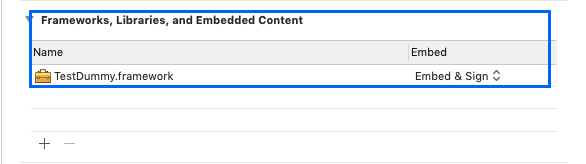
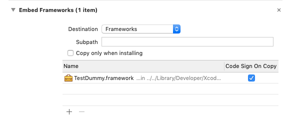
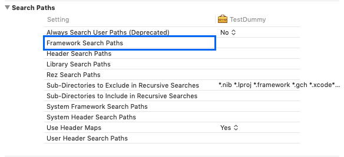

iOS 프로젝트에 바이너리 프레임워크를 추가할 때는 **링크(link)**와 **임베드(embed)**를 구분해야 한다. 빌드에는 성공했지만 앱 실행 직후 `dyld` 오류가 발생한다면, 대부분 동적 프레임워크가 앱 번들에 포함되지 않았거나 서명·아키텍처가 맞지 않는 경우다.

## 1. 바이너리 형식 확인

먼저 프레임워크 내부의 실행 파일을 확인한다.

```bash
file TestDummy.framework/TestDummy
```

출력 예시는 다음과 같다.

```text
TestDummy: Mach-O 64-bit dynamically linked shared library arm64
```

이 결과는 해당 바이너리가 ARM64용 동적 라이브러리임을 뜻한다. 다만 `file` 출력만으로 배포 구성을 모두 판단하기는 어렵다. 공급자가 제공한 설치 문서와 지원 플랫폼을 함께 확인하는 것이 안전하다.

기기와 시뮬레이터를 모두 지원하는 바이너리를 배포할 때는 여러 플랫폼 변형을 하나로 묶은 `XCFramework` 형식이 권장된다.

## 2. Xcode에 프레임워크 추가

1. 프로젝트 편집기에서 앱 타깃을 선택한다.
2. **General > Frameworks, Libraries, and Embedded Content**로 이동한다.
3. `+` 버튼을 눌러 프레임워크 또는 XCFramework를 추가한다.
4. 공급자의 안내에 따라 임베드 방식을 선택한다.



동적 프레임워크는 런타임에 로드할 수 있도록 앱 번들 안에 포함해야 한다. 일반적인 앱 타깃에서는 **Embed & Sign**을 사용한다. 정적 라이브러리는 코드가 앱 실행 파일에 링크되므로 같은 방식으로 판단하면 안 된다. 패키지 형태와 리소스 포함 여부에 따라 설정이 달라질 수 있으므로 배포 문서를 우선한다.

Xcode가 자동으로 생성한 **Embed Frameworks** 빌드 단계를 임의로 중복 추가하지 않는다. 같은 프레임워크가 여러 단계에 들어가면 중복 복사나 서명 오류가 발생할 수 있다.



## 3. 자주 발생하는 오류

### `No such module` 또는 `file not found`

다음 항목을 순서대로 확인한다.

- 프레임워크가 앱 타깃에 실제로 연결되어 있는가?
- **Framework Search Paths**가 프레임워크가 있는 디렉터리를 가리키는가?
- 검색 경로에 공백이 있다면 따옴표 처리가 되어 있는가?
- 현재 빌드 플랫폼과 아키텍처를 프레임워크가 지원하는가?
- Swift 프레임워크라면 모듈 인터페이스가 현재 컴파일러와 호환되는가?

가능하면 절대 경로 대신 `$(PROJECT_DIR)` 또는 `$(SRCROOT)`를 기준으로 상대 경로를 사용한다.



### `Library not loaded: @rpath/...`

앱이 동적 프레임워크에 링크되었지만 앱 번들에서 해당 파일을 찾지 못할 때 발생한다.

- 앱 타깃의 **Frameworks, Libraries, and Embedded Content**에서 임베드 설정을 확인한다.
- 빌드된 `.app/Frameworks` 디렉터리에 프레임워크가 있는지 확인한다.
- 프레임워크와 앱의 코드 서명이 유효한지 확인한다.
- 중첩된 앱 확장에 프레임워크를 잘못 포함하지 않았는지 확인한다.

## 4. 배포 전 체크리스트

- 기기와 시뮬레이터 빌드가 모두 성공하는가?
- 필요한 플랫폼과 아키텍처가 XCFramework에 포함되어 있는가?
- Release 구성에서도 모듈을 정상적으로 불러오는가?
- Archive 후 내보낸 앱에서도 동적 프레임워크가 포함되는가?
- 서명과 Team ID가 배포 환경에 맞는가?

## 참고 자료

- [Apple: Addressing missing framework crashes](https://developer.apple.com/documentation/xcode/addressing-missing-framework-crashes)
- [Apple: Creating a multiplatform binary framework bundle](https://developer.apple.com/documentation/xcode/creating-a-multi-platform-binary-framework-bundle)
- [Apple: Placing content in a bundle](https://developer.apple.com/documentation/bundleresources/placing-content-in-a-bundle)
