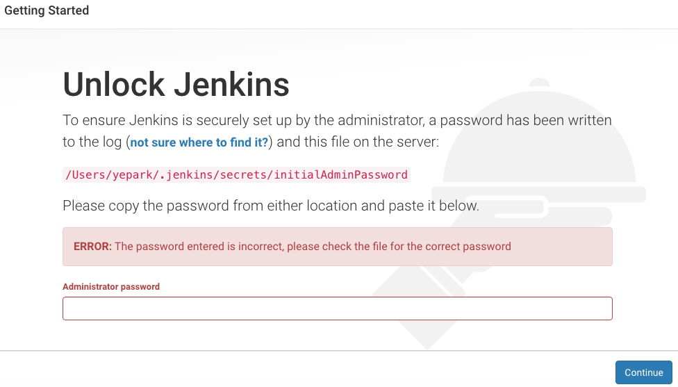
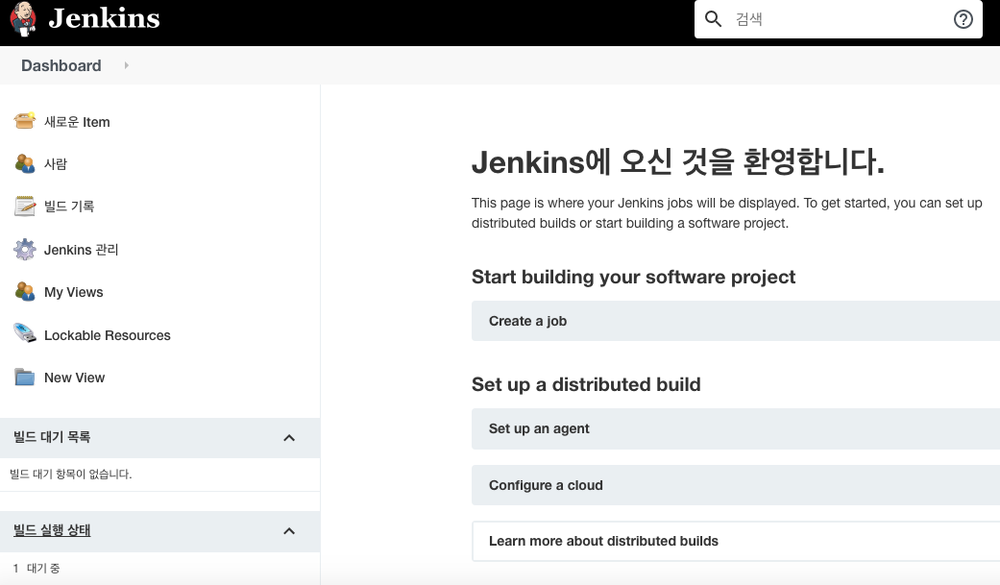
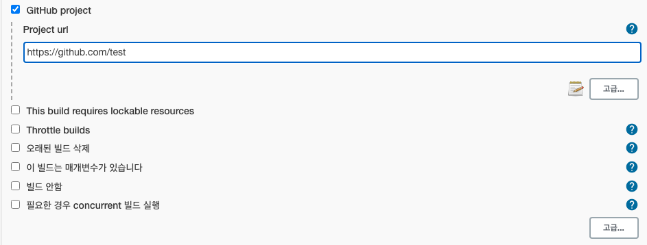
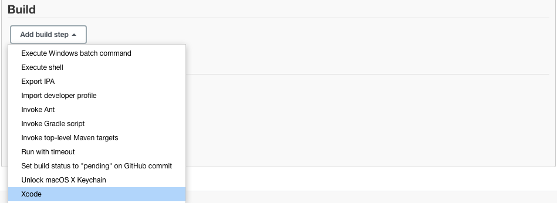
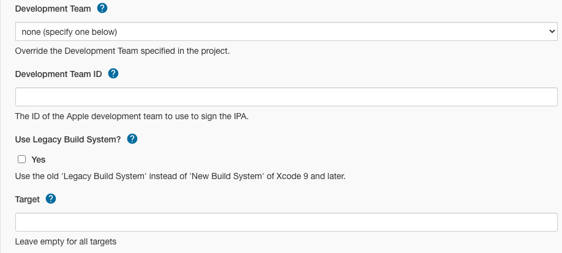
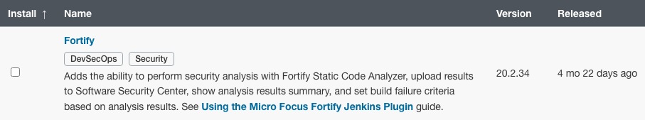
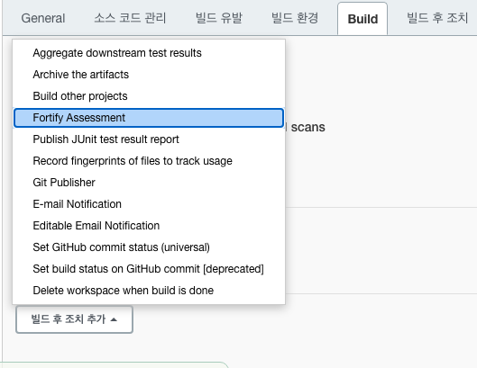
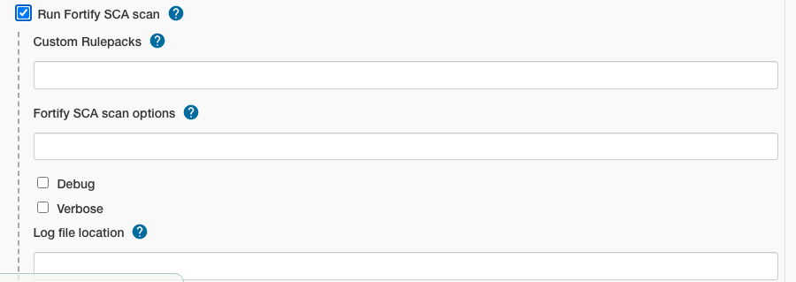

> 이 글의 화면 캡처는 2020년 Jenkins UI를 기준으로 한다. 메뉴 이름과 플러그인 화면은 현재 버전에서 달라질 수 있으므로, 설치 전 공식 문서의 지원 버전을 함께 확인한다.

Jenkins는 빌드, 테스트, 분석, 배포 작업을 자동화하는 오픈 소스 자동화 서버다. 이 글에서는 macOS에 Jenkins LTS를 설치하고, Xcode 프로젝트와 Fortify 정적 분석을 연결할 때 필요한 흐름을 정리한다.

## 설치 전 확인

Jenkins를 실행하려면 지원되는 Java 런타임이 필요하다. 지원 버전은 Jenkins 릴리스에 따라 달라지므로 [Java 지원 정책](https://www.jenkins.io/doc/book/platform-information/support-policy-java/)을 먼저 확인한다. 2026년 11월 기준 최신 Jenkins 계열은 Java 21 또는 Java 25를 사용한다.

```bash
java -version
```

Jenkins용 Java와 앱을 빌드할 때 사용하는 JDK는 서로 다를 수 있다. 다만 컨트롤러와 에이전트는 Jenkins가 요구하는 최소 Java 버전을 충족해야 한다.

## Homebrew로 Jenkins LTS 설치

```bash
brew install jenkins-lts
brew services start jenkins-lts
```

서비스 상태와 설치 정보를 확인하려면 다음 명령을 사용한다.

```bash
brew services list
brew info jenkins-lts
```

업데이트와 중지는 다음과 같다.

```bash
brew upgrade jenkins-lts
brew services restart jenkins-lts
brew services stop jenkins-lts
```

설치가 끝나면 브라우저에서 <http://localhost:8080>에 접속한다. 첫 실행 시 콘솔 로그에 표시된 초기 관리자 암호를 입력하고, 추천 플러그인 설치와 관리자 계정 생성을 마친다.


{: .full}


{: .full}

## Xcode 빌드 구성

Xcode 프로젝트는 전용 플러그인보다 `xcodebuild` 명령을 빌드 단계에서 직접 실행하는 편이 동작을 이해하고 재현하기 쉽다.

```bash
set -o pipefail

xcodebuild \
  -workspace MyApp.xcworkspace \
  -scheme MyApp \
  -destination 'platform=iOS Simulator,name=iPhone 16' \
  clean test
```

프로젝트만 사용하는 경우 `-workspace` 대신 `-project MyApp.xcodeproj`를 지정한다. 실제 장비용 Archive에는 별도의 서명 인증서, 프로비저닝 프로파일, 키체인 접근 설정이 필요하다. 인증 정보는 스크립트에 직접 기록하지 말고 Jenkins Credentials로 관리한다.

기존 **Xcode integration** 플러그인을 사용하는 작업은 다음 흐름으로 구성할 수 있다.

1. **Manage Jenkins > Plugins**에서 Xcode 관련 플러그인을 설치한다.
2. 새 Job을 만들고 소스 저장소를 연결한다.
3. 빌드 단계에서 Workspace/Project, Scheme, Configuration을 지정한다.
4. 빌드 에이전트에 Xcode와 필요한 Simulator 런타임이 설치되어 있는지 확인한다.


{: .full}


{: .full}


{: .full}

## Fortify 연동

Fortify Jenkins Plugin은 Static Code Analyzer(SCA) 분석, ScanCentral SAST 연동, Software Security Center(SSC) 업로드, 빌드 실패 기준 설정을 지원한다.

1. **Manage Jenkins > Plugins**에서 `Fortify`를 설치한다.
2. Jenkins Credentials에 Fortify 인증 정보를 등록한다.
3. Job 또는 Pipeline에 분석 단계를 추가한다.
4. 분석 결과 업로드와 실패 기준을 프로젝트 정책에 맞게 설정한다.


{: .full}


{: .full}


{: .full}

플러그인과 Fortify SCA/SSC의 지원 조합은 버전마다 다르다. 과거 설정을 그대로 복사하기보다 현재 플러그인 문서의 호환 버전과 Pipeline 예제를 기준으로 구성한다.

## 운영 체크리스트

- Jenkins와 플러그인을 업데이트하기 전에 `JENKINS_HOME`을 백업한다.
- 컨트롤러에서 직접 빌드하지 않고 별도 에이전트를 사용한다.
- Xcode 버전과 Simulator 런타임을 빌드 로그에 남긴다.
- 인증서, 토큰, 암호는 Credentials로 관리한다.
- 실패한 빌드의 Derived Data와 로그를 보존해 재현 가능하게 만든다.
- Fortify 규칙 팩과 SCA 버전을 고정하고 변경 이력을 관리한다.

## 참고 자료

- [Jenkins: Installing Jenkins on macOS](https://www.jenkins.io/doc/book/installing/macos/)
- [Jenkins: macOS Installer for Jenkins LTS](https://www.jenkins.io/download/lts/macos/)
- [Jenkins: Java Support Policy](https://www.jenkins.io/doc/book/platform-information/support-policy-java/)
- [Jenkins Fortify Plugin](https://plugins.jenkins.io/fortify/)
- [OpenText Fortify Jenkins Plugin Documentation](https://www.microfocus.com/documentation/fortify-jenkins-plugin/)
