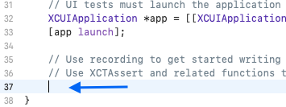
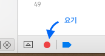
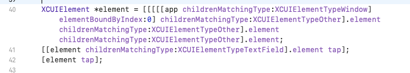

XCTest에서 비동기 동작을 검증하려면 테스트가 끝나야 하는 조건을 명확히 표현해야 한다. 단순히 일정 시간 `sleep`하는 방식은 느리고 불안정하므로, `XCTestExpectation`이나 조건 기반 expectation을 사용한다.

## 콜백이 있는 비동기 코드

완료 콜백이 있는 API는 expectation을 만들고, 콜백 안에서 검증한 뒤 `fulfill`한다.

```objc
- (void)testAsyncHandlerReturnsSuccess {
    XCTestExpectation *expectation =
        [self expectationWithDescription:@"비동기 작업 완료"];

    [self.testObject asyncHandler:^(BOOL success) {
        XCTAssertTrue(success);
        [expectation fulfill];
    }];

    [self waitForExpectations:@[expectation] timeout:3.0];
}
```

제한 시간 안에 `fulfill`이 호출되지 않으면 XCTest가 테스트 실패로 기록한다. 콜백이 여러 번 호출되어야 하는 경우에는 `expectedFulfillmentCount`를 설정하고, 호출되면 안 되는 콜백은 `inverted` expectation으로 표현할 수 있다.

## 상태 변화를 기다리는 테스트

콜백을 외부로 노출하지 않는 객체라면 predicate expectation으로 상태가 만족될 때까지 기다릴 수 있다.

```objc
- (void)testObjectEventuallyBecomesValid {
    NSPredicate *predicate =
        [NSPredicate predicateWithBlock:^BOOL(TestObject *object,
                                               NSDictionary *bindings) {
            return object.isValid;
        }];

    XCTNSPredicateExpectation *expectation =
        [[XCTNSPredicateExpectation alloc] initWithPredicate:predicate
                                                     object:self.testObject];

    [self.testObject startAsyncWork];

    XCTWaiterResult result =
        [XCTWaiter waitForExpectations:@[expectation] timeout:10.0];

    XCTAssertEqual(result, XCTWaiterResultCompleted);
}
```

가능하다면 비동기 API 자체가 완료 결과를 전달하도록 설계하는 편이 테스트와 오류 처리 모두에 유리하다. 상태를 반복 확인하는 방식은 꼭 필요한 경우에만 사용한다.

## UI 테스트 시작하기

Xcode의 UI 테스트는 XCTest와 Accessibility를 기반으로 앱을 실행하고 실제 사용자 흐름을 검증한다.

1. 프로젝트에 **UI Testing Bundle** 타깃을 추가한다.
2. `XCTestCase`의 테스트 메서드 안에 커서를 둔다.
3. 편집기 옆의 **Record UI Test** 버튼을 누른다.
4. Simulator에서 동작을 수행해 코드 초안을 생성한다.
5. 생성된 쿼리를 의미 있는 Accessibility Identifier로 다듬고 assertion을 추가한다.


{: .full}


{: .full}


{: .full}

녹화 기능은 출발점일 뿐이다. 화면 순서나 인덱스에 의존하는 쿼리는 UI 변경에 쉽게 깨지므로, 제품 코드에 안정적인 `accessibilityIdentifier`를 지정하고 테스트에서는 그 값을 사용한다.

```objc
- (void)testLoginFlow {
    XCUIApplication *app = [XCUIApplication new];
    [app launch];

    XCUIElement *loginButton = app.buttons[@"login.button"];
    XCTAssertTrue([loginButton waitForExistenceWithTimeout:3.0]);
    [loginButton tap];

    XCTAssertTrue([app.staticTexts[@"home.title"] exists]);
}
```

## `@testable import`의 의미

Swift 테스트 타깃에서 다음과 같이 모듈을 가져오면 `internal` 선언에 접근할 수 있다.

```swift
@testable import MyApp
```

`private`과 `fileprivate` 접근 수준까지 열어 주는 기능은 아니다. Objective-C에는 같은 키워드가 없으며, 테스트 타깃이 필요한 헤더와 모듈을 가져올 수 있도록 Target Membership과 헤더 공개 범위를 구성한다.

## 테스트를 안정적으로 유지하는 방법

- 고정된 대기 시간보다 expectation과 `waitForExistence`를 사용한다.
- 한 테스트에서는 하나의 명확한 동작을 검증한다.
- 외부 네트워크와 실제 시간은 테스트 더블로 분리한다.
- UI 테스트는 핵심 사용자 흐름과 회귀 버그에 집중한다.
- 테스트 실패 메시지에 기대값과 실제 상태가 드러나게 한다.

## 참고 자료

- [Apple: Asynchronous tests and expectations](https://developer.apple.com/documentation/xctest/asynchronous-tests-and-expectations)
- [Apple: XCTestExpectation](https://developer.apple.com/documentation/xctest/xctestexpectation)
- [Apple: Adding tests to your Xcode project](https://developer.apple.com/documentation/xcode/adding-tests-to-your-xcode-project)
- [Apple: Recording UI automation for testing](https://developer.apple.com/documentation/xcuiautomation/recording-ui-automation-for-testing)
