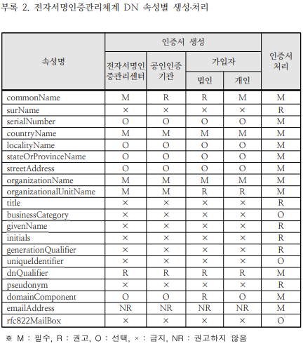

PKCS#10은 인증서 서명 요청(Certificate Signing Request, CSR)의 문법을 정의한다. CSR에는 인증 대상의 이름, 공개 키, 선택적 속성이 들어가며, 요청자는 해당 내용을 자신의 개인 키로 서명한다.

## CSR의 전체 구조

RFC 2986에 정의된 최상위 구조는 다음과 같다.

```asn1
CertificationRequest ::= SEQUENCE {
    certificationRequestInfo CertificationRequestInfo,
    signatureAlgorithm       AlgorithmIdentifier,
    signature                BIT STRING
}

CertificationRequestInfo ::= SEQUENCE {
    version       INTEGER { v1(0) } (v1,...),
    subject       Name,
    subjectPKInfo SubjectPublicKeyInfo,
    attributes    [0] Attributes
}
```

각 필드의 의미는 다음과 같다.

- `version`: 현재 규격에서는 `0`
- `subject`: 인증서를 발급받을 주체의 Distinguished Name
- `subjectPKInfo`: 공개 키 알고리즘, 파라미터, 공개 키
- `attributes`: 인증서에 포함할 추가 정보나 challenge password 등의 선택적 속성
- `signatureAlgorithm`: CSR 서명에 사용한 알고리즘
- `signature`: `CertificationRequestInfo`를 개인 키로 서명한 값

서명은 요청자가 CSR에 포함된 공개 키에 대응하는 개인 키를 보유하고 있음을 검증하는 데 사용된다.

## Subject DN

RFC 2986은 `subject`를 “인증서 주체, 즉 인증받을 공개 키의 소유자에 대한 Distinguished Name”으로 정의한다.

DN은 여러 RDN(Relative Distinguished Name)의 조합으로 표현된다. 자주 사용되는 속성은 다음과 같다.

- `CN`: Common Name
- `O`: Organization
- `OU`: Organizational Unit
- `C`: Country
- `ST`: State or Province
- `L`: Locality

어떤 속성이 필수인지는 PKCS#10 자체가 일괄 결정하지 않는다. 인증기관의 인증서 정책과 프로파일이 요구사항을 정한다. 따라서 CSR을 만들 때는 발급 대상 CA의 문서를 먼저 확인해야 한다.

## 국내 전자서명인증관리체계 DN 규격

국내 전자서명인증관리체계와 호환되는 PKI 서비스를 구현한다면 KCAC DN 규격의 속성명, OID, 길이, 인코딩, 구성 규칙을 따라야 한다. 이 요구사항은 모든 PKCS#10 CSR에 보편적으로 적용되는 규칙이 아니라 해당 인증 체계의 프로파일이다.



CSR을 처리하는 쪽에서는 문자열 모양만 비교하지 말고 ASN.1 구조와 OID를 기준으로 파싱해야 한다. DN 문자열의 표시 순서와 이스케이프 방식은 표현 규칙에 따라 달라질 수 있다.

## 확인할 항목

- CSR의 서명이 포함된 공개 키로 검증되는가?
- 공개 키 알고리즘과 키 길이가 CA 정책을 만족하는가?
- Subject DN의 속성과 인코딩이 발급 프로파일에 맞는가?
- 요청한 확장 속성을 CA가 허용하는가?
- 개인 키가 CSR이나 로그에 포함되지 않았는가?

## 참고 자료

- [RFC Editor: RFC 2986 — PKCS #10](https://www.rfc-editor.org/rfc/rfc2986)
- [한국인터넷진흥원: 전자서명인증관리체계 DN 규격](https://www.rootca.or.kr/kcac/down/TechSpec/1.3-KCAC.TS.DN.pdf)
