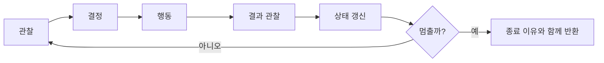

# 루프 엔지니어링
{: .no_toc }



[하네스 엔지니어링]({{ '/ai/using-ai/harness-engineering/' | relative_url }})에서는 모델이 일하는 실행 시스템, 즉 도구·권한·검증·기록을 묶는 틀을 만들었다. 이 글은 그 틀 **안에서 실제로 돌아가는 엔진**을 다룬다. 바로 에이전트 루프다.

**에이전트 루프**는 "모델이 다음 행동을 고르고 → 프로그램이 그 행동을 실행하고 → 결과를 다시 모델에게 보여 주는" 과정을 되풀이하는 반복문이다. 내비게이션을 떠올리면 쉽다. 내비게이션은 출발 전에 길을 한 번 정하고 끝나지 않는다. 현재 위치를 보고, 다음 갈림길을 고르고, 길을 잘못 들면 경로를 다시 계산하고, 도착하면 안내를 멈춘다.

루프를 만드는 것 자체는 `while` 한 줄이면 된다. 어려운 것은 이 네 가지다.

1. 한 바퀴마다 **무엇을 기억할지** (상태)
2. **언제 멈출지** (종료)
3. **실패했을 때 어떻게 할지** (오류 처리)
4. 그 모든 일을 **어떻게 보고 시험할지** (관찰과 테스트)

이 글에서는 이 네 가지를 설계하는 일을 루프 엔지니어링이라고 부른다. 공식 직무명은 아니다. 관찰·결정·행동·종료 규칙을 묶어 부르는 이름이다.

## 루프 한 바퀴를 손으로 따라가기

"주문 A-100의 배송 상태와 도착 예정일을 알려줘"라는 요청을 받았다고 하자. 도구는 두 개다. `get_order`는 배송 상태를, `get_eta`는 도착 예정일을 돌려준다.



한 바퀴를 단계별로 풀면 이렇다.

| 단계 | 누가 | 이 예에서 하는 일 |
| --- | --- | --- |
| 관찰 | 프로그램 | 요청과 지금까지 알아낸 사실을 모델 입력으로 만든다 |
| 결정 | 모델 | "`get_order(A-100)`을 부르자"고 정한다 |
| 행동 | 프로그램 | 인자와 권한을 검사하고 도구를 실제로 실행한다 |
| 결과 관찰 | 프로그램 | `{"status": "shipped"}`를 받는다 |
| 상태 갱신 | 프로그램 | 사실 목록에 `status`를 추가한다 |
| 멈출지 판단 | 프로그램 | 아직 `eta`가 없으니 다음 바퀴로 간다 |

표에서 "모델"이 하는 일은 **결정 한 칸뿐**이다. 나머지는 전부 우리가 짜는 프로그램이 한다. 루프 엔지니어링의 대부분이 모델 바깥의 코드라는 뜻이다.

{: .tip }
모델은 운전대를 잡은 사람이 아니라 **조수석에서 "다음에 왼쪽"이라고 말하는 사람**에 가깝다. 실제로 핸들을 돌리고, 길이 막혔는지 확인하고, 기름이 떨어지면 차를 세우는 것은 프로그램이다.

[Anthropic의 에이전트 설계 글](https://www.anthropic.com/engineering/building-effective-agents)도 에이전트를 "환경의 피드백을 바탕으로 루프 안에서 도구를 쓰는 LLM"이라고 설명한다. 같은 글은 에이전트가 매 단계 환경에서 "실제 정보(ground truth)"를 얻어 진행 상황을 판단해야 하고, 통제를 위해 최대 반복 횟수 같은 **멈춤 조건**을 두는 것이 흔하다고 적는다.

## ReAct: 생각과 행동을 번갈아 하기

오늘날 도구 루프의 원형으로 자주 언급되는 것이 **ReAct**다. Yao 등이 2022년에 낸 논문 [ReAct: Synergizing Reasoning and Acting in Language Models](https://arxiv.org/abs/2210.03629)에서 제안했다.

이름은 Reasoning(추론)과 Acting(행동)을 합친 것이다. 논문의 핵심은 모델이 **추론 기록과 작업용 행동을 번갈아(interleaved) 생성**하게 하는 것이다. 생각만 길게 하지도, 행동만 하지도 않는다.

```text
생각: 배송 상태부터 확인해야 한다.
행동: get_order("A-100")
관찰: {"status": "shipped"}
생각: 상태는 알았다. 도착 예정일이 아직 없다.
행동: get_eta("A-100")
관찰: {"eta": "2026-11-29"}
생각: 둘 다 알았다. 답하자.
행동: finish(...)
```

논문은 추론 기록이 모델이 행동 계획을 세우고, 추적하고, 고치는 데 도움을 준다고 설명한다. 질의응답(HotpotQA)과 사실 검증(FEVER)에서는 간단한 Wikipedia API와 상호작용해 사고 사슬(chain-of-thought)만 쓸 때의 환각과 오류 전파 문제를 줄였다고 보고한다. ALFWorld와 WebShop에서는 한두 개의 예시만으로 모방 학습·강화 학습 방법보다 성공률이 각각 34%p, 10%p 높았다고 보고한다.

{: .note }
지금의 모델 API는 "행동:" 같은 글자를 파싱하지 않는다. 모델이 **구조화된 도구 호출**을 따로 내놓는다. 그래도 "생각하고 → 행동하고 → 결과를 보고 → 다시 생각한다"는 뼈대는 그대로다.

## API는 이 루프를 어떻게 돌리나

ReAct의 뼈대가 실제 API에서 어떤 모양인지 보자. 세 가지 도구의 공식 문서를 읽고 확인한 내용이다.

### Claude API: `stop_reason`으로 도는 `while` 루프

[Claude 문서의 How tool use works](https://platform.claude.com/docs/en/agents-and-tools/tool-use/how-tool-use-works)는 먼저 이렇게 못 박는다. 모델은 아무것도 직접 실행하지 않는다. 구조화된 요청을 내놓고, 우리 코드가 실행하고, 결과가 대화로 돌아간다.

문서가 제시하는 기본 모양은 `stop_reason`을 조건으로 하는 `while` 루프다.

```text
1. tools 목록과 사용자 메시지로 요청을 보낸다.
2. 응답이 stop_reason: "tool_use"이고
   tool_use 블록이 하나 이상 들어 있다.
3. 각 도구를 실행하고 결과를 tool_result 블록으로 만든다.
4. 원래 메시지 + 모델 응답 + tool_result가 담긴
   user 메시지로 새 요청을 보낸다.
5. stop_reason이 "tool_use"인 동안 2부터 반복한다.
```

`"end_turn"`, `"max_tokens"`, `"stop_sequence"`, `"refusal"` 같은 다른 값이 오면 루프를 빠져나온다. 문서는 이것이 최종 답이거나, **애플리케이션이 따로 처리해야 할 다른 이유로 멈춘 것**이라고 설명한다. 즉 `max_tokens`로 끊긴 응답을 완료로 취급하면 안 된다.

[Handle tool calls](https://platform.claude.com/docs/en/agents-and-tools/tool-use/handle-tool-calls) 문서에는 왕복 규칙이 더 자세히 나온다.

- `tool_use` 블록에는 `id`, `name`, `input`이 있다.
- 돌려보낼 `tool_result`에는 `tool_use_id`(어느 호출에 대한 답인지), `content`, 그리고 선택 필드 `is_error`가 있다.
- 도구가 실패해도 `tool_use` 블록마다 `tool_result`를 하나씩 돌려줘야 한다.
- `tool_result` 블록은 user 메시지의 content 배열에서 **맨 앞**에 와야 하고, 텍스트는 그 뒤에 둔다.
- 도구가 실패하면 `is_error: true`로 돌려준다. 문서는 이때 Claude가 새 `tool_use`로 다시 호출할 수 있으니 **루프가 허용하는 재시도 횟수를 제한하라**고 적는다.
- 오류 메시지는 `"failed"` 대신 무엇이 잘못됐고 다음에 무엇을 해 볼지 담으라고 권한다. 예시는 `"Rate limit exceeded. Retry after 60 seconds."`다.

서버에서 실행되는 도구(웹 검색 등)는 Anthropic 쪽에서 자체 루프를 돈다. 그 루프에도 반복 상한이 있고, 상한에 걸리면 `stop_reason: "pause_turn"`이 온다. 문서는 이것이 **작업이 끝나지 않았다는 뜻**이며, 대화를 다시 보내 이어 가라고 설명한다.

### OpenAI Agents SDK: `max_turns`

[OpenAI Agents SDK의 Running agents](https://openai.github.io/openai-agents-python/running_agents/) 문서는 Runner가 도는 루프를 이렇게 설명한다.

- 현재 에이전트로 LLM을 호출한다.
- 출력이 최종 출력이면 루프를 끝내고 결과를 돌려준다.
- 핸드오프(다른 에이전트로 넘기기)를 요청하면 에이전트와 입력을 바꾸고 다시 돈다.
- 도구 호출을 내놓으면 실행하고, 결과를 붙이고, 다시 돈다.

`max_turns`를 넘으면 `MaxTurnsExceeded` 예외가 난다. 문서는 이 예외를 "에이전트가 정해진 루프 턴(LLM 호출) 안에 작업을 끝내지 못했다"는 뜻이라고 설명한다. `error_handlers`에 `"max_turns"` 키로 처리기를 넣으면 예외 대신 통제된 최종 출력을 돌려줄 수 있다.

### LangGraph: `recursion_limit`

[LangGraph Graph API 문서](https://docs.langchain.com/oss/python/langgraph/graph-api)에 따르면 `recursion_limit`은 한 번의 실행이 거칠 수 있는 **슈퍼스텝** 수의 상한이다. 슈퍼스텝은 그래프가 한 번에 실행하는 노드 묶음 한 단계라고 생각하면 된다. 넘으면 `GraphRecursionError`가 난다. 문서 기준 기본값은 1.1.4부터 10,007이고, config의 최상위 키로 `recursion_limit`을 넘겨 바꾼다.

{: .warning }
세 도구 모두 "반복 상한"을 주지만 **세는 단위가 다르다.** Claude API 루프는 우리가 직접 세고, Agents SDK는 LLM 호출 턴을 세고, LangGraph는 슈퍼스텝을 센다. 한 번의 모델 응답에 도구 호출이 여러 개 들어갈 수도 있다. "최대 10번"이라고 적을 때 무엇을 10번 세는지 꼭 적어 두자.

## 실험 1: 모델 없이 도는 루프

모델을 연결하기 전에, 모델 자리에 **정해진 행동만 내놓는 가짜 정책**을 넣고 루프를 시험한다.

**정책(policy)**은 "현재 상태를 보고 다음 행동을 고르는 함수"다. 실제 서비스에서는 모델이 정책 역할을 한다. 가짜 정책을 쓰면 같은 입력에서 항상 같은 행동이 나오므로, 루프의 종료 규칙만 따로 시험할 수 있다. 연극 리허설에서 배우 대신 대본을 읽어 주는 사람을 세워 무대 장치만 점검하는 것과 같다.

아래 코드를 `react_loop.py`로 저장한다. 외부 패키지와 API 키 없이 Python 3.12에서 실행했다.

```python
from dataclasses import dataclass, field

# 가짜 도구: 주문 시스템
ORDERS = {"A-100": {"status": "shipped",
                    "eta": "2026-11-29"}}


def get_order(order_id):
    o = ORDERS.get(order_id)
    if o is None:
        return {"error": "not_found"}
    return {"status": o["status"]}


def get_eta(order_id):
    o = ORDERS.get(order_id)
    return {"eta": o["eta"] if o else None}


def search_faq(query):
    return {"hits": []}  # 항상 빈 결과


TOOLS = {"get_order": get_order,
         "get_eta": get_eta,
         "search_faq": search_faq}
REQUIRED = {"status", "eta"}  # 완료 조건


@dataclass
class State:
    goal: str
    step: int = 0
    facts: dict = field(default_factory=dict)
    actions: list = field(default_factory=list)
    stale: int = 0      # 새 사실 없이 지난 횟수
    trace: list = field(default_factory=list)


def check_finish(state):
    missing = REQUIRED - state.facts.keys()
    if missing:
        return f"rejected: missing {sorted(missing)}"
    return None


def run(policy, goal, max_steps=6,
        max_stale=3, max_repeat=3):
    s = State(goal)
    while True:
        # 1) 예산 확인
        if s.step >= max_steps:
            return "max_steps", s
        s.step += 1
        # 2) 결정
        name, args = policy(s)
        s.actions.append((name, args))
        # 3) 행동
        if name == "finish":
            err = check_finish(s)
            if err is None:
                s.trace.append((s.step, name, "ok"))
                return "done", s
            obs = {"error": err}
        else:
            try:
                obs = TOOLS[name](**args)
            except Exception as e:
                # 예외도 관찰로 바꿔 돌려준다
                obs = {"error": repr(e)}
        # 4) 상태 갱신
        new = {k: v for k, v in obs.items()
               if k in REQUIRED and v is not None
               and s.facts.get(k) != v}
        s.facts.update(new)
        s.stale = 0 if new else s.stale + 1
        s.trace.append((s.step, name, obs))
        # 5) 멈출지 판단
        last = s.actions[-max_repeat:]
        if (len(last) == max_repeat
                and len(set(map(str, last))) == 1):
            return "repeated_action", s
        if s.stale >= max_stale:
            return "no_progress", s


def scripted(*plan):
    """정해진 행동을 차례로 내놓는 가짜 정책"""
    def policy(state):
        i = min(state.step - 1, len(plan) - 1)
        return plan[i]
    return policy


A = {"order_id": "A-100"}
B = {"order_id": "B-200"}  # 없는 주문
POLICIES = {
    "good": scripted(("get_order", A),
                     ("get_eta", A),
                     ("finish", {})),
    "premature": scripted(("finish", {}),
                          ("get_order", A),
                          ("get_eta", A),
                          ("finish", {})),
    "stubborn": scripted(("get_eta", B)),
    "wander": scripted(
        ("search_faq", {"query": "배송"}),
        ("search_faq", {"query": "택배"}),
        ("search_faq", {"query": "도착"}),
        ("search_faq", {"query": "언제"})),
}

if __name__ == "__main__":
    for label, pol in POLICIES.items():
        reason, s = run(pol, "A-100 배송 상태")
        print(f"[{label}] -> {reason}"
              f" (steps={s.step})")
        for step, name, obs in s.trace:
            print(f"  {step}. {name:<10} {obs}")
    # max_steps: 한도를 아주 작게
    reason, s = run(POLICIES["good"], "x",
                    max_steps=2)
    print(f"[good, max_steps=2] -> {reason}"
          f" facts={s.facts}")
```

```bash
python react_loop.py
```

실제로 나온 결과다.

```text
[good] -> done (steps=3)
  1. get_order  {'status': 'shipped'}
  2. get_eta    {'eta': '2026-11-29'}
  3. finish     ok
[premature] -> done (steps=4)
  1. finish     {'error': "rejected: missing ['eta', 'status']"}
  2. get_order  {'status': 'shipped'}
  3. get_eta    {'eta': '2026-11-29'}
  4. finish     ok
[stubborn] -> repeated_action (steps=3)
  1. get_eta    {'eta': None}
  2. get_eta    {'eta': None}
  3. get_eta    {'eta': None}
[wander] -> no_progress (steps=3)
  1. search_faq {'hits': []}
  2. search_faq {'hits': []}
  3. search_faq {'hits': []}
[good, max_steps=2] -> max_steps facts={'status': 'shipped', 'eta': '2026-11-29'}
```

다섯 실행이 모두 **다른 이유로** 멈췄다. 하나씩 읽어 보자.

- **good**: 두 도구로 사실을 모으고 `finish`가 검사를 통과해 `done`.
- **premature**: 첫 바퀴에 바로 "끝났다"고 했다. 실행기가 필수 사실이 없다며 거절하고, 그 거절 메시지를 관찰로 돌려줬다. 이후 제대로 모아서 `done`.
- **stubborn**: 없는 주문의 도착일을 세 번 똑같이 물었다. 같은 행동 3연속이라 `repeated_action`.
- **wander**: 검색어는 매번 달랐지만 새 사실이 하나도 생기지 않았다. 같은 행동 검사로는 못 잡고, 진전 없음 검사가 `no_progress`로 잡았다.
- **max_steps=2**: 사실은 다 모았지만 `finish`를 부르기 전에 예산이 끝났다. 결과는 `done`이 아니라 `max_steps`다.

{: .warning }
마지막 줄이 중요하다. 필요한 사실이 상태에 **다 있어도** 완료 검사를 통과하지 않았으면 완료가 아니다. 반복문을 빠져나온 것과 목표를 이룬 것은 다르다. 호출하는 쪽에 종료 이유를 반드시 함께 돌려주자.

## 루프 상태 설계: 무엇을 들고 다닐까

**루프 상태**는 한 바퀴에서 다음 바퀴로 넘겨주는 정보다. 등산할 때 배낭과 같다. 꼭 필요한 것만 넣어야 오래 걷는다. 다 넣으면 무거워서 못 걷고, 빠뜨리면 길에서 곤란해진다.

위 예제의 `State`에는 이것들이 들어 있다.

| 필드 | 들고 다니는 이유 |
| --- | --- |
| `goal` | 매 바퀴 모델이 원래 요청을 다시 본다 |
| `step` | 예산 확인 |
| `facts` | 확인된 사실. 완료 판정과 진전 판정의 근거 |
| `actions` | 반복 행동 감지 |
| `stale` | 새 사실 없이 지난 바퀴 수 |
| `trace` | 관찰과 디버깅 |

상태를 담는 방식은 크게 두 가지다.

- **스크래치패드(scratchpad)**: 모델의 생각과 도구 결과를 대화 기록에 그대로 계속 붙이는 방식. 연습장에 낙서하듯 쌓아 간다. 만들기 쉽고 모델이 맥락을 다 본다. 대신 길어질수록 비용이 늘고, 프로그램이 "지금 무엇을 아는지"를 읽어 내기 어렵다.
- **구조화된 상태**: `facts`, `stale`처럼 필드를 정해 두고 프로그램이 직접 갱신하는 방식. 완료·진전·예산 판단을 코드로 할 수 있다.

{: .tip }
실무에서 나는 **둘을 함께 쓴다.** 모델에게 보여 줄 대화 기록(스크래치패드)과, 프로그램이 판단에 쓸 구조화된 상태를 분리한다. 멈출지 말지는 구조화된 상태로만 판단한다. 모델이 대화 속에서 "다 했다"고 말한 문장을 정규식으로 찾아 종료를 결정하면, 말투가 조금만 바뀌어도 루프가 깨진다. Claude 문서도 모델 출력에서 결정을 정규식으로 뽑고 있다면 그 결정은 도구 호출이어야 했다는 신호라고 적는다.

상태에 무엇을 넣을지 정할 때 나는 이 질문을 쓴다. **"이 값이 없으면 다음 바퀴의 결정이나 종료 판단이 달라지는가?"** 달라지지 않으면 기록(trace)에만 남기고 상태에는 넣지 않는다. 이 기준은 [컨텍스트 엔지니어링]({{ '/ai/using-ai/context-engineering/' | relative_url }})에서 본 "많게가 아니라 관련 있게"를 루프 안에 적용한 것이다.

## 종료 설계: 언제, 왜 멈추는가

종료 조건은 루프 엔지니어링에서 가장 중요한 부분이다. 실험 1의 종료 이유를 일반화하면 이렇다.

| 종료 이유 | 뜻 | 호출자가 할 일 |
| --- | --- | --- |
| `done` | 목표 달성이 검사로 확인됨 | 결과 사용 |
| `needs_input` | 사용자 정보가 없어 진행 불가 | 질문하기 |
| `failed` | 재시도해도 안 되는 오류 | 원인 보고 |
| `max_steps` | 바퀴 수 예산 소진 | 미완료로 보고 |
| `budget` | 토큰·시간·비용 예산 소진 | 미완료로 보고 |
| `no_progress` | 몇 바퀴째 새 사실이 없음 | 전략 바꾸기 또는 사람에게 |
| `repeated_action` | 같은 행동을 연속 반복 | 전략 바꾸기 또는 사람에게 |
| `interrupted` | 사람 승인을 기다리는 중 | 승인 후 재개 |

### 완료는 "명시적인 완료 도구 + 검사"로

모델이 끝을 알리는 방법은 두 가지다. 도구 호출 없이 답만 내는 것(Claude API의 `end_turn`, Agents SDK의 최종 출력)과, `finish` 같은 **완료 도구**를 부르는 것이다.

{: .tip }
실무에서 나는 완료 조건이 분명한 작업이면 **완료 도구를 따로 둔다.** 완료 도구의 인자에 결과를 구조화해서 받으면, 실행기가 그 자리에서 검사할 수 있다. 실험 1의 `check_finish`가 그 역할이다. 검사에 실패하면 거절 이유를 관찰로 돌려주고 루프를 계속한다. "모델이 끝났다고 말함"과 "끝났음이 확인됨"을 분리하는 장치다.

### 예산은 여러 개가 필요하다

바퀴 수 상한만으로는 부족하다.

- 도구 하나가 응답하지 않으면 바퀴 수가 늘지 않는다. **도구별 시간 제한**과 **전체 마감 시각**이 따로 필요하다.
- 바퀴마다 입력이 길어지므로 같은 10바퀴라도 비용이 다르다. **누적 토큰이나 비용 상한**을 둔다.
- 모델 호출 수와 도구 호출 수는 다르다. 한 응답에 도구 호출이 여러 개 있을 수 있다.

### 진전 없음과 반복 행동은 다른 병이다

실험 1에서 `stubborn`은 같은 행동을 반복했고, `wander`는 매번 다른 행동을 했지만 얻은 것이 없었다. 반복 행동 검사만 있으면 `wander`가 예산 끝까지 돈다. 진전 없음 검사만 있으면 `stubborn`도 잡히지만 이유가 덜 구체적이다. 둘 다 두는 것이 좋다.

{: .question }
"진전"을 무엇으로 셀까? 이 예제는 "새로 확인된 필수 사실"로 셌다. 코드 수정 에이전트라면 "통과한 테스트 수", 검색 에이전트라면 "새로 찾은 관련 문서 수"가 될 수 있다. 내 작업에서 진전을 숫자로 셀 수 있는지 먼저 생각해 보자. 셀 수 없다면 종료 판단도 어렵다.

### 검사 순서도 설계다

실험 1은 "예산 → 결정 → 행동 → 상태 갱신 → 반복 검사 → 진전 검사" 순서다. `stubborn`은 3바퀴째에 반복 행동과 진전 없음 조건을 **동시에** 만족했지만, 반복 검사를 먼저 해서 `repeated_action`으로 기록됐다. 어떤 이유를 먼저 기록할지는 나중에 실패 통계를 낼 때 영향을 준다. 더 구체적인 이유를 먼저 검사하자.

## 루프 안의 오류 처리

도구는 실패한다. 네트워크가 끊기고, 요청 한도에 걸리고, 권한이 없고, 대상이 없다. 루프 안에서 실패를 다룰 때 핵심은 **실패를 두 종류로 나누는 것**이다.

- **재시도 가능(retryable)**: 시간이 지나면 나아질 수 있는 실패. 시간 초과, 요청 한도 초과.
- **치명적(fatal)**: 다시 해도 결과가 같은 실패. 권한 없음, 없는 대상, 잘못된 인자.

치명적 오류를 재시도하면 시간과 돈만 쓴다. 재시도 가능한 오류를 바로 포기하면 잠깐의 흔들림에 작업 전체가 실패한다.

### 백오프와 지터

**백오프(backoff)**는 재시도 사이에 기다리는 시간을 점점 늘리는 것이다. 전화가 안 될 때 1초, 2초, 4초 간격으로 다시 거는 것과 같다. **지터(jitter)**는 그 대기 시간에 무작위성을 섞는 것이다. 여러 클라이언트가 동시에 실패한 뒤 정확히 같은 순간에 다시 몰려드는 일을 막는다.

### 서킷 브레이커

**서킷 브레이커(circuit breaker)**는 연속 실패가 쌓이면 한동안 호출 자체를 막는 장치다. 집의 누전 차단기처럼, 문제가 계속되면 일단 내려서 더 큰 피해를 막는다. 죽은 서비스에 루프가 계속 요청을 보내 예산을 다 쓰는 일을 막는다.

### 실험 2: 실패를 일부러 주입하기

**결함 주입(fault injection)**은 테스트에서 실패를 일부러 만들어 넣는 방법이다. 아래 `FaultyTool`은 미리 정한 순서로 예외를 던진다. 실제로 기다리지는 않고, 기다렸을 시간만 기록한다. 그래서 몇 번을 돌려도 결과가 같다.

`retry.py`로 저장한다.

```python
import random


class Timeout(Exception): pass
class RateLimited(Exception):
    def __init__(self, after):
        self.after = after
class NotFound(Exception): pass
class Forbidden(Exception): pass


RETRYABLE = (Timeout, RateLimited)


def classify(exc):
    if isinstance(exc, RETRYABLE):
        return "retryable"
    return "fatal"


class FaultyTool:
    """미리 정한 순서로 실패를 주입하는 도구"""
    def __init__(self, faults):
        self.faults = list(faults)
        self.calls = 0

    def __call__(self):
        self.calls += 1
        f = self.faults.pop(0) if self.faults else None
        if f:
            raise f
        return {"status": "shipped"}


def backoff(n, rng, base=0.5, cap=8.0):
    # 지수 백오프 + full jitter
    return rng.uniform(0, min(cap, base * 2 ** n))


def call_with_retry(tool, rng, sleeps,
                    max_attempts=4):
    for n in range(max_attempts):
        try:
            return "ok", tool()
        except Exception as e:
            kind = classify(e)
            name = type(e).__name__
            if kind == "fatal":
                return "fatal", name
            if n == max_attempts - 1:
                return "exhausted", name
            wait = backoff(n, rng)
            if isinstance(e, RateLimited):
                wait = max(wait, e.after)
            sleeps.append(round(wait, 2))


class Breaker:
    """연속 실패가 쌓이면 잠시 호출을 막는다"""
    def __init__(self, limit=3, cooldown=2):
        self.limit, self.cooldown = limit, cooldown
        self.fails, self.blocked = 0, 0

    def call(self, fn):
        if self.blocked > 0:
            self.blocked -= 1
            return "open", None
        result = fn()
        if result[0] == "ok":
            self.fails = 0
        else:
            self.fails += 1
            if self.fails >= self.limit:
                self.blocked = self.cooldown
                self.fails = 0
        return result


def as_tool_result(status, value):
    """루프 안에서 모델에게 돌려줄 관찰"""
    if status == "ok":
        return {"content": value}
    hint = {"fatal": "다시 시도해도 안 됨",
            "exhausted": "잠시 뒤 다시"}
    return {"content": f"{value}: {hint[status]}",
            "is_error": True}


if __name__ == "__main__":
    cases = {
        "timeout 2번 뒤 성공":
            [Timeout(), Timeout()],
        "rate limit(3초)":
            [RateLimited(3.0)],
        "권한 없음": [Forbidden()],
        "없는 주문": [NotFound()],
        "timeout 계속": [Timeout()] * 9,
    }
    for label, faults in cases.items():
        rng = random.Random(42)
        sleeps = []
        tool = FaultyTool(faults)
        st, val = call_with_retry(tool, rng, sleeps)
        print(f"{label}: {st} calls={tool.calls}"
              f" sleeps={sleeps}")
        print("   ->", as_tool_result(st, val))

    print("-- circuit breaker --")
    br = Breaker(limit=3, cooldown=2)
    down = FaultyTool([Timeout()] * 12)
    for i in range(1, 7):
        st, _ = br.call(lambda: call_with_retry(
            down, random.Random(0), []))
        print(f"요청 {i}: {st} (도구 호출 누적"
              f" {down.calls})")
```

실제로 나온 결과다.

```text
timeout 2번 뒤 성공: ok calls=3 sleeps=[0.32, 0.03]
   -> {'content': {'status': 'shipped'}}
rate limit(3초): ok calls=2 sleeps=[3.0]
   -> {'content': {'status': 'shipped'}}
권한 없음: fatal calls=1 sleeps=[]
   -> {'content': 'Forbidden: 다시 시도해도 안 됨', 'is_error': True}
없는 주문: fatal calls=1 sleeps=[]
   -> {'content': 'NotFound: 다시 시도해도 안 됨', 'is_error': True}
timeout 계속: exhausted calls=4 sleeps=[0.32, 0.03, 0.55]
   -> {'content': 'Timeout: 잠시 뒤 다시', 'is_error': True}
-- circuit breaker --
요청 1: exhausted (도구 호출 누적 4)
요청 2: exhausted (도구 호출 누적 8)
요청 3: exhausted (도구 호출 누적 12)
요청 4: open (도구 호출 누적 12)
요청 5: open (도구 호출 누적 12)
요청 6: ok (도구 호출 누적 13)
```

읽는 법은 이렇다.

- 시간 초과 두 번은 재시도로 넘겼다. 대기 시간이 `0.32`, `0.03`으로 들쭉날쭉한 것은 지터 때문이다. full jitter는 0부터 상한 사이에서 무작위로 고르므로 두 번째가 더 짧을 수도 있다.
- 요청 한도 오류는 서버가 알려 준 3초를 무작위 대기보다 우선했다.
- 권한 없음과 없는 주문은 한 번만 호출하고 바로 `fatal`로 끝냈다.
- 시간 초과가 계속되면 4번 시도 후 `exhausted`. 대기는 3번뿐이다. 마지막 실패 뒤에는 기다릴 이유가 없다.
- 서킷 브레이커는 세 요청 연속 실패 후 두 요청을 **도구를 부르지 않고** 막았다(`open`). 누적 호출 수가 12에서 멈춘 것이 그 증거다. 그 뒤 다시 시도해 성공했다.

`as_tool_result`는 오류를 **모델이 볼 관찰**로 바꾼다. Claude API라면 이 모양이 `is_error: true`인 `tool_result`가 된다. 모델은 "다시 시도해도 안 됨"을 보고 다른 방법을 찾거나 사용자에게 사정을 설명할 수 있다.

{: .warning }
재시도를 **두 층에서 동시에** 하면 곱해진다. 도구 래퍼가 4번 재시도하고, 모델도 `is_error`를 보고 같은 도구를 4번 다시 부르면 최대 16번 호출된다. 실무에서 나는 일시 오류의 재시도는 래퍼(코드)에서만 하고, 모델에게는 "재시도까지 했는데 실패했다"는 최종 결과만 보여 준다. 모델에게 맡기는 것은 "다른 방법을 고를지"다.

{: .warning }
**쓰기 작업**의 시간 초과는 조심해야 한다. 환불 서버가 처리를 끝낸 뒤 응답만 유실됐다면, 재시도가 환불을 두 번 만든다. 같은 요청을 여러 번 보내도 결과가 한 번 보낸 것과 같은 성질을 **멱등성(idempotency)**이라고 한다. 엘리베이터 버튼을 여러 번 눌러도 한 번 부른 것과 같은 것처럼. 쓰기 도구는 멱등 키를 쓰거나, 재시도 전에 서버 상태를 먼저 다시 조회해야 한다.

## 자기 수정 루프: 만들고, 검사하고, 고치기

지금까지는 "정보를 모으는" 루프였다. 이번에는 **결과물을 다듬는** 루프다. 코드를 쓰고 → 테스트를 돌리고 → 실패를 보고 고친다.

Anthropic 글은 이 모양을 **evaluator-optimizer** 워크플로라고 부른다. 한 LLM 호출이 응답을 만들고, 다른 호출이 평가와 피드백을 주는 것을 루프로 도는 방식이다. 글은 이 방식이 **평가 기준이 분명하고, 반복해서 다듬는 것이 측정 가능한 가치를 줄 때** 특히 효과적이라고 적는다.

[Reflexion](https://arxiv.org/abs/2303.11366)(Shinn 등, 2023)은 한 걸음 더 나간다. 모델 가중치를 바꾸지 않고, 이전 시도에 대한 피드백을 모델이 **글로 반성**하게 하고 그 반성문을 **에피소드 메모리 버퍼**에 저장해 다음 시도에 쓴다. 논문은 이를 언어적 강화(verbal reinforcement)라고 부른다.

{: .tip }
자기 수정 루프에서 가장 중요한 것은 **검사기**다. 테스트, 스키마 검사, 린터, 컴파일러처럼 결과가 정해진 검사기가 있으면 루프가 수렴할 근거가 생긴다. 모델이 자기 결과를 "괜찮아 보인다"고 평가하는 것만으로 루프를 돌리면, 무엇이 나아졌는지 알 수 없다. 실무에서 나는 결정적인 검사기를 먼저 만들고, 그게 불가능한 부분만 모델 평가자를 쓴다. 평가 방법은 [AI 평가와 개선]({{ '/ai/using-ai/evaluation/' | relative_url }})에서 자세히 다룬다.

### 실험 3: 수렴하는 루프와 진동하는 루프

윤년 판별 함수를 고치는 루프다. 검사기는 실제로 코드를 실행해 네 개의 테스트를 돌린다. 수정자는 가짜다. `converging`은 실패한 테스트를 보고 제대로 고치고, `oscillating`은 한 실패를 고치면 다른 실패를 다시 만든다.

`refine.py`로 저장한다.

```python
import hashlib

TESTS = [(2024, True), (2023, False),
         (1900, False), (2000, True)]


def verify(src):
    """검증기: 코드를 실행하고 실패한 테스트를 돌려준다"""
    env = {}
    exec(src, env)
    f = env["is_leap"]
    return [y for y, want in TESTS if f(y) != want]


V1 = "def is_leap(y): return y % 4 == 0"
V2 = ("def is_leap(y):\n"
      "    return y % 4 == 0 and y % 100 != 0")
V3 = ("def is_leap(y):\n"
      "    return (y % 4 == 0 and y % 100 != 0)"
      " or y % 400 == 0")


def converging(src, failed):
    # 실패 목록을 보고 고치는 가짜 수정자
    if 1900 in failed:
        return V2
    if 2000 in failed:
        return V3
    return src


def oscillating(src, failed):
    # 한 실패를 고치면 다른 실패가 생기는 수정자
    return V2 if src == V1 else V1


def refine(draft, revise, max_rounds=5):
    src, seen = draft, set()
    for r in range(1, max_rounds + 1):
        failed = verify(src)
        key = hashlib.sha1(src.encode()).hexdigest()
        print(f"  round {r}: failed={failed}"
              f" id={key[:7]}")
        if not failed:
            return "pass", r
        if key in seen:
            # 같은 코드가 다시 나옴: 더 돌아도 소용없다
            return "oscillation", r
        seen.add(key)
        src = revise(src, failed)
    return "max_rounds", max_rounds


for name, rev in [("converging", converging),
                  ("oscillating", oscillating)]:
    print(f"[{name}]")
    print("  ->", refine(V1, rev))
```

실제로 나온 결과다.

```text
[converging]
  round 1: failed=[1900] id=7dbe45b
  round 2: failed=[2000] id=3c0f383
  round 3: failed=[] id=d1d8381
  -> ('pass', 3)
[oscillating]
  round 1: failed=[1900] id=7dbe45b
  round 2: failed=[2000] id=3c0f383
  round 3: failed=[1900] id=7dbe45b
  -> ('oscillation', 3)
```

수렴하는 쪽은 실패가 `[1900]` → `[2000]` → `[]`로 바뀌며 3라운드에 통과했다.

진동하는 쪽은 3라운드에 1라운드와 **똑같은 코드**(`id=7dbe45b`)가 다시 나왔다. 같은 입력이면 검사 결과도, 다음 수정도 같다. 즉 이대로는 영원히 두 상태 사이를 오간다. 해시로 이미 본 결과물을 기억해 두면 상한(`max_rounds=5`)까지 가지 않고 3라운드에 멈출 수 있다.

{: .note }
**진동(oscillation)**은 루프가 두 개 이상의 상태를 번갈아 오가며 끝나지 않는 현상이다. 시소처럼 한쪽을 누르면 다른 쪽이 올라간다. 실패 개수만 보면 매 라운드 1개로 "나빠지지는 않았다"처럼 보여서 놓치기 쉽다.

### 자기 수정 루프가 수렴하지 않는 이유들

실무에서 내가 자주 보는 원인은 이렇다.

- **검사기의 피드백이 너무 뭉뚱그려져 있다.** "테스트 실패"만 주고 어느 입력에서 무엇이 나왔는지 주지 않으면 수정자가 짐작으로 고친다.
- **수정자가 이전 시도를 모른다.** 매 라운드 최신 실패만 보여 주면, 2라운드에 고친 것을 3라운드에 되돌린다. 진동의 흔한 원인이다. 이미 시도한 방법과 그 결과를 요약해서 함께 넘기는 것이 Reflexion의 메모리 버퍼와 같은 발상이다.
- **요구 사항끼리 충돌한다.** 두 테스트가 동시에 만족될 수 없으면 아무리 돌아도 수렴하지 않는다. 이때는 루프가 아니라 요구 사항을 고쳐야 한다.
- **검사기가 결정적이지 않다.** 같은 코드가 어떤 때는 통과하고 어떤 때는 실패하면(시간, 네트워크, 순서 의존 테스트) 루프가 엉뚱한 신호를 따라간다.

{: .tip }
수렴하지 않고 멈출 때는 **마지막 결과물이 아니라 가장 좋았던 결과물**과 남은 실패 목록을 함께 돌려주는 것이 좋다. 마지막 결과가 가장 좋다는 보장은 없다. 그리고 그 결과의 상태는 `pass`가 아니라 `oscillation`이나 `max_rounds`로 정직하게 표시한다. 한도가 품질 기준을 대신하면 안 된다.

## 계획 루프: 먼저 계획하고 실행하기

ReAct처럼 한 걸음씩 생각하는 대신, **먼저 전체 계획을 세우고 단계별로 실행하는** 방식도 있다. 여행 갈 때 일정표를 먼저 짜고 하루씩 따라가는 것과 같다. 흔히 plan-then-execute라고 부른다.

Anthropic 글의 **orchestrator-workers** 패턴이 이와 가깝다. 중앙 LLM이 작업을 동적으로 쪼개 작업자 LLM들에게 맡기고 결과를 합친다. 글은 하위 작업이 미리 정해져 있지 않고 입력에 따라 오케스트레이터가 정한다는 점을 핵심 차이로 든다.

계획 루프에서는 **재계획(re-planning)** 시점을 정하는 것이 설계의 핵심이다. 실무에서 나는 이렇게 판단한다.

| 방식 | 잘 맞는 경우 | 약점 |
| --- | --- | --- |
| 한 걸음씩(ReAct) | 다음 행동이 직전 결과에 크게 좌우될 때 | 전체 그림 없이 헤매기 쉽다 |
| 먼저 계획 | 단계가 많고 순서가 비교적 예측될 때 | 초기 계획이 틀리면 끝까지 틀린 길로 간다 |
| 계획 + 재계획 | 둘 다 필요할 때 | 언제 재계획할지 규칙이 없으면 매 바퀴 계획만 다시 짠다 |

{: .tip }
재계획은 "매 바퀴"가 아니라 **사건이 있을 때**만 한다. 예를 들면 단계가 치명적 오류로 실패했을 때, 관찰이 계획의 가정을 깨뜨렸을 때(없다고 생각한 파일이 있음), 진전 없음이 감지됐을 때다. 그리고 재계획 횟수에도 상한을 둔다. 재계획 루프도 결국 루프다.

## 병렬 도구 호출

서로 의존하지 않는 조회 두 개라면 한 바퀴에 동시에 할 수 있다. 실험 1의 `get_order`와 `get_eta`가 그런 예다.

[Claude 문서의 Parallel tool use](https://platform.claude.com/docs/en/agents-and-tools/tool-use/parallel-tool-use)에 따르면 기본적으로 Claude는 한 응답에서 여러 도구를 호출할 수 있다. 실행 순서는 API가 정하지 않는다. 동시에 돌려도, 순서대로 돌려도 된다. 대신 규칙이 있다.

- `tool_use` 블록마다 `tool_result`를 하나씩, **모두 다음 user 메시지 하나에** 담아 돌려준다.
- 앞 호출이 실패해서 뒤 호출을 실행하지 않기로 했더라도, 그 호출에 대해 `is_error: true`와 짧은 설명을 담은 `tool_result`를 돌려준다.
- 병렬 호출을 끄려면 `tool_choice` 안에 `disable_parallel_tool_use: true`를 넣는다. 최상위 파라미터가 아니다.

{: .warning }
병렬 호출은 루프의 셈법을 바꾼다. 한 바퀴에 도구가 세 번 불리면 "바퀴 수"와 "도구 호출 수"가 갈라진다. 반복 행동 감지도 바퀴 단위로 할지 호출 단위로 할지 정해야 한다. 그리고 **쓰기 도구끼리는 병렬로 돌리지 않는 것**이 안전하다. 순서에 따라 결과가 달라질 수 있기 때문이다.

## 사람이 끼어드는 지점

결제, 삭제, 외부 발송처럼 되돌리기 어려운 행동은 사람 승인을 받고 진행해야 한다. Anthropic 글도 에이전트가 체크포인트나 막힌 지점에서 사람의 피드백을 위해 멈출 수 있다고 적는다.

루프 관점에서 사람 승인은 **종료가 아니라 일시 정지**다. 현재 상태와 실행하려던 행동을 저장하고, 루프를 빠져나와 `interrupted`를 돌려준다. 승인이 오면 저장된 상태에서 이어 간다.

[LangGraph의 interrupts 문서](https://docs.langchain.com/oss/python/langgraph/interrupts)는 이 구조를 구체적으로 보여 준다.

- `interrupt()`는 그래프 실행을 멈추고 호출자에게 값을 돌려준다.
- 상태를 저장할 체크포인터와, 어느 상태에서 이어 갈지 알려 줄 thread ID가 필요하다. 재개할 때도 같은 thread ID를 써야 한다.
- `Command(resume=...)`로 넘긴 값이 `interrupt()`의 반환값이 된다.
- 재개하면 interrupt를 부른 **노드가 처음부터 다시 실행된다.** 그래서 interrupt 앞의 부작용은 (가능하면) 멱등이어야 한다고 문서가 경고한다.

{: .warning }
마지막 항목은 직접 루프를 짤 때도 똑같이 적용된다. "승인 요청 메일 보내기 → 승인 대기"를 한 단계에 넣으면, 재개할 때 메일이 또 나간다. 승인 대기 앞에는 다시 실행해도 안전한 일만 두자.

## 루프를 관찰하기

루프가 이상하게 끝났을 때 "왜?"에 답하려면, 바퀴마다 무슨 일이 있었는지 기록이 있어야 한다. 이 기록을 **트레이스(trace)**라고 한다. 비행기의 블랙박스처럼, 사고가 난 뒤에 원인을 찾는 데 쓴다. 실험 1의 `trace` 목록이 가장 작은 트레이스다.

실무에서 나는 바퀴마다 최소한 이것을 남긴다.

| 항목 | 이유 |
| --- | --- |
| 바퀴 번호, 시각, 걸린 시간 | 어디서 느려졌는지 |
| 모델 입력 크기(토큰), 출력 크기 | 컨텍스트가 얼마나 자라는지 |
| 모델이 고른 행동과 인자 | 결정 재현 |
| 도구 결과 요약, 오류 종류 | 실패 분류 |
| 상태 변화(새로 생긴 사실) | 진전 판정의 근거 |
| 남은 예산 | 한도 소진 원인 |
| 종료 이유 | 통계 |

그리고 실행 전체를 모아 이런 지표를 본다.

- **성공까지 걸린 바퀴 수의 분포.** 평균만 보지 말고 긴 꼬리를 본다. 대부분 3바퀴에 끝나는데 일부가 상한까지 간다면 그 사례들이 문제다.
- **종료 이유별 비율.** `done`이 아닌 종료를 `no_progress`, `repeated_action`, `failed` 등으로 나눠 센다. 이 분류가 있어야 무엇을 고칠지 정할 수 있다.
- **바퀴당 입력 토큰의 증가 추세.** 아래 "컨텍스트 비대"를 일찍 알아챈다.

{: .tip }
종료 이유를 처음부터 **정해진 목록(enum)**으로 두자. 자유로운 문자열로 남기면 나중에 "timeout", "Timeout", "시간초과"가 따로 집계된다. 실험 1의 `run`이 문자열 몇 개만 돌려주는 것도 이 때문이다.

## 자주 생기는 병과 진단법

### 무한 루프

상한 없는 루프다. 모든 루프에는 바퀴 수, 시간, 비용 중 **최소 하나 이상의 하드 상한**이 있어야 한다. 상한은 "정상적으로는 절대 닿지 않을 값"으로 잡고, 닿으면 버그로 취급해 트레이스를 본다.

### 반복과 진동

같은 행동을 계속하거나(실험 1의 `stubborn`), 두 상태를 오간다(실험 3의 `oscillating`). 행동 이력과 결과물 해시를 상태에 두면 잡을 수 있다.

### 성급한 종료

필요한 일을 다 하지 않고 "끝났다"고 한다(실험 1의 `premature`). 완료 도구와 검사로 막는다. 검사에 실패하면 이유를 관찰로 돌려준다.

### 컨텍스트 비대

[Anthropic의 컨텍스트 엔지니어링 글](https://www.anthropic.com/engineering/effective-context-engineering-for-ai-agents)은 루프에서 도는 에이전트가 다음 추론에 관련될 수 있는 데이터를 점점 더 많이 만든다고 적는다. 같은 글은 컨텍스트 창의 토큰이 늘수록 모델이 정보를 정확히 떠올리는 능력이 떨어지는 현상(context rot)을 설명하고, 대응으로 이런 방법을 소개한다.

- **컴팩션(compaction)**: 컨텍스트 창 한도에 가까워진 대화를 요약해 새로 시작하는 것.
- **도구 결과 지우기(tool result clearing)**: 글은 이것을 가장 안전하고 가벼운 컴팩션 형태 중 하나로 든다. 오래전 도구 호출의 원본 결과는 다시 볼 일이 적다.
- **구조화된 메모(structured note-taking)**: 에이전트가 정기적으로 컨텍스트 밖 메모리에 메모를 써 두는 것.

{: .tip }
실무에서 나는 컴팩션을 할 때 **구조화된 상태는 절대 요약하지 않는다.** 확인된 사실, 남은 예산, 시도한 방법 목록은 그대로 두고, 대화 기록만 줄인다. 요약 과정에서 "주문 ID가 A-100"이 "주문 하나"로 바뀌면 다음 바퀴가 엉뚱한 일을 한다.

### 디버깅 순서

루프가 이상하게 끝났을 때 내가 보는 순서다.

1. **종료 이유부터 본다.** `max_steps`인지 `no_progress`인지에 따라 볼 곳이 다르다.
2. **트레이스에서 진전이 멈춘 바퀴를 찾는다.** 새 사실이 마지막으로 생긴 바퀴가 어디인가.
3. **그 바퀴의 관찰을 본다.** 도구가 오류를 돌려줬는데 모델이 이해할 수 없는 메시지였나? 결과가 너무 길어 중요한 부분이 묻혔나?
4. **그 바퀴의 모델 입력을 본다.** 필요한 사실이 입력에 있었나? 컴팩션에서 사라지지 않았나?
5. **고친 뒤 같은 사례를 다시 돌려 트레이스를 비교한다.** 아래 골든 트레이스가 이 단계를 자동으로 해 준다.

## 루프를 결정적으로 테스트하기

모델이 들어간 루프는 실행할 때마다 결과가 다를 수 있다. 그래서 루프의 **규칙**은 모델 없이 시험한다. 방법은 세 가지다.

- **대본 정책(scripted policy)**: 실험 1처럼 행동을 미리 정해 둔다.
- **결함 주입**: 실험 2처럼 실패를 정해진 순서로 넣는다.
- **골든 트레이스(golden trace)**: 한 번 확인한 올바른 실행 경로를 파일로 저장해 두고, 코드를 바꾼 뒤 같은 경로가 나오는지 비교한다. 정답지를 미리 만들어 두고 채점하는 것과 같다.

### 실험 4: 골든 트레이스

`react_loop.py`와 같은 폴더에 `test_loop.py`로 저장한다.

```python
import json, pathlib, sys
from react_loop import run, POLICIES, scripted, A

GOLDEN = pathlib.Path("golden.json")


def summarize(policy):
    reason, s = run(policy, "A-100 배송 상태")
    return [reason] + [n for _, n, _ in s.trace]


now = {k: summarize(p) for k, p in POLICIES.items()}
if not GOLDEN.exists():
    GOLDEN.write_text(json.dumps(now, indent=1))
    print("golden.json 저장")
    sys.exit()

golden = json.loads(GOLDEN.read_text())
bad = [k for k in golden if golden[k] != now[k]]
print("골든 트레이스 비교:", "PASS" if not bad
      else f"FAIL {bad}")

# 정책을 일부러 바꿔서 테스트가 잡아내는지 확인
mutant = scripted(("get_eta", A), ("get_eta", A),
                  ("get_order", A), ("finish", {}))
got = summarize(mutant)
print("기대:", golden["good"])
print("실제:", got)
```

두 번 실행했다. 첫 번째는 골든 파일을 만들고, 두 번째는 비교한다.

```bash
python test_loop.py
python test_loop.py
```

```text
golden.json 저장
골든 트레이스 비교: PASS
기대: ['done', 'get_order', 'get_eta', 'finish']
실제: ['done', 'get_eta', 'get_eta', 'get_order', 'finish']
```

`mutant` 정책도 종료 이유는 `done`이다. **최종 결과만 보면 똑같이 성공**이다. 하지만 경로를 보면 `get_eta`를 한 번 헛되이 더 불렀다. 실제 서비스라면 그만큼 비용과 시간이 든다. 골든 트레이스는 이런 차이를 잡는다.

{: .note }
골든 트레이스는 "경로가 달라지면 무조건 실패"가 아니라 **"경로가 달라졌으니 사람이 확인하라"**는 신호다. 일부러 더 나은 경로로 바꿨다면 골든 파일을 새로 저장하면 된다. 모델이 들어간 실제 실행에는 정확한 일치 대신 "필수 도구를 불렀는가", "금지 도구를 부르지 않았는가", "바퀴 수가 N 이하인가" 같은 느슨한 검사를 쓴다.

## 실험 5: 진짜 모델로 같은 루프 돌리기

이제 대본 정책 자리에 실제 모델을 넣는다. API 키 없이 Mac에서 도는 작은 로컬 모델을 썼다.

| 항목 | 값 |
| --- | --- |
| 기기 | Apple M4, macOS 15.6 |
| 라이브러리 | `mlx-lm` 0.32.2, `mlx` 0.32.5, Python 3.12 |
| 모델 | `mlx-community/Qwen2.5-3B-Instruct-4bit`, `mlx-community/Qwen2.5-1.5B-Instruct-4bit` |
| 생성 설정 | `max_tokens=80`, 샘플러 미지정(mlx-lm 기본값인 greedy) |

모델에게는 JSON 한 개로 도구를 고르라고 지시하고, 지금까지의 행동과 관찰을 대화로 보여 준다. 출력이 JSON이 아니거나 인자가 틀리면 `invalid`라는 가짜 도구로 바꿔서 **오류를 관찰로 돌려준다.** 루프 본체는 실험 1의 `run`을 그대로 쓴다.

`llm_loop.py`로 저장한다.

```python
import json
from mlx_lm import load, generate
import react_loop as rl

MODEL = "mlx-community/Qwen2.5-3B-Instruct-4bit"
model, tok = load(MODEL)

SYSTEM = """You control a tool loop.
Tools:
- get_order(order_id): order status
- get_eta(order_id): delivery date
- finish(answer): final answer to user
Reply with ONE JSON object only, e.g.
{"tool": "get_order", "args": {"order_id": "X"}}"""


def llm_policy(state):
    msgs = [{"role": "system", "content": SYSTEM},
            {"role": "user", "content": state.goal}]
    pairs = zip(state.actions, state.trace)
    for (name, args), (_, _, obs) in pairs:
        msgs.append({"role": "assistant",
                     "content": json.dumps(
                         {"tool": name,
                          "args": args})})
        msgs.append({"role": "user", "content":
                     "Observation: "
                     + json.dumps(obs)})
    prompt = tok.apply_chat_template(
        msgs, add_generation_prompt=True,
        tokenize=False)
    out = generate(model, tok, prompt=prompt,
                   max_tokens=80)
    print("    model:", out.strip())
    try:
        act = json.loads(out.strip())
        name = act["tool"]
        args = act.get("args", {})
        if name == "finish":
            return "finish", {}
        if name not in rl.TOOLS:
            raise KeyError(name)
        if set(args) != {"order_id"}:
            raise ValueError("need order_id")
        return name, args
    except Exception as e:
        return "invalid", {"why": repr(e)}


rl.TOOLS["invalid"] = lambda why: {"error": why}
goal = "주문 A-100의 배송 상태와 도착 예정일을 알려줘."
reason, s = rl.run(llm_policy, goal, max_steps=6)
print("->", reason, "steps =", s.step)
print("facts:", s.facts)
for step, name, obs in s.trace:
    print(f"  {step}. {name:<9} {obs}")
```

```bash
pip install mlx-lm
python llm_loop.py
```

3B 모델로 실행한 결과다.

```text
    model: {"tool": "get_order", "args": {"order_id": "A-100"}}
    model: {"tool": "get_eta", "args": {"order_id": "A-100"}}
    model: {"tool": "finish", "args": {"answer": "주문 A-100은 발송된 상태이며, 배송 예정일은 2026년 11월 29일입니다."}}
-> done steps = 3
facts: {'status': 'shipped', 'eta': '2026-11-29'}
  1. get_order {'status': 'shipped'}
  2. get_eta   {'eta': '2026-11-29'}
  3. finish    ok
```

`MODEL`만 1.5B로 바꿔 실행한 결과다.

```text
    model: {"tool": "get_order", "args": {"order_id": "A-100"}}
    model: 주문 A-100은 배송이 완료되어 배송 상태는 "배송 완료"입니다. 도착 예정일은 현재 정보가 없으므로 알 수 없습니다.
    model: {"tool": "get_order", "args": {"order_id": "A-100"}}
    model: {"tool": "get_order", "args": {"order_id": "A-100"}}
-> no_progress steps = 4
facts: {'status': 'shipped'}
  1. get_order {'status': 'shipped'}
  2. invalid   {'error': "JSONDecodeError('Expecting value: line 1 column 1 (char 0)')"}
  3. get_order {'status': 'shipped'}
  4. get_order {'status': 'shipped'}
```

3B는 실험 1의 `good` 대본과 같은 경로로 끝냈다. 1.5B는 두 번째 바퀴에서 JSON 대신 문장으로 답했다. 그 문장은 `shipped`(발송됨)를 "배송 완료"로 바꿔 말했고, 도착 예정일은 조회하지도 않고 "정보가 없다"고 했다. 실행기는 이 답을 받아들이지 않았다. 파싱 오류를 관찰로 돌려줬고, 이후 같은 조회만 반복하자 `no_progress`로 멈췄다.

{: .warning }
이 결과는 **이 프롬프트, 이 설정으로 한 번씩 돌린 관찰**이다. "1.5B 모델은 도구 루프를 못 한다"는 일반적인 결론이 아니다. 여기서 볼 것은 모델의 실력이 아니라, 모델이 엉뚱한 출력을 내도 **루프의 규칙이 잘못된 완료를 막고 이유를 남기며 멈췄다**는 점이다.

이 실험을 만들면서 실제로 겪은 일도 두 가지 적어 둔다.

- 처음 버전은 `run`이 도구 예외를 잡지 않았다. 1.5B가 인자 없이 `{"tool": "get_order"}`를 내놓자 `TypeError`로 **루프 전체가 죽었다.** 그래서 실험 1의 `run`에 `try/except`를 넣어 예외를 관찰로 바꾸게 했다.
- 같은 처음 버전은 대화 기록에 도구 이름만 넣고 인자는 뺐다. 이 버전에서 3B는 경로는 맞았지만 최종 답을 중국어로 썼다. 완료 검사는 사실(`status`, `eta`)만 확인하므로 이 답도 `done`이었다. **완료 검사가 확인하는 범위 밖의 품질은 따로 평가해야 한다**는 예다. 기록 형식을 고친 지금 버전에서는 위처럼 한국어로 답했다.

## 실무에서는: 루프 설계 점검표

지금까지의 내용을 내가 루프를 검토할 때 쓰는 질문으로 정리했다. 공식 규칙이 아니라 실무 판단이다.

**상태**
- 멈출지 말지를 대화 문장이 아니라 구조화된 상태로 판단하는가?
- 상태의 각 필드가 다음 결정이나 종료 판단에 실제로 쓰이는가?

**종료**
- 바퀴 수, 시간, 비용 중 하드 상한이 있는가? 무엇을 세는지 적혀 있는가?
- 완료를 검사로 확인하는가? 검사 실패 이유를 관찰로 돌려주는가?
- 진전 없음과 반복 행동을 따로 감지하는가?
- 종료 이유가 정해진 목록이고, 호출자에게 함께 돌아가는가?

**오류**
- 재시도 가능한 오류와 치명적 오류를 나누는가?
- 재시도가 코드와 모델 두 층에서 곱해지지 않는가?
- 쓰기 도구의 재시도가 멱등한가?
- 도구 예외가 루프를 죽이지 않고 관찰로 바뀌는가?
- 오류 메시지가 다음에 무엇을 할지 알려 주는가?

**자기 수정**
- 결정적인 검사기가 있는가?
- 이미 본 결과물을 기억해 진동을 감지하는가?
- 수렴하지 못했을 때 가장 좋았던 결과와 남은 실패를 돌려주는가?

**사람과 관찰**
- 되돌리기 어려운 행동 앞에서 멈추고, 재개 시 앞 단계가 다시 실행돼도 안전한가?
- 바퀴마다 트레이스가 남는가? 종료 이유별 통계를 볼 수 있는가?
- 모델 없이 대본 정책과 결함 주입으로 규칙을 시험하는가?

{: .tip }
마지막으로, 루프가 정말 필요한지부터 묻자. Anthropic 글은 가능한 한 가장 단순한 해법을 찾고, 필요할 때만 복잡도를 늘리라고 권한다. 조회 한 번이면 끝나는 일은 루프 없이 함수 하나로 충분하다. 결과에 따라 다음 행동이 달라져야 할 때 루프를 쓴다.

## 실습 소스

본문의 예제 코드를 파일로 받을 수 있다. 내려받은 파일을 한 폴더에 두고 본문 순서대로 실행한다.

패키지는 `pip install -r requirements.txt`로 설치한다.

- [requirements.txt]({{ '/assets/examples/ai/loop-engineering/requirements.txt' | relative_url }})
- [llm_loop.py]({{ '/assets/examples/ai/loop-engineering/llm_loop.py' | relative_url }})
- [react_loop.py]({{ '/assets/examples/ai/loop-engineering/react_loop.py' | relative_url }})
- [refine.py]({{ '/assets/examples/ai/loop-engineering/refine.py' | relative_url }})
- [retry.py]({{ '/assets/examples/ai/loop-engineering/retry.py' | relative_url }})
- [test_loop.py]({{ '/assets/examples/ai/loop-engineering/test_loop.py' | relative_url }})

**추가 준비가 필요한 파일** (Apple 실리콘 Mac의 MLX 로컬 모델): `llm_loop.py`

## 정리

- 에이전트 루프는 **관찰 → 결정 → 행동 → 결과 관찰 → 상태 갱신 → 멈출지 판단**의 반복이다. 모델은 결정 한 칸을 맡고, 나머지는 프로그램이 한다.
- API는 이 루프를 `stop_reason: "tool_use"` → `tool_result` 왕복(Claude), `max_turns`(OpenAI Agents SDK), `recursion_limit`(LangGraph) 같은 방식으로 드러낸다. 상한이 세는 단위는 저마다 다르다.
- 종료는 `done`, `max_steps`, `no_progress`, `repeated_action`처럼 **이유와 함께** 돌려준다. 반복문을 빠져나온 것과 목표 달성은 다르다.
- 오류는 재시도 가능과 치명적으로 나누고, 백오프·지터·서킷 브레이커로 다루며, 결과를 모델이 읽을 관찰로 바꾼다.
- 자기 수정 루프는 결정적인 검사기가 있어야 수렴할 근거가 생기고, 이미 본 결과물을 기억하면 진동을 일찍 멈출 수 있다.
- 루프 규칙은 대본 정책·결함 주입·골든 트레이스로 **모델 없이** 시험한다. 실제 모델 실행에서도 그 규칙이 잘못된 완료를 막는다.

## 다음 편: 그래프 엔지니어링

이 글의 루프는 `while` 하나 안에 결정·실행·검사·재시도가 다 들어 있었다. 경로가 늘어나면 이 안이 금방 복잡해진다. 문의 종류에 따라 다른 길로 보내고, 실패하면 특정 단계로 돌아가고, 승인을 기다렸다가 이어 가야 한다.

[그래프 엔지니어링]({{ '/ai/using-ai/graph-engineering/' | relative_url }})에서는 이 숨어 있던 분기와 반복을 **노드와 연결선으로 꺼내 보이게** 만든다. 이 글의 종료 이유 하나하나가 그래프에서는 다른 노드로 가는 연결선이 된다. 실제 코드는 [LangGraph]({{ '/ai/using-ai/langgraph/' | relative_url }})에서 다룬다.

## 참고

- [Anthropic: Building effective agents](https://www.anthropic.com/engineering/building-effective-agents)
- [Anthropic: Effective context engineering for AI agents](https://www.anthropic.com/engineering/effective-context-engineering-for-ai-agents)
- [Claude Docs: How tool use works](https://platform.claude.com/docs/en/agents-and-tools/tool-use/how-tool-use-works)
- [Claude Docs: Handle tool calls](https://platform.claude.com/docs/en/agents-and-tools/tool-use/handle-tool-calls)
- [Claude Docs: Parallel tool use](https://platform.claude.com/docs/en/agents-and-tools/tool-use/parallel-tool-use)
- [OpenAI Agents SDK: Running agents](https://openai.github.io/openai-agents-python/running_agents/)
- [LangGraph: Graph API (recursion limit)](https://docs.langchain.com/oss/python/langgraph/graph-api)
- [LangGraph: Interrupts](https://docs.langchain.com/oss/python/langgraph/interrupts)
- [Yao et al., ReAct: Synergizing Reasoning and Acting in Language Models (arXiv:2210.03629)](https://arxiv.org/abs/2210.03629)
- [Shinn et al., Reflexion: Language Agents with Verbal Reinforcement Learning (arXiv:2303.11366)](https://arxiv.org/abs/2303.11366)
- [mlx-lm (GitHub)](https://github.com/ml-explore/mlx-lm)
