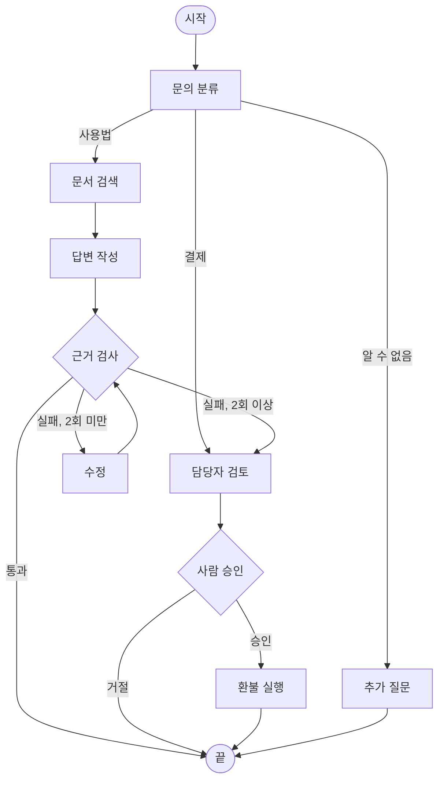
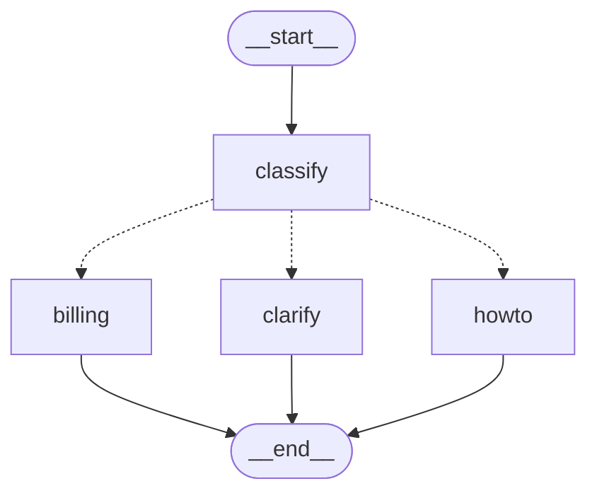
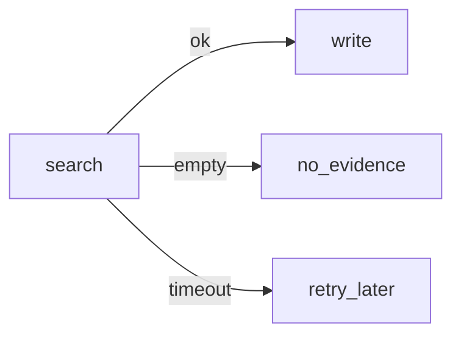
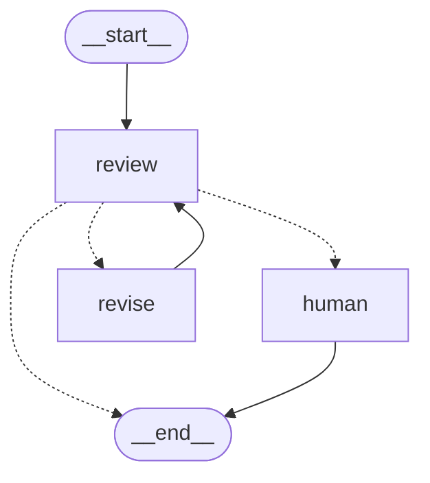
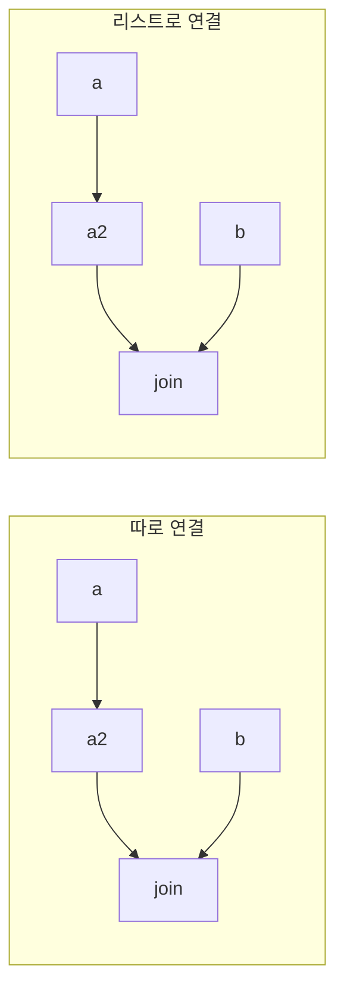
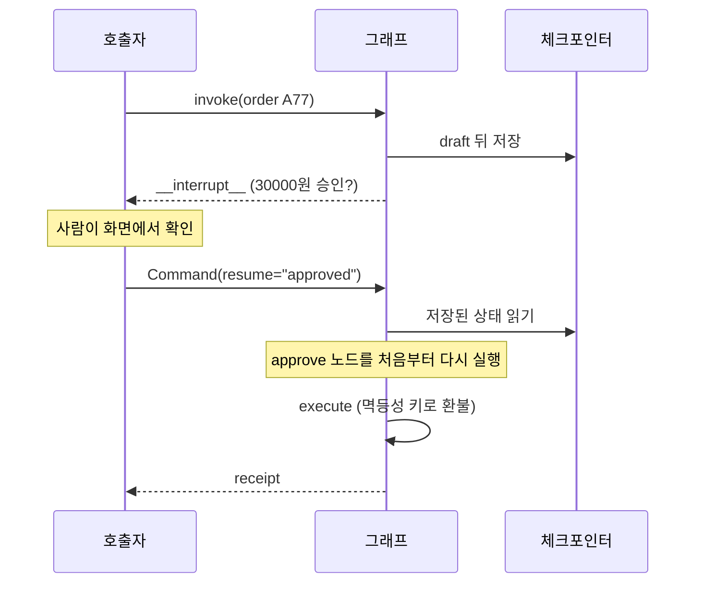

# 그래프 엔지니어링
{: .no_toc }



고객 문의 하나를 처리하는 AI를 생각해 보자. 문의를 분류하고, 사용법 질문이면 문서를 찾고, 결제 문제면 담당자에게 넘긴다. 답을 쓴 뒤에는 근거를 검사하고, 떨어지면 고친다. 환불처럼 돈이 오가는 일은 사람의 승인을 받고 나서 실행한다.

이 흐름을 그림으로 그리면 이렇다.



네모 하나가 한 단계의 일이고, 화살표가 다음에 갈 곳이다. **그래프 엔지니어링은 AI 업무를 이런 그림, 곧 "단계와 연결"로 설계하고, 그 그림이 실제로 그대로 실행되게 만드는 일이다.**

{: .tip }
지하철 노선도를 떠올리면 쉽다. 역(노드)과 선로(엣지)가 정해져 있고, 갈아타는 역(분기)에서 어느 노선을 탈지는 규칙으로 정한다. 승객이 들고 다니는 표(상태)에 지금까지의 정보가 적혀 있다. 노선도가 있으면 "이 승객이 어디를 거쳐 왔는가"를 나중에 따라가 볼 수 있다.

[루프 엔지니어링]({{ '/ai/using-ai/loop-engineering/' | relative_url }})에서는 모델이 행동을 고르고 결과를 보고 다시 고르는 반복 하나를 다뤘다. 그래프는 그 반복과 갈림길, 동시에 하는 일을 **눈에 보이는 구조로 꺼내 놓는다.** 위 그림의 "수정 → 근거 검사" 화살표가 바로 루프다. 다만 이제 그 루프가 언제 빠져나오는지가 그림에 적혀 있다.

{: .note }
"그래프 엔지니어링"은 표준화된 직무명이 아니다. 이 글에서는 AI 워크플로우와 에이전트의 제어 흐름을 그래프로 설계하는 일을 이 이름으로 부른다.

## 용어 다섯 개

| 용어 | 한 문장 설명 | 비유 |
| --- | --- | --- |
| 노드(node) | 한 단계의 일을 하는 함수 | 지하철역 |
| 엣지(edge) | 다음에 실행할 노드로 가는 연결 | 선로 |
| 라우팅(routing) | 갈림길에서 어느 엣지를 탈지 고르는 규칙 | 환승역의 안내판 |
| 상태(state) | 노드들이 함께 읽고 쓰는 작업 데이터 | 승객이 들고 다니는 표 |
| 체크포인트(checkpoint) | 어느 시점의 상태를 저장해 둔 것 | 게임의 세이브 파일 |

이 글의 실습은 [LangGraph](https://docs.langchain.com/oss/python/langgraph/graph-api)로 한다. LangGraph는 상태를 가진 워크플로우를 그래프로 만들고 실행하는 Python 라이브러리다. 설치와 첫 그래프 만들기는 [LangGraph 실습]({{ '/ai/using-ai/langgraph/' | relative_url }})에 있으니, 여기서는 **설계**에 집중한다. 되돌아가는 화살표가 없는 의존성 그래프는 [DAG]({{ '/ai/dag/' | relative_url }})에서 따로 다룬다.

## 그래프가 나을 때, 자유로운 에이전트가 나을 때

Anthropic의 [Building effective agents](https://www.anthropic.com/engineering/building-effective-agents)는 두 가지를 나눈다.

- **워크플로우**: 모델과 도구가 "미리 정해 둔 코드 경로"를 따라 움직이는 시스템.
- **에이전트**: 모델이 스스로 과정과 도구 사용을 정하는 시스템.

그래프는 워크플로우를 표현하는 가장 직접적인 방법이다. 이 글은 같은 문서가 소개하는 다섯 가지 워크플로우 패턴을 그래프 모양으로 옮기면 어떻게 되는지 정리해 두었다.

| 패턴 (문서의 설명) | 그래프 모양 | LangGraph에서 쓰는 것 |
| --- | --- | --- |
| Prompt chaining: 일을 순서대로 나누고, 앞 단계 출력을 다음 단계가 처리 | 일직선, 중간에 검사 관문 | `add_edge`, 관문은 조건 분기 |
| Routing: 입력을 분류해 전문 경로로 보냄 | 한 노드에서 여러 갈래 | `add_conditional_edges` |
| Parallelization: 독립된 일을 동시에 하고 결과를 모음 | 펼쳤다 모으기 | 여러 엣지 + reducer |
| Orchestrator-workers: 중심 모델이 일을 나누고 일꾼에게 맡긴 뒤 합침 | 개수가 실행 중에 정해지는 펼치기 | `Send` |
| Evaluator-optimizer: 한쪽이 만들고 다른 쪽이 평가해 반복 | 되돌아가는 화살표 | 조건 분기 + 반복 상한 |

같은 문서는 에이전트를 "필요한 단계 수를 예측하기 어렵거나 불가능한 열린 문제"에 쓸 수 있다고 하고, 자율성에는 비용과 오류 누적의 위험이 따른다고 적는다. 또 "가장 단순한 해법을 찾고, 필요할 때만 복잡도를 올리라"고 권한다.

### 실무에서는: 이럴 때 그래프로 만든다

아래는 공식 문서의 주장이 아니라, 직접 설계해 본 사람으로서의 판단 기준이다.

- **경로를 말로 설명할 수 있다.** "결제 문의는 반드시 담당자를 거친다"처럼 규칙이 있다면, 그 규칙을 프롬프트에 부탁하지 말고 엣지로 박아 둔다. 엣지는 모델이 잊어버리지 않는다.
- **사람 승인, 재시작, 몇 시간 이상 걸리는 대기가 있다.** 이런 일은 "어디까지 했는가"를 저장해야 하고, 저장하려면 단계의 경계가 분명해야 한다.
- **단계마다 따로 시험하고 싶다.** 분류가 틀렸는지, 검색이 틀렸는지, 글쓰기가 틀렸는지 나눠 보려면 단계가 나뉘어 있어야 한다.
- **같은 일을 여러 개 동시에 돌린다.** 합치는 규칙을 코드로 정해 둬야 결과가 흔들리지 않는다.

### 실무에서는: 이럴 때는 그래프가 과하다

- **한 번의 모델 호출이면 끝나는 일.** 노드 하나짜리 그래프는 함수 하나보다 나을 게 없다.
- **다음 단계를 미리 알 수 없는 탐색.** 코드베이스를 뒤지며 고치는 일처럼 단계가 입력마다 크게 다르면, 모든 경로를 엣지로 그리려다 그래프가 거미줄이 된다. 이럴 때는 [루프]({{ '/ai/using-ai/loop-engineering/' | relative_url }}) 하나를 노드로 넣고, 그 바깥만 그래프로 감싸는 편이 낫다.
- **팀이 그림을 관리하지 않는다.** 그래프의 장점은 "그림 = 실제 동작"일 때만 나온다. 그림을 갱신하지 않으면 거짓 지도가 된다.

{: .tip }
둘 중 하나를 고르는 문제가 아니다. 바깥은 그래프로 단단하게(분류 → 처리 → 승인 → 실행), 안쪽 한 노드는 자유로운 에이전트 루프로 유연하게 만드는 혼합형이 가장 흔한 좋은 설계다.

## 실습 환경

모든 예제는 **모델과 API 키 없이** 돌아간다. 모델을 부르는 자리는 규칙이 정해진 Python 함수로 바꿨다. 그래프의 동작(분기, 반복, 병렬, 저장)만 확인하려면 이 편이 정확하다. 모델의 답은 매번 달라질 수 있지만 그래프의 동작은 같아야 하기 때문이다.

[LangGraph 실습]({{ '/ai/using-ai/langgraph/' | relative_url }})과 같은 버전을 썼다.

```bash
uv venv -p 3.11 .venv
uv pip install -p .venv/bin/python langgraph==1.2.23
```

```text
Python 3.11.18
langgraph 1.2.23
langgraph-checkpoint 4.3.2
langchain-core 1.8.5
```

## 상태는 그래프의 계약서다

그래프에서 가장 먼저 설계할 것은 그림이 아니라 **상태**다. 노드끼리는 서로를 직접 부르지 않는다. 오직 상태를 통해서만 이야기한다. 그래서 상태의 모양은 노드들 사이의 계약서다.

{: .tip }
릴레이 경주의 바통과 같다. 주자(노드)는 서로 대화하지 않고 바통만 넘긴다. 바통에 무엇이 붙어 있어야 하는지 미리 정해 두지 않으면, 다음 주자가 받았을 때 필요한 것이 없다.

LangGraph에서 노드는 상태 전체를 받아 **바뀐 부분만** 돌려준다. 돌려준 값을 상태에 어떻게 반영할지는 키마다 정하는 **reducer**가 결정한다. reducer는 "예전 값과 새 값을 받아 합친 값을 돌려주는 함수"다. [Graph API 문서](https://docs.langchain.com/oss/python/langgraph/graph-api)에 따르면 기본 reducer는 예전 값을 새 값으로 바꿔 끼운다. `Annotated[list, operator.add]`처럼 적으면 리스트를 이어 붙인다.

```python
import operator
from typing import Annotated
from typing_extensions import TypedDict


class State(TypedDict):
    question: str                       # 덮어쓰기
    found: Annotated[list[str], operator.add]  # 이어 붙이기
```

이 차이가 왜 중요한지는 뒤의 병렬 실습에서 실제 오류로 확인한다.

### 실무에서는: 상태 설계 원칙

1. **원본과 결과를 둔다. 완성된 프롬프트는 두지 않는다.** 질문, 분류, 검색 근거, 초안, 평가는 상태에 둔다. 이것들로 만든 프롬프트 문자열은 노드 안에서 그때 만든다. 프롬프트를 상태에 넣으면 나중에 프롬프트를 고칠 때 이미 저장된 상태가 옛 프롬프트를 들고 있게 된다.
2. **키마다 주인을 정한다.** `draft`는 작성 노드와 수정 노드만 쓴다. 검사 노드는 읽기만 한다. 한 키를 여러 노드가 아무렇게나 쓰면, 값이 이상할 때 범인을 찾을 수 없다.
3. **커다란 공용 사전 하나를 두지 않는다.** `context: dict` 하나에 모든 것을 넣으면 타입이 계약 역할을 못 한다. 어떤 노드가 무엇을 기대하는지 코드만 봐서는 알 수 없게 된다.
4. **두 값이면 부족한 상태를 `bool`로 두지 않는다.** 승인 여부를 `approved: bool`로 두면 "아직 안 물어봄"과 "거절함"을 구분할 수 없다. `not_requested`, `pending`, `approved`, `rejected`처럼 업무가 실제로 구분하는 값을 쓴다.
5. **승인에는 대상을 묶는다.** 누가, 어떤 행동을, 어떤 입력(금액, 수신자)으로 승인했는지 함께 둔다. 금액이 바뀌면 예전 승인은 효력이 없어야 한다. 뒤의 시간 여행 실습에서 이 규칙이 왜 필요한지 보인다.
6. **크게 자라는 것은 참조만 둔다.** 긴 문서 본문, 파일, 이미지는 체크포인트마다 저장된다. 저장소의 ID와 버전만 상태에 두고 본문은 밖에 둔다.

{: .warning }
`TypedDict`는 타입 힌트일 뿐, 실행 중에 입력을 검사하지 않는다. 바깥에서 들어오는 요청은 그래프에 넣기 전에 따로 검사한다.

### 상태는 단계마다 채워진다

처음부터 모든 키가 차 있지는 않다. 어느 단계 뒤에 어느 키가 생기는지 표로 적어 두면, 그 표가 곧 노드들의 전제 조건 목록이 된다.

| 단계 | 읽는 값 | 새로 만드는 값 | 다음 단계의 전제 |
| --- | --- | --- | --- |
| 입력 검사 | 원문 | 정리한 질문 | 질문이 비어 있지 않음 |
| 분류 | 질문 | `howto` / `billing` / `unknown` | 허용된 값 중 하나 |
| 문서 검색 | 질문, 사용자 권한 | 문서 ID·버전·본문, 검색 결과 상태 | 이 사용자가 읽을 수 있는 자료 |
| 답변 작성 | 질문, 근거 | 초안, 인용 ID | 없는 근거를 인용하지 않음 |
| 근거 검사 | 초안, 근거 | 통과 여부, 결함 목록 | 필수 검사를 모두 함 |
| 수정 | 초안, 결함 | 새 초안, 수정 횟수 | 수정 상한 안쪽 |

## 노드 설계

### 실무에서는: 좋은 노드의 조건

- **한 가지 일만 한다.** "검색하고 요약하고 보내기"를 한 노드에 넣으면, 보내기에서 실패해도 검색부터 다시 한다.
- **입력은 상태, 출력은 바뀐 부분.** 노드 안에서 전역 변수를 고치거나 다른 노드를 직접 부르지 않는다. 그러면 노드를 상태 하나만 넣고 시험할 수 있다.
- **다시 실행돼도 안전하다(멱등성).** 멱등성은 "같은 일을 두 번 해도 한 번 한 것과 결과가 같은 성질"이다. 엘리베이터 버튼을 여러 번 눌러도 한 번만 오는 것과 같다. 뒤에서 보겠지만 LangGraph는 재시도와 재개 때 노드를 **처음부터** 다시 실행한다.
- **바깥 세상을 바꾸는 일은 따로 뗀다.** 메일 발송, 결제, 파일 삭제는 그 일만 하는 노드로 만든다. 그래야 그 앞에 승인을 두고, 그 노드에만 중복 방지를 걸 수 있다.

### 얼마나 잘게 나눌까

너무 크면 실패 위치를 모르고, 너무 작으면 그림과 기록만 복잡해진다. 다음 질문에 "예"가 나오는 곳이 경계다.

- 여기서 따로 재시도할 가치가 있는가?
- 앞뒤에서 쓰는 도구나 권한이 다른가?
- 사람 승인이나 검사를 넣어야 하는 자리인가?
- 이 중간 결과를 기록으로 보고 싶은가?
- 실패했을 때 여기서부터 다시 시작하면 시간과 비용이 아껴지는가?

## 엣지 설계: 분기와 기본 경로

엣지는 두 종류다.

- **고정 엣지** (`add_edge`): 늘 같은 곳으로 간다.
- **조건 엣지** (`add_conditional_edges`): 라우팅 함수가 돌려준 값으로 갈 곳을 고른다.

### 실습 1: 분류해서 보내고, 모르면 되묻기

`route.py`

```python
from typing import Literal
from typing_extensions import TypedDict
from langgraph.graph import StateGraph, START, END


class State(TypedDict, total=False):
    text: str
    category: str
    answer: str


def classify(state: State):
    t = state["text"].strip()
    if not t:
        return {"category": "empty"}
    if "결제" in t or "환불" in t:
        return {"category": "billing"}
    if "어떻게" in t:
        return {"category": "howto"}
    return {"category": "unknown"}


Route = Literal["howto", "billing", "clarify"]


def route(state: State) -> Route:
    c = state["category"]
    if c in ("howto", "billing"):
        return c
    return "clarify"  # 모르는 값은 모두 여기로


def howto(state: State):
    return {"answer": "문서 검색 경로"}


def billing(state: State):
    return {"answer": "결제 담당자 경로"}


def clarify(state: State):
    return {"answer": "질문을 조금 더 알려 주세요"}


b = StateGraph(State)
b.add_node("classify", classify)
b.add_node("howto", howto)
b.add_node("billing", billing)
b.add_node("clarify", clarify)
b.add_edge(START, "classify")
b.add_conditional_edges("classify", route)
for n in ("howto", "billing", "clarify"):
    b.add_edge(n, END)
app = b.compile()

if __name__ == "__main__":
    for q in ["비밀번호 어떻게 바꿔요?",
              "결제가 두 번 됐어요",
              "   ",
              "안녕"]:
        r = app.invoke({"text": q})
        print(repr(q), "->", r["category"], "|", r["answer"])
    print(app.get_graph().draw_mermaid())
```

실행 결과:

```text
'비밀번호 어떻게 바꿔요?' -> howto | 문서 검색 경로
'결제가 두 번 됐어요' -> billing | 결제 담당자 경로
'   ' -> empty | 질문을 조금 더 알려 주세요
'안녕' -> unknown | 질문을 조금 더 알려 주세요
```

`classify`는 분류만 하고, `route`는 길만 고른다. 분류 결과 `empty`와 `unknown`은 모두 `clarify`로 간다. 이렇게 **"그 밖의 모든 값"이 가는 기본 경로**가 있어야 한다.

`draw_mermaid()`가 출력한 그래프 구조는 다음과 같다. 점선(`-.->`)이 조건 엣지다.

```text
graph TD;
	__start__([<p>__start__</p>]):::first
	classify(classify)
	howto(howto)
	billing(billing)
	clarify(clarify)
	__end__([<p>__end__</p>]):::last
	__start__ --> classify;
	classify -.-> billing;
	classify -.-> clarify;
	classify -.-> howto;
	billing --> __end__;
	clarify --> __end__;
	howto --> __end__;
```

이 출력을 그대로 Mermaid로 그리면 이렇게 보인다(맨 위 설정 줄과 색상 줄만 뺐다).



### 기본 경로가 없으면: 오류 없이 조용히 멈춘다

라우팅 함수가 검사 없이 분류값을 그대로 돌려주면 어떻게 될까? `route_bad.py`는 위 파일에서 라우팅 함수만 바꿨다.

```python
from route import State, StateGraph, START, END
from route import classify, howto, billing, clarify


def raw_route(state: State):
    return state["category"]  # 검사 없이 그대로


b = StateGraph(State)
b.add_node("classify", classify)
b.add_node("howto", howto)
b.add_node("billing", billing)
b.add_node("clarify", clarify)
b.add_edge(START, "classify")
b.add_conditional_edges("classify", raw_route)
for n in ("howto", "billing", "clarify"):
    b.add_edge(n, END)
app = b.compile()

try:
    print(app.invoke({"text": "안녕"}))
except Exception as e:
    print(type(e).__name__, ":", e)
```

```text
Task classify with path ('__pregel_pull', 'classify') wrote to unknown channel branch:to:unknown, ignoring it.
{'text': '안녕', 'category': 'unknown'}
```

예외가 나지 않았다. 경고 한 줄을 남기고 그래프가 그냥 끝났고, 결과에 `answer`가 없다. 사용자는 빈 답을 받는다. 이런 곳을 **막다른 길(dead end)**이라고 부른다. 운영 중이라면 경고 로그를 보지 않는 한 아무도 모른다.

라우팅 함수에 매핑 사전을 주고, 그 사전에 없는 값을 돌려주면 이번에는 예외가 난다. 위 코드에서 연결 부분만 이렇게 바꿨다.

```python
b.add_conditional_edges(
    "classify", raw_route,
    {"howto": "howto", "billing": "billing"})
```

```text
KeyError : 'unknown'
```

조용히 끝나는 것보다는 낫지만, 사용자 입장에서는 여전히 실패다.

이 그래프를 그려 보면 문제가 하나 더 보인다. 라우팅 함수에 반환 타입(`Literal`)도 매핑 사전도 없으면 LangGraph는 갈 수 있는 곳을 모른다. `draw_mermaid()`의 연결 줄이 이것뿐이었다.

```text
	__start__ --> classify;
	classify --> __end__;
```

`howto`, `billing`, `clarify`로 가는 길이 그림에서 사라졌다. 그림만 보면 세 노드는 아무 데서도 갈 수 없는 노드처럼 보인다.

{: .warning }
라우팅 함수는 (1) 반환 타입을 `Literal[...]`로 적거나 매핑 사전을 주고, (2) 마지막에 "그 밖의 값"을 받는 기본 경로를 반드시 둔다. 앞의 것은 그림을 맞게 만들고, 뒤의 것은 막다른 길을 없앤다.

### 실무에서는: 라우팅 규칙

- **자유 문장으로 분기하지 않는다.** 모델에게 "결제 문의면 billing이라고 답해"라고 시키고 `if "billing" in text`로 분기하면, 모델이 "This is not billing"이라고 써도 결제 경로로 간다. 모델 출력은 허용된 값 목록이 있는 구조화 출력(예: JSON 스키마의 enum)으로 받고, 라우팅 함수는 그 값만 본다.
- **분류와 길 고르기를 나눈다.** 위 예제처럼 분류 노드는 상태에 값을 쓰고, 라우팅 함수는 그 값을 읽어 길만 고른다. 라우팅 함수 안에서 모델을 부르면 그 판단이 상태에 남지 않아 나중에 왜 그 길로 갔는지 알 수 없다.
- **확실한 규칙은 코드로, 애매한 판단만 모델로.** "금액이 100만 원 이상이면 사람에게"는 if 문이다. 모델에게 맡길 이유가 없다.
- **모르는 값은 "비싼 쪽"으로 보내지 않는다.** 분류를 모르겠다고 결제 경로나 실행 경로로 보내면 안 된다. 되묻기, 사람 검토처럼 안전한 곳으로 보낸다.

{: .note }
LangGraph에는 노드가 상태 갱신과 다음 노드 선택을 한 번에 돌려주는 `Command(update=..., goto=...)`도 있다. [Graph API 문서](https://docs.langchain.com/oss/python/langgraph/graph-api)는 "한 단계에서 상태를 고치는 동시에 다음 실행을 골라야 할 때" 쓰라고 설명한다. 이 글은 길 고르기를 라우팅 함수로 따로 떼어 시험하기 쉽게 하는 쪽을 택했다.

## 오류도 엣지로 그린다

검색 서버가 시간 초과로 실패한 것과, 검색은 잘 됐는데 근거가 없는 것은 다른 사건이다. 둘을 한 덩어리 "실패"로 처리하면 원인 분석이 틀어진다. 예상할 수 있는 실패는 **상태 값으로 바꾸고, 그 값에 맞는 엣지를 그린다.**

`error_edge.py`

```python
from typing import Literal
from typing_extensions import TypedDict
from langgraph.graph import StateGraph, START, END


class State(TypedDict, total=False):
    query: str
    docs: list[str]
    status: Literal["ok", "empty", "timeout"]
    answer: str


def fake_search(q: str) -> list[str]:
    if q == "느린 질문":
        raise TimeoutError
    return ["문서1"] if "내보내기" in q else []


def search(s: State):
    try:
        docs = fake_search(s["query"])
    except TimeoutError:
        return {"docs": [], "status": "timeout"}
    return {"docs": docs,
            "status": "ok" if docs else "empty"}


def route(s: State) -> Literal[
        "write", "no_evidence", "retry_later"]:
    return {"ok": "write",
            "empty": "no_evidence",
            "timeout": "retry_later"}[s["status"]]


def write(s: State):
    return {"answer": f"근거 {s['docs']}로 답변"}


def no_evidence(s: State):
    return {"answer": "찾은 근거가 없어 답할 수 없음"}


def retry_later(s: State):
    return {"answer": "검색 장애: 잠시 뒤 다시 시도"}


b = StateGraph(State)
for f in (search, write, no_evidence, retry_later):
    b.add_node(f.__name__, f)
b.add_edge(START, "search")
b.add_conditional_edges("search", route)
for n in ("write", "no_evidence", "retry_later"):
    b.add_edge(n, END)
app = b.compile()

for q in ["내보내기 되나요", "날씨 어때", "느린 질문"]:
    r = app.invoke({"query": q})
    print(f"{q:10} {r['status']:8} {r['answer']}")
```

```text
내보내기 되나요   ok       근거 ['문서1']로 답변
날씨 어때      empty    찾은 근거가 없어 답할 수 없음
느린 질문      timeout  검색 장애: 잠시 뒤 다시 시도
```



### 실무에서는: 어떤 오류를 엣지로 만들까

- **업무상 의미가 있는 실패는 엣지로.** "근거 없음", "권한 없음", "사용자 정보 부족"은 정상적인 결과 중 하나다. 각각 다른 안내가 필요하므로 경로를 따로 둔다.
- **잠깐의 장애는 재시도로.** 네트워크 오류처럼 다시 하면 될 일은 노드의 재시도 정책에 맡긴다(뒤에서 다룬다). 재시도를 다 써도 안 되면 그때 오류 경로로 보낸다.
- **코드 버그는 숨기지 않는다.** `KeyError`, `TypeError` 같은 것을 모두 잡아 "실패" 상태로 바꾸면 버그가 정상 경로처럼 보인다. 이런 예외는 그대로 터지게 둔다.

## 반복: 빠져나오는 길이 있는 루프

평가에 떨어지면 고쳐서 다시 평가하는 구조는 그래프에서 **되돌아가는 화살표**다. 이 화살표에는 반드시 빠져나오는 조건이 있어야 한다.

### 실습 2: 수정 횟수로 멈추기

점수는 모델 대신 글자 수로 매긴다. 한 글자에 10점, 80점이면 통과다. 수정은 글자를 하나 붙인다. 두 번 고쳐도 안 되면 사람에게 넘긴다.

`cycle.py`

```python
from typing import Literal
from typing_extensions import TypedDict
from langgraph.graph import StateGraph, START, END
from langgraph.errors import GraphRecursionError

MAX_REVISIONS = 2


class State(TypedDict):
    draft: str
    score: int
    revisions: int


def review(state: State):
    # 모델 대신 '글자 수'로 점수를 매긴다
    return {"score": len(state["draft"]) * 10}


def revise(state: State):
    return {"draft": state["draft"] + "+",
            "revisions": state["revisions"] + 1}


def route(state: State) -> Literal[
        "revise", "human", "__end__"]:
    if state["score"] >= 80:
        return END
    if state["revisions"] >= MAX_REVISIONS:
        return "human"
    return "revise"


def human(state: State):
    return {}


def build(router):
    b = StateGraph(State)
    b.add_node("review", review)
    b.add_node("revise", revise)
    b.add_node("human", human)
    b.add_edge(START, "review")
    b.add_conditional_edges("review", router)
    b.add_edge("revise", "review")
    b.add_edge("human", END)
    return b.compile()


def run(app, draft, **config):
    s = {"draft": draft, "score": 0, "revisions": 0}
    steps = []
    for up in app.stream(s, config,
                         stream_mode="updates"):
        steps.extend(up)
    print(draft, "->", " > ".join(steps))


guarded = build(route)
run(guarded, "초안입니다요")   # 6글자
run(guarded, "짧음")          # 2글자


def no_guard(state: State) -> Literal[
        "revise", "__end__"]:
    return END if state["score"] >= 800 else "revise"


loop = build(no_guard)
try:
    run(loop, "짧음", recursion_limit=6)
except GraphRecursionError as e:
    print(type(e).__name__)
    print(str(e).splitlines()[0])
print(guarded.get_graph().draw_mermaid())
```

```text
초안입니다요 -> review > revise > review > revise > review
짧음 -> review > revise > review > revise > review > human
GraphRecursionError
Recursion limit of 6 reached without hitting a stop condition. You can increase the limit by setting the `recursion_limit` config key.
```

- 6글자 초안은 60점 → 70점 → 80점으로 두 번 고쳐서 통과했다.
- 2글자 초안은 두 번 고쳐도 40점이라 `human`으로 넘어갔다.
- 가드가 없는 `no_guard`는 사실상 통과할 수 없는 기준(800점)을 걸었다. 그래프는 멈추지 않았고, 설정한 `recursion_limit=6`에서 `GraphRecursionError`로 끊겼다.

그래프 구조(출력에서 연결 줄만):

```text
	__start__ --> review;
	review -.-> __end__;
	review -.-> human;
	review -.-> revise;
	revise --> review;
	human --> __end__;
```



### recursion_limit는 안전망이지 종료 조건이 아니다

[Graph API 문서](https://docs.langchain.com/oss/python/langgraph/graph-api)의 Recursion limit 항목에 따르면, 이 한도는 **super-step**(아래 병렬 절에서 설명) 수를 센다. 1.1.4부터 기본값은 10,007이고, 넘으면 `GraphRecursionError`가 난다. 설정은 `configurable` 안이 아니라 config의 맨 위 키 `recursion_limit`로 준다. 설치한 1.2.23 소스(`langgraph/_internal/_config.py`)에서도 기본값이 `LANGGRAPH_DEFAULT_RECURSION_LIMIT` 환경 변수, 없으면 `"10007"`으로 정해져 있는 것을 확인했다.

{: .warning }
기본값 10,007은 모델을 부르는 루프에 대해서는 사실상 "제한 없음"이다. 한 바퀴에 모델 호출이 한 번만 있어도 수천 번의 호출 비용이 나간 뒤에야 멈춘다. 업무 규칙에 맞는 상한(`MAX_REVISIONS`)을 상태에 두고, `recursion_limit`는 그 상한보다 조금 큰 값으로 따로 걸어 "설계 실수"를 잡는 안전망으로 쓴다.

예외로 끝나는 것과 상한에 걸려 `human`으로 가는 것은 결과가 다르다. 예외는 지금까지의 작업을 호출자에게 의미 있게 돌려주지 못한다. 상한 경로는 "두 번 고쳤는데 40점에서 멈췄다"는 정보를 들고 사람에게 간다. [루프 엔지니어링]({{ '/ai/using-ai/loop-engineering/' | relative_url }})에서 말한 "완료, 실패, 한도 소진을 구분하라"가 그래프에서는 **서로 다른 끝 노드**로 나타난다.

### 실무에서는: 좋은 반복의 조건

- **합격 기준**이 코드로 판정 가능하다. "더 좋아 보이면"은 기준이 아니다.
- **최대 횟수**가 상태에 있다.
- **수렴 검사**가 있다. 점수가 두 번 연속 오르지 않으면 더 돌려도 소용없을 가능성이 크다. 상한까지 기다리지 말고 일찍 멈춘다.
- **가장 좋았던 결과를 따로 보관**한다. 수정이 오히려 나빠지는 일이 생긴다. 마지막 초안이 아니라 최고 점수 초안을 넘긴다.
- **평가자가 고칠 점을 구조로 남긴다.** "별로"가 아니라 "3번 문장이 근거 없음"처럼 남겨야 수정 노드가 그것을 고칠 수 있다.

## 병렬: 펼치고 모으기

### super-step이란

LangGraph는 그래프를 **super-step**이라는 단위로 진행한다. super-step은 "이번 차례에 실행할 수 있는 노드를 모두 실행하고, 그 결과를 한꺼번에 상태에 반영하는 한 박자"다. [Graph API 문서](https://docs.langchain.com/oss/python/langgraph/graph-api)는 "병렬로 실행되는 노드는 하나의 super-step을 공유한다"고 적는다.

{: .tip }
여러 사람이 같은 공유 문서에 각자 메모를 적고, 박자가 끝날 때 한꺼번에 저장 버튼을 누르는 모습을 떠올리자. 같은 칸에 두 사람이 다른 값을 적었다면, 저장할 때 무엇을 남길지 규칙(reducer)이 있어야 한다.

### 실습 3: 개수가 실행 중에 정해지는 펼치기(map-reduce)

검색할 출처 목록이 실행 중에 정해진다고 하자. 같은 `search` 노드를 출처마다 한 번씩, 각자 다른 입력으로 실행해야 한다. [문서](https://docs.langchain.com/oss/python/langgraph/graph-api)는 이럴 때 `Send`를 쓰라고 하고, 일반 엣지로는 이것을 할 수 없다고 적는다. 이렇게 여러 개로 나눠 처리하고(map) 결과를 하나로 모으는(reduce) 방식을 **map-reduce**라고 부른다.

`fanout.py`

```python
import operator
from typing import Annotated
from typing_extensions import TypedDict
from langgraph.graph import StateGraph, START, END
from langgraph.types import Send

DOCS = {"manual": "내보내기 메뉴",
        "policy": "관리자만 가능",
        "faq": "무료 플랜 제한"}


class State(TypedDict):
    question: str
    sources: list[str]
    found: Annotated[list[str], operator.add]
    answer: str


class Job(TypedDict):
    question: str
    source: str


def plan(state: State):
    return {"sources": ["manual", "policy", "faq"]}


def fan_out(state: State):
    return [Send("search", {"question": state["question"],
                            "source": s})
            for s in state["sources"]]


def search(job: Job):
    return {"found": [f"{job['source']}: "
                      f"{DOCS[job['source']]}"]}


def write(state: State):
    return {"answer": " / ".join(sorted(state["found"]))}


b = StateGraph(State)
b.add_node("plan", plan)
b.add_node("search", search)
b.add_node("write", write)
b.add_edge(START, "plan")
b.add_conditional_edges("plan", fan_out, ["search"])
b.add_edge("search", "write")
b.add_edge("write", END)
app = b.compile()

init = {"question": "내보내기 되나요?", "sources": [],
        "found": [], "answer": ""}
for up in app.stream(init, stream_mode="updates"):
    print(up)
print(app.get_graph().draw_mermaid())
```

```text
{'plan': {'sources': ['manual', 'policy', 'faq']}}
{'search': {'found': ['manual: 내보내기 메뉴']}}
{'search': {'found': ['policy: 관리자만 가능']}}
{'search': {'found': ['faq: 무료 플랜 제한']}}
{'write': {'answer': 'faq: 무료 플랜 제한 / manual: 내보내기 메뉴 / policy: 관리자만 가능'}}
```

`search`가 세 번 실행됐고, 세 결과가 `operator.add` reducer로 하나의 리스트에 이어 붙었다. `write`는 세 결과가 모두 모인 뒤 한 번 실행됐다. `Send`가 받는 입력(`Job`)은 그래프 전체 상태와 모양이 달라도 된다는 점도 눈여겨보자. 일꾼에게는 자기 몫만 준다.

그래프 구조(연결 줄만):

```text
	__start__ --> plan;
	plan -.-> search;
	search --> write;
	write --> __end__;
```

{: .note }
그림에는 `search`가 하나로 그려진다. 몇 개로 펼쳐질지는 실행 중에 정해지기 때문이다. 그림만 보고 "검색은 한 번"이라고 읽으면 안 된다.

{: .tip }
`write`에서 `sorted()`를 쓴 이유가 있다. 병렬 결과가 모이는 순서에 기대지 않으려는 것이다. 이 실행에서는 보낸 순서대로 모였지만, 순서가 중요하면 결과에 출처나 번호를 붙이고 모은 뒤 직접 정렬한다.

### reducer가 없으면: 실제 오류

`found` 한 줄만 기본 reducer(덮어쓰기)로 바꿨다.

```python
    found: list[str]  # reducer 없음
```

```text
InvalidUpdateError
At key 'found': Can receive only one value per step. Use an Annotated key to handle multiple values.
```

한 super-step에서 세 노드가 `found`에 값을 썼는데, 덮어쓰기 규칙으로는 셋 중 무엇을 남길지 정할 수 없다. LangGraph는 마음대로 하나를 고르지 않고 오류를 낸다. 조용히 둘을 버리는 것보다 훨씬 나은 동작이다.

{: .warning }
반대로 생각하면, **같은 super-step에 같은 키를 쓰는 노드가 하나뿐일 때는 이 오류가 나지 않는다.** 지금은 병렬이 아니던 두 노드가 나중에 병렬이 되면 그때 처음 터진다. 병렬로 갈 가능성이 있는 키는 처음부터 reducer를 정해 둔다.

### 합류의 의미: "모두 기다림"은 저절로 되지 않는다

두 갈래의 길이가 다르면 어떻게 될까? `a → a2 → join`과 `b → join`을 동시에 시작해 보자.

`join.py`

```python
import operator
from typing import Annotated
from typing_extensions import TypedDict
from langgraph.graph import StateGraph, START, END


class State(TypedDict):
    log: Annotated[list[str], operator.add]


def node(name):
    def fn(state: State):
        return {"log": [name]}
    return fn


def build(wait_all: bool):
    b = StateGraph(State)
    for n in ("a", "a2", "b", "join"):
        b.add_node(n, node(n))
    b.add_edge(START, "a")
    b.add_edge(START, "b")
    b.add_edge("a", "a2")   # a 쪽이 한 단계 더 길다
    if wait_all:
        b.add_edge(["a2", "b"], "join")
    else:
        b.add_edge("a2", "join")
        b.add_edge("b", "join")
    b.add_edge("join", END)
    return b.compile()


for wait_all in (False, True):
    out = build(wait_all).invoke({"log": []})
    print(f"wait_all={wait_all}:", out["log"])
```

```text
wait_all=False: ['a', 'b', 'a2', 'join', 'join']
wait_all=True: ['a', 'b', 'a2', 'join']
```

엣지를 두 개 따로 그렸을 때는 `join`이 **두 번** 실행됐다. `b`가 끝난 박자에 한 번, `a2`가 끝난 박자에 또 한 번이다. 첫 번째 `join`은 `a2`의 결과 없이 실행된 것이다. `add_edge(["a2", "b"], "join")`처럼 출발점을 리스트로 주면 둘 다 끝난 뒤 한 번만 실행됐다.



두 그림은 똑같아 보이지만 동작이 다르다. 그래서 그림만으로는 합류의 의미를 알 수 없고, 코드에서 **"하나라도 오면 실행"인지 "모두 와야 실행"인지**를 확인해야 한다. 앞의 `fanout.py`처럼 `Send`로 펼친 일꾼들이 모두 같은 박자에 끝나면 `write`는 한 번만 실행된다. 일꾼 안에 단계가 더 생기면 이 전제가 깨질 수 있으니, 그때는 위 실험을 다시 해 본다.

### 실습 4: 한 갈래만 실패하면

두 검색 중 정책 검색만 시간 초과로 실패했다. 이미 성공한 설명서 검색까지 다시 해야 할까?

[Checkpointers 문서](https://docs.langchain.com/oss/python/langgraph/checkpointers)에 따르면, 한 super-step 안에서 어떤 노드가 실패해도 LangGraph는 그 박자에 성공한 다른 노드의 쓰기(pending writes)를 저장해 두고, 재개할 때 그 노드들을 다시 실행하지 않는다. 직접 확인했다.

`partial.py`

```python
import operator
from typing import Annotated
from typing_extensions import TypedDict
from langgraph.graph import StateGraph, START, END
from langgraph.checkpoint.memory import InMemorySaver

calls = {"manual": 0, "policy": 0}
broken = {"policy": True}


class State(TypedDict):
    found: Annotated[list[str], operator.add]


def manual(state: State):
    calls["manual"] += 1
    return {"found": ["manual"]}


def policy(state: State):
    calls["policy"] += 1
    if broken["policy"]:
        raise TimeoutError("정책 서버 시간 초과")
    return {"found": ["policy"]}


def write(state: State):
    return {}


b = StateGraph(State)
b.add_node("manual", manual)
b.add_node("policy", policy)
b.add_node("write", write)
b.add_edge(START, "manual")
b.add_edge(START, "policy")
b.add_edge(["manual", "policy"], "write")
b.add_edge("write", END)
app = b.compile(checkpointer=InMemorySaver())
cfg = {"configurable": {"thread_id": "t1"}}

try:
    app.invoke({"found": []}, cfg)
except TimeoutError as e:
    print("1차 실패:", e)
snap = app.get_state(cfg)
print("next:", snap.next)
print("tasks:", [(t.name, t.error is not None)
                 for t in snap.tasks])

broken["policy"] = False        # 서버가 회복됐다
out = app.invoke(None, cfg)     # 같은 thread 재개
print("결과:", out["found"])
print("호출 횟수:", calls)
```

```text
1차 실패: 정책 서버 시간 초과
next: ('policy',)
tasks: [('manual', False), ('policy', True)]
결과: ['manual', 'policy']
호출 횟수: {'manual': 1, 'policy': 2}
```

- 실패 직후 저장된 상태를 보면 남은 일(`next`)은 `policy` 하나다. `tasks`에서 `policy`만 오류가 있다.
- 입력 자리에 `None`을 주고 같은 `thread_id`로 다시 실행하면 저장된 곳에서 이어간다.
- `manual`은 한 번만 실행됐다. 실패한 `policy`만 다시 실행됐다.

{: .tip }
체크포인터가 없으면 이 이어가기가 불가능하다. 병렬 검색이 비싸다면 체크포인터는 "선택 기능"이 아니라 비용 절감 장치다.

### 실무에서는: 부분 실패를 어떻게 다룰까

- **반드시 다 있어야 하는가, 일부로도 되는가를 정한다.** 권한 정책 없이 "내보내기 할 수 있다"고 답하면 위험하다. 이런 근거는 필수로 두고, 없으면 오류 경로로 보낸다. FAQ처럼 있으면 좋은 근거는 빠져도 진행한다.
- **일부로 진행할 때는 빠진 것을 상태에 남긴다.** `missing: ["faq"]`처럼 남겨야 답변 노드가 "FAQ는 확인하지 못했다"고 쓸 수 있고, 평가 때도 구분할 수 있다.
- **펼치는 개수에 상한을 둔다.** `Send`로 만드는 일꾼 수가 입력에 따라 정해진다면, 입력이 커질 때 일꾼이 수백 개가 될 수 있다. 계획 노드에서 개수를 자른다.

## 하위 그래프: 그래프 안의 그래프

그래프가 커지면 일부를 떼어 따로 만든 뒤 노드처럼 끼워 넣을 수 있다. 이것을 **하위 그래프(subgraph)**라고 한다. 회사 조직도에서 "법무팀"을 한 칸으로 그리고, 그 안의 절차는 법무팀이 따로 관리하는 것과 같다.

[Subgraphs 문서](https://docs.langchain.com/oss/python/langgraph/use-subgraphs)는 두 방법을 설명한다.

- 상위와 하위 그래프가 **상태 키를 공유**하면, 컴파일한 하위 그래프를 바로 `add_node`에 넣는다.
- **상태 모양이 다르면**, 노드 함수 안에서 하위 그래프를 부르고 앞뒤로 상태를 바꿔 준다.

뒤쪽이 계약을 분명히 나누는 방법이라 아래처럼 실행해 봤다.

`subgraph.py`

```python
from typing_extensions import TypedDict
from langgraph.graph import StateGraph, START, END


# 하위 그래프: 자기만의 상태 계약
class CheckState(TypedDict, total=False):
    draft: str
    problems: list[str]


def find_problems(s: CheckState):
    bad = [w for w in ("아마", "보통") if w in s["draft"]]
    return {"problems": bad}


sb = StateGraph(CheckState)
sb.add_node("find_problems", find_problems)
sb.add_edge(START, "find_problems")
sb.add_edge("find_problems", END)
checker = sb.compile()


# 상위 그래프: 상태 키가 다르다
class Parent(TypedDict, total=False):
    answer: str
    passed: bool


def check(s: Parent):
    out = checker.invoke({"draft": s["answer"]})
    return {"passed": not out["problems"]}


pb = StateGraph(Parent)
pb.add_node("check", check)
pb.add_edge(START, "check")
pb.add_edge("check", END)
app = pb.compile()

for a in ["관리자만 가능합니다", "아마 될 거예요"]:
    print(a, "->", app.invoke({"answer": a}))

for ns, up in app.stream({"answer": "보통 됩니다"},
                         stream_mode="updates",
                         subgraphs=True):
    print(ns, up)
```

```text
관리자만 가능합니다 -> {'answer': '관리자만 가능합니다', 'passed': True}
아마 될 거예요 -> {'answer': '아마 될 거예요', 'passed': False}
('check:b207ffc4-6d7b-aaaa-0a44-c3025adb4293',) {'find_problems': {'problems': ['보통']}}
() {'check': {'passed': False}}
```

상위 그래프는 `passed` 하나만 받는다. 하위 그래프 안의 `problems`는 상위 상태로 새어 나오지 않는다. `stream`에 `subgraphs=True`를 주면 하위 그래프 안의 갱신도 볼 수 있고, 앞의 튜플이 어느 하위 그래프에서 온 갱신인지 알려 준다(이름 뒤의 ID는 실행마다 다르다).

{: .note }
같은 문서에 따르면 하위 그래프는 기본적으로 상위 그래프의 체크포인터를 물려받는다. 하위 그래프가 스레드마다 자기 상태를 계속 기억해야 하면 `checkpointer=True`로 컴파일한다.

### 실무에서는: 언제 하위 그래프로 떼나

- **다른 팀이나 다른 그래프에서도 쓰는 묶음.** 근거 검사, 개인정보 가리기처럼 여러 곳에 들어가는 절차.
- **안쪽 상태가 바깥에 보일 필요가 없을 때.** 하위 그래프의 중간 값이 상위 상태에 쌓이면 상태가 쓸데없이 커진다.
- **안쪽만 따로 시험하고 싶을 때.** 하위 그래프는 그 자체로 하나의 그래프라 따로 `invoke`해서 시험할 수 있다.

## 체크포인트, 사람 승인, 시간 여행

[Checkpointers 문서](https://docs.langchain.com/oss/python/langgraph/checkpointers)에 따르면 체크포인터는 super-step마다 상태 스냅샷을 저장하고, 스냅샷은 **thread**로 묶인다. thread는 "한 건의 작업 흐름"이고 `thread_id`로 찾는다. 고객 한 명의 환불 요청 한 건을 thread 하나로 생각하면 된다.

사람 승인은 이 저장 기능 위에 만들어진다. [Interrupts 문서](https://docs.langchain.com/oss/python/langgraph/interrupts)에 따르면 노드 안에서 `interrupt()`를 부르면 실행이 멈추고, 상태가 저장되고, 넘긴 값이 호출자에게 돌아간다. 나중에 `Command(resume=값)`으로 다시 실행하면, 그 값이 `interrupt()`의 반환값이 된다.

### 실습 5: 환불 승인, 재개, 기록 보기, 다시 실행, 분기

가짜 결제사는 **멱등성 키**를 받는다. 멱등성 키는 "이 요청이 어떤 요청인지 알려 주는 고유한 이름표"다. 같은 이름표로 두 번 오면 결제사는 두 번째를 무시한다. 이 키는 주문 번호와 금액으로 만든다.

`approval.py`

```python
from typing import Literal
from typing_extensions import TypedDict
from langgraph.graph import StateGraph, START, END
from langgraph.checkpoint.memory import InMemorySaver
from langgraph.types import interrupt, Command

PROVIDER = {}   # 가짜 결제사: 멱등성 키 -> 처리 결과


def refund_api(key: str, amount: int):
    if key in PROVIDER:
        return f"중복 요청 무시({key})"
    PROVIDER[key] = amount
    return f"환불 {amount}원 처리({key})"


class State(TypedDict, total=False):
    order_id: str
    amount: int
    decision: str
    receipt: str


def draft(state: State):
    return {"amount": state.get("amount", 30000)}


def approve(state: State):
    print("  [approve 노드 시작]")
    answer = interrupt({"order": state["order_id"],
                        "amount": state["amount"]})
    return {"decision": answer}


def after_approve(state: State) -> Literal[
        "execute", "__end__"]:
    if state["decision"] == "approved":
        return "execute"
    return END


def execute(state: State):
    key = f"refund:{state['order_id']}:{state['amount']}"
    return {"receipt": refund_api(key, state["amount"])}


b = StateGraph(State)
b.add_node("draft", draft)
b.add_node("approve", approve)
b.add_node("execute", execute)
b.add_edge(START, "draft")
b.add_edge("draft", "approve")
b.add_conditional_edges("approve", after_approve)
b.add_edge("execute", END)
app = b.compile(checkpointer=InMemorySaver())
cfg = {"configurable": {"thread_id": "order-77"}}

print("1) 첫 실행")
out = app.invoke({"order_id": "A77"}, cfg)
print("  interrupt:", out["__interrupt__"][0].value)
print("  next:", app.get_state(cfg).next)

print("2) 사람이 승인하고 재개")
out = app.invoke(Command(resume="approved"), cfg)
print("  receipt:", out["receipt"])

print("3) 상태 기록 (최신이 먼저)")
history = list(app.get_state_history(cfg))
for s in history:
    print(f"  step={s.metadata['step']:>2}",
          "next=", s.next)

print("4) execute 직전부터 다시 실행 (replay)")
before = next(s for s in history
              if s.next == ("execute",))
out = app.invoke(None, before.config)
print("  receipt:", out["receipt"])

print("5) 승인 직전에서 금액을 바꿔 분기 (fork)")
pre = next(s for s in history
           if s.next == ("approve",))
fork = app.update_state(pre.config,
                        {"amount": 50000},
                        as_node="draft")
out = app.invoke(None, fork)
print("  interrupt:", out["__interrupt__"][0].value)
```

```text
1) 첫 실행
  [approve 노드 시작]
  interrupt: {'order': 'A77', 'amount': 30000}
  next: ('approve',)
2) 사람이 승인하고 재개
  [approve 노드 시작]
  receipt: 환불 30000원 처리(refund:A77:30000)
3) 상태 기록 (최신이 먼저)
  step= 3 next= ()
  step= 2 next= ('execute',)
  step= 1 next= ('approve',)
  step= 0 next= ('draft',)
  step=-1 next= ('__start__',)
4) execute 직전부터 다시 실행 (replay)
  receipt: 중복 요청 무시(refund:A77:30000)
5) 승인 직전에서 금액을 바꿔 분기 (fork)
  [approve 노드 시작]
  interrupt: {'order': 'A77', 'amount': 50000}
```

한 단계씩 읽어 보자.



**1) 멈춤.** `invoke`는 예외를 던지지 않고 `__interrupt__` 키에 승인 요청 내용을 담아 돌아왔다. 저장된 상태의 `next`가 `('approve',)`이니, 다시 시작하면 `approve`부터 한다.

**2) 재개.** `[approve 노드 시작]`이 **한 번 더** 찍혔다. 문서에 적힌 대로 재개하면 `interrupt()`를 부른 노드가 **처음부터 다시 실행**된다. 노드 안 중간 줄부터 이어지는 것이 아니다. 그래서 `interrupt()` 앞에 메일 발송 같은 일을 두면 두 번 일어난다. 문서도 `interrupt()` 앞의 부수 효과는 멱등해야 한다고 적는다.

**3) 기록.** `get_state_history`는 [문서](https://docs.langchain.com/oss/python/langgraph/checkpointers)대로 최신 스냅샷부터 돌려줬다. `next`가 빈 튜플이면 그래프가 끝난 것이다. 스냅샷에는 `values`, `next`, `config`, `metadata`, `created_at`, `parent_config`, `tasks`가 들어 있다.

**4) 다시 실행(replay).** 과거 스냅샷의 `config`로 `invoke(None, ...)`하면 그 시점부터 다시 실행한다. [Time travel 문서](https://docs.langchain.com/oss/python/langgraph/use-time-travel)에 따르면 그 앞의 노드는 저장된 결과를 쓰고 다시 실행하지 않지만, **그 뒤의 노드는 실제로 다시 실행된다.** 그래서 `execute`가 다시 돌았고, 결제사가 같은 멱등성 키를 알아보고 `중복 요청 무시`로 막았다. 키가 없었다면 환불이 두 번 나갔다.

**5) 분기(fork).** 승인 직전 스냅샷에 `update_state`로 금액을 50,000원으로 바꿨다. 문서에 따르면 `update_state`는 원래 기록을 지우지 않고 그 지점에서 갈라지는 **새 체크포인트**를 만든다. `as_node="draft"`는 "이 변경을 `draft` 노드가 한 것으로 치라"는 뜻이고, 그래서 다음에 `approve`가 실행된다. 금액이 바뀌었으니 승인을 다시 묻는다. 승인 노드가 금액보다 뒤에 있기 때문에 이렇게 된다.

{: .question }
만약 승인 결과만 상태에 남겨 두고, 승인 **뒤**의 스냅샷에서 금액을 바꿨다면 어떻게 됐을까? `execute`는 바뀐 금액으로 승인 없이 실행된다. 그래서 승인에는 "어떤 금액에 대한 승인인가"를 함께 저장하고, `execute`에서 승인한 금액과 실행할 금액이 같은지 한 번 더 확인하는 것이 안전하다.

### interrupt를 쓸 때 문서가 정한 규칙

[Interrupts 문서](https://docs.langchain.com/oss/python/langgraph/interrupts)에서 확인한 내용이다.

- 체크포인터와 `thread_id`가 있어야 한다. 운영에서는 영구 저장 체크포인터를 쓴다.
- `interrupt()`를 맨 `try/except`로 감싸지 않는다. 멈춤 신호를 잡아 버리기 때문이다.
- 한 노드에서 여러 번 부르면 **순서(인덱스)**로 짝을 맞춘다. 실행마다 부르는 순서가 바뀌면 안 된다.
- 넘기는 값은 JSON으로 바꿀 수 있어야 한다.
- 컴파일할 때 주는 `interrupt_before`, `interrupt_after`는 디버깅할 때 한 노드씩 멈춰 보는 중단점이다. 문서는 사람 승인용으로는 `interrupt()`를 권한다.

### 실무에서는: 승인 화면에 보여 줄 것

- 무엇을 하려는가(행동과 대상)
- 영향 범위(금액, 수신자, 바뀌는 파일)
- 왜 이 행동을 골랐는가(근거)
- 승인하면 바로 무엇이 일어나는가
- 수정하거나 거절하는 방법

승인 화면에 정보가 부족하면 사람은 "그냥 승인"을 누르게 된다. 그러면 승인 노드는 있지만 실제로는 아무것도 막지 못한다.

### 저장소 고르기

[Checkpointers 문서](https://docs.langchain.com/oss/python/langgraph/checkpointers)가 나열하는 구현은 이렇다. `InMemorySaver`는 LangGraph에 포함되고 메모리에만 저장한다. `langgraph-checkpoint-sqlite`는 로컬 작업용, `langgraph-checkpoint-postgres`와 `langgraph-checkpoint-mongodb`는 운영용으로 소개된다. 이 글의 실습은 모두 `InMemorySaver`라 프로그램을 끄면 기록이 사라진다.

## 지속 실행과 부수 효과

**지속 실행(durable execution)**은 "중간에 프로세스가 죽거나 사람을 며칠 기다려도, 저장된 곳에서 이어서 끝까지 가는 실행"을 말한다. 체크포인트가 그 바탕이다. 하지만 체크포인트는 **그래프의 상태**를 되돌릴 뿐, 이미 보낸 메일이나 나간 환불을 되돌리지 못한다.

### 실습 6: 재시도는 "적어도 한 번"이다

메일을 보낸 뒤 응답 확인에서 시간 초과가 났다고 하자. 노드에 재시도 정책을 걸면 어떻게 될까?

`retry.py`

```python
from typing_extensions import TypedDict
from langgraph.graph import StateGraph, START, END
from langgraph.types import RetryPolicy

outbox = []          # 실제로 나간 메일
attempt = {"n": 0}


class State(TypedDict, total=False):
    to: str
    ok: bool


def notify(s: State):
    attempt["n"] += 1
    outbox.append(s["to"])          # 부수 효과 먼저
    if attempt["n"] == 1:
        raise TimeoutError("응답 확인 실패")
    return {"ok": True}


b = StateGraph(State)
b.add_node("notify", notify,
           retry_policy=RetryPolicy(
               max_attempts=3,
               initial_interval=0.01,
               retry_on=TimeoutError))
b.add_edge(START, "notify")
b.add_edge("notify", END)
app = b.compile()

print(app.invoke({"to": "kim@example.com"}))
print("시도:", attempt["n"], "발송함:", outbox)
```

```text
{'to': 'kim@example.com', 'ok': True}
시도: 2 발송함: ['kim@example.com', 'kim@example.com']
```

그래프 결과는 성공(`ok: True`)이지만 메일은 **두 번** 나갔다. 재시도가 노드 전체를 처음부터 다시 실행했기 때문이다.

[Fault tolerance 문서](https://docs.langchain.com/oss/python/langgraph/fault-tolerance)도 같은 내용을 적는다. 재시도는 노드 전체를 다시 실행하므로 실행은 **at-least-once(적어도 한 번)**이고, 결제나 메일 같은 부수 효과가 여러 번 일어날 수 있다. 그래서 문서는 부수 효과에 **안정적인 멱등성 키**를 함께 보내 상대 서비스가 중복을 걸러 내게 하라고 권한다. 체크포인트는 함수 중간이 아니라 super-step 경계에서 쓰이므로, 키는 저장된 상태에서 만들거나 부수 효과 앞의 별도 단계에서 저장해 두라고 한다. 응답을 못 받은 경우는 "실패"가 아니라 "결과 모름"으로 보고, 되돌리거나 다시 하기 전에 상대 서비스에 상태를 물어보라고 한다.

같은 문서의 `RetryPolicy` 기본값은 `max_attempts=3`(첫 시도 포함), `initial_interval=0.5`초, `backoff_factor=2.0`, `max_interval=128.0`초, `jitter=True`다. 설치한 1.2.23에서 `RetryPolicy()`를 출력해 같은 값을 확인했다.

{: .note }
흔히 말하는 **exactly-once(정확히 한 번)**는 실행 엔진 혼자서 보장하지 않는다. "적어도 한 번 실행 + 상대 쪽의 중복 제거"를 합쳐서 **결과가 한 번만 반영되게** 만드는 것이다. 실습 5의 결제사가 바로 그 중복 제거 역할을 했다.

### 저장 시점 고르기

설치한 1.2.23 소스(`langgraph/types.py`)의 `Durability` 설명에 따르면, 실행할 때 `durability`로 저장 시점을 고를 수 있다.

| 값 | 소스의 설명 |
| --- | --- |
| `"sync"` | 다음 단계가 시작되기 전에 변경을 동기적으로 저장 |
| `"async"` | 다음 단계를 실행하는 동안 비동기로 저장 |
| `"exit"` | 그래프가 끝날 때만 저장 |

`"exit"`는 저장이 가장 적지만, 중간에 죽으면 그 실행의 중간 지점에서 이어갈 수 없다. 이 표는 소스 주석으로 확인한 것이고, 세 방식의 속도 차이는 측정하지 않았다.

### 실무에서는: 부수 효과 체크리스트

- 바깥을 바꾸는 노드는 **그 일만** 한다. 앞뒤의 계산과 섞지 않는다.
- 멱등성 키는 **업무 의미로** 만든다. `refund:주문번호:금액`처럼. 실행할 때마다 새로 만드는 난수는 재시도 때 달라져서 중복을 못 막는다.
- 상대가 멱등성 키를 받지 않으면, 실행 전에 "이미 했는지" 조회하는 단계를 둔다.
- `interrupt()` 앞, 재시도 대상 노드 안, 시간 여행으로 다시 돌 수 있는 구간에는 키 없는 부수 효과를 두지 않는다.
- "응답 없음"은 별도 상태(`unknown`)로 두고 조회 경로를 그린다.

## 그래프를 바꿀 때: 저장된 thread가 있다면

운영 중인 그래프에는 승인 대기 중인 thread가 쌓여 있다. 이때 노드 이름을 바꾸면 어떻게 될까?

[Graph API 문서의 Graph migrations 항목](https://docs.langchain.com/oss/python/langgraph/graph-api)은 이렇게 정리한다.

- 끝난 thread에 대해서는 노드와 엣지를 자유롭게 추가, 삭제, 이름 변경할 수 있다.
- **멈춰 있는(interrupted) thread**에 대해서는 엣지를 바꾸고 노드를 추가할 수 있지만, **그 thread가 들어가려는 노드의 이름을 바꾸거나 지우면 안 된다.** 문서는 재개할 때 이름으로 노드를 찾고, 없으면 실행이 실패한다고 적는다.
- 상태 키 추가와 삭제는 양쪽으로 호환된다. 키 이름을 바꾸면 기존 thread에서 그 키의 저장 값이 사라진다.

### 실습 7: 대기 중인 thread의 노드 이름 바꾸기

`migrate.py`

```python
from typing_extensions import TypedDict
from langgraph.graph import StateGraph, START, END
from langgraph.checkpoint.memory import InMemorySaver
from langgraph.types import interrupt, Command

saver = InMemorySaver()   # v1, v2가 같은 저장소를 쓴다
cfg = {"configurable": {"thread_id": "old-1"}}


class State(TypedDict, total=False):
    decision: str


def ask(state: State):
    return {"decision": interrupt("승인할까요?")}


def build(name: str):
    b = StateGraph(State)
    b.add_node(name, ask)
    b.add_edge(START, name)
    b.add_edge(name, END)
    return b.compile(checkpointer=saver)


v1 = build("approve")
v1.invoke({}, cfg)
print("v1 멈춤, next:", v1.get_state(cfg).next)

v2 = build("human_approval")   # 노드 이름만 바꿈
print("v2가 본 next:", v2.get_state(cfg).next)
out = v2.invoke(Command(resume="approved"), cfg)
print("v2 재개 결과:", out)
```

```text
v1 멈춤, next: ('approve',)
v2가 본 next: ()
v2 재개 결과: {}
```

v1에서는 `approve`에서 멈춰 있었다. 이름을 바꾼 v2로 같은 thread를 열자 `next`가 빈 튜플, 곧 "끝난 thread"처럼 보였다. 승인을 보내 재개했더니 **예외 없이** 빈 결과가 돌아왔다. `decision`은 기록되지 않았다.

{: .warning }
문서는 "실행이 실패한다"고 적지만, 이 글에서 쓴 langgraph 1.2.23에서는 실패 없이 조용히 끝났다. 버전에 따라 다를 수 있으니 문서만 믿지 말고, 그래프를 바꾸기 전에 **운영 저장소의 사본에 멈춘 thread를 만들어 두고 새 버전으로 재개해 보는 시험**을 꼭 한다. 조용한 실패가 가장 위험하다.

### 실무에서는: 그래프 변경 순서

1. 바꾸려는 노드에서 멈춰 있는 thread가 있는지 먼저 센다.
2. 노드 이름은 바꾸지 않는다. 동작을 바꿔야 하면 새 이름의 노드를 **추가**하고, 새 thread만 그쪽으로 가게 엣지를 바꾼다.
3. 옛 노드는 그 노드에서 멈춘 thread가 모두 끝날 때까지 남겨 둔다.
4. 상태 키 이름도 바꾸지 않는다. 새 키를 추가하고, 노드가 옛 키와 새 키를 모두 읽게 한 뒤, 옛 thread가 사라지면 정리한다.
5. 그래프 버전을 thread의 메타데이터나 상태에 남겨 두면, 나중에 "이 thread는 어느 버전으로 시작했나"를 알 수 있다.

## 관찰: 노드 단위로 기록을 본다

최종 답만 기록하면 "결제 문의가 실수로 일반 답변 경로를 탔다"는 사실을 놓친다. 그래프의 장점은 **어떤 노드를 어떤 순서로 지났는지**를 볼 수 있다는 점이다.

설치한 1.2.23 소스(`langgraph/types.py`)의 `StreamMode` 설명에서 확인한 `stream_mode` 값 중 관찰에 쓰는 것은 이렇다.

| 값 | 내보내는 것 |
| --- | --- |
| `"values"` | 단계마다 상태 전체 |
| `"updates"` | 단계마다 노드 이름과 그 노드가 돌려준 변경 |
| `"tasks"` | 작업의 시작과 끝, 결과와 오류 |
| `"checkpoints"` | 체크포인트가 만들어질 때마다 그 내용 |
| `"debug"` | `checkpoints`와 `tasks`를 함께 |

이 글의 `cycle.py`가 `"updates"`로 지나간 노드 이름을 모아 `review > revise > review`처럼 경로를 출력한 것이 가장 단순한 관찰이다. 체크포인터를 쓰면 `get_state_history`로 끝난 뒤에도 같은 기록을 볼 수 있다.

### 실무에서는: 노드마다 남길 것

- 노드 이름, 시작과 끝 시각, 시도 횟수
- 라우팅 결과와 그 근거가 된 상태 값(예: `category=billing`)
- 상태 변경 중 **크기가 큰 값은 요약이나 ID만**
- 외부 호출의 멱등성 키와 응답 상태
- thread ID와 그래프 버전

## 시험: 노드, 라우팅, 경로를 따로

### 라우팅 함수는 표로 시험한다

라우팅 함수는 상태를 받아 문자열을 돌려주는 보통 함수다. 그래프를 실행하지 않고 표 하나로 시험할 수 있다.

`table_test.py`

```python
from route import route

CASES = [
    ({"category": "howto"}, "howto"),
    ({"category": "billing"}, "billing"),
    ({"category": "empty"}, "clarify"),
    ({"category": "unknown"}, "clarify"),
    ({"category": "Billing"}, "clarify"),
]

for state, want in CASES:
    got = route(state)
    mark = "ok" if got == want else "FAIL"
    print(f"{mark:4} {state['category']:8} -> {got}")
```

```text
ok   howto    -> howto
ok   billing  -> billing
ok   empty    -> clarify
ok   unknown  -> clarify
ok   Billing  -> clarify
```

마지막 줄처럼 **대문자가 섞인 값, 철자가 틀린 값**을 꼭 넣는다. 모델이 돌려주는 값은 이런 식으로 어긋나기 쉽다. 이 표에서 `Billing`이 `clarify`로 간 것은 의도한 동작이다. 대소문자를 맞춰 받고 싶다면 그 정리는 분류 노드에서 하고, 이 표에 기대값을 적어 둔다.

### 실무에서는: 시험의 세 층

| 층 | 무엇을 | 어떻게 |
| --- | --- | --- |
| 노드 | 상태 하나를 넣고 돌려준 변경을 확인 | 보통 함수 시험, 모델 자리는 고정 응답 |
| 라우팅 | 상태 → 갈 곳 | 위와 같은 표, 경계값과 이상한 값 포함 |
| 경로 | 입력 → 지나간 노드 순서 | `stream_mode="updates"`로 경로를 모아 기대 경로와 비교 |

경로 시험에는 두 종류를 둔다.

- **정상 경로(golden path)**: 대표 입력마다 "이 노드들을 이 순서로 지나야 한다"를 적는다. 예: `"결제가 두 번 됐어요"` → `classify > billing`.
- **실패 경로**: 검색 시간 초과, 근거 없음, 수정 상한 도달, 승인 거절을 일부러 만들어 각각 정해진 끝 노드에 닿는지 본다. 실습 2의 `짧음 → ... > human`이 그런 시험이다.

{: .tip }
그래프 시험은 "경로가 맞는가"만 본다. 검색 결과가 관련 있는지, 답변 문장이 정확한지는 따로 봐야 한다. 그 방법은 [AI 평가와 개선]({{ '/ai/using-ai/evaluation/' | relative_url }})에서 다룬다.

## 자주 보는 고장과 고치는 법

아래는 실습에서 직접 본 것과, 설계하며 자주 마주치는 문제를 묶은 것이다. "실습에서 확인"이라고 적은 것은 이 글의 실행 결과로 보였다.

| 증상 | 원인 | 처방 |
| --- | --- | --- |
| 빈 답이 나오는데 오류가 없다 | 라우팅 함수가 없는 노드 이름을 돌려줌 (실습에서 확인) | 기본 경로, `Literal` 반환 타입, 라우팅 표 시험 |
| 그림에서 노드가 떨어져 있다 | 라우팅 함수에 반환 타입도 매핑도 없음 (실습에서 확인) | `Literal[...]` 또는 매핑 사전 |
| `InvalidUpdateError` | 병렬 노드가 reducer 없는 키에 동시에 씀 (실습에서 확인) | 키에 reducer 지정, 또는 키를 나눔 |
| 합류 노드가 두 번 실행된다 | 길이가 다른 갈래를 엣지 두 개로 연결 (실습에서 확인) | `add_edge([...], 노드)` |
| `GraphRecursionError` | 빠져나오는 조건이 없는 루프 (실습에서 확인) | 상태에 반복 상한, 수렴 검사 |
| 메일·결제가 두 번 | 재시도, 재개, 시간 여행으로 노드가 다시 실행됨 (실습에서 확인) | 멱등성 키, 부수 효과 노드 분리 |
| 배포 뒤 대기 중이던 일이 사라짐 | 멈춘 thread가 들어갈 노드의 이름을 바꿈 (실습에서 확인) | 노드 이름 유지, 새 노드 추가 방식 |
| 상태가 점점 커지고 느려진다 | 긴 본문, 대화 전체를 매 단계 상태에 누적 | 참조만 저장, 하위 그래프로 가두기 |
| 한 노드를 고쳤더니 먼 노드가 깨진다 | 상태 키를 통한 숨은 결합 | 키마다 쓰는 노드를 하나로, 노드별 읽기/쓰기 표 |
| 같은 입력인데 경로가 다르다 | 모델의 자유 문장으로 분기, 병렬 결과 순서에 의존 | 구조화 출력으로 분기, 모은 뒤 정렬 |

### 실무에서는: 이상할 때 보는 순서

1. **경로부터 본다.** `stream_mode="updates"`나 `get_state_history`로 지나간 노드 순서를 뽑는다. 기대 경로와 처음 어긋나는 지점을 찾는다.
2. **그 지점의 라우팅 입력을 본다.** 어긋난 갈림길 직전 스냅샷의 `values`에서 라우팅 함수가 읽는 키를 확인한다. 대부분 여기서 원인이 나온다.
3. **그 스냅샷으로 다시 실행해 본다.** 시간 여행으로 그 지점부터 다시 돌려 같은 일이 반복되는지 본다. 모델이 들어간 노드는 결과가 달라질 수 있으니, 부수 효과가 있는 노드가 뒤에 있다면 먼저 막아 둔다.
4. **값을 고쳐 분기해 본다.** `update_state`로 의심 가는 값만 바꿔 경로가 바로잡히는지 본다. 원래 기록은 남는다.
5. **고친 뒤 그 입력을 경로 시험에 추가한다.** 같은 고장이 다시 오지 않게 한다.

## 정리

{: .note }
- 그래프는 단계(노드), 연결(엣지), 갈림길 규칙(라우팅), 공유 데이터(상태)로 업무를 설계한다. 경로를 말로 설명할 수 있는 일, 승인과 재시작이 필요한 일에 잘 맞는다.
- **상태가 계약서다.** 원본과 결과를 두고, 키마다 주인을 정하고, 병렬로 쓰는 키에는 reducer를 정한다. reducer가 없으면 `InvalidUpdateError`가 난다.
- **라우팅에는 기본 경로를 둔다.** 없는 노드 이름을 돌려주면 1.2.23에서는 경고만 남기고 조용히 끝났다.
- **루프에는 상태에 둔 상한을, `recursion_limit`는 안전망으로.** 기본값 10,007은 비용 관점에서 제한이 아니다.
- **합류는 "모두 기다림"을 명시한다.** 길이가 다른 갈래를 엣지 두 개로 이으면 합류 노드가 두 번 돌았다.
- **체크포인트는 상태를 되돌리지, 바깥 세상을 되돌리지 않는다.** 재시도, 재개, 시간 여행은 노드를 처음부터 다시 실행하므로 부수 효과에는 멱등성 키를 붙인다.
- **멈춘 thread가 있으면 노드 이름을 바꾸지 않는다.** 바꾸기 전에 사본에서 재개 시험을 한다.
- 시험은 노드, 라우팅 표, 경로(정상과 실패) 세 층으로 한다.

## 함께 읽기

- [루프 엔지니어링]({{ '/ai/using-ai/loop-engineering/' | relative_url }}): 그래프의 한 노드 안에 들어가는 관찰·행동·종료 루프
- [하네스 엔지니어링]({{ '/ai/using-ai/harness-engineering/' | relative_url }}): 그래프가 쓰는 도구, 권한, 기록을 묶는 실행 환경
- [AI 평가와 개선]({{ '/ai/using-ai/evaluation/' | relative_url }}): 경로가 아니라 답의 품질을 재는 방법
- [LangGraph 실습]({{ '/ai/using-ai/langgraph/' | relative_url }}): 설치, `StateGraph`, `compile`과 `invoke`의 기초
- [DAG]({{ '/ai/dag/' | relative_url }}): 되돌아가는 화살표가 없는 의존성 그래프

다음 글 [AI 평가와 개선]({{ '/ai/using-ai/evaluation/' | relative_url }})에서는 그래프가 맞는 길로 갔다는 것을 넘어, 그 길 끝에서 나온 답이 맞는지를 데이터셋과 회귀 시험으로 재는 방법을 다룬다.

## 참고

모든 실습은 Python 3.11.18, langgraph 1.2.23, langgraph-checkpoint 4.3.2에서 실행했다. 문서는 2026-11-27에 읽었다.

- [LangGraph: Graph API overview](https://docs.langchain.com/oss/python/langgraph/graph-api) — reducer, super-step, 조건 엣지, `Send`, `Command`, Recursion limit, Graph migrations
- [LangGraph: Checkpointers](https://docs.langchain.com/oss/python/langgraph/checkpointers) — 스냅샷 필드, 기록 순서, replay, `update_state`, pending writes, 저장소 종류
- [LangGraph: Interrupts](https://docs.langchain.com/oss/python/langgraph/interrupts) — `interrupt()`, `Command(resume=...)`, 재개 시 노드 재실행, 사용 규칙
- [LangGraph: Use time-travel](https://docs.langchain.com/oss/python/langgraph/use-time-travel) — 과거 시점부터 다시 실행, 분기
- [LangGraph: Fault tolerance](https://docs.langchain.com/oss/python/langgraph/fault-tolerance) — `RetryPolicy` 기본값, at-least-once, 멱등성 키
- [LangGraph: Subgraphs](https://docs.langchain.com/oss/python/langgraph/use-subgraphs) — 하위 그래프 두 방식, 체크포인터 상속, `subgraphs=True`
- [LangGraph: Persistence](https://docs.langchain.com/oss/python/langgraph/persistence) — 체크포인터와 store, 운영용 저장소
- [Anthropic: Building effective agents](https://www.anthropic.com/engineering/building-effective-agents) (2024-12-19) — 워크플로우와 에이전트, 다섯 가지 워크플로우 패턴
