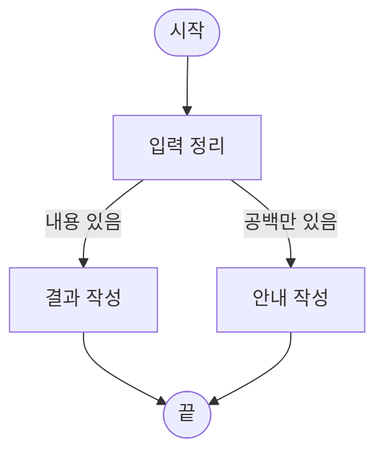

# LangGraph
{: .no_toc }



입력란에 `"  안녕하세요  "`를 넣으면 앞뒤 공백을 지우고 글자 수를 센다. 공백만 넣으면 글자 수 대신 안내를 보여 준다. 두 입력에 대한 결과는 정해져 있다. 이 작은 흐름에서 어떤 데이터가 다음 단계로 넘어가는지 확인하면, 승인 대기나 모델 호출을 붙일 때도 실행 경로를 읽을 수 있다.



**LangGraph**는 LLM 애플리케이션의 실행 흐름을 상태를 가진 그래프로 정의하고 실행하는 Python 라이브러리다. LangChain 팀이 만들었으며, 흐름을 노드·엣지·상태 세 가지로 표현한다. 분기와 반복, 중간 저장과 재개처럼 순서대로만 실행하는 체인으로는 다루기 어려운 흐름을 코드로 적을 수 있다.

**노드**는 입력 정리나 답변 작성 한 가지를 맡은 함수다. **엣지**는 그 함수가 끝난 뒤 실행할 위치를 연결하는 화살표다. **상태**는 노드가 읽고 갱신하는 작업 노트다. `StateGraph`로 이 셋을 정의하고, `compile()`로 실행할 수 있게 준비한다. [LangGraph Graph API](https://docs.langchain.com/oss/python/langgraph/graph-api)

## 첫 그래프에서 두 경로 실행하기

아래 예제를 Python 3.11.18, `langgraph` 1.2.24, `langgraph-checkpoint` 4.3.2에서 실행했다. Pydantic 예제에는 2.14.4를, 도구와 에이전트 예제에는 `langchain` 1.5.2와 `langchain-core` 1.8.5를 사용했다. 실습에 사용한 모델 응답은 코드에 정해 둔 값이다. 모델 API 키는 필요 없다.

```bash
uv venv --python 3.11 .venv
source .venv/bin/activate
uv pip install langgraph==1.2.24 langgraph-checkpoint==4.3.2
uv pip install langchain==1.5.2 langchain-core==1.8.5
uv pip install pydantic==2.14.4
```

아래를 `ex01_first.py`에 저장하고 `python ex01_first.py`로 실행한다. 예전에 실습한 [스트리밍과 체크포인트를 포함한 첫 그래프]({{ "/assets/examples/ai/first_graph.py" | relative_url }})도 내려받을 수 있다.

```python
from typing_extensions import TypedDict
from langgraph.graph import StateGraph, START, END


class TextState(TypedDict, total=False):
    original: str
    cleaned: str
    answer: str


def normalize(state: TextState):
    return {"cleaned": state["original"].strip()}


def choose_route(state: TextState):
    return "valid" if state["cleaned"] else "empty"


def write_answer(state: TextState):
    text = state["cleaned"]
    return {"answer": f"입력: {text} / 글자 수: {len(text)}"}


def explain_empty(state: TextState):
    return {"answer": "내용을 입력해 주세요."}


builder = StateGraph(TextState)
builder.add_node("normalize", normalize)
builder.add_node("write_answer", write_answer)
builder.add_node("explain_empty", explain_empty)

builder.add_edge(START, "normalize")
builder.add_conditional_edges(
    "normalize",
    choose_route,
    {"valid": "write_answer", "empty": "explain_empty"},
)
builder.add_edge("write_answer", END)
builder.add_edge("explain_empty", END)

app = builder.compile()

if __name__ == "__main__":
    for text in ["  안녕하세요  ", "   "]:
        print(app.invoke({"original": text}))
    print(app.get_graph().draw_mermaid())
```

```text
{'original': '  안녕하세요  ', 'cleaned': '안녕하세요', 'answer': '입력: 안녕하세요 / 글자 수: 5'}
{'original': '   ', 'cleaned': '', 'answer': '내용을 입력해 주세요.'}
---
config:
  flowchart:
    curve: linear
---
graph TD;
	__start__([<p>__start__</p>]):::first
	normalize(normalize)
	write_answer(write_answer)
	explain_empty(explain_empty)
	__end__([<p>__end__</p>]):::last
	__start__ --> normalize;
	normalize -. &nbsp;empty&nbsp; .-> explain_empty;
	normalize -. &nbsp;valid&nbsp; .-> write_answer;
	explain_empty --> __end__;
	write_answer --> __end__;
	classDef default fill:#f2f0ff,line-height:1.2
	classDef first fill-opacity:0
	classDef last fill:#bfb6fc
```

`invoke`에 입력한 `original`은 남는다. `normalize`는 `cleaned`만, 답을 만드는 노드는 `answer`만 반환한다. 그래프가 이 변경을 상태에 적용한다. `choose_route`가 반환하는 `valid`와 `empty`는 조건부 엣지에 등록한 키다. `get_graph().draw_mermaid()`는 이 연결을 Mermaid 텍스트로 내보낸다.

`total=False`는 타입을 선언할 때 일부 키가 비어 있어도 된다는 뜻이다. 외부 입력에 `original`이 있음을 실행 중에 검사하지는 않는다. 위의 글자 수는 Python `len`의 문자열 길이로, 조합 문자나 이모지를 화면에서 세는 방식과 다를 수 있다.

## 상태를 얼마나 공개할지 정하기

`input_schema`와 `output_schema`를 주면 호출자에게 보이는 상태 키를 고를 수 있다. 노드의 인자 타입으로 내부 노드끼리 주고받는 키도 선언할 수 있다. 다음을 `ex05_schemas.py`로 실행한다.

```python
from typing_extensions import TypedDict
from langgraph.graph import StateGraph, START, END


class In(TypedDict):
    question: str


class Out(TypedDict):
    answer: str


class Overall(In, Out):
    draft: str          # 안에서만 쓰는 메모


class Secret(TypedDict):
    hint: str           # 두 노드 사이 비밀 쪽지


def plan(state: In) -> Secret:
    return {"hint": state["question"].upper()}


def write(state: Secret) -> dict:
    return {"draft": f"[{state['hint']}]"}


def finish(state: Overall) -> Out:
    return {"answer": state["draft"] + " 끝"}


g = StateGraph(Overall, input_schema=In,
               output_schema=Out)
g.add_node("plan", plan)
g.add_node("write", write)
g.add_node("finish", finish)
g.add_edge(START, "plan")
g.add_edge("plan", "write")
g.add_edge("write", "finish")
g.add_edge("finish", END)
app = g.compile()

print(app.invoke({"question": "hi"}))
for u in app.stream({"question": "hi"},
                    stream_mode="updates"):
    print(u)
```

```text
{'answer': '[HI] 끝'}
{'plan': {'hint': 'HI'}}
{'write': {'draft': '[HI]'}}
{'finish': {'answer': '[HI] 끝'}}
```

`invoke` 결과에는 `answer`만 보인다. `stream_mode="updates"` 결과에는 내부의 `hint`와 `draft`도 나타난다. 이 차이를 확인한 뒤, 브라우저나 외부 호출자에게 어떤 스트림을 전달할지 정한다. 내부 스키마는 데이터 접근을 막는 보안 경계가 아니다. [Graph API의 여러 스키마](https://docs.langchain.com/oss/python/langgraph/graph-api#multiple-schemas)

### TypedDict, dataclass, Pydantic

`TypedDict`는 상태 키와 값의 타입을 알려 준다. 기본값을 선언할 때는 `dataclass`를 쓸 수 있다. 입력을 Pydantic 모델로 받는 노드에서는 Pydantic의 타입 변환과 검증을 쓸 수 있다. 다음을 `ex06_pydantic.py`로 실행한다.

```python
from dataclasses import dataclass, field
from pydantic import BaseModel
from langgraph.graph import StateGraph, START, END


class Order(BaseModel):
    item: str
    qty: int


def check(state: Order):
    print("노드 안 타입:", type(state).__name__,
          state.qty)
    return {"qty": state.qty + 1}


g = StateGraph(Order)
g.add_node("check", check)
g.add_edge(START, "check")
g.add_edge("check", END)
app = g.compile()

print(app.invoke({"item": "펜", "qty": "2"}))
try:
    app.invoke({"item": "펜", "qty": "두 개"})
except Exception as e:
    print(type(e).__name__)
    print(str(e).splitlines()[0])


@dataclass
class Cart:
    items: list[str] = field(default_factory=list)
    note: str = "없음"


def add(state: Cart):
    print("note =", state.note)
    return {"items": state.items + ["사과"]}


g2 = StateGraph(Cart)
g2.add_node("add", add)
g2.add_edge(START, "add")
g2.add_edge("add", END)
print(g2.compile().invoke({}))
```

```text
노드 안 타입: Order 2
{'item': '펜', 'qty': 3}
ValidationError
1 validation error for Order
note = 없음
{'items': ['사과']}
```

`"2"`는 정수 `2`로 변환돼 노드에 들어갔다. `"두 개"`에서는 `ValidationError`가 났다. `Cart`는 빈 입력에서도 `note`의 기본값을 읽었다. 이 동작은 `StateGraph`의 상태 스키마에 대한 것이다. `create_agent`의 사용자 정의 상태는 그 API에서 요구하는 `TypedDict`로 작성한다. [Graph API 상태 스키마](https://docs.langchain.com/oss/python/langgraph/graph-api#schema)

## 여러 갱신을 합치는 reducer

리듀서는 한 키의 기존 값과 새 값을 어떻게 합칠지 정하는 함수다. 설정이 없는 키는 순차 단계에서 새 값으로 덮어쓴다. 목록에 `operator.add`를 지정하면 이전 내용 뒤에 노드가 반환한 항목을 붙인다. 다음을 `ex02_reducers.py`로 실행한다.

```python
import operator
from typing import Annotated
from typing_extensions import TypedDict
from langgraph.graph import StateGraph, START, END
from langgraph.types import Overwrite


def keep_max(old: int, new: int) -> int:
    return max(old, new)


class State(TypedDict):
    last: str                               # 덮어쓰기
    logs: Annotated[list[str], operator.add]  # 이어 붙이기
    best: Annotated[int, keep_max]          # 직접 만든 규칙


def a(state: State):
    return {"last": "a", "logs": ["a"], "best": 7}


def b(state: State):
    return {"last": "b", "logs": ["b"], "best": 3}


def reset(state: State):
    return {"logs": Overwrite(["reset"])}


g = StateGraph(State)
g.add_node("a", a)
g.add_node("b", b)
g.add_node("reset", reset)
g.add_edge(START, "a")
g.add_edge("a", "b")
g.add_edge("b", END)
app = g.compile()
print(app.invoke({"last": "", "logs": ["start"], "best": 0}))

g2 = StateGraph(State)
g2.add_node("a", a)
g2.add_node("reset", reset)
g2.add_edge(START, "a")
g2.add_edge("a", "reset")
g2.add_edge("reset", END)
app2 = g2.compile()
print(app2.invoke({"last": "", "logs": ["start"], "best": 0}))
```

```text
{'last': 'b', 'logs': ['start', 'a', 'b'], 'best': 7}
{'last': 'a', 'logs': ['reset'], 'best': 7}
```

첫 실행에서 `last`는 마지막 값인 `b`가 됐다. `logs`는 이전 기록과 노드별 목록을 합쳤다. `best`에는 `keep_max`가 적용돼 큰 값인 `7`이 남았다. 두 번째 실행의 `Overwrite`는 목록 리듀서를 건너뛰고 `logs`를 교체한다.

다음을 `ex03_parallel.py`로 실행한다. 같은 실행 단계에서 두 노드가 `found`를 갱신하는 예다.

```python
import operator
from typing import Annotated
from typing_extensions import TypedDict
from langgraph.graph import StateGraph, START, END


class NoReducer(TypedDict):
    found: list[str]


class WithReducer(TypedDict):
    found: Annotated[list[str], operator.add]


def build(schema):
    g = StateGraph(schema)
    g.add_node("web", lambda s: {"found": ["웹"]})
    g.add_node("docs", lambda s: {"found": ["문서"]})
    g.add_edge(START, "web")   # START에서 두 갈래
    g.add_edge(START, "docs")
    g.add_edge("web", END)
    g.add_edge("docs", END)
    return g.compile()


try:
    build(NoReducer).invoke({"found": []})
except Exception as e:
    print(type(e).__name__)
    print(str(e).splitlines()[0])

print(build(WithReducer).invoke({"found": []}))
```

```text
InvalidUpdateError
At key 'found': Can receive only one value per step. Use an Annotated key to handle multiple values.
{'found': ['문서', '웹']}
```

두 노드의 출력을 한 번에 받는 키에는 어떤 결과를 보관할지 합치는 규칙이 필요하다. 이 예의 `found`에는 두 결과가 모두 필요하므로 리스트 리듀서를 붙인다. [Graph API 리듀서](https://docs.langchain.com/oss/python/langgraph/graph-api#reducers)

### 대화는 메시지 ID로 갱신하기

`MessagesState`에는 `messages` 키와 `add_messages` 리듀서가 들어 있다. 같은 ID의 메시지는 교체하고 새 ID는 추가한다. 다음을 `ex04_messages.py`로 실행해 ID가 `2`인 답을 바꿔 본다.

```python
from langchain_core.messages import AIMessage, HumanMessage
from langgraph.graph import MessagesState, StateGraph
from langgraph.graph import START, END
from langgraph.graph.message import add_messages

old = [HumanMessage("안녕", id="1"),
       AIMessage("반가워요", id="2")]
new = [AIMessage("반갑습니다!", id="2"),  # 같은 id → 교체
       HumanMessage("날씨 알려줘", id="3")]  # 새 id → 추가
for m in add_messages(old, new):
    print(m.type, m.id, m.content)

def bot(state: MessagesState):
    return {"messages": [("ai", "네, 말씀하세요.")]}

g = StateGraph(MessagesState)
g.add_node("bot", bot)
g.add_edge(START, "bot")
g.add_edge("bot", END)
out = g.compile().invoke(
    {"messages": [{"role": "user", "content": "저기요"}]})
for m in out["messages"]:
    print(type(m).__name__, repr(m.content))
```

```text
human 1 안녕
ai 2 반갑습니다!
human 3 날씨 알려줘
HumanMessage '저기요'
AIMessage '네, 말씀하세요.'
```

메시지 목록에 이전 답을 수정하거나 도구 메시지를 추가하는 그래프라면, 단순 리스트 합치기와 메시지 ID 기반 갱신이 어떻게 다른지 확인한다. [Graph API 메시지 상태](https://docs.langchain.com/oss/python/langgraph/graph-api#working-with-messages-in-graph-state)

## 노드에서 상태와 다음 목적지를 함께 지정하기

기존 상태를 보고 갈 곳만 고른다면 `add_conditional_edges`에 판단 함수를 등록한다. 같은 노드에서 상태를 갱신하면서 다음 목적지도 지정해야 할 때는 `Command(update=..., goto=...)`를 반환할 수 있다.

다음을 `ex07_command.py`로 실행한다. 금액이 100 이상인 경우 담당자 확인으로 보낸다.

```python
import operator
from typing import Annotated, Literal
from typing_extensions import TypedDict
from langgraph.graph import StateGraph, START, END
from langgraph.types import Command


class State(TypedDict):
    amount: int
    path: Annotated[list[str], operator.add]


def review(state: State) -> Command[
        Literal["auto_ok", "manager"]]:
    big = state["amount"] >= 100
    return Command(
        update={"path": ["review"]},
        goto="manager" if big else "auto_ok",
    )


def auto_ok(state: State):
    return {"path": ["auto_ok"]}


def manager(state: State):
    return {"path": ["manager"]}


g = StateGraph(State)
g.add_node("review", review)
g.add_node("auto_ok", auto_ok)
g.add_node("manager", manager)
g.add_edge(START, "review")
g.add_edge("auto_ok", END)
g.add_edge("manager", END)
app = g.compile()
for n in [30, 250]:
    r = app.invoke({"amount": n, "path": []})
    print(n, r["path"])

# 함정: Command와 일반 엣지를 같은 노드에 섞기
g.add_edge("review", "auto_ok")
bad = g.compile()
print("섞음", bad.invoke({"amount": 250, "path": []})["path"])
print(app.get_graph().draw_mermaid())
```

```text
30 ['review', 'auto_ok']
250 ['review', 'manager']
섞음 ['review', 'auto_ok', 'manager']
---
config:
  flowchart:
    curve: linear
---
graph TD;
	__start__([<p>__start__</p>]):::first
	review(review)
	auto_ok(auto_ok)
	manager(manager)
	__end__([<p>__end__</p>]):::last
	__start__ --> review;
	review -.-> auto_ok;
	review -.-> manager;
	auto_ok --> __end__;
	manager --> __end__;
	classDef default fill:#f2f0ff,line-height:1.2
	classDef first fill-opacity:0
	classDef last fill:#bfb6fc
```

`Command[Literal["auto_ok", "manager"]]`는 가능한 목적지를 알린다. 이 타입을 바탕으로 `draw_mermaid()`로 봤을 때 두 경로가 드러난다. 두 번째 그래프에서는 `review`에 일반 엣지까지 달아서 `auto_ok`와 `manager`가 모두 실행됐다. 이미 컴파일한 그래프를 수정할 때는 경고가 나오며, 이 예제처럼 새로 컴파일한 객체에 변경이 반영된다. [Graph API Command](https://docs.langchain.com/oss/python/langgraph/graph-api#command)

## 입력 수만큼 병렬 작업 만들기

`Send`는 특정 노드에 그 실행만의 입력을 건넨다. 문단 수가 실행할 때 정해져도, 문단마다 같은 요약 함수를 부를 수 있다. 다음을 `ex08_send.py`로 실행한다.

```python
import operator
from typing import Annotated
from typing_extensions import TypedDict
from langgraph.graph import StateGraph, START, END
from langgraph.types import Send


class Overall(TypedDict):
    docs: list[str]
    summaries: Annotated[list[str], operator.add]
    report: str


class One(TypedDict):       # 일꾼 하나가 받는 상자
    doc: str


def fan_out(state: Overall):
    return [Send("summarize", {"doc": d})
            for d in state["docs"]]


def summarize(state: One):
    return {"summaries": [state["doc"][:3]]}


def combine(state: Overall):
    return {"report": " | ".join(state["summaries"])}


g = StateGraph(Overall)
g.add_node("summarize", summarize)
g.add_node("combine", combine)
g.add_conditional_edges(START, fan_out, ["summarize"])
g.add_edge("summarize", "combine")
g.add_edge("combine", END)
app = g.compile()

docs = ["사과는 빨갛다", "바나나는 노랗다", "포도는 보라색"]
for u in app.stream({"docs": docs},
                    stream_mode="updates"):
    print(u)
```

```text
{'summarize': {'summaries': ['사과는']}}
{'summarize': {'summaries': ['바나나']}}
{'summarize': {'summaries': ['포도는']}}
{'combine': {'report': '사과는 | 바나나 | 포도는'}}
```

각 호출의 `summarize` 노드는 자기 문단만 받는다. 노드가 반환한 `summaries`는 리듀서로 합쳐지고, `combine`이 합쳐진 결과를 읽는다. 실무에서 결과를 원문 순서로 보여 줘야 한다면 각 작업에 문단 번호를 넣고 결과를 번호로 정렬한다. [Graph API Send](https://docs.langchain.com/oss/python/langgraph/graph-api#send)

## 스트리밍에서 상태와 모델 조각 보기

| 모드 | 관찰하는 값 |
| --- | --- |
| `values` | 각 단계가 끝난 뒤의 상태 전체 |
| `updates` | 단계별 노드 이름과 변경한 키 |
| `custom` | 노드가 스트림에 직접 보낸 진행 상황 |
| `messages` | 모델 응답 조각과 호출을 식별하는 메타데이터 |
| `debug` | 작업 시작과 결과 등 실행 디버깅 정보 |

아래 `ex09_stream.py`는 같은 그래프에 모드를 바꿔 적용한다. 여러 모드를 함께 요청했을 때 기본 v1 형식은 모드와 데이터의 튜플을 반환한다. `version="v2"`의 스트림 항목은 `type`, `ns`, `data` 키를 갖는다. [스트리밍 문서](https://docs.langchain.com/oss/python/langgraph/streaming)

```python
from typing_extensions import TypedDict
from langgraph.graph import StateGraph, START, END
from langgraph.config import get_stream_writer


class S(TypedDict, total=False):
    n: int
    msg: str


def step1(state: S):
    w = get_stream_writer()
    w({"진행": "1/2 계산 중"})
    return {"n": state["n"] * 10}


def step2(state: S):
    return {"msg": f"결과 {state['n']}"}


g = StateGraph(S)
g.add_node("step1", step1)
g.add_node("step2", step2)
g.add_edge(START, "step1")
g.add_edge("step1", "step2")
g.add_edge("step2", END)
app = g.compile()

for mode in ["values", "updates", "custom"]:
    print(f"--- {mode}")
    for c in app.stream({"n": 4}, stream_mode=mode):
        print(c)

print("--- 여러 모드 (v1)")
for c in app.stream({"n": 4},
                    stream_mode=["updates", "custom"]):
    print(c)

print("--- v2")
for c in app.stream({"n": 4}, stream_mode="updates",
                    version="v2"):
    print(c)

print("--- debug (type만)")
for c in app.stream({"n": 4}, stream_mode="debug"):
    print(c["step"], c["type"], c["payload"]["name"]
          if "name" in c["payload"] else "")
```

```text
--- values
{'n': 4}
{'n': 40}
{'n': 40, 'msg': '결과 40'}
--- updates
{'step1': {'n': 40}}
{'step2': {'msg': '결과 40'}}
--- custom
{'진행': '1/2 계산 중'}
--- 여러 모드 (v1)
('custom', {'진행': '1/2 계산 중'})
('updates', {'step1': {'n': 40}})
('updates', {'step2': {'msg': '결과 40'}})
--- v2
{'type': 'updates', 'ns': (), 'data': {'step1': {'n': 40}}}
{'type': 'updates', 'ns': (), 'data': {'step2': {'msg': '결과 40'}}}
--- debug (type만)
1 task step1
1 task_result step1
2 task step2
2 task_result step2
```

다음을 `ex11_msgstream.py`로 실행하면 `messages` 모드에서 가짜 모델이 나눠 준 문자열과 이를 만든 노드 `chat`을 볼 수 있다.

```python
from langchain_core.language_models.fake_chat_models \
    import GenericFakeChatModel
from langgraph.graph import MessagesState, StateGraph
from langgraph.graph import START, END

model = GenericFakeChatModel(
    messages=iter(["LangGraph는 상태 그래프입니다"]))


def chat(state: MessagesState):
    return {"messages": [model.invoke(state["messages"])]}


g = StateGraph(MessagesState)
g.add_node("chat", chat)
g.add_edge(START, "chat")
g.add_edge("chat", END)
app = g.compile()

for chunk, meta in app.stream(
        {"messages": [("user", "한 줄 설명")]},
        stream_mode="messages"):
    print(repr(chunk.content), meta["langgraph_node"])
```

```text
'LangGraph는' chat
' ' chat
'상태' chat
' ' chat
'그래프입니다' chat
```

상태 전체가 필요한 화면에는 `values`를, 진행 로그에는 `updates`를 쓸 수 있다. 두 종류를 함께 받는 소비자는 `type`으로 먼저 나눠 처리하면 각 이벤트의 데이터 모양을 유지할 수 있다.

## 반복에 종료 조건과 상한 두기

`context_schema`는 실행마다 주고 싶은 설정의 타입을 선언한다. 노드와 분기 함수는 `Runtime`의 `context`에서 그 값을 읽는다. `recursion_limit`는 그래프가 끝에 닿지 못했을 때 실행 단계 수를 제한하는 설정이다. 다음을 `ex12_limits.py`로 실행한다.

```python
from dataclasses import dataclass
from typing_extensions import TypedDict
from langgraph.graph import StateGraph, START, END
from langgraph.errors import GraphRecursionError
from langgraph.managed import RemainingSteps
from langgraph.runtime import Runtime


class S(TypedDict):
    tries: int
    left: RemainingSteps   # 남은 단계 수 (자동으로 채워짐)


@dataclass
class Ctx:
    target: int = 99       # 실행마다 바꾸는 설정


def attempt(state: S, runtime: Runtime[Ctx]):
    return {"tries": state["tries"] + 1}


def route(state: S, runtime: Runtime[Ctx]):
    if state["tries"] >= runtime.context.target:
        return "done"
    if state["left"] <= 2:
        return "give_up"
    return "again"


g = StateGraph(S, context_schema=Ctx)
g.add_node("attempt", attempt)
g.add_node("give_up", lambda s: {"tries": -1})
g.add_edge(START, "attempt")
g.add_conditional_edges("attempt", route, {
    "again": "attempt", "done": END,
    "give_up": "give_up"})
g.add_edge("give_up", END)
app = g.compile()

print(app.invoke({"tries": 0}, context={"target": 3}))
print(app.invoke({"tries": 0}, {"recursion_limit": 6},
                 context=Ctx()))
try:
    app.invoke({"tries": 0})   # context를 빠뜨림
except AttributeError as e:
    print("AttributeError:", e)

# 안전장치 없이 돌기만 하는 그래프
g2 = StateGraph(S)
g2.add_node("spin", lambda s: {"tries": s["tries"] + 1})
g2.add_edge(START, "spin")
g2.add_edge("spin", "spin")
try:
    g2.compile().invoke({"tries": 0},
                        {"recursion_limit": 5})
except GraphRecursionError as e:
    print("GraphRecursionError:",
          str(e).splitlines()[0])
```

```text
{'tries': 3}
{'tries': -1}
AttributeError: 'NoneType' object has no attribute 'target'
GraphRecursionError: Recursion limit of 5 reached without hitting a stop condition. You can increase the limit by setting the `recursion_limit` config key.
```

첫 실행은 `target=3`에서 정상 종료한다. 두 번째 실행은 남은 단계 수 `RemainingSteps`를 보고 포기 경로로 간다. `Ctx`의 기본값을 쓰려면 이 예제처럼 `context=Ctx()`를 전달한다. 컨텍스트를 아예 주지 않은 실행은 `runtime.context.target`에서 오류가 났다. 마지막 그래프는 반복에서 빠져나갈 길이 없어 `GraphRecursionError`로 끝났다.

{: .tip }
실무에서는 상태에 성공 여부와 시도 횟수를 두고 정상 종료, 처리 포기, 사람 확인을 분기한다. 그래프 실행 상한은 그 분기 밖에서 실행이 계속되는 경우를 막는다. 모델 호출 시간과 외부 요청 수는 별도로 제한한다.

## 체크포인트로 상태를 조회하고 다시 실행하기

체크포인트는 특정 실행 단계의 상태 기록이다. 체크포인터와 함께 컴파일한 그래프는 `thread_id`별로 상태를 보관한다. 다음을 `ex13_persist.py`로 실행한다.

```python
import operator
from typing import Annotated
from typing_extensions import TypedDict
from langgraph.graph import StateGraph, START, END
from langgraph.checkpoint.memory import InMemorySaver


class S(TypedDict, total=False):
    topic: str
    joke: str
    log: Annotated[list[str], operator.add]


def pick(state: S):
    return {"topic": "양말", "log": ["pick"]}


def write(state: S):
    return {"joke": f"{state['topic']}이 사라졌다",
            "log": ["write"]}


g = StateGraph(S)
g.add_node("pick", pick)
g.add_node("write", write)
g.add_edge(START, "pick")
g.add_edge("pick", "write")
g.add_edge("write", END)
app = g.compile(checkpointer=InMemorySaver())

cfg = {"configurable": {"thread_id": "t1"}}
print(app.invoke({"log": []}, cfg))

snap = app.get_state(cfg)
print("next:", snap.next)
print("step:", snap.metadata["step"])

print("--- history (최신부터)")
hist = list(app.get_state_history(cfg))
for h in hist:
    print(h.metadata["step"], h.next,
          h.metadata["source"], h.values.get("topic"))

before = next(h for h in hist if h.next == ("write",))
print("--- replay")
print(app.invoke(None, before.config))
print("--- fork")
fork = app.update_state(before.config,
                        {"topic": "우산"})
print(app.invoke(None, fork))
print("기록 수:", len(list(app.get_state_history(cfg))))
print("다른 thread:", app.get_state(
    {"configurable": {"thread_id": "t2"}}).values)
for h in app.get_state_history(cfg):
    print(h.metadata["step"], h.next,
          h.metadata["source"], h.values.get("joke"))
```

```text
{'topic': '양말', 'joke': '양말이 사라졌다', 'log': ['pick', 'write']}
next: ()
step: 2
--- history (최신부터)
2 () loop 양말
1 ('write',) loop 양말
0 ('pick',) loop None
-1 ('__start__',) input None
--- replay
{'topic': '양말', 'joke': '양말이 사라졌다', 'log': ['pick', 'write']}
--- fork
{'topic': '우산', 'joke': '우산이 사라졌다', 'log': ['pick', 'write']}
기록 수: 8
다른 thread: {}
3 () loop 우산이 사라졌다
2 ('write',) update None
3 () loop 양말이 사라졌다
2 ('write',) fork None
2 () loop 양말이 사라졌다
1 ('write',) loop None
0 ('pick',) loop None
-1 ('__start__',) input None
```

| API | 하는 일 |
| --- | --- |
| `get_state(config)` | 현재 스냅샷의 값 `values`와 대기 노드 `next`를 확인한다. |
| `get_state_history(config)` | 같은 스레드 안에서 저장된 스냅샷을 읽는다. |
| `invoke(None, snapshot.config)` | 선택한 체크포인트 뒤의 실행을 다시 수행한다. |
| `update_state(snapshot.config, values)` | 상태를 바꾼 체크포인트를 새로 만들고 그 설정을 반환한다. |

`next == ("write",)`인 체크포인트는 주제는 골랐고 농담은 아직 안 쓴 시점이다. 코드가 그 시점에서 다시 실행하면 `write`가 동작한다. 상태의 주제를 `우산`으로 바꾼 체크포인트에서는 다른 농담이 나왔다. 바꾸기 전의 기록도 그대로 조회된다. 모델 호출이나 외부 요청이 `write` 안에 있으면 다시 실행될 수 있으므로, 실제 부수 효과가 있는 노드에는 재실행을 고려한 설계가 필요하다. [체크포인터 문서](https://docs.langchain.com/oss/python/langgraph/checkpointers), [체크포인트 재실행과 분기](https://docs.langchain.com/oss/python/langgraph/use-time-travel)

### 프로세스를 다시 시작해도 기록 남기기

`InMemorySaver`는 현재 프로세스에 저장한다. 로컬 파일로 보관하는 예제는 `SqliteSaver`를 쓴다. 다음 패키지를 추가하고 새 작업 폴더에 아래 코드를 `ex14_sqlite.py`로 저장한다. 각 실행이 같은 폴더의 `chat.db`를 연다.

```bash
uv pip install langgraph-checkpoint-sqlite==3.1.3
```

```python
import sys
from langgraph.checkpoint.sqlite import SqliteSaver
from langgraph.graph import MessagesState, StateGraph
from langgraph.graph import START, END


def echo(state: MessagesState):
    n = len(state["messages"])
    return {"messages": [("ai", f"지금까지 {n}개")]}


g = StateGraph(MessagesState)
g.add_node("echo", echo)
g.add_edge(START, "echo")
g.add_edge("echo", END)

with SqliteSaver.from_conn_string("chat.db") as saver:
    app = g.compile(checkpointer=saver)
    cfg = {"configurable": {"thread_id": "user-7"}}
    out = app.invoke(
        {"messages": [("user", sys.argv[1])]}, cfg)
    print(out["messages"][-1].content)
```

```bash
python ex14_sqlite.py 첫번째
python ex14_sqlite.py 두번째
```

```text
지금까지 1개
지금까지 3개
```

두 번째 프로세스는 앞서 들어온 사용자 메시지와 답변을 새 메시지 앞에 포함한다. 이전 실행이 이미 같은 DB에 기록됐다면 출력의 개수도 그만큼 커진다.

### 업무 승인에서 멈췄다가 이어 가기

`interrupt(payload)`는 노드를 멈추고 외부 호출자에게 확인할 데이터를 돌려준다. 같은 `thread_id`에 `Command(resume=decision)`를 주면 `interrupt` 호출 위치에서 그 결정 값을 읽을 수 있다. `ex15_interrupt.py`에서 보내기 상태만 바꾸는 모의 이메일 승인을 실행한다.

```python
from typing_extensions import TypedDict
from langgraph.graph import StateGraph, START, END
from langgraph.checkpoint.memory import InMemorySaver
from langgraph.types import Command, interrupt


class S(TypedDict, total=False):
    email: str
    status: str


def draft(state: S):
    return {"email": "내일 회의는 10시입니다."}


def approve(state: S):
    print("  (approve 노드 시작)")
    answer = interrupt({"질문": "보낼까요?",
                        "초안": state["email"]})
    print("  (사람 답:", answer, ")")
    if answer["ok"]:
        return {"status": "sent"}
    return {"status": "rejected"}


g = StateGraph(S)
g.add_node("draft", draft)
g.add_node("approve", approve)
g.add_edge(START, "draft")
g.add_edge("draft", "approve")
g.add_edge("approve", END)
app = g.compile(checkpointer=InMemorySaver())

cfg = {"configurable": {"thread_id": "mail-1"}}
print("1) 첫 실행")
r = app.invoke({}, cfg)
print(r["__interrupt__"])
print("next:", app.get_state(cfg).next)

print("2) 재개")
r = app.invoke(Command(resume={"ok": True}), cfg)
print(r)

print("3) 체크포인터 없이")
plain = g.compile()
r = plain.invoke({})
print("멈춤 표시:", "__interrupt__" in r)
try:
    plain.invoke(Command(resume={"ok": True}))
except RuntimeError as e:
    print("RuntimeError:", e)
```

```text
1) 첫 실행
  (approve 노드 시작)
[Interrupt(value={'질문': '보낼까요?', '초안': '내일 회의는 10시입니다.'}, id='36342308f74c19bf6b96a85cf24a84af', response_schema=None)]
next: ('approve',)
2) 재개
  (approve 노드 시작)
  (사람 답: {'ok': True} )
{'email': '내일 회의는 10시입니다.', 'status': 'sent'}
3) 체크포인터 없이
  (approve 노드 시작)
멈춤 표시: True
RuntimeError: Cannot use Command(resume=...) without checkpointer
```

`"(approve 노드 시작)"`이 두 번 찍혔다. 재개할 때 현재 노드의 시작부터 코드가 다시 실행됐기 때문이다. 노드 안에서 승인 전에 데이터를 쓰면 재개 때 그 쓰기가 반복될 수 있다. 승인을 받은 뒤에 외부 작업을 수행하고, 네트워크 재시도에도 같은 요청이 중복 처리되지 않도록 요청 ID를 사용한다. 중단 ID는 실행마다 다를 수 있다. [LangGraph 중단과 재개](https://docs.langchain.com/oss/python/langgraph/interrupts)

개발 중 특정 노드 앞뒤의 상태를 확인할 때는 `compile(interrupt_before=...)` 또는 `interrupt_after`로 중단점을 지정할 수 있다. 다음 `ex16_breakpoint.py`는 `b` 앞에서 멈춘 뒤 `x`를 바꾸고 `invoke(None, cfg)`로 이어 간다.

```python
from typing_extensions import TypedDict
from langgraph.graph import StateGraph, START, END
from langgraph.checkpoint.memory import InMemorySaver


class S(TypedDict):
    x: int


g = StateGraph(S)
g.add_node("a", lambda s: {"x": s["x"] + 1})
g.add_node("b", lambda s: {"x": s["x"] * 10})
g.add_edge(START, "a")
g.add_edge("a", "b")
g.add_edge("b", END)
app = g.compile(checkpointer=InMemorySaver(),
                interrupt_before=["b"])

cfg = {"configurable": {"thread_id": "dbg"}}
print(app.invoke({"x": 1}, cfg))
print("next:", app.get_state(cfg).next)
app.update_state(cfg, {"x": 5})   # 값을 고쳐 보고
print(app.invoke(None, cfg))      # None으로 이어 가기
```

```text
{'x': 2}
next: ('b',)
{'x': 50}
```

## 여러 대화에서 쓸 값을 Store에 넣기

체크포인터는 한 스레드의 실행 상태를 저장한다. Store는 여러 스레드에서 쓸 데이터를 별도의 이름 공간에 넣을 수 있다. 이름 공간은 `("u1", "prefs")`처럼 여러 값으로 이루어진 분류 경로이고, 그 안의 항목은 `lang`, `tone`처럼 키로 찾는다. 다음을 `ex17_store.py`로 실행한다.

```python
from dataclasses import dataclass
from langgraph.checkpoint.memory import InMemorySaver
from langgraph.graph import MessagesState, StateGraph
from langgraph.graph import START, END
from langgraph.runtime import Runtime
from langgraph.store.memory import InMemoryStore

store = InMemoryStore()
store.put(("u1", "prefs"), "lang", {"v": "Python"})
store.put(("u1", "prefs"), "tone", {"v": "짧게"})
store.put(("u2", "prefs"), "lang", {"v": "Swift"})
for it in store.search(("u1", "prefs")):
    print(it.namespace, it.key, it.value)
print(store.get(("u2", "prefs"), "lang").value)


@dataclass
class Ctx:
    user_id: str


def reply(state: MessagesState, runtime: Runtime[Ctx]):
    ns = (runtime.context.user_id, "prefs")
    text = state["messages"][-1].content
    if text.startswith("기억:"):
        runtime.store.put(ns, "note",
                          {"v": text[3:].strip()})
        return {"messages": [("ai", "기억했어요")]}
    got = runtime.store.get(ns, "note")
    memo = got.value["v"] if got else "없음"
    return {"messages": [("ai", f"메모: {memo}")]}


g = StateGraph(MessagesState, context_schema=Ctx)
g.add_node("reply", reply)
g.add_edge(START, "reply")
g.add_edge("reply", END)
app = g.compile(checkpointer=InMemorySaver(),
                store=store)


def ask(thread, user, text):
    cfg = {"configurable": {"thread_id": thread}}
    out = app.invoke({"messages": [("user", text)]},
                     cfg, context=Ctx(user))
    n = len(out["messages"])
    print(thread, user, "→", out["messages"][-1].content,
          f"(이 thread 메시지 {n}개)")


ask("chat-A", "u1", "기억: 금요일 배포")
ask("chat-B", "u1", "내 메모 뭐였지?")   # 다른 thread
ask("chat-C", "u2", "내 메모 뭐였지?")   # 다른 사용자
```

```text
('u1', 'prefs') lang {'v': 'Python'}
('u1', 'prefs') tone {'v': '짧게'}
{'v': 'Swift'}
chat-A u1 → 기억했어요 (이 thread 메시지 2개)
chat-B u1 → 메모: 금요일 배포 (이 thread 메시지 2개)
chat-C u2 → 메모: 없음 (이 thread 메시지 2개)
```

`chat-A`와 `chat-B`는 다른 대화인데도 같은 사용자 `u1`의 메모를 읽었다. `u2`는 별도 이름 공간을 사용해 그 메모를 읽지 않았다. 서비스에서는 로그인으로 확인한 사용자 식별자로 이 경로를 구성한다. 예제의 `InMemoryStore`는 프로세스를 종료하면 값이 사라진다. [LangGraph Store 문서](https://docs.langchain.com/oss/python/langgraph/stores)

## 하위 그래프를 노드로 연결하기

하위 그래프는 바깥 그래프의 한 노드에서 실행하는 그래프다. 두 그래프가 같은 키를 쓰면 컴파일한 하위 그래프를 노드로 직접 연결할 수 있다. 키가 다르면 바깥 노드 함수에서 입력과 출력을 변환한다. 다음을 `ex18_subgraph.py`로 실행한다.

```python
from typing_extensions import TypedDict
from langgraph.graph import StateGraph, START, END


# 1) 부모와 같은 키(text)를 쓰는 서브그래프
class Shared(TypedDict, total=False):
    text: str
    sub_note: str          # 서브그래프 안에서만 쓰는 키


def clean(s: Shared):
    return {"text": s["text"].strip(), "sub_note": "ok"}


def shout(s: Shared):
    return {"text": s["text"].upper()}


sb = StateGraph(Shared)
sb.add_node("clean", clean)
sb.add_node("shout", shout)
sb.add_edge(START, "clean")
sb.add_edge("clean", "shout")
sb.add_edge("shout", END)
sub = sb.compile()


class Parent(TypedDict):
    text: str


pb = StateGraph(Parent)
pb.add_node("prep", sub)        # 컴파일된 그래프 = 노드
pb.add_node("done", lambda s: {"text": s["text"] + "!"})
pb.add_edge(START, "prep")
pb.add_edge("prep", "done")
pb.add_edge("done", END)
parent = pb.compile()
print(parent.invoke({"text": "  hi  "}))

for ns, upd in parent.stream({"text": " hi "},
                             stream_mode="updates",
                             subgraphs=True):
    print(ns, upd)


# 2) 키가 다르면 노드 함수 안에서 바꿔 끼운다
class Order(TypedDict):
    order_text: str
    shipped: str


def call_sub(s: Order):
    out = sub.invoke({"text": s["order_text"]})
    return {"shipped": out["text"]}


ob = StateGraph(Order)
ob.add_node("call_sub", call_sub)
ob.add_edge(START, "call_sub")
ob.add_edge("call_sub", END)
print(ob.compile().invoke({"order_text": " book "}))
```

```text
{'text': 'HI!'}
('prep:2ee4be34-25ed-af33-4d5f-59e784cf7937',) {'clean': {'text': 'hi', 'sub_note': 'ok'}}
('prep:2ee4be34-25ed-af33-4d5f-59e784cf7937',) {'shout': {'text': 'HI'}}
() {'prep': {'text': 'HI'}}
() {'done': {'text': 'HI!'}}
{'order_text': ' book ', 'shipped': 'BOOK'}
```

`subgraphs=True`에서 `prep:...` 이름 공간은 하위 그래프에서 온 항목을 가리킨다. 뒤의 ID는 실행에 따라 달라진다. `()`는 바깥 그래프 항목이다. 부모와 공유하지 않은 `sub_note`는 내부 업데이트 스트림에는 나타나지만 부모의 최종 값에는 없다. [LangGraph 하위 그래프](https://docs.langchain.com/oss/python/langgraph/use-subgraphs)

## 비동기 노드, 시간 제한, 재시도

네트워크 호출에 시간이 걸리는 노드는 `async def`로 작성할 수 있다. 비동기 그래프는 `ainvoke`나 `astream`으로 실행한다. 다음 `ex22_async.py`의 두 노드는 외부 호출 대신 `asyncio.sleep`으로 기다린다. 출력 순서와 대기 시간은 실행마다 달라질 수 있다.

```python
import asyncio
import time
from typing_extensions import TypedDict
from langgraph.errors import NodeTimeoutError
from langgraph.graph import StateGraph, START, END


class S(TypedDict, total=False):
    a: str
    b: str


async def fetch_a(state: S):
    await asyncio.sleep(0.5)
    return {"a": "A"}


async def fetch_b(state: S):
    await asyncio.sleep(0.5)
    return {"b": "B"}


async def too_slow(state: S):
    await asyncio.sleep(2)
    return {"a": "늦음"}


g = StateGraph(S)
g.add_node("fetch_a", fetch_a)
g.add_node("fetch_b", fetch_b)
g.add_edge(START, "fetch_a")
g.add_edge(START, "fetch_b")
app = g.compile()

g2 = StateGraph(S)
g2.add_node("too_slow", too_slow, timeout=0.3)
g2.add_edge(START, "too_slow")
slow = g2.compile()


async def main():
    t = time.perf_counter()
    async for u in app.astream({}, stream_mode="updates"):
        print(u)
    print(f"걸린 시간 {time.perf_counter() - t:.1f}초")
    try:
        await slow.ainvoke({})
    except NodeTimeoutError as e:
        print("NodeTimeoutError:", e.node, e.kind,
              e.run_timeout)

asyncio.run(main())
```

```text
{'fetch_a': {'a': 'A'}}
{'fetch_b': {'b': 'B'}}
걸린 시간 0.5초
NodeTimeoutError: too_slow run 0.3
```

`too_slow`는 실행 제한 0.3초 이내에 완료하지 못해 `NodeTimeoutError`로 끝났다. 이 버전에서는 동기 노드에 같은 방식의 `timeout`을 설정하면 컴파일할 때 거부한다.

다음 `ex21_retry.py`는 일시적으로 연결이 끊긴 작업을 두 번 더 실행한다. 계속 실패한 작업은 `error_handler`가 대체 결과를 작성한다.

```python
from typing_extensions import TypedDict
from langgraph.errors import NodeError
from langgraph.graph import StateGraph, START, END
from langgraph.runtime import Runtime
from langgraph.types import Command, RetryPolicy


class S(TypedDict, total=False):
    result: str


def flaky(state: S, runtime: Runtime):
    n = runtime.execution_info.node_attempt
    print("  시도", n)
    if n < 3:
        raise ConnectionError("잠깐 끊김")
    return {"result": f"{n}번째에 성공"}


def broken(state: S):
    raise ConnectionError("계속 끊김")


def on_error(state: S, error: NodeError) -> Command:
    return Command(
        update={"result": f"대체 처리: {error.error}"},
        goto=END)


fast = RetryPolicy(max_attempts=3, initial_interval=0.01,
                   retry_on=ConnectionError)

g = StateGraph(S)
g.add_node("flaky", flaky, retry_policy=fast)
g.add_edge(START, "flaky")
g.add_edge("flaky", END)
print(g.compile().invoke({}))

g2 = StateGraph(S)
g2.add_node("broken", broken, retry_policy=fast,
            error_handler=on_error)
g2.add_edge(START, "broken")
g2.add_edge("broken", END)
print(g2.compile().invoke({}))

g3 = StateGraph(S)
g3.add_node("slow", lambda s: {}, timeout=5)
g3.add_edge(START, "slow")
try:
    g3.compile()
except Exception as e:
    print(type(e).__name__, str(e)[:70])
```

```text
시도 1
  시도 2
  시도 3
{'result': '3번째에 성공'}
{'result': '대체 처리: 계속 끊김'}
ValueError Node timeouts are only supported for async nodes because sync Python e
```

`max_attempts=3`은 최초 시도를 포함한다. 그래프 전체의 종료 조건이나 요청의 총 대기 시간도 별도로 정한다. 외부 서비스 호출의 타임아웃이 지나도 그 서비스가 실제 작업을 실행했을 수 있으므로, 같은 요청을 재시도할 때는 그 결과를 조회하거나 중복 방지 키를 사용한다. [LangGraph 오류 처리 문서](https://docs.langchain.com/oss/python/langgraph/fault-tolerance)

## 일반 Python 흐름에 저장과 재개를 붙이기

기존 코드가 이미 함수 호출 순서와 조건으로 표현돼 있다면 Functional API로 실행 단계를 작성할 수 있다. `@entrypoint`가 호출 가능한 흐름을 만들고, `@task`가 개별 작업을 감싼다. 다음 `ex19_functional.py`는 모의 글 작성 결과를 보관한 뒤 승인을 기다린다.

```python
from langgraph.checkpoint.memory import InMemorySaver
from langgraph.func import entrypoint, task
from langgraph.types import Command, interrupt

calls = {"n": 0}


@task
def write_essay(topic: str) -> str:
    calls["n"] += 1          # 비싼 작업이라고 생각하자
    return f"{topic}에 관한 글"


@entrypoint(checkpointer=InMemorySaver())
def workflow(topic: str) -> dict:
    essay = write_essay(topic).result()
    ok = interrupt({"검토": essay})
    return {"essay": essay, "approved": ok}


cfg = {"configurable": {"thread_id": "f1"}}
for part in workflow.stream("고양이", cfg):
    print(part)
print("task 실행 횟수:", calls["n"])
print(workflow.invoke(Command(resume=True), cfg))
print("task 실행 횟수:", calls["n"])
```

```text
{'write_essay': '고양이에 관한 글'}
{'__interrupt__': (Interrupt(value={'검토': '고양이에 관한 글'}, id='a40536e96956893189235a386d73c586', response_schema=None),)}
task 실행 횟수: 1
{'essay': '고양이에 관한 글', 'approved': True}
task 실행 횟수: 1
```

승인 후 `entrypoint`는 시작부터 다시 진행한다. 이미 완료해 저장한 `write_essay`의 결과를 가져오므로 예제의 호출 횟수는 1이다. 부수 효과가 있는 task가 시작된 뒤 성공 결과를 저장하기 전에 실행이 끊기면 다시 실행될 수 있다. 저장하는 시점도 선택할 수 있다. `durability="sync"`는 다음 단계로 넘어가기 전에 변경을 기록하고, `"async"`는 다음 단계가 진행되는 동안 기록한다. `"exit"`는 실행이 끝날 때 남긴다. [Functional API](https://docs.langchain.com/oss/python/langgraph/functional-api), [지속 실행과 저장 시점](https://docs.langchain.com/oss/python/langgraph/fault-tolerance)

## 모델과 도구 노드 연결하기

`ToolNode`는 모델 메시지에 담긴 도구 호출을 실행하고 결과 메시지를 만든다. `tools_condition`은 마지막 모델 메시지에 도구 호출이 있는지 보고 도구 노드나 종료로 보낸다. 다음을 `ex10_agent.py`로 실행한다. 모델의 두 답은 코드에 들어 있으며, 곱셈 함수는 실제로 실행된다.

```python
from langchain_core.language_models.fake_chat_models \
    import GenericFakeChatModel
from langchain_core.messages import AIMessage
from langchain_core.tools import tool
from langgraph.graph import MessagesState, StateGraph
from langgraph.graph import START
from langgraph.prebuilt import ToolNode, tools_condition


@tool
def multiply(a: int, b: int) -> int:
    """두 정수를 곱한다."""
    return a * b


class FakeToolModel(GenericFakeChatModel):
    def bind_tools(self, tools, **kwargs):
        return self   # 정해 둔 답만 내므로 도구 정보는 무시


# 모델이 낼 답을 순서대로 정해 둔다
script = iter([
    AIMessage("", tool_calls=[{
        "name": "multiply", "args": {"a": 12, "b": 7},
        "id": "call_1"}]),
    AIMessage("12 곱하기 7은 84입니다."),
])
model = FakeToolModel(messages=script)
model = model.bind_tools([multiply])


def agent(state: MessagesState):
    return {"messages": [model.invoke(state["messages"])]}


g = StateGraph(MessagesState)
g.add_node("agent", agent)
g.add_node("tools", ToolNode([multiply]))
g.add_edge(START, "agent")
g.add_conditional_edges("agent", tools_condition)
g.add_edge("tools", "agent")
app = g.compile()

if __name__ == "__main__":
    q = {"messages": [("user", "12 곱하기 7은?")]}
    for u in app.stream(q, stream_mode="updates"):
        for node, upd in u.items():
            m = upd["messages"][-1]
            print(f"[{node}] {type(m).__name__}:",
                  m.content or m.tool_calls)
    print(app.get_graph().draw_mermaid())
```

```text
[agent] AIMessage: [{'name': 'multiply', 'args': {'a': 12, 'b': 7}, 'id': 'call_1', 'type': 'tool_call'}]
[tools] ToolMessage: 84
[agent] AIMessage: 12 곱하기 7은 84입니다.
---
config:
  flowchart:
    curve: linear
---
graph TD;
	__start__([<p>__start__</p>]):::first
	agent(agent)
	tools(tools<hr/><small><em>__tools = multiply</em></small>)
	__end__([<p>__end__</p>]):::last
	__start__ --> agent;
	agent -.-> __end__;
	agent -.-> tools;
	tools --> agent;
	classDef default fill:#f2f0ff,line-height:1.2
	classDef first fill-opacity:0
	classDef last fill:#bfb6fc
```

`agent`가 도구 요청을 상태에 더하면 `tools`가 `84`를 돌려준다. 도구 결과를 붙인 상태가 `agent`로 다시 넘어가고, 도구 요청이 없는 모델 메시지가 나오면서 끝난다.

다음 `ex24_toolnode.py`는 인자 검증 실패와 도구 실행 중 예외를 어떻게 구별하는지 보여 준다. 아래 동작은 이 글에서 사용한 버전과 설정에서 확인했다.

```python
from langchain_core.messages import AIMessage
from langchain_core.tools import tool
from langgraph.graph import MessagesState, StateGraph
from langgraph.graph import START, END
from langgraph.prebuilt import ToolNode


@tool
def divide(a: int, b: int) -> float:
    """a를 b로 나눈다."""
    return a / b


def run(calls, **kw):
    g = StateGraph(MessagesState)
    g.add_node("tools", ToolNode([divide], **kw))
    g.add_edge(START, "tools")
    g.add_edge("tools", END)
    msg = AIMessage("", tool_calls=calls)
    out = g.compile().invoke({"messages": [msg]})
    for m in out["messages"][1:]:
        print(" ", m.tool_call_id, m.status,
              m.content[:50])


def call(i, **args):
    return {"name": "divide", "args": args, "id": i}


print("1) 정상 두 개를 한 번에")
run([call("c1", a=6, b=3), call("c2", a=9, b=3)])
print("2) 인자 형식이 틀림 (기본 설정)")
run([call("c3", a="여섯", b=3)])
print("3) 0으로 나눔 (기본 설정)")
try:
    run([call("c4", a=1, b=0)])
except ZeroDivisionError as e:
    print("  예외가 그대로 올라옴:", e)
print("4) handle_tool_errors=True")
run([call("c5", a=1, b=0)], handle_tool_errors=True)
```

```text
1) 정상 두 개를 한 번에
  c1 success 2.0
  c2 success 3.0
2) 인자 형식이 틀림 (기본 설정)
  c3 error Error invoking tool 'divide' with kwargs {'a': '여섯
3) 0으로 나눔 (기본 설정)
  예외가 그대로 올라옴: division by zero
4) handle_tool_errors=True
  c5 error Error: ZeroDivisionError('division by zero')
 Plea
```

기본 설정은 `"여섯"`을 정수로 받을 수 없을 때 오류 상태의 `ToolMessage`를 만든다. 도구 안에서 0으로 나눈 예외는 호출자에게 올라왔다. `handle_tool_errors=True`로 바꾸면 이 예외도 오류 메시지로 바뀐다. 사용하는 경우 모델이 오류 메시지를 받은 뒤 같은 호출을 계속하지 않도록 종료 기준을 둔다. [ToolNode API](https://reference.langchain.com/python/langgraph/prebuilt/tool_node/ToolNode)

### 기본 에이전트가 필요할 때

`ex10_agent.py`와 같은 폴더에 `ex23_prebuilt.py`를 저장하고 실행한다. 이전 `create_react_agent`의 사용 중단 경고와 `create_agent`가 만든 그래프를 함께 확인할 수 있다.

```python
import warnings
from langchain.agents import create_agent
from langchain_core.messages import AIMessage
from langgraph.prebuilt import create_react_agent
from ex10_agent import FakeToolModel, multiply


def fake():
    return FakeToolModel(messages=iter([
        AIMessage("", tool_calls=[{
            "name": "multiply", "args": {"a": 3, "b": 4},
            "id": "c1"}]),
        AIMessage("3 곱하기 4는 12입니다.")]))


with warnings.catch_warnings(record=True) as w:
    warnings.simplefilter("always")
    create_react_agent(fake(), [multiply])
    print(w[0].category.__name__)
    print(str(w[0].message))

agent = create_agent(fake(), tools=[multiply])
print(type(agent).__name__)
print(list(agent.get_graph().nodes))
out = agent.invoke(
    {"messages": [("user", "3 곱하기 4?")]})
print(out["messages"][-1].content)
```

```text
LangGraphDeprecatedSinceV10
create_react_agent has been moved to `langchain.agents`. Please update your import to `from langchain.agents import create_agent`. Deprecated in LangGraph V1.0 to be removed in V2.0.
CompiledStateGraph
['__start__', 'model', 'tools', '__end__']
3 곱하기 4는 12입니다.
```

기본 도구 호출 반복은 [LangChain]({{ "/ai/using-ai/langchain/" | relative_url }})의 `create_agent` 예제로 시작할 수 있다. 직접 만든 노드가 사이에 들어가야 하거나 상태와 멈추는 위치를 명시해야 하면 Graph API로 이 연결을 작성한다.

## 분기와 재개를 테스트하기

먼저 `ex01_first.py`와 같은 폴더에 `test_first_graph.py`를 저장한다. 함수 단독, 컴파일한 노드, 중간 상태에서의 실행, 전체 입력에서의 실행을 각각 검사한다. 아래는 pytest 9.2.0 결과다.

```bash
uv pip install pytest==9.2.0
```

```python
from langgraph.checkpoint.memory import InMemorySaver
from ex01_first import builder, choose_route, normalize


def test_normalize_is_plain_function():
    assert normalize({"original": " a "}) == {
        "cleaned": "a"}


def test_router():
    assert choose_route({"cleaned": ""}) == "empty"
    assert choose_route({"cleaned": "x"}) == "valid"


def test_one_node_of_compiled_graph():
    app = builder.compile()
    out = app.nodes["write_answer"].invoke(
        {"cleaned": "abc"})
    assert out["answer"].endswith("글자 수: 3")


def test_partial_run_from_middle():
    app = builder.compile(checkpointer=InMemorySaver())
    cfg = {"configurable": {"thread_id": "t"}}
    # normalize가 이미 끝난 것처럼 상태를 심는다
    app.update_state(cfg, {"original": "",
                           "cleaned": ""},
                     as_node="normalize")
    out = app.invoke(None, cfg)
    assert out["answer"] == "내용을 입력해 주세요."


def test_full_graph():
    app = builder.compile()
    out = app.invoke({"original": "  hi "})
    assert out["cleaned"] == "hi"
```

```bash
python -m pytest -q test_first_graph.py
```

```text
.....                                                                    [100%]
5 passed in 0.09s
```

분기 함수에 바로 상태를 넣으면 그 함수가 길을 고르는 기준을 시험할 수 있다. `app.nodes["write_answer"].invoke(...)`는 컴파일된 노드를 호출한다. `update_state(..., as_node="normalize")`로 정리 노드가 끝난 상태를 작성하면 다음 경로부터 검증할 수 있다. 전체 그래프 테스트는 호출자가 넣는 최초 입력으로 실제 연결도 확인한다. [LangGraph 테스트 문서](https://docs.langchain.com/oss/python/langgraph/test)

프로그램을 서버에서 실행할 때는 컴파일된 그래프에 지속 저장소를 붙이는 경우와 LangSmith의 Agent Server로 배포하는 경우의 설정을 각각 확인한다. 이 글의 실습은 로컬 Python 프로세스에서 실행했다. [Agent Server 애플리케이션 구조](https://docs.langchain.com/oss/python/langgraph/application-structure)

## 정리

- 일반 Python 함수로 노드를 만들고 `StateGraph`에서 다음 실행 위치를 정한다.
- 노드는 바뀐 상태 키를 반환한다. 병렬 노드가 같은 키에 쓰면 결과를 합치는 규칙을 선언한다.
- `updates`로 실행 순서를 확인하고, 체크포인터로 남긴 `thread_id`의 상태를 조회한다.
- 승인 대기에서 재개하면 중단된 노드가 다시 시작된다. 부수 효과의 중복을 막는 키와 종료 조건을 둔다.

## 다음 편

[그래프 엔지니어링]({{ "/ai/using-ai/graph-engineering/" | relative_url }})에서 상태의 경계를 정하고, 일부 병렬 노드가 실패했을 때 어떤 값으로 합칠지 살펴본다. 순환 없이 의존성만 표현하는 방법은 [DAG]({{ "/ai/dag/" | relative_url }})에서 이어진다.

## 참고

- [LangGraph Graph API](https://docs.langchain.com/oss/python/langgraph/graph-api)
- [LangGraph 스트리밍](https://docs.langchain.com/oss/python/langgraph/streaming)
- [LangGraph 체크포인터](https://docs.langchain.com/oss/python/langgraph/checkpointers)
- [LangGraph Interrupts](https://docs.langchain.com/oss/python/langgraph/interrupts)
- [LangGraph Store](https://docs.langchain.com/oss/python/langgraph/stores)
- [LangGraph 오류 처리](https://docs.langchain.com/oss/python/langgraph/fault-tolerance)
- [LangGraph Functional API](https://docs.langchain.com/oss/python/langgraph/functional-api)
