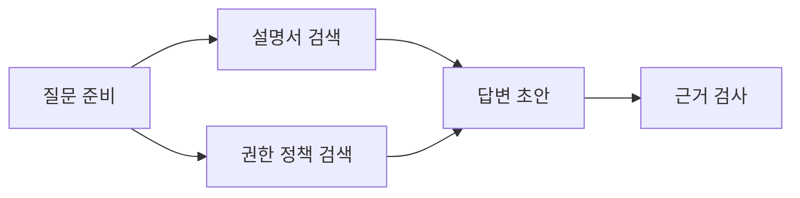

# DAG와 AI 워크플로
{: .no_toc }



**DAG(Directed Acyclic Graph)는 화살표에 방향이 있고, 그 방향을 따라갔을 때 출발점으로 돌아오는 경로가 없는 그래프다.** AI 시스템에서는 “어떤 작업이 어떤 결과를 기다려야 하는가”를 표현하는 데 쓴다.

예를 들어 답변을 쓰기 전에 사용 설명서와 권한 정책을 찾아야 한다면, 두 검색을 각각 실행한 뒤 결과가 모두 준비됐을 때 답변 작성을 시작해야 한다. DAG는 이 의존 관계를 표현한다. 모델이 답을 잘 쓰는 문제와, 필요한 작업을 올바른 순서로 실행하는 문제를 나누어 생각할 수 있게 된다.

이 글에서는 문서 두 개를 찾아 답변을 준비하는 작은 사례를 끝까지 따라간다. Python 예제는 외부 패키지와 API 키 없이 실행된다. 검색과 모델 호출 자리는 고정된 데이터로 대체해, 우선 실행 순서와 데이터 전달을 확인한다.

## 먼저 해결하려는 문제를 보자

사용자가 “파일을 내보내려면 어떤 권한이 필요한가?”라고 물었다. 답변에는 두 종류의 근거가 필요하다.

- 사용 설명서: 어느 화면에서 내보내기를 실행하는가.
- 권한 정책: 어떤 사용자가 그 기능을 실행할 수 있는가.

설명서 검색이 정책 검색의 결과를 필요로 하지는 않는다. 둘은 같은 질문에서 출발할 수 있다. 반면 답변 작성은 두 검색 결과가 모두 있어야 시작할 수 있다.



이 그림을 읽을 때 화살표를 “다음으로 반드시 하나를 선택한다”는 뜻으로 보면 혼동하기 쉽다. 여기서는 **앞 작업의 결과가 뒤 작업에 필요하다**는 뜻이다. 질문 준비가 끝나면 두 검색을 시작할 수 있고, 초안은 두 검색을 모두 기다린다.

여러 갈래로 일을 보내는 것을 fan-out, 결과를 모아 이어가는 것을 fan-in이라고 부른다. 이름보다 중요한 것은 **어느 지점에서 기다림이 필요한지**다.

## DAG라는 이름의 세 부분

### Graph: 작업과 관계를 따로 표현한다

그래프는 노드와 엣지로 구성된다. 이 사례에서는 작업 하나가 노드이고, 두 작업 사이의 의존 관계가 엣지다. 그래프라는 자료구조가 항상 작업 흐름을 뜻하는 것은 아니다. 사람 사이의 관계나 웹 페이지 링크도 그래프로 표현할 수 있다. 여기서는 범위를 작업 의존성으로 한정한다.

### Directed: 화살표에는 방향이 있다

`설명서 검색 → 초안 작성`은 초안이 설명서 검색 결과를 필요로 한다는 뜻이다. 반대 방향인 `초안 작성 → 설명서 검색`과는 다른 관계다.

방향을 무시하면 “무엇을 먼저 준비해야 하는가”라는 정보가 사라진다. 순서를 계산할 수 있으려면 관계의 방향이 명확해야 한다.

### Acyclic: 방향을 따라 돌아오는 경로가 없다

다음 구조에는 문제가 있다.

```text
초안을 쓰려면 검사가 끝나야 한다.
검사를 하려면 초안이 있어야 한다.

초안 작성 → 검사 → 초안 작성
```

의존성으로 읽으면 두 작업이 서로를 기다린다. 이것이 순환이다. DAG는 이런 경로를 허용하지 않는다. 노드 하나가 자기 자신을 기다리는 경우도 순환이다.

단, “같은 작업 종류를 다시 수행한다”는 사실만으로 모든 실행이 순환 그래프가 되는 것은 아니다. `초안 1 → 검사 1 → 초안 2 → 검사 2`처럼 각각을 다른 노드로 펼치면 유한한 DAG로 표현할 수 있다. 반복 횟수를 실행 중에 결정하는 에이전트 루프는 별도의 제어 구조가 더 자연스럽다.

## 실행 순서는 하나만 있는 것이 아니다

위상 정렬(topological sort)은 **모든 선행 작업이 후행 작업보다 앞에 오도록 노드를 나열하는 것**이다.

이 사례에는 적어도 다음 두 순서가 가능하다.

```text
질문 → 설명서 검색 → 정책 검색 → 초안 → 검사
질문 → 정책 검색 → 설명서 검색 → 초안 → 검사
```

둘 다 의존 관계를 지킨다. 설명서와 정책 사이에는 순서를 정하는 화살표가 없기 때문이다. 따라서 DAG를 정렬했다고 해서 실행 순서가 유일해지는 것은 아니다.

이 둘을 동시에 실행해도 되는지는 별도로 확인한다. 의존 관계 외에도 API 동시 호출 제한, 사용 가능한 메모리, 접근 권한, 공유 데이터 수정 여부 같은 제약이 있다. **그래프가 병렬 실행을 허용하는 것과 실행기가 실제로 병렬 실행하는 것은 다르다.**

## Python에서 의존성을 적는 방법

Python 표준 라이브러리의 `graphlib.TopologicalSorter`를 사용한다. 이 글의 코드는 Python 3.12 이상을 기준으로 하며 전체 파일은 Python 3.12.16에서 실행했다. `python3`가 macOS 기본 3.9를 가리킬 수 있으므로 아래 실행에서는 `python3.12`를 명시한다.

```python
from graphlib import TopologicalSorter

dependencies = {
    "question": set(),
    "retrieve_manual": {"question"},
    "retrieve_policy": {"question"},
    "draft": {"retrieve_manual", "retrieve_policy"},
    "verify": {"draft"},
}

print(tuple(TopologicalSorter(dependencies).static_order()))
```

사전의 키는 작업 이름, 값은 **그 작업이 기다리는 선행 작업들의 집합**이다. `"draft": {"retrieve_manual", "retrieve_policy"}`는 초안이 두 검색을 기다린다는 뜻이다. 다음에 실행할 작업 목록이 아니다.

이 표현은 그림의 화살표와 읽는 방향이 달라 보일 수 있다. 그림은 `검색 → 초안`으로 그리고, 사전은 `초안: {검색}`으로 적는다. 둘은 같은 관계다.

`static_order()`는 가능한 순서를 제공한다. 작업 함수 자체를 실행하거나 스레드를 만들지는 않는다. 정렬과 실행은 다른 책임이다. 위상 정렬의 정의와 이 입력 형식은 [Python graphlib 공식 문서](https://docs.python.org/3.12/library/graphlib.html)에서 확인할 수 있다.

## 준비된 작업만 실행하는 작은 실행기

순서 목록을 한 번 만드는 대신, 완료된 작업에 따라 다음 작업을 풀어 주는 방식으로 실행해 보자. 실제 파일의 함수명 `run_graph`는 아래 코드와 같다. 전체 코드는 [dag.py]({{ '/assets/examples/ai/dag.py' | relative_url }})에서 받을 수 있다.

```bash
python3.12 --version
python3.12 dag.py
```

핵심 실행 루프는 다음과 같다. `execute` 함수와 의존성 정의는 다운로드 파일에 함께 들어 있다.

```python
async def run_graph(dependencies, worker=execute):
    sorter = TopologicalSorter(dependencies)
    sorter.prepare()
    results = {}
    batches = []

    while sorter.is_active():
        ready = tuple(sorted(sorter.get_ready()))
        async with asyncio.TaskGroup() as group:
            tasks = {
                node: group.create_task(
                    worker(node, {p: results[p] for p in dependencies[node]})
                )
                for node in ready
            }
        results.update({node: task.result() for node, task in tasks.items()})
        sorter.done(*ready)
        batches.append(ready)

    return results, batches
```

이 코드는 짧지만 각 줄에 역할이 있다.

| 코드 | 하는 일 | 이 단계가 필요한 이유 |
| --- | --- | --- |
| `prepare()` | 순환 검사와 실행 준비 | 실행을 시작하기 전에 성립하지 않는 의존성을 찾음 |
| `get_ready()` | 선행 작업이 완료된 노드를 반환 | 아직 입력이 없는 작업의 조기 실행을 막음 |
| `results[p]` | 선행 작업의 결과를 전달 | 실행 순서뿐 아니라 데이터 의존성도 연결 |
| `TaskGroup` | 준비된 작업을 함께 시작하고 완료를 기다림 | 독립적인 비동기 I/O를 겹쳐 실행 |
| `done(*ready)` | 성공한 작업의 완료를 알림 | 그 작업을 기다리던 후속 노드를 해제 |

`get_ready()`가 반환했다는 것은 “실행해도 된다”는 뜻이다. 성공했다는 뜻은 아니다. `done()`을 작업 시작 직후 호출하면 후속 작업이 미완성 데이터를 읽을 수 있다. 예제는 해당 묶음이 성공한 뒤 결과를 저장하고 완료를 알린다.

## 실제로 어떤 순서로 진행될까

실행 결과의 묶음은 다음과 같다.

```text
batches: [('question',), ('retrieve_manual', 'retrieve_policy'), ('draft',), ('verify',)]
answer: 내보내기에는 관리자 권한이 필요하다. 설정에서 내보내기를 선택한다.
cycle: rejected before execution
failure: draft and verify did not run
```

첫 묶음에서는 입력이 필요 없는 `question`만 준비된다. 질문이 완료되면 두 검색이 준비된다. 두 검색이 끝나야 `draft`가 풀리고, 초안이 끝나야 `verify`가 풀린다.

이 예제의 검색은 외부 서비스를 호출하지 않고 고정된 문서를 반환한다. `asyncio.sleep()`은 I/O를 기다리는 자리를 흉내 낸다. 초안도 모델이 생성하는 것이 아니라 두 문장을 조합한다. 따라서 위 결과는 **의존성 제어가 맞다는 증거**이며 검색 품질이나 모델의 사실 정확성을 검증한 결과는 아니다.

검사 노드는 두 출처 ID가 붙었는지만 확인한다. 실제 근거 검사에서는 ID 존재뿐 아니라 문서 내용이 답변의 각 주장을 뒷받침하는지, 문서가 최신인지, 사용자가 볼 권한이 있는지도 따로 확인해야 한다.

## 동시 실행과 병렬 실행을 구분하기

예제는 두 검색의 대기 시간을 겹친다. `asyncio`가 두 Python 함수를 각각 다른 CPU 코어에서 계산하는 것은 아니다. 네트워크 응답을 기다리는 작업에는 유용하지만, 무거운 CPU 계산을 그대로 넣으면 이벤트 루프가 막힐 수 있다.

CPU 작업은 프로세스 풀이나 별도 작업 서버를 고려하고, GPU 작업은 장치 메모리와 실행 큐를 고려한다. DAG는 이 자원 배치를 대신 결정하지 않는다.

또한 이 작은 실행기는 한 묶음의 작업이 모두 끝나야 다음 묶음으로 넘어간다. 예를 들어 설명서 검색은 1초, 정책 검색은 10초가 걸리고 설명서만 사용하는 별도 후속 작업이 있다면, 그 후속 작업도 현재 구현에서는 10초를 기다리게 된다. 운영용 실행기는 개별 완료 이벤트마다 `done(node)`를 알리고 새로 준비된 작업을 즉시 실행하도록 설계할 수 있다.

작은 예제에서는 이해하기 쉬운 실행 경계를 택했다. 이 제약을 모른 채 고성능 스케줄러로 사용하면 불필요한 대기가 생긴다.

## 시간은 노드 수보다 가장 긴 경로에 좌우된다

작업 시간을 다음처럼 가정하자. 설명용 수치이며 측정 결과가 아니다.

| 작업 | 시간 |
| --- | ---: |
| 질문 준비 | 0.1초 |
| 설명서 검색 | 2초 |
| 정책 검색 | 3초 |
| 초안 작성 | 4초 |
| 검사 | 1초 |

모두 순차 실행하면 `0.1 + 2 + 3 + 4 + 1 = 10.1초`다. 두 검색을 겹치고 다른 제약이 없다면 `0.1 + max(2, 3) + 4 + 1 = 8.1초`로 생각할 수 있다.

이때 질문 → 정책 검색 → 초안 → 검사 경로가 가장 오래 걸린다. 이런 경로를 임계 경로(critical path)라고 한다. 설명서 검색만 2초에서 1초로 줄여도 정책 검색을 기다려야 하므로 전체 시간은 줄지 않을 수 있다.

실제로는 스케줄링 비용, 요청 제한, 네트워크 변동, 자원 경쟁이 추가된다. 병렬화는 전체 비용을 자동으로 줄이지도 않는다. 두 검색 요청의 요금은 여전히 발생하며, 더 많은 분기를 동시에 열면 순간 요청량이 커진다.

## 실패했을 때 초안을 계속 써도 될까

정책 검색이 실패했는데 설명서만 보고 “누구나 내보낼 수 있다”고 답하면 위험하다. 이 사례에서는 두 검색을 모두 필수로 두었다. 하나라도 실패하면 초안과 검사를 실행하지 않는다. 다운로드 코드의 실패 시험은 이 동작을 확인한다.

`TaskGroup` 안에서 처리하지 않은 오류가 발생하면 다른 진행 중 작업의 취소가 요청되고 오류 묶음이 전달된다. 이미 끝난 외부 작업을 되돌려 주지는 않는다. 취소 요청을 무시하거나 외부 서비스에 이미 전달된 행동까지 원상복구한다고 기대해서는 안 된다. 세부 동작은 [Python TaskGroup 문서](https://docs.python.org/3.12/library/asyncio-task.html#task-groups)를 참고한다.

업무에 따라 일부 실패를 허용할 수도 있다. 추천 문구 검색은 선택 사항이고 권한 정책은 필수라면, 두 의존성을 같은 성공 조건으로 처리하면 안 된다. 선택 작업의 실패를 명시적인 결과 상태로 바꾸고, 초안에서 사용 가능한 근거 범위를 표시하는 방식이 필요하다.

이것은 단순히 화살표를 그리는 문제를 넘어선다. **노드의 성공·실패·건너뜀 중 어떤 상태가 후속 작업을 허용하는가**를 실행기의 계약으로 정해야 한다.

## 재시도는 순환과 어떻게 다를까

일시적인 네트워크 오류 때문에 검색을 다시 하는 것과, 답변 평가 결과에 따라 초안을 계속 고치는 것은 목적이 다르다.

| 상황 | 설계할 위치 | 필요한 제한 |
| --- | --- | --- |
| 검색 요청의 일시 오류 | 한 노드의 실행 정책 | 최대 시도 수, 대기 간격, 시간 제한 |
| 초안의 품질 부족 | 작업 흐름의 수정·평가 경로 | 합격 기준, 반복 상한, 사람 검토 경로 |
| 다른 질문을 새로 처리 | 새로운 실행 인스턴스 | 실행 ID와 입력 분리 |

노드 내부의 제한된 재시도는 작업 의존성 그래프에 뒤로 향하는 엣지를 추가하지 않아도 구현할 수 있다. 반면 수정 → 재평가를 동적으로 반복하는 흐름을 그대로 노드 간 연결로 그리면 순환 그래프가 된다.

예제 실행기는 재시도와 영구 저장을 구현하지 않는다. 실패 처리를 이해하기 위한 최소 구조다. 재시도를 추가한다면 결제나 메시지 발송 같은 외부 변경을 그대로 반복하지 않도록 요청 ID와 중복 처리 정책부터 정해야 한다.

## DAG와 LangGraph는 같은 말이 아니다

DAG는 그래프의 성질이고 LangGraph는 상태와 실행 흐름을 구성하는 프레임워크다. LangGraph로 DAG 형태의 작업을 만들 수 있지만 반복 경로도 만들 수 있으므로, 모든 LangGraph 프로그램을 DAG라고 부르면 부정확하다.

```text
DAG 형태: 검색 → 초안 → 검사 → 완료

반복 형태: 초안 → 평가 ─ 합격 → 완료
             ↑      │
             └ 수정 ← 불합격
```

반복 그래프에서는 “앞 단계가 모두 한 번 끝났는가”만으로 실행을 설명할 수 없다. 현재 상태, 이번 평가 결과, 반복 횟수와 종료 조건이 필요하다. [LangGraph Graph API](https://docs.langchain.com/oss/python/langgraph/graph-api)는 노드와 엣지로 순차 실행·분기·반복을 구성한다.

조건 분기가 있다는 이유만으로 DAG가 아닌 것은 아니다. `분류 → 일반 문의` 또는 `분류 → 결제 문의`처럼 뒤로 돌아오는 경로 없이 갈라지면 비순환 구조를 유지할 수 있다. 다만 실행기는 선택되지 않은 경로를 어떻게 건너뛰고 합류할지 알아야 한다. 이 글의 단순 실행기는 모든 선행 작업 성공을 기다리므로 그런 분기 규칙을 제공하지 않는다.

## 운영에서 저장해야 할 것은 결과 문자열만이 아니다

같은 질문을 나중에 다시 검증하려면 어떤 자료와 설정으로 답했는지 알아야 한다. 예를 들어 정책 문서가 바뀌었는데 예전 검색 결과를 캐시에서 가져오면, 그래프 실행은 성공해도 답변은 낡을 수 있다.

실행 기록에는 실행 ID, 노드 이름, 시도 횟수, 입력 문서의 버전, 모델·프롬프트 버전, 출력 위치, 시작·종료 시각과 오류 종류를 남긴다. 개인정보와 비밀 값은 원문 로그에 무조건 저장하지 않는다. 추적 가능성과 접근 제한을 함께 설계해야 한다.

결과를 재사용할 때도 노드 이름만 캐시 키로 삼으면 안 된다. 같은 `draft`라도 질문, 검색 문서, 모델과 프롬프트가 다르면 다른 계산이다. 무엇이 바뀌면 캐시를 무효화할지 정의해야 한다.

배치 일정과 작업 재시도·상태 관리를 갖춘 도구로는 Airflow 같은 워크플로 시스템이 있다. 수학적인 DAG 구조 위에 실행 관리 기능을 더한 도구이며, 이 글의 작은 스케줄러와 기능 범위가 다르다. 구체적인 실행 정책은 [Airflow Dag 공식 문서](https://airflow.apache.org/docs/apache-airflow/stable/core-concepts/dags.html)에서 확인한다.

## 직접 바꿔 보며 이해하기

먼저 `question`이 `verify`를 기다리도록 바꿔 보자. `질문 → 검색 → 초안 → 검사 → 질문`이 되어 `prepare()`가 순환을 거부한다. 실행 중 멈추는 문제가 아니라 의존성 자체가 성립하지 않는다는 것을 확인할 수 있다.

다음으로 정책 검색에서 오류를 발생시켜 보자. 다운로드 파일에 이 시험이 포함돼 있다. 초안과 검사가 실행되지 않아야 한다. 이때 “왜 초안이 시작되지 않았지?”라는 질문에 그래프의 필수 의존성으로 답할 수 있어야 한다.

마지막으로 초안의 정책 의존성을 제거해 보자. 그래프 자체는 비순환으로 남을 수 있지만, 초안 함수가 정책 결과를 읽으려 하므로 입력이 맞지 않는다. 이 실험은 **그래프의 구조가 유효하다는 것과 각 노드가 필요한 데이터를 받는다는 것이 별도의 검증 대상**임을 보여 준다.

이 세 경우를 설명할 수 있다면 DAG를 단순히 “순서도”로 외운 단계를 넘은 것이다. 다음에는 [그래프 엔지니어링]({{ '/ai/using-ai/graph-engineering/' | relative_url }})에서 조건 분기와 상태를, [LangGraph]({{ '/ai/using-ai/langgraph/' | relative_url }})에서 중단·재개와 반복 실행을 이어서 살펴볼 수 있다.
