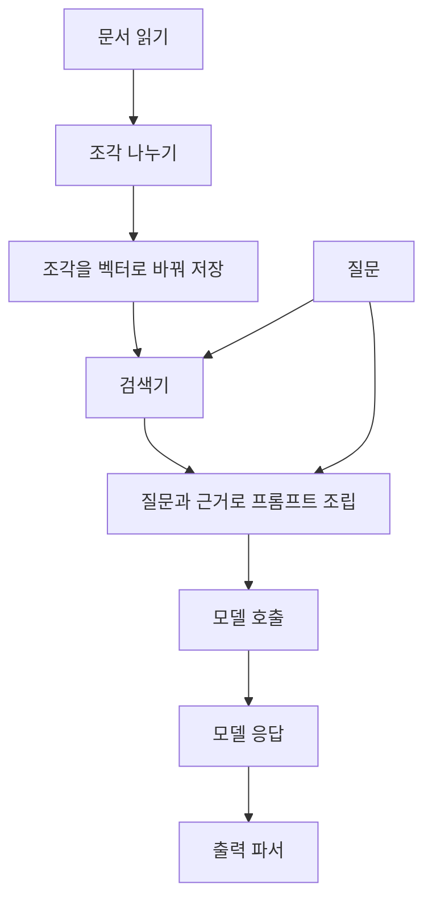

# RAG
{: .no_toc }



"고객이 결제한 지 10일 지났는데 환불이 되나요?"라는 질문을 받았다고 하자. 상담원이라면 환불 규정을 찾아 읽고 답한다. AI에게도 같은 순서를 줄 수 있다. 질문이 들어올 때 문서에서 관련 부분을 찾아 모델에게 주고, 모델은 그 자료로 답을 쓴다. 이 방식이 **검색 증강 생성(Retrieval-Augmented Generation, RAG)**이다. [Lewis 외, RAG 원 논문](https://arxiv.org/abs/2005.11401)

이 글의 실습에서는 검색기가 실제로 `refund.md`를 찾아냈다. 그런데 모델은 "사용한 일수만큼 빼고 환불한다"는 규정을 "사용한 일수만큼 환불한다"로 뒤집었다. 답변에는 찾았던 파일 이름까지 붙어 있었다. 검색이 성공해도 모델이 조건을 틀리게 읽을 수 있으므로 둘을 따로 확인해야 한다.

| 단계 | 들어오는 값 | 나가는 값 |
| --- | --- | --- |
| 검색 | 질문 문자열 | 문서 조각과 출처 |
| 프롬프트 | 질문과 조각 | 모델에 보낼 메시지 |
| 모델 | 메시지 | 답변을 담은 `AIMessage` |
| 출력 파서 | 모델이 만든 메시지 | 문자열 또는 형식을 검사한 객체 |

## 문서를 준비하는 때와 질문에 답하는 때

**색인**은 나중에 찾기 쉽게 문서를 정리해 둔 자료다. 여기서는 문서를 읽어 조각으로 나누고, 조각을 숫자 벡터로 바꿔 저장한다. 질문이 들어오면 질문도 같은 모델로 벡터화하고, 검색기가 가까운 조각을 찾아온다. 질문과 조각을 프롬프트에 넣고, 모델이 만든 답을 파서로 받아 앱으로 돌려준다. [LangChain의 검색 파이프라인](https://docs.langchain.com/oss/python/deepagents/retrieval)



사내 문서나 갱신된 규정은 모델이 학습한 뒤에도 바뀐다. RAG에서는 새 판을 색인에 반영하면 다음 질문에서 새 판을 찾을 수 있다. 또한 답에 출처 ID를 남기면 사용자가 근거를 직접 열어 볼 수 있다. 어떤 사용자가 어느 문서를 읽을 수 있는지는 검색 코드가 확인해야 한다.

{: .tip }
실무에서는 표나 정책에 정답이 정확히 한 필드로 들어 있다면 그 필드를 앱 코드로 조회한다. 여러 자료를 읽고 설명해야 할 때는 관련 문단을 검색한 뒤 서술을 맡길 수 있다. 이 글은 요청마다 검색 한 번과 생성 한 번을 하는 2단계 RAG다. 검색 도구를 언제 다시 부를지 모델이 정하는 구성도 있다. [LangChain의 2단계 RAG와 에이전트형 RAG](https://docs.langchain.com/oss/python/deepagents/retrieval)

## 실습 준비

Apple Silicon Mac에서 Python 3.11.18로 실행했다. 아래 코드 블록에서 표시한 파일 이름대로 한 디렉터리에 저장한다. 임베딩과 생성은 모두 로컬에서 실행하며 처음에는 모델을 내려받는다. 실습은 아래 패키지 버전으로 실행했다.

```bash
python3.11 -m venv .venv
source .venv/bin/activate
python -m pip install \
  langchain-core==1.8.5 langchain-text-splitters==1.2.0 \
  langchain-huggingface==1.3.0 sentence-transformers==6.3.0 \
  mlx-lm==0.32.2 pydantic==2.14.4 \
  langchain-community==0.4.2 langchain-classic==1.1.0 \
  rank-bm25==0.2.2
```

임베딩은 `sentence-transformers/paraphrase-multilingual-MiniLM-L12-v2`를 쓴다. 답변은 `mlx-community/Qwen2.5-3B-Instruct-4bit`가 만든다. 생성 최대 길이는 200토큰이고, 온도는 `0.0`으로 정했다. 아래 출력은 이 환경에서 나온 기록이다. 모델이나 패키지 버전이 다르면 점수와 문장이 달라질 수 있다. [MLX LM](https://github.com/ml-explore/mlx-lm)

## 문서를 조각으로 나눠 색인 만들기

`docs.py`에는 실습용 문서 다섯 개를 넣는다. `page_content`는 검색할 본문이다. `metadata`에는 출처처럼 본문과 함께 보관할 정보를 넣는다.

```python
from langchain_core.documents import Document

raw = [
    Document(
        page_content=(
            "환불 규정\n\n"
            "결제 후 7일 이내에는 전액 환불한다. "
            "7일이 지나면 사용한 일수만큼 빼고 환불한다.\n\n"
            "연간 플랜은 30일이 지나면 환불하지 않는다."
        ),
        metadata={"source": "refund.md"},
    ),
    Document(
        page_content=(
            "요금제 안내\n\n"
            "무료 플랜은 프로젝트를 3개까지 만든다. "
            "프로 플랜은 월 9,900원이고 프로젝트 제한이 없다."
        ),
        metadata={"source": "pricing.md"},
    ),
    Document(
        page_content=(
            "고객센터\n\n"
            "운영 시간은 평일 오전 9시부터 오후 6시까지다. "
            "주말과 공휴일에는 이메일로만 문의를 받는다."
        ),
        metadata={"source": "support.md"},
    ),
    Document(
        page_content=(
            "오류 E-4012\n\n"
            "카드 유효기간이 지났다는 뜻이다. "
            "새 카드를 등록하면 해결된다."
        ),
        metadata={"source": "error-4012.md"},
    ),
    Document(
        page_content=(
            "오류 E-4013\n\n"
            "카드 한도를 넘었다는 뜻이다. "
            "카드사에 한도를 확인한다."
        ),
        metadata={"source": "error-4013.md"},
    ),
]
```

**청크(chunk)**는 검색할 때 통째로 꺼낼 문서 조각이다. 문서 한 편을 책 한 챕터에 비유하면 청크는 필요한 대목에 붙이는 쪽지 한 장이다. `RecursiveCharacterTextSplitter`는 문단, 줄바꿈, 공백처럼 큰 경계를 먼저 써 보고 길이가 넘으면 더 작은 경계로 나눈다. 기본 길이 단위는 문자다. [LangChain의 재귀 분할기](https://docs.langchain.com/oss/python/integrations/splitters/recursive_text_splitter)

`s1_split.py`를 저장하고 `python s1_split.py`를 실행한다.

```python
from langchain_text_splitters import (
    RecursiveCharacterTextSplitter,
)
from docs import raw

splitter = RecursiveCharacterTextSplitter(
    chunk_size=60,
    chunk_overlap=10,
)
chunks = splitter.split_documents(raw)

print("청크 수:", len(chunks))
for c in chunks:
    src = c.metadata["source"]
    print(f"[{src}] {c.page_content!r}")
```

```text
청크 수: 7
[refund.md] '환불 규정\n\n결제 후 7일 이내에는 전액 환불한다. 7일이 지나면 사용한 일수만큼 빼고 환불한다.'
[refund.md] '연간 플랜은 30일이 지나면 환불하지 않는다.'
[pricing.md] '요금제 안내'
[pricing.md] '무료 플랜은 프로젝트를 3개까지 만든다. 프로 플랜은 월 9,900원이고 프로젝트 제한이 없다.'
[support.md] '고객센터\n\n운영 시간은 평일 오전 9시부터 오후 6시까지다. 주말과 공휴일에는 이메일로만 문의를 받는다.'
[error-4012.md] '오류 E-4012\n\n카드 유효기간이 지났다는 뜻이다. 새 카드를 등록하면 해결된다.'
[error-4013.md] '오류 E-4013\n\n카드 한도를 넘었다는 뜻이다. 카드사에 한도를 확인한다.'
```

한 파일에서 조각이 여럿 나올 수 있다. 환불 규정은 일반 규정과 연간 플랜 규정이 다른 조각에 들어갔다. 요금제는 제목과 본문이 갈라졌다. 실무에서는 제목과 상위 절 이름을 메타데이터에 붙이면 조각만 봐도 무슨 내용인지 알 수 있다. 같은 출처의 여러 조각을 구분할 때는 조각 ID도 남긴다.

**겹침(overlap)**은 잘린 앞뒤에 일부 글을 되풀이해 경계에서 문장이 끊기는 영향을 줄이는 설정이다. `s1b_overlap.py`를 실행하면 두 번째 줄에서 앞 조각의 끝부분이 다음 조각에 다시 나온다. 문단 경계와 길이 제한에 따라 실제 겹치는 양은 달라진다.

```python
from langchain_text_splitters import (
    RecursiveCharacterTextSplitter,
)

text = "가 나 다 라 마 바 사 아 자 차 카 타 파 하"
for overlap in (0, 4):
    s = RecursiveCharacterTextSplitter(
        chunk_size=12,
        chunk_overlap=overlap,
    )
    print(overlap, s.split_text(text))
```

```text
0 ['가 나 다 라 마 바', '사 아 자 차 카 타', '파 하']
4 ['가 나 다 라 마 바', '마 바 사 아 자 차', '자 차 카 타 파 하']
```

`store.py`는 문서 조각을 벡터로 바꿔 `InMemoryVectorStore`에 넣는다. **임베딩**은 글을 숫자의 목록인 벡터로 바꾸는 일이다. 이 저장소는 질문 벡터와 조각 벡터의 코사인 유사도를 비교해 가까운 순으로 반환한다. 벡터를 만드는 과정과 대규모 색인 구조는 [임베딩]({{ '/ai/using-ai/embedding/' | relative_url }})과 [벡터 DB]({{ '/ai/using-ai/vector-db/' | relative_url }})에서 이어서 볼 수 있다. [LangChain의 인메모리 벡터 저장소](https://reference.langchain.com/python/langchain-core/vectorstores/in_memory/InMemoryVectorStore)

```python
from langchain_core.vectorstores import InMemoryVectorStore
from langchain_huggingface import HuggingFaceEmbeddings
from langchain_text_splitters import (
    RecursiveCharacterTextSplitter,
)
from docs import raw

MODEL = "paraphrase-multilingual-MiniLM-L12-v2"
emb = HuggingFaceEmbeddings(
    model_name=f"sentence-transformers/{MODEL}",
    encode_kwargs={"normalize_embeddings": True},
)

def build(size, overlap):
    splitter = RecursiveCharacterTextSplitter(
        chunk_size=size, chunk_overlap=overlap
    )
    chunks = splitter.split_documents(raw)
    return InMemoryVectorStore.from_documents(chunks, emb)

store = build(200, 20)
```

## 질문을 검색하고 점수를 확인하기

**검색기(retriever)**는 질문을 받아 관련 문서 조각을 돌려주는 부품이다. 아래 진단 코드는 문서와 점수를 함께 보기 위해 저장소 메서드를 바로 부른다. `k=3`은 순위 앞의 조각을 최대 세 개 가져온다는 뜻이다. `s2_search.py`를 저장하고 `python s2_search.py 200`으로 실행한다.

```python
import sys
from store import build

size = int(sys.argv[1])
store = build(size, 10)
q = "결제하고 10일 지났는데 환불되나요?"
hits = store.similarity_search_with_score(q, k=3)
for doc, score in hits:
    src = doc.metadata["source"]
    text = doc.page_content[:20].replace("\n", " ")
    print(f"{score:.4f} [{src}] {text}")
```

```text
0.5536 [refund.md] 환불 규정  결제 후 7일 이내에는
0.2699 [error-4013.md] 오류 E-4013  카드 한도를 넘었
0.2698 [error-4012.md] 오류 E-4012  카드 유효기간이
```

`refund.md`가 첫 번째이고 다음 두 조각은 카드 오류 문서다. 점수 0.5536은 이 모델이 이 질문과 문서 조각 사이에 매긴 코사인 유사도다. 답을 맞힐 확률로 해석하면 안 된다. 실제로 두 번째와 세 번째 문서에는 질문의 환불 기준이 들어 있지 않다.

{: .tip }
실무에서는 낮은 점수를 거르는 기준을 쓰기 전에 정답이 있는 질문과 없는 질문을 모두 시험한다. `k`를 키우면 필요한 조각을 더 가져올 기회가 생기고, 무관한 조각도 들어올 수 있다. 생성 프롬프트의 길이와 검색 적중률을 함께 본다.

## 찾은 문서를 메시지로 만들기

`prompt.py`에서 검색 결과를 `[파일 이름] 본문` 줄로 바꾼다. `ChatPromptTemplate`이 `{context}`와 `{question}` 자리에 실제 값을 채워 모델에 보낼 메시지를 만든다.

```python
from langchain_core.prompts import ChatPromptTemplate

prompt = ChatPromptTemplate.from_messages([
    ("system",
     "아래 자료만 보고 한국어로 짧게 답하라. "
     "답 끝에 근거로 쓴 자료의 대괄호 이름을 붙여라. "
     "자료에 답이 없으면 '자료에 없습니다'라고만 답하라."
     "\n\n자료:\n{context}"),
    ("human", "{question}"),
])

def format_docs(docs):
    return "\n".join(
        f"[{d.metadata['source']}] "
        + d.page_content.replace("\n", " ")
        for d in docs
    )
```

{: .warning }
실습은 위에서 정의한 고정 문서만 시스템 메시지에 넣는다. 사용자가 올린 파일이나 외부 문서가 들어오는 서비스에서는 시스템 지시문과 가져온 문서 데이터를 분리한다. 사용자 권한은 검색 전에 확인하고, 문서에 적힌 지시가 모델의 도구 권한을 바꾸지 못하게 한다. [컨텍스트 엔지니어링]({{ '/ai/using-ai/context-engineering/' | relative_url }})

## 모델과 출력 파서를 이어 보기

`llm.py`는 MLX에서 나온 답변 문자열을 LangChain이 쓰는 `AIMessage`로 감싼다. 모델이 낸 원문은 `AIMessage.content`에 있다. 이 파일은 아래 실습에서 가져오는 모델 연결 코드다.

```python
from langchain_core.language_models import BaseChatModel
from langchain_core.messages import AIMessage
from langchain_core.outputs import ChatGeneration, ChatResult
from mlx_lm import generate, load
from mlx_lm.sample_utils import make_sampler

MODEL_ID = "mlx-community/Qwen2.5-3B-Instruct-4bit"
mlx_model, tokenizer = load(MODEL_ID)
ROLE = {"system": "system", "human": "user", "ai": "assistant"}

class LocalMLX(BaseChatModel):
    max_tokens: int = 200

    @property
    def _llm_type(self):
        return "local-mlx"

    def _generate(self, messages, stop=None,
                  run_manager=None, **kwargs):
        chat = [{"role": ROLE[m.type], "content": m.content}
                for m in messages]
        text = tokenizer.apply_chat_template(
            chat, add_generation_prompt=True, tokenize=False
        )
        out = generate(
            mlx_model, tokenizer, prompt=text,
            max_tokens=self.max_tokens,
            sampler=make_sampler(temp=0.0),
        )
        msg = AIMessage(content=out)
        return ChatResult(generations=[ChatGeneration(message=msg)])

model = LocalMLX()
```

`s3_stages.py`를 실행하면 검색 결과, 채운 프롬프트, 모델 원문, 파싱 결과를 한 번의 요청에서 확인할 수 있다. **출력 파서(output parser)**는 모델 응답을 앱 코드가 받아 쓰는 값으로 바꾸는 부품이다. `StrOutputParser`는 여기서 메시지의 답변을 문자열로 꺼낸다.

```python
from langchain_core.output_parsers import StrOutputParser
from store import store
from prompt import prompt, format_docs
from llm import model, MODEL_ID

retriever = store.as_retriever(search_kwargs={"k": 2})
q = "결제하고 10일 지났는데 환불되나요?"

docs = retriever.invoke(q)                 # 1. 검색
print("① 검색:", [d.metadata["source"] for d in docs])

value = prompt.invoke({                    # 2. 프롬프트
    "context": format_docs(docs),
    "question": q,
})
print("② 프롬프트:")
for m in value.to_messages():
    print(f"  {m.type}: {m.content}")

msg = model.invoke(value)                  # 3. 모델
print("③ 모델 결과 타입:", type(msg).__name__)
print("   content:", repr(msg.content))

text = StrOutputParser().invoke(msg)       # 4. 파서
print("④ 파서 결과는 str인가?", isinstance(text, str))
print("   ", text)
print("모델:", MODEL_ID)
```

```text
① 검색: ['refund.md', 'error-4013.md']
② 프롬프트:
  system: 아래 자료만 보고 한국어로 짧게 답하라. 답 끝에 근거로 쓴 자료의 대괄호 이름을 붙여라. 자료에 답이 없으면 '자료에 없습니다'라고만 답하라.

자료:
[refund.md] 환불 규정  결제 후 7일 이내에는 전액 환불한다. 7일이 지나면 사용한 일수만큼 빼고 환불한다.  연간 플랜은 30일이 지나면 환불하지 않는다.
[error-4013.md] 오류 E-4013  카드 한도를 넘었다는 뜻이다. 카드사에 한도를 확인한다.
  human: 결제하고 10일 지났는데 환불되나요?
③ 모델 결과 타입: AIMessage
   content: '환불 규정에 따르면, 결제 후 7일 이내에는 전액 환불하며, 7일이 지나면 사용한 일수만큼 환불합니다. 따라서 10일 지나서는 3일 동안 사용한 금액만큼 환불될 것입니다. [refund.md] 근거로 답했습니다.'
④ 파서 결과는 str인가? True
    환불 규정에 따르면, 결제 후 7일 이내에는 전액 환불하며, 7일이 지나면 사용한 일수만큼 환불합니다. 따라서 10일 지나서는 3일 동안 사용한 금액만큼 환불될 것입니다. [refund.md] 근거로 답했습니다.
모델: mlx-community/Qwen2.5-3B-Instruct-4bit
```

줄에 찍힌 `AIMessage`는 모델의 출력 타입이고 `True`는 파싱 후 값이 문자열이라는 뜻이다. 답변은 여전히 틀렸다. 규정에서 빼야 할 금액을 돌려줄 금액으로 해석했으므로, 이 응답을 자동 환불 계산에 쓰면 금액이 달라진다. 파서가 바꾼 것은 결과의 타입이다.

## 검색부터 파싱까지 한 줄로 연결하기

LangChain에서 `|`는 앞 단계의 출력을 다음 단계의 입력으로 보낸다. 이 조합 방식을 **LCEL(LangChain Expression Language)**이라고 한다. 아래 체인은 질문 문자열 하나에서 두 입력을 만든다. `context`에는 검색 후 줄로 바꾼 문서가 들어가고, `question`에는 `RunnablePassthrough`가 넘긴 원래 질문이 들어간다. `s4_chain.py`를 실행한다.

```python
from langchain_core.output_parsers import StrOutputParser
from langchain_core.runnables import RunnablePassthrough
from store import store
from prompt import prompt, format_docs
from llm import model

retriever = store.as_retriever(search_kwargs={"k": 2})

chain = (
    {
        "context": retriever | format_docs,
        "question": RunnablePassthrough(),
    }
    | prompt
    | model
    | StrOutputParser()
)

for q in [
    "프로 플랜은 한 달에 얼마예요?",
    "토요일에 전화 상담 되나요?",
    "회사 대표 이름이 뭐예요?",
]:
    print("Q:", q)
    print("A:", chain.invoke(q))
```

```text
Q: 프로 플랜은 한 달에 얼마예요?
A: 프로 플랜은 한 달에 9,900원입니다. [pricing.md]에서 확인できます.
Q: 토요일에 전화 상담 되나요?
A: [error-4013.md] 고객센터는 평일 오전 9시부터 오후 6시까지 운영하며, 주말과 공휴일에는 이메일만 받습니다.
Q: 회사 대표 이름이 뭐예요?
A: 자료에 없습니다
```

첫 답에서 가격과 파일 이름은 맞았지만 출력에 일본어가 섞였다. 둘째 답의 이메일 안내는 `support.md`에 있지만 인용은 카드 오류 문서인 `error-4013.md`로 나갔다. 셋째 질문의 답은 자료에 없었고 실제로 답변을 보류했다. 세 결과에서 언어, 출처, 답변 보류를 각각 검사할 이유를 볼 수 있다.

## 구조화된 출력에서 검사할 수 있는 것

**스키마(schema)**는 어떤 값이 들어와야 하는지 정한 규칙이다. 아래에서는 답변 문자열, 출처 목록, 자료에서 답을 찾았는지 여부를 스키마로 선언한다. `PydanticOutputParser`에서 얻은 형식 안내를 프롬프트에 넣고, 모델이 만든 텍스트를 그 스키마로 검사한다. `s5_struct.py`를 실행한다. [LangChain의 PydanticOutputParser](https://reference.langchain.com/python/langchain-core/output_parsers/pydantic/PydanticOutputParser)

```python
from pydantic import BaseModel, Field
from langchain_core.output_parsers import (
    PydanticOutputParser,
)
from langchain_core.prompts import ChatPromptTemplate
from store import store
from prompt import format_docs
from llm import model

class Answer(BaseModel):
    answer: str = Field(description="질문에 대한 답")
    sources: list[str] = Field(description="근거 파일 이름")
    found: bool = Field(description="자료에 답이 있으면 true")

parser = PydanticOutputParser(pydantic_object=Answer)

prompt = ChatPromptTemplate.from_messages([
    ("system",
     "자료만 보고 답하라.\n{format}\n\n자료:\n{context}"),
    ("human", "{question}"),
]).partial(format=parser.get_format_instructions())

retriever = store.as_retriever(search_kwargs={"k": 2})
q = "무료 플랜은 프로젝트를 몇 개 만들 수 있나요?"
docs = retriever.invoke(q)
msg = (prompt | model).invoke(
    {"context": format_docs(docs), "question": q}
)
print("모델 원문:", repr(msg.content))
result = parser.invoke(msg)
print("파싱 결과:", repr(result))
print("result.sources:", result.sources)
```

```text
모델 원문: '{"answer": "무료 플랜은 프로젝트를 3개까지 만든다.", "sources": ["pricing.md"], "found": true}'
파싱 결과: Answer(answer='무료 플랜은 프로젝트를 3개까지 만든다.', sources=['pricing.md'], found=True)
result.sources: ['pricing.md']
```

이번에는 필드 세 개가 있는 `Answer` 객체를 받았다. 같은 필드에 틀린 요금이나 엉뚱한 파일 이름이 들어가도 타입이 맞으면 파서를 통과할 수 있다. 형식 검사 다음에는 검색 결과에 실제로 그 출처가 있는지, 출처에 답변의 주장을 뒷받침할 문장이 있는지 확인한다.

`s6_fail.py`에서는 모델 호출 대신 두 가지 예제 응답을 직접 넣는다. 하나는 JSON으로 읽을 수 없는 문장이고 다른 하나는 필수인 `sources`가 빠진 JSON이다.

```python
from pydantic import BaseModel
from langchain_core.messages import AIMessage
from langchain_core.output_parsers import (
    JsonOutputParser, PydanticOutputParser,
)
from langchain_core.exceptions import OutputParserException

class Answer(BaseModel):
    answer: str
    sources: list[str]
    found: bool

bad = [
    "답은 3개입니다.",                      # JSON이 아님
    '{"answer": "3개", "found": true}',    # 필드 빠짐
]
for text in bad:
    for p in (JsonOutputParser(),
              PydanticOutputParser(pydantic_object=Answer)):
        name = type(p).__name__
        try:
            print(name, "->", p.invoke(AIMessage(text)))
        except OutputParserException as e:
            first = str(e).splitlines()[0]
            print(name, "-> 실패:", first[:70])
```

```text
JsonOutputParser -> 실패: Invalid json output: 답은 3개입니다.
PydanticOutputParser -> 실패: Invalid json output: 답은 3개입니다.
JsonOutputParser -> {'answer': '3개', 'found': True}
PydanticOutputParser -> 실패: Failed to parse Answer from completion {"answer": "3개", "found": true}
```

{: .tip }
실무에서는 파싱 오류와 근거 부족을 다른 실패로 기록한다. 형식이 틀렸다면 재생성을 제한된 횟수로 시도할 수 있다. 근거가 없거나 질문에 답할 수 있는 문서가 없다면 답변을 보류하고, 규정이 여러 개 충돌하면 시행일과 적용 대상부터 확인한다.

## 검색 결과가 빗나갈 때

### 오류 코드는 단어 검색과 함께 찾기

**하이브리드 검색**은 단어 검색과 벡터 검색의 후보를 합치는 방식이다. BM25는 문서에 질문의 단어가 얼마나 중요하게 등장하는지 점수를 매긴다. 오류 코드나 제품 ID는 문자 하나가 다르면 뜻이 바뀌므로 단어 검색 결과가 도움이 된다. `EnsembleRetriever`는 두 목록의 **순위**를 가중치와 함께 합친다. 서로 다른 종류의 점수를 직접 더하지 않는다. `s7_hybrid.py`를 실행한다. 이 파일의 `langchain-community`는 설치 버전에서 사용 중단 안내를 출력한다. 예시는 해당 버전에서 실행했다. [LangChain의 EnsembleRetriever](https://reference.langchain.com/python/langchain-classic/retrievers/ensemble/EnsembleRetriever)

```python
from langchain_community.retrievers import BM25Retriever
from langchain_classic.retrievers import EnsembleRetriever
from langchain_text_splitters import (
    RecursiveCharacterTextSplitter,
)
from docs import raw
from store import store

chunks = RecursiveCharacterTextSplitter(
    chunk_size=200, chunk_overlap=20
).split_documents(raw)

bm25 = BM25Retriever.from_documents(
    chunks, preprocess_func=str.split, k=2
)
vector = store.as_retriever(search_kwargs={"k": 2})

def names(docs):
    return [d.metadata["source"] for d in docs]

q = "E-4012 오류가 떴어요"
print("BM25:", names(bm25.invoke(q)))
print("벡터:", names(vector.invoke(q)))
for w in ([0.5, 0.5], [0.7, 0.3]):
    hybrid = EnsembleRetriever(
        retrievers=[bm25, vector], weights=w
    )
    print("하이브리드", w, names(hybrid.invoke(q)))
```

```text
BM25: ['error-4012.md', 'error-4013.md']
벡터: ['error-4013.md', 'error-4012.md']
하이브리드 [0.5, 0.5] ['error-4012.md', 'error-4013.md']
하이브리드 [0.7, 0.3] ['error-4012.md', 'error-4013.md']
```

이 질문에서는 벡터가 E-4013을 먼저 골랐고, BM25와 합친 목록에서는 E-4012가 앞에 왔다. 코드가 고객 질문에 그대로 있다면 대소문자와 구분 기호만 정리해 해당 코드 필드를 정확히 비교하는 방법도 있다.

### 가져온 후보의 순서를 다시 매기기

**재정렬(reranking)**은 1차 검색에서 얻은 후보에 더 자세한 기준을 적용해 줄을 다시 세우는 일이다. 여기서 쓰는 `CrossEncoder`는 질문과 문서 후보를 한 쌍씩 함께 읽고 관련 점수를 낸다. 첫 검색은 후보 네 개를 고르고, 재정렬 모델은 이 네 개만 검사한다. `s8_rerank.py`를 실행한다. [Sentence Transformers의 Retrieve & Re-Rank](https://sbert.net/examples/sentence_transformer/applications/retrieve_rerank/README.html)

```python
from sentence_transformers import CrossEncoder
from store import store

RERANKER = "cross-encoder/mmarco-mMiniLMv2-L12-H384-v1"
ce = CrossEncoder(RERANKER)

q = "E-4012 오류가 떴어요"
cands = store.similarity_search(q, k=4)   # 1차: 넓게
print("벡터 순서:", [d.metadata["source"] for d in cands])

scores = ce.predict([(q, d.page_content) for d in cands])
ranked = sorted(zip(scores, cands), key=lambda x: -x[0])
print("재정렬 후:")
for s, d in ranked:
    print(f"  {s:7.3f} {d.metadata['source']}")
```

```text
벡터 순서: ['error-4013.md', 'error-4012.md', 'refund.md', 'support.md']
재정렬 후:
    5.795 error-4012.md
    1.688 error-4013.md
   -5.194 support.md
   -5.428 refund.md
```

E-4012 문서가 두 번째에서 첫 번째로 올라왔다. 여기의 점수는 앞서 본 코사인 점수와 척도가 다르다. 첫 검색에서 필요한 조각을 놓치면 재정렬은 그 조각을 평가할 기회가 없다.

### 대화의 후속 질문을 혼자 읽히게 바꾸기

**질문 재작성(query rewriting)**은 이전 대화에 기대는 문장을 검색기가 혼자 읽어도 뜻이 통하는 질문으로 바꾸는 단계다. 예를 들어 "그럼 4012는요?"에는 앞에서 오류를 얘기했다는 사실이 빠져 있다. `s10_rewrite.py`를 실행해 원래 질문과 재작성한 질문의 검색 결과를 비교한다.

```python
from langchain_core.output_parsers import StrOutputParser
from langchain_core.prompts import ChatPromptTemplate
from store import store
from llm import model

rewrite = ChatPromptTemplate.from_messages([
    ("system",
     "대화와 후속 질문을 보고, 혼자 읽어도 뜻이 "
     "통하는 검색용 질문 한 줄로 바꿔라. "
     "질문만 출력하라."),
    ("human", "대화:\n{history}\n\n후속 질문: {question}"),
]) | model | StrOutputParser()

history = ("사용자: E-4013 오류가 뭐예요?\n"
           "상담원: 카드 한도를 넘었다는 뜻입니다.")
q = "그럼 4012는요?"

def top(text):
    hits = store.similarity_search_with_score(text, k=2)
    return [(d.metadata["source"], round(s, 3))
            for d, s in hits]

print("원래 질문:", q, top(q))
new_q = rewrite.invoke({"history": history, "question": q})
print("바꾼 질문:", new_q, top(new_q))
```

```text
원래 질문: 그럼 4012는요? [('error-4013.md', 0.33), ('error-4012.md', 0.232)]
바꾼 질문: E-4012는 무엇을 의미합니까? [('error-4013.md', 0.55), ('error-4012.md', 0.464)]
```

모델이 오류 코드를 복원했지만 두 검색 모두 1위가 E-4013이었다. 이 질문은 재작성만으로 순위가 나아지지 않았다. 제품명이나 날짜처럼 바뀌면 안 되는 값은 재작성 전후를 비교하고, 원래 질문의 검색 결과도 함께 쓸지 평가할 수 있다.

## 검색과 답변을 따로 평가하기

### 검색에서 정답 문서를 찾았는가

**Hit@k**는 상위 `k`개 후보 안에 정답 문서가 하나라도 들어간 질문의 비율이다. 이 실험은 일곱 질문에 파일 이름을 하나씩 정답으로 붙인 뒤 생성 모델 없이 검색 결과만 센다. `s9_eval.py`를 실행한다.

```python
from store import build

tests = [
    ("결제하고 10일 지났는데 환불되나요?", "refund.md"),
    ("연간 플랜 환불 기간", "refund.md"),
    ("프로 플랜 가격", "pricing.md"),
    ("무료로 프로젝트 몇 개?", "pricing.md"),
    ("주말에 문의하는 방법", "support.md"),
    ("E-4012 오류가 떴어요", "error-4012.md"),
    ("카드 한도 초과 오류", "error-4013.md"),
]

for size in (60, 200):
    store = build(size, 10)
    for k in (1, 2):
        miss = []
        for q, want in tests:
            got = store.similarity_search(q, k=k)
            if want not in [d.metadata["source"] for d in got]:
                miss.append(q)
        hit = len(tests) - len(miss)
        print(f"chunk={size:3} k={k} "
              f"hit={hit}/{len(tests)} miss={miss}")
```

```text
chunk= 60 k=1 hit=4/7 miss=['결제하고 10일 지났는데 환불되나요?', '주말에 문의하는 방법', 'E-4012 오류가 떴어요']
chunk= 60 k=2 hit=6/7 miss=['E-4012 오류가 떴어요']
chunk=200 k=1 hit=6/7 miss=['E-4012 오류가 떴어요']
chunk=200 k=2 hit=7/7 miss=[]
```

같은 일곱 질문에서 60자와 `k=1`은 4개, 200자와 `k=2`는 7개를 적중했다. 이 수치는 이 문서와 이 질문에서 나온 값이다. 파일이 맞아도 필요한 문단이 후보에 없을 수 있으므로, 실제 서비스에서는 파일 ID와 함께 정답 문단의 ID를 적어 두는 편이 정확하다.

### 답변이 근거의 뜻을 유지했는가

**근거 충실도(faithfulness)**는 답변 속 주장을 가져온 자료가 뒷받침하는지 보는 기준이다. 인용한 ID가 검색 결과에 있는지, 답에 있는 숫자가 자료에 있는지는 그 전에 코드로 걸러낼 수 있는 신호다. `s11_faith.py`는 두 값만 비교하는 작은 검사다.

```python
import re
from langchain_core.output_parsers import StrOutputParser
from store import store
from prompt import prompt, format_docs
from llm import model

retriever = store.as_retriever(search_kwargs={"k": 2})
answer_chain = prompt | model | StrOutputParser()

def check(q):
    docs = retriever.invoke(q)
    context = format_docs(docs)
    answer = answer_chain.invoke(
        {"context": context, "question": q}
    )
    got = {d.metadata["source"] for d in docs}
    cited = set(re.findall(r"\[([\w.-]+\.md)\]", answer))
    nums = set(re.findall(r"\d[\d,]*", answer))
    ctx_nums = set(re.findall(r"\d[\d,]*", context))
    print("Q:", q)
    print("A:", answer)
    print("  인용이 검색 결과 안에 있나:", cited <= got, cited)
    print("  답의 숫자가 자료에 있나:", nums <= ctx_nums,
          nums - ctx_nums or "")

for q in ["결제하고 10일 지났는데 환불되나요?",
          "프로 플랜은 한 달에 얼마예요?"]:
    check(q)
```

```text
Q: 결제하고 10일 지났는데 환불되나요?
A: 환불 규정에 따르면, 결제 후 7일 이내에는 전액 환불하며, 7일이 지나면 사용한 일수만큼 환불합니다. 따라서 10일 지나서는 3일 동안 사용한 금액만큼 환불될 것입니다. [refund.md] 근거로 답했습니다.
  인용이 검색 결과 안에 있나: True {'refund.md'}
  답의 숫자가 자료에 있나: False {'10', '3'}
Q: 프로 플랜은 한 달에 얼마예요?
A: 프로 플랜은 한 달에 9,900원입니다. [pricing.md]에서 확인できます.
  인용이 검색 결과 안에 있나: True {'pricing.md'}
  답의 숫자가 자료에 있나: True
```

환불 질문은 실제 문서를 인용하고도 규정의 뜻을 바꿨다. 숫자 검사는 질문에서 가져온 10까지 표시했으므로 `False`의 이유를 사람이 확인해야 한다. 가격 질문에서는 두 검사가 통과했지만, 숫자가 서로 다른 조각에 우연히 들어 있어도 이 검사는 통과할 수 있다. 인용이 비어 있을 때도 부분집합 검사는 참이다. 출처가 필수인 답에는 빈 인용을 따로 거르고, 실제 근거 충실도는 각 주장과 인용된 문단을 대조해 판정한다.

| 증상 | 먼저 확인할 값 |
| --- | --- |
| 정답 문서 자체가 없다 | 문서가 색인된 시점과 검색 권한 필터 |
| 문서는 찾았지만 정답 문단이 없다 | 분할 경계와 최종 후보 조각 ID |
| 문단은 있지만 답이 조건을 바꿨다 | 채워진 프롬프트와 모델 원문 |
| 답은 맞고 출처가 틀리다 | 주장과 인용 조각의 대응 |
| 앱에서 응답을 읽지 못한다 | 모델 원문과 파서 예외 |

## 실습 소스

본문의 예제 코드를 파일로 받을 수 있다. 내려받은 파일을 한 폴더에 두고 본문 순서대로 실행한다.

패키지는 `pip install -r requirements.txt`로 설치한다.

- [requirements.txt]({{ '/assets/examples/ai/rag/requirements.txt' | relative_url }})
- [docs.py]({{ '/assets/examples/ai/rag/docs.py' | relative_url }})
- [llm.py]({{ '/assets/examples/ai/rag/llm.py' | relative_url }})
- [prompt.py]({{ '/assets/examples/ai/rag/prompt.py' | relative_url }})
- [s1_split.py]({{ '/assets/examples/ai/rag/s1_split.py' | relative_url }})
- [s1b_overlap.py]({{ '/assets/examples/ai/rag/s1b_overlap.py' | relative_url }})
- [s2_search.py]({{ '/assets/examples/ai/rag/s2_search.py' | relative_url }})
- [s3_stages.py]({{ '/assets/examples/ai/rag/s3_stages.py' | relative_url }})
- [s4_chain.py]({{ '/assets/examples/ai/rag/s4_chain.py' | relative_url }})
- [s5_struct.py]({{ '/assets/examples/ai/rag/s5_struct.py' | relative_url }})
- [s6_fail.py]({{ '/assets/examples/ai/rag/s6_fail.py' | relative_url }})
- [s7_hybrid.py]({{ '/assets/examples/ai/rag/s7_hybrid.py' | relative_url }})
- [s8_rerank.py]({{ '/assets/examples/ai/rag/s8_rerank.py' | relative_url }})
- [s9_eval.py]({{ '/assets/examples/ai/rag/s9_eval.py' | relative_url }})
- [s10_rewrite.py]({{ '/assets/examples/ai/rag/s10_rewrite.py' | relative_url }})
- [s11_faith.py]({{ '/assets/examples/ai/rag/s11_faith.py' | relative_url }})
- [store.py]({{ '/assets/examples/ai/rag/store.py' | relative_url }})

**추가 준비가 필요한 파일** (Hugging Face 임베딩 모델과 Apple 실리콘 Mac의 MLX 로컬 모델): `store.py`, `s2_search.py`, `llm.py`, `prompt.py`, `s3_stages.py`, `s4_chain.py`, `s5_struct.py`, `s6_fail.py`, `s7_hybrid.py`, `s8_rerank.py`, `s9_eval.py`, `s10_rewrite.py`, `s11_faith.py`

## 정리

{: .note }
RAG는 질문을 받은 뒤 근거를 검색하고, 그 근거를 프롬프트에 넣어 답을 만드는 방식이다. 검색 후보, 실제 프롬프트, `AIMessage`, 파싱 결과를 남기면 오류가 일어난 단계를 확인할 수 있다. 검색 적중률은 후보에 근거가 들어갔는지 알려 준다. 답변의 주장과 출처가 근거를 따르는지는 별도로 확인한다.

## 함께 읽기

- [LangChain]({{ '/ai/using-ai/langchain/' | relative_url }})에서 메시지, 모델, 도구의 연결을 더 살펴본다.
- [AI 평가와 개선]({{ '/ai/using-ai/evaluation/' | relative_url }})에서 평가 질문과 판정 기준을 설계하는 법을 다룬다.
- [컨텍스트 엔지니어링]({{ '/ai/using-ai/context-engineering/' | relative_url }})에서 찾아온 문서를 어떤 순서와 형식으로 입력에 넣는지 살펴본다.

## 참고

- [Lewis 외, Retrieval-Augmented Generation for Knowledge-Intensive NLP Tasks](https://arxiv.org/abs/2005.11401)
- [LangChain, Retrieval](https://docs.langchain.com/oss/python/deepagents/retrieval)
- [LangChain, Recursive text splitter](https://docs.langchain.com/oss/python/integrations/splitters/recursive_text_splitter)
- [LangChain, InMemoryVectorStore](https://reference.langchain.com/python/langchain-core/vectorstores/in_memory/InMemoryVectorStore)
- [LangChain, PydanticOutputParser](https://reference.langchain.com/python/langchain-core/output_parsers/pydantic/PydanticOutputParser)
- [MLX LM](https://github.com/ml-explore/mlx-lm)
- [Sentence Transformers, Retrieve & Re-Rank](https://sbert.net/examples/sentence_transformer/applications/retrieve_rerank/README.html)
