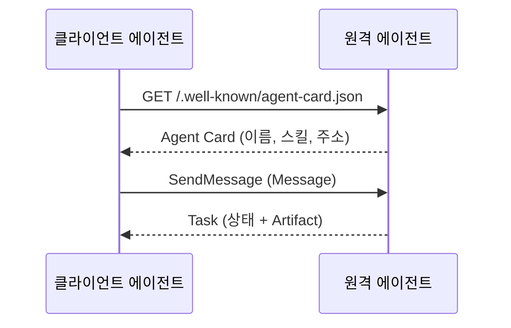
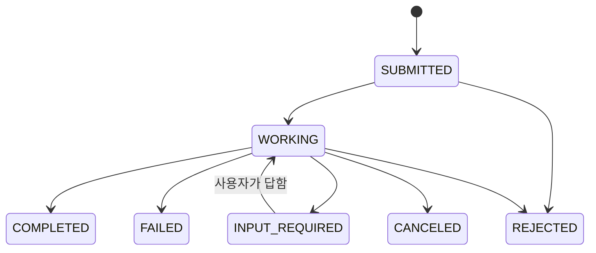

# A2A
{: .no_toc }



여행 예약 에이전트가 항공권 에이전트에게 "11월 30일 서울→도쿄 표를 찾아 줘"라고 부탁하는 장면을 떠올려 보자. 두 에이전트를 만든 회사가 다르고, 하나는 LangGraph로, 다른 하나는 다른 프레임워크로 만들었다. 이 둘이 서로 말을 알아들으려면 **같은 약속**이 필요하다. A2A(Agent2Agent)가 그 약속이다.

## 먼저 그림으로 보기



흐름은 두 단계다.

1. **명함 받기**: 상대 에이전트의 Agent Card를 읽고 무엇을 할 수 있는지, 어디로 요청을 보내면 되는지 알아낸다.
2. **일 맡기기**: Message를 보내면 상대가 Task(작업)를 만들고, 결과물을 Artifact에 담아 돌려준다.

{: .tip }
Agent Card는 **명함**, Message는 **대화 한 마디**, Task는 **접수된 일감 번호표**, Artifact는 **완성된 결과물**이라고 생각하면 된다.

공식 명세는 A2A를 이렇게 소개한다. 서로 다른 프레임워크, 언어, 회사가 만든 에이전트들이 **서로의 내부 상태, 메모리, 도구에 접근하지 않고도** 협업하게 하는 공개 표준이다. 상대가 속에서 어떤 모델과 도구를 쓰는지는 몰라도 된다. 명세는 이것을 "불투명한 실행(Opaque Execution)"이라고 부른다.

## 누가 관리하고, 지금 몇 버전인가

A2A는 Google이 기여한 프로젝트이고, 지금은 **Linux Foundation** 아래의 오픈소스 프로젝트다. 라이선스는 Apache 2.0이다. (공식 저장소 `a2aproject/A2A`의 README 기준)

| 항목 | 확인한 값 |
| --- | --- |
| 명세 최신 릴리스 | `v1.0.1` (2026-05-28 공개) |
| 요청에 쓰는 버전 값 | `1.0` (`Major.Minor` 형식) |
| 공식 Python SDK | `a2a-sdk` `1.3.1` (2026-11-17 공개) |

`v1.0.1`은 `v1.0.0`(2026-03-12)의 버그 수정판이다. 아래 예제는 Python 3.12.16과 `a2a-sdk` 1.3.1에서 실행했다.

{: .warning }
인터넷에 있는 예전 글은 `0.2`나 `0.3` 시절 형식이 많다. 1.0에서는 메서드 이름, 상태 값 표기, 카드 필드가 바뀌었다. 예를 들어 1.0의 JSON-RPC 메서드 이름은 `SendMessage`, 상태 값은 `TASK_STATE_COMPLETED` 같은 대문자 이름이다. 옛 예제를 그대로 따라 하면 맞지 않을 수 있다.

## 직접 만들어 보기: 달러 → 원 계산 에이전트

LLM 없이 규칙으로만 동작하는 작은 에이전트를 만든다. "100달러는 몇 원?"처럼 숫자가 들어오면 원화로 바꿔 주고, 숫자가 없으면 "몇 달러인가요?"라고 되묻는다.

{: .warning }
코드 안의 환율 `1400`은 예제용 고정값이다. 실제 환율이 아니다.

### 설치

[uv](https://docs.astral.sh/uv/)로 가상 환경을 만들고 공식 SDK를 설치했다. HTTP 서버 기능은 `http-server` 옵션에 들어 있고, 서버 실행에는 `uvicorn`을 쓴다. 공식 helloworld 예제와 같은 구성이다.

```bash
uv venv .venv
uv pip install -p .venv/bin/python \
  "a2a-sdk[http-server]" uvicorn
```

설치된 버전은 이렇게 확인했다.

```text
a2a-sdk                  1.3.1
starlette                1.10.0
uvicorn                  0.54.0
```

### 에이전트가 하는 일: agent.py

SDK에서 실제 일을 하는 부분은 `AgentExecutor`다. `execute`에 들어온 Message를 읽고, 진행 상황과 결과를 **이벤트 큐(EventQueue)**에 넣는다. 큐에 넣은 이벤트를 SDK가 받아서 Task를 갱신하고 응답을 만든다.

```python
import re

from a2a.helpers import (
    get_message_text,
    new_data_part,
    new_task_from_user_message,
    new_text_message,
    new_text_part,
)
from a2a.server.agent_execution import (
    AgentExecutor,
    RequestContext,
)
from a2a.server.events import EventQueue
from a2a.server.tasks import TaskUpdater

RATE = 1400  # 예제용 고정값: 1 USD = 1400 KRW


class ExchangeExecutor(AgentExecutor):
    async def execute(
        self,
        context: RequestContext,
        event_queue: EventQueue,
    ) -> None:
        task = context.current_task
        if task is None:
            task = new_task_from_user_message(
                context.message
            )
            await event_queue.enqueue_event(task)

        updater = TaskUpdater(
            event_queue, task.id, task.context_id
        )
        await updater.start_work(
            new_text_message("계산 중...")
        )

        text = get_message_text(context.message)
        found = re.search(r"\d+(\.\d+)?", text)
        if found is None:
            await updater.requires_input(
                new_text_message("몇 달러인가요?")
            )
            return

        usd = float(found.group())
        krw = usd * RATE
        answer = f"{usd:g} USD = {krw:,.0f} KRW"
        await updater.add_artifact(
            name="result",
            parts=[
                new_text_part(answer),
                new_data_part({"usd": usd, "krw": krw}),
            ],
        )
        await updater.complete(new_text_message("완료"))

    async def cancel(self, context, event_queue):
        raise NotImplementedError("취소는 지원하지 않는다")
```

코드에서 볼 곳은 세 군데다.

- `new_task_from_user_message`: 처음 온 요청이면 Task를 새로 만든다.
- `TaskUpdater`: `start_work`, `requires_input`, `complete`처럼 **상태를 바꾸는 버튼**을 모아 둔 도구다.
- `add_artifact`: 결과물을 만든다. 사람이 읽을 글(text Part)과 프로그램이 읽을 JSON(data Part)을 함께 담았다.

### 명함과 서버: server.py

```python
import uvicorn
from starlette.applications import Starlette

from a2a.server.request_handlers import (
    DefaultRequestHandler,
)
from a2a.server.routes import (
    create_agent_card_routes,
    create_jsonrpc_routes,
)
from a2a.server.tasks import InMemoryTaskStore
from a2a.types import (
    AgentCapabilities,
    AgentCard,
    AgentInterface,
    AgentSkill,
)

from agent import ExchangeExecutor

skill = AgentSkill(
    id="usd_to_krw",
    name="달러 → 원 계산",
    description="달러 금액을 원화로 바꾼다.",
    tags=["exchange", "example"],
    examples=["100달러는 몇 원?"],
)

card = AgentCard(
    name="Exchange Agent",
    description="LLM 없이 고정 환율로 계산하는 예제",
    version="0.1.0",
    default_input_modes=["text/plain"],
    default_output_modes=[
        "text/plain",
        "application/json",
    ],
    capabilities=AgentCapabilities(streaming=True),
    supported_interfaces=[
        AgentInterface(
            protocol_binding="JSONRPC",
            url="http://127.0.0.1:9999",
            protocol_version="1.0",
        )
    ],
    skills=[skill],
)

handler = DefaultRequestHandler(
    agent_executor=ExchangeExecutor(),
    task_store=InMemoryTaskStore(),
    agent_card=card,
)

routes = []
routes.extend(create_agent_card_routes(card))
routes.extend(create_jsonrpc_routes(handler, "/"))
app = Starlette(routes=routes)

if __name__ == "__main__":
    uvicorn.run(app, host="127.0.0.1", port=9999)
```

`AgentCard`가 명함이다. `create_agent_card_routes`가 이 명함을 `/.well-known/agent-card.json` 주소에 걸어 두고, `create_jsonrpc_routes`가 `/` 주소로 JSON-RPC 요청을 받는다.

```bash
.venv/bin/python server.py
```

```text
INFO:     Uvicorn running on http://127.0.0.1:9999 (Press CTRL+C to quit)
```

### 1단계: 명함 받아 오기

다른 에이전트가 우리 에이전트를 처음 만나면 먼저 이 주소를 읽는다.

```bash
curl -s http://127.0.0.1:9999/.well-known/agent-card.json \
  | python3 -m json.tool --no-ensure-ascii
```

```json
{
  "name": "Exchange Agent",
  "description": "LLM 없이 고정 환율로 계산하는 예제",
  "supportedInterfaces": [
    {
      "url": "http://127.0.0.1:9999",
      "protocolBinding": "JSONRPC",
      "protocolVersion": "1.0"
    }
  ],
  "version": "0.1.0",
  "capabilities": {
    "streaming": true
  },
  "defaultInputModes": [
    "text/plain"
  ],
  "defaultOutputModes": [
    "text/plain",
    "application/json"
  ],
  "skills": [
    {
      "id": "usd_to_krw",
      "name": "달러 → 원 계산",
      "description": "달러 금액을 원화로 바꾼다.",
      "tags": [
        "exchange",
        "example"
      ],
      "examples": [
        "100달러는 몇 원?"
      ]
    }
  ]
}
```

Python에서는 `snake_case`(`default_input_modes`)로 썼는데, JSON에서는 `camelCase`(`defaultInputModes`)로 나왔다. 명세가 JSON 필드 이름을 camelCase로 쓰도록 정해 두었기 때문이다.

`curl -i`로 응답 헤더도 봤다. 그중 일부만 옮긴다.

```text
HTTP/1.1 200 OK
etag: W/"fda4039573243173fc0ea233636c0f17b63d71f0548fe12dd21e2416c1dd6463"
content-type: application/json
```

헤더에 `etag`가 들어 있다. 명세는 카드 응답에 캐시용 헤더(`Cache-Control`, `ETag`)를 넣도록 권장한다.

### 2단계: 메시지 보내기

JSON-RPC는 "이 메서드를 이 값으로 실행해 줘"를 JSON 한 덩어리로 보내는 방식이다. `method`에 할 일, `params`에 내용을 넣는다.

```json
{
  "jsonrpc": "2.0",
  "id": 1,
  "method": "SendMessage",
  "params": {
    "message": {
      "messageId": "msg-1",
      "role": "ROLE_USER",
      "parts": [{"text": "100달러는 몇 원?"}]
    }
  }
}
```

```bash
curl -s http://127.0.0.1:9999/ \
  -H 'Content-Type: application/json' \
  -H 'A2A-Version: 1.0' \
  -d @req1.json | python3 -m json.tool --no-ensure-ascii
```

실제 응답이다.

```json
{
  "result": {
    "task": {
      "id": "2e527abc-95c3-4894-9d2d-3484bff7793c",
      "contextId": "9881fa49-f752-4557-bffc-36e21b75f235",
      "status": {
        "state": "TASK_STATE_COMPLETED",
        "message": {
          "messageId": "a40c82f1-cfe3-45b8-bd46-aa700c0bb1d5",
          "role": "ROLE_AGENT",
          "parts": [
            {
              "text": "완료"
            }
          ]
        },
        "timestamp": "2026-11-26T15:06:37.846641Z"
      },
      "artifacts": [
        {
          "artifactId": "117d49fb-f5e7-4b2b-9c8e-9eedeefff0dc",
          "name": "result",
          "parts": [
            {
              "text": "100 USD = 140,000 KRW"
            },
            {
              "data": {
                "krw": 140000.0,
                "usd": 100.0
              }
            }
          ]
        }
      ],
      "history": [
        {
          "messageId": "msg-1",
          "contextId": "9881fa49-f752-4557-bffc-36e21b75f235",
          "taskId": "2e527abc-95c3-4894-9d2d-3484bff7793c",
          "role": "ROLE_USER",
          "parts": [
            {
              "text": "100달러는 몇 원?"
            }
          ]
        },
        {
          "messageId": "00d4d9e5-ba85-4de6-8e6d-286e0f7c4cd4",
          "role": "ROLE_AGENT",
          "parts": [
            {
              "text": "계산 중..."
            }
          ]
        }
      ]
    }
  },
  "id": 1,
  "jsonrpc": "2.0"
}
```

`SendMessage`는 기본값에서 Task가 끝 상태나 멈춤 상태(입력 필요, 인증 필요)에 이를 때까지 기다렸다가 답한다. 그래서 응답에 이미 완료된 Task가 들어 있다. 한 번의 응답 안에 앞에서 본 개념이 다 들어 있다.

- `task.id`: 서버가 붙인 일감 번호. 나중에 이 번호로 상태를 다시 물어볼 수 있다.
- `contextId`: 관련된 대화와 Task를 하나로 묶는 번호.
- `status.state`: 지금 상태. 여기서는 `TASK_STATE_COMPLETED`(완료).
- `artifacts`: 결과물. Part 두 개(text, data)가 들어 있다.
- `history`: 이 Task에서 오간 Message 기록. `role`이 `ROLE_USER`면 보낸 쪽, `ROLE_AGENT`면 에이전트 쪽이다.

{: .note }
`A2A-Version` 헤더는 "나는 1.0 규칙으로 말한다"는 표시다. 명세는 클라이언트가 이 헤더를 매번 보내도록 정했고, 헤더가 비어 있으면 서버는 `0.3`으로 해석해야 한다.

없는 버전을 보내면 어떻게 되는지도 확인했다. `A2A-Version: 9.9`로 보냈더니 명세의 `VersionNotSupportedError`(코드 `-32009`)가 돌아왔다.

```json
{"error":{"code":-32009,"message":"A2A version '9.9' is not supported by this handler. Expected version '1.0'.", ...}}
```

(`data` 부분은 길어서 `...`로 줄였다.)

### 3단계: 되묻고 이어 가기 (input-required)

숫자 없이 "환전해 줘"만 보냈다. 응답의 상태 부분만 옮긴다.

```json
"status": {
    "state": "TASK_STATE_INPUT_REQUIRED",
    "message": {
        "role": "ROLE_AGENT",
        "parts": [{"text": "몇 달러인가요?"}]
    }
}
```

Task가 끝나지 않고 **입력을 기다리는 상태**로 멈췄다. 이제 같은 `taskId`를 넣어 답을 보낸다.

```json
{
  "jsonrpc": "2.0",
  "id": 4,
  "method": "SendMessage",
  "params": {
    "message": {
      "messageId": "msg-4",
      "taskId": "9222ae9b-e849-4f5b-9308-177961954cf3",
      "role": "ROLE_USER",
      "parts": [{"text": "50"}]
    }
  }
}
```

```text
9222ae9b-e849-4f5b-9308-177961954cf3 TASK_STATE_COMPLETED
[{"artifactId": "53bbb453-eb4d-4d66-992d-d750ab7ac075", "name": "result", "parts": [{"text": "50 USD = 70,000 KRW"}, {"data": {"krw": 70000.0, "usd": 50.0}}]}]
```

같은 Task 번호로 이어서 완료됐다. 한 번에 끝나지 않는 일을 여러 번 주고받으며 마무리할 수 있다는 뜻이다. 이 Task를 `GetTask`로 다시 조회해도 상태는 `TASK_STATE_COMPLETED`였다.

{: .question }
`data` Part의 숫자가 `70000`이 아니라 `70000.0`으로 나왔다. 왜일까? SDK 문서 주석에 답이 있다. data Part는 내부적으로 protobuf의 `Value`에 담기는데, 이 형식은 모든 숫자를 실수(double)로 저장한다.

이미 끝난 Task를 `CancelTask`로 취소해 보면 `TaskNotCancelableError`(코드 `-32002`)가 돌아왔다. 끝난 일은 되돌릴 수 없다.

### 4단계: 스트리밍으로 받기

메서드 이름만 `SendStreamingMessage`로 바꾸면 응답이 한 번에 오지 않고 **일이 진행될 때마다 조금씩** 온다. 응답 형식은 SSE(Server-Sent Events)다. SSE는 서버가 연결을 열어 둔 채 `data: ...` 줄을 하나씩 흘려보내는 방식이다.

```bash
curl -s -N -i http://127.0.0.1:9999/ \
  -H 'Content-Type: application/json' \
  -H 'A2A-Version: 1.0' \
  -d @req2.json
```

```text
HTTP/1.1 200 OK
content-type: text/event-stream; charset=utf-8

data: {"result": {"task": {"id": "1833...", "status": {"state": "TASK_STATE_SUBMITTED"}, ...}}, "id": 2, "jsonrpc": "2.0"}

data: {"result": {"statusUpdate": {"taskId": "1833...", "status": {"state": "TASK_STATE_WORKING", ...}}}, "id": 2, "jsonrpc": "2.0"}

data: {"result": {"artifactUpdate": {"taskId": "1833...", "artifact": {"name": "result", "parts": [{"text": "20 USD = 28,000 KRW"}, ...]}}}, "id": 2, "jsonrpc": "2.0"}

data: {"result": {"statusUpdate": {"taskId": "1833...", "status": {"state": "TASK_STATE_COMPLETED", ...}}}, "id": 2, "jsonrpc": "2.0"}
```

한 줄이 너무 길어서 ID와 일부 필드를 `...`로 줄였다. 이벤트 종류와 상태만 뽑으면 순서가 잘 보인다.

```python
import json
import sys

for line in sys.stdin:
    if not line.startswith("data: "):
        continue
    result = json.loads(line[6:])["result"]
    kind = next(iter(result))
    body = result[kind]
    state = body.get("status", {}).get("state", "")
    print(kind, state)
```

```text
task TASK_STATE_SUBMITTED
statusUpdate TASK_STATE_WORKING
artifactUpdate 
statusUpdate TASK_STATE_COMPLETED
```

처음에 Task가 접수(`SUBMITTED`)되고, 작업 중(`WORKING`), 결과물 도착, 완료(`COMPLETED`) 순서로 왔다. 명세는 이벤트를 **만들어진 순서대로** 보내야 한다고 정해 두었다.

### SDK 클라이언트로 보내기

curl 대신 SDK 클라이언트를 쓰면 카드를 읽고, 카드에 적힌 주소와 방식으로 알아서 연결한다. 공식 helloworld 예제의 `test_client.py`와 같은 순서다. (서버를 다시 켜고 실행했다.)

```python
import asyncio

import httpx
from a2a.client import (
    A2ACardResolver,
    ClientConfig,
    create_client,
)
from a2a.helpers import new_text_message
from a2a.types import (
    Role,
    SendMessageRequest,
    TaskState,
)

URL = "http://127.0.0.1:9999"


async def main() -> None:
    async with httpx.AsyncClient() as http:
        resolver = A2ACardResolver(http, URL)
        card = await resolver.get_agent_card()
    print("카드:", card.name, card.skills[0].id)

    config = ClientConfig(streaming=True)
    client = await create_client(
        agent=card, client_config=config
    )
    message = new_text_message(
        "30달러는?", role=Role.ROLE_USER
    )
    request = SendMessageRequest(message=message)
    async for event in client.send_message(request):
        kind = event.WhichOneof("payload")
        print("이벤트:", kind)
        if kind == "status_update":
            state = event.status_update.status.state
            print("  상태:", TaskState.Name(state))
        if kind == "artifact_update":
            part = event.artifact_update.artifact.parts[0]
            print("  결과:", part.text)
    await client.close()


asyncio.run(main())
```

```text
카드: Exchange Agent usd_to_krw
이벤트: task
이벤트: status_update
  상태: TASK_STATE_WORKING
이벤트: artifact_update
  결과: 30 USD = 42,000 KRW
이벤트: status_update
  상태: TASK_STATE_COMPLETED
```

## 핵심 개념 자세히 보기

### Agent Card: 에이전트의 명함

명세는 A2A 서버가 Agent Card를 **반드시** 제공하도록 정했다. 찾는 방법은 세 가지다.

- 정해진 주소: `https://{서버 도메인}/.well-known/agent-card.json`
- 에이전트 목록(레지스트리, 카탈로그)에서 찾기
- 카드 주소나 내용을 미리 설정해 두기

1.0 명세의 필수 필드는 `name`, `description`, `supportedInterfaces`, `version`, `capabilities`, `defaultInputModes`, `defaultOutputModes`, `skills`다.

`supportedInterfaces`는 "어떤 방식으로, 어느 주소에서 받는지"의 목록이다. **첫 번째 항목이 서버가 가장 원하는 방식**이고, 클라이언트는 자기가 쓸 수 있는 것 중 앞쪽 것을 고른다.

### Skill: 할 줄 아는 일

`skills`에는 에이전트가 할 줄 아는 일을 하나씩 적는다. `id`, `name`, `description`, `tags`, `examples`가 있고, 스킬마다 받는 형식(`inputModes`)과 내보내는 형식(`outputModes`)을 따로 적을 수도 있다. 예제처럼 생략하면 카드의 기본값을 쓴다.

{: .tip }
스킬 설명은 사람이 아니라 **다른 에이전트가 읽는 자기소개서**다. 클라이언트 에이전트는 이 설명을 보고 "이 일을 저 에이전트에게 맡길까"를 판단한다.

### Task와 상태

Task는 A2A에서 일을 세는 기본 단위다. 고유 ID가 있고, 상태가 정해진 순서로 바뀐다. 1.0의 상태 값은 아래와 같다. (`a2a.proto` 기준)

| 상태 | 뜻 | 종류 |
| --- | --- | --- |
| `TASK_STATE_SUBMITTED` | 접수됨 | 진행 |
| `TASK_STATE_WORKING` | 처리 중 | 진행 |
| `TASK_STATE_INPUT_REQUIRED` | 추가 입력이 필요함 | 멈춤 |
| `TASK_STATE_AUTH_REQUIRED` | 인증이 필요함 | 멈춤 |
| `TASK_STATE_COMPLETED` | 성공적으로 끝남 | 끝 |
| `TASK_STATE_FAILED` | 오류로 끝남 | 끝 |
| `TASK_STATE_CANCELED` | 취소됨 | 끝 |
| `TASK_STATE_REJECTED` | 에이전트가 맡지 않기로 함 | 끝 |



그림은 위 예제에서 본 흐름과 proto 주석의 설명을 바탕으로 그렸다. `AUTH_REQUIRED`도 `INPUT_REQUIRED`처럼 멈춤 상태다. 명세에 따르면 "끝" 상태의 Task는 새 Message를 받지 않고, 스트림도 끝 상태에 도달하면 닫힌다. 실습에서도 완료된 Task는 취소되지 않았다.

{: .note }
서버는 Task 대신 Message 하나만 돌려줄 수도 있다. `SendMessage` 응답에는 `task`와 `message` 중 하나가 들어간다. 바로 답하면 끝나는 간단한 대화는 Task 없이 Message로 답할 수 있다.

### Message와 Part

**Message**는 대화 한 턴이다. `role`이 `ROLE_USER`(클라이언트가 보냄)나 `ROLE_AGENT`(에이전트가 보냄)이고, 안에 Part가 하나 이상 들어간다.

**Part**는 내용을 담는 가장 작은 칸이다. 1.0에서는 아래 네 가지 중 하나를 담는다.

| 필드 | 담는 것 |
| --- | --- |
| `text` | 글자 |
| `raw` | 파일 내용 바이트 (JSON에서는 base64 문자열) |
| `url` | 파일이 있는 주소 |
| `data` | 아무 JSON 값 |

여기에 `mediaType`(예: `image/png`), `filename`, `metadata`를 덧붙일 수 있다. 파일은 `raw`나 `url`로 보낸다.

### Artifact: 결과물

Artifact는 에이전트가 Task의 결과로 만든 물건이다. 문서, 그림, 구조화된 데이터 등이 될 수 있고 Message처럼 Part로 이루어진다.

Message와 Artifact를 나눠 둔 이유가 있다. Message는 "계산 중...", "몇 달러인가요?" 같은 **대화**이고, Artifact는 "50 USD = 70,000 KRW" 같은 **납품물**이다. 받는 쪽은 Artifact만 모아도 결과를 얻을 수 있다.

### 전송 방식 세 가지

1.0 명세는 같은 동작을 세 가지 방식(바인딩)으로 정의한다. 어느 방식을 쓰든 기능과 결과는 같아야 한다.

| 동작 | JSON-RPC | gRPC | HTTP+JSON(REST) |
| --- | --- | --- | --- |
| 메시지 보내기 | `SendMessage` | `SendMessage` | `POST /message:send` |
| 스트리밍 | `SendStreamingMessage` | `SendStreamingMessage` | `POST /message:stream` |
| Task 조회 | `GetTask` | `GetTask` | `GET /tasks/{id}` |
| Task 목록 | `ListTasks` | `ListTasks` | `GET /tasks` |
| 취소 | `CancelTask` | `CancelTask` | `POST /tasks/{id}:cancel` |
| 다시 구독 | `SubscribeToTask` | `SubscribeToTask` | `POST /tasks/{id}:subscribe` |

JSON-RPC와 REST의 스트리밍은 SSE를 쓴다. 서버가 어떤 방식을 지원하는지는 카드의 `supportedInterfaces`에 `protocolBinding`(`JSONRPC`, `GRPC`, `HTTP+JSON`)으로 적는다. 이 글의 예제는 JSON-RPC만 열었다.

### 진행 상황을 받는 세 가지 방법

| 방법 | 어떻게 | 어울리는 상황 |
| --- | --- | --- |
| 폴링 | `GetTask`를 주기적으로 호출 | 간단한 연동 |
| 스트리밍 | 연결을 열어 두고 이벤트를 받음 | 화면에 실시간 진행 표시 |
| 푸시 알림 | 에이전트가 클라이언트의 웹훅 주소로 HTTP POST | 오래 걸리는 일, 서버끼리 연동 |

스트리밍은 카드의 `capabilities.streaming`이, 푸시 알림은 `capabilities.pushNotifications`가 `true`여야 쓸 수 있다. 푸시 알림은 Task마다 알림 받을 `url`, `token`, 인증 정보를 등록해 두는 방식이다. 이 글에서는 푸시 알림을 실행해 보지 않았다.

{: .warning }
푸시 알림은 에이전트가 **남이 알려 준 주소로 요청을 보내는** 기능이다. 명세는 에이전트가 웹훅 주소를 검사해서 사설 IP나 localhost로 가는 요청을 거부하라고 권장한다. 내부망 공격(SSRF)에 악용될 수 있기 때문이다.

### 인증은 카드에 적고, 자격 증명은 따로 받는다

A2A는 인증을 새로 발명하지 않고 기존 웹 보안 방식을 쓴다. 흐름은 이렇다.

1. 클라이언트가 카드의 `securitySchemes`에서 서버가 요구하는 인증 방식을 읽는다.
2. 실제 자격 증명(토큰 등)은 A2A 바깥에서 따로 받는다.
3. 받은 자격 증명을 매 요청의 HTTP 헤더 등에 넣어 보낸다.

`securitySchemes`에 쓸 수 있는 방식은 API 키, HTTP 인증(Basic, Bearer 등), OAuth 2.0, OpenID Connect, 상호 TLS(mTLS)다. 명세는 실제 서비스에서 HTTPS(gRPC는 TLS)를 **반드시** 쓰도록 정했다. 카드에는 비밀번호 같은 민감한 정보를 넣지 않는다.

인증한 사용자에게만 더 많은 스킬을 보여 주는 **확장 카드**(`GetExtendedAgentCard`)도 있다. 카드 자체에 서명(`signatures`, JWS)을 붙여 위조를 막을 수도 있다.

## MCP와는 무엇이 다른가

A2A 공식 문서는 둘을 경쟁 관계가 아니라 **서로 보완하는 관계**라고 설명한다.

| | MCP | A2A |
| --- | --- | --- |
| 연결 대상 | 에이전트 ↔ 도구, API, 데이터 | 에이전트 ↔ 에이전트 |
| 공식 문서의 비유 | 세로(vertical): 한 에이전트를 깊게 | 가로(horizontal): 다른 에이전트로 넓게 |
| 다루는 것 | 도구 설명, 입력, 구조화된 출력 | 서로 찾기, 작업 관리, 맥락과 결과 교환 |

공식 문서의 표현을 빌리면 "MCP는 각 에이전트에 깊이를, A2A는 시스템에 범위를" 준다. 함께 쓰는 예도 명세에 있다. A2A 클라이언트가 A2A 서버 에이전트에게 일을 맡기고, 그 서버 에이전트는 MCP로 여러 도구와 데이터를 써서 일을 처리한다.

{: .tip }
MCP는 **직원이 쓰는 공구**를 꽂는 규격이고, A2A는 **다른 부서 직원에게 일을 부탁하는** 규격이다. 부탁받은 직원이 속에서 어떤 공구를 쓰는지는 부탁한 쪽이 몰라도 된다.

## A2A 위에 올라가는 확장: A2UI

A2A에는 **확장(Extension)** 장치가 있다. 기본 명세 밖의 기능을 더할 때 쓰고, 카드의 `capabilities.extensions`에 확장의 URI를 적어 지원 여부를 알린다.

A2UI(Agent-to-User Interface)는 에이전트가 글 대신 화면 구성 요소(UI)를 데이터로 보내게 하는 프레임워크다. A2UI 저장소에는 A2UI를 A2A에 얹는 확장 명세가 있고, 확장 URI는 `https://a2ui.org/a2a-extension/a2ui/v1.0`이다. A2UI 자체는 [A2UI와 SwiftUI]({{ '/ios/a2ui-swiftui/' | relative_url }}) 글에서 다룬다.

## 정리

- A2A는 서로 다른 팀, 프레임워크, 회사가 만든 에이전트끼리 대화하는 공개 표준이다. Linux Foundation 아래 프로젝트이고, 최신 명세 릴리스는 `v1.0.1`이다.
- 클라이언트는 `/.well-known/agent-card.json`에서 **Agent Card**를 읽어 상대의 스킬과 주소를 알아낸다.
- **Message**(대화 한 턴)를 보내면 서버는 **Task**(일감)를 만들고, 결과를 **Artifact**로 돌려준다. 둘 다 **Part**(text, raw, url, data)로 이루어진다.
- Task 상태는 `SUBMITTED` → `WORKING` → `COMPLETED`처럼 바뀌고, `INPUT_REQUIRED`에서는 같은 `taskId`로 이어서 답할 수 있다.
- 전송 방식은 JSON-RPC, gRPC, HTTP+JSON 세 가지이고, 진행 상황은 폴링, 스트리밍(SSE), 푸시 알림으로 받는다.
- MCP는 에이전트와 도구를, A2A는 에이전트와 에이전트를 잇는다.

## 다음에 해 볼 것

이번 에이전트는 규칙만으로 답했다. `execute` 안의 계산 부분을 [LangGraph]({{ '/ai/using-ai/langgraph/' | relative_url }})나 [LangChain]({{ '/ai/using-ai/langchain/' | relative_url }})으로 만든 에이전트 호출로 바꾸면, 바깥의 카드와 Task 구조는 그대로 두고 속만 LLM 에이전트로 바꿀 수 있다. 공식 README도 LangGraph 같은 프레임워크로 만든 에이전트를 A2A 서버로 공개하는 것을 사용 예로 든다.

## 참고

- [A2A 공식 사이트](https://a2a-protocol.org/)
- [A2A 명세 (Specification)](https://a2a-protocol.org/latest/specification/)
- [A2A와 MCP 비교 (공식 문서)](https://a2a-protocol.org/latest/topics/a2a-and-mcp/)
- [A2A 저장소와 릴리스 노트](https://github.com/a2aproject/A2A/releases)
- [A2A Python SDK (a2a-python)](https://github.com/a2aproject/a2a-python)
- [공식 예제: Python helloworld](https://github.com/a2aproject/a2a-samples/tree/main/samples/python/agents/helloworld)
- [A2UI A2A 확장 명세](https://github.com/google/A2UI/blob/main/specification/v1_0/extensions/a2a/docs/a2ui_extension_specification.md)
