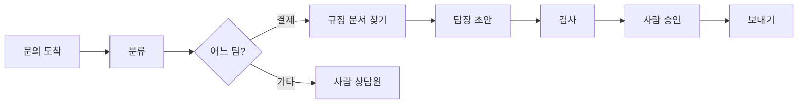
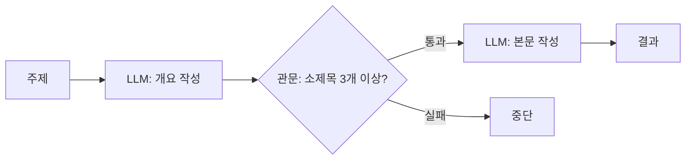
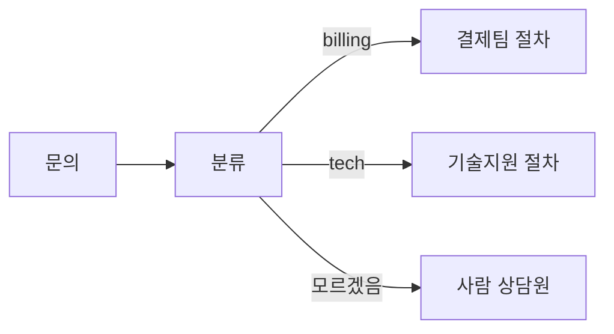
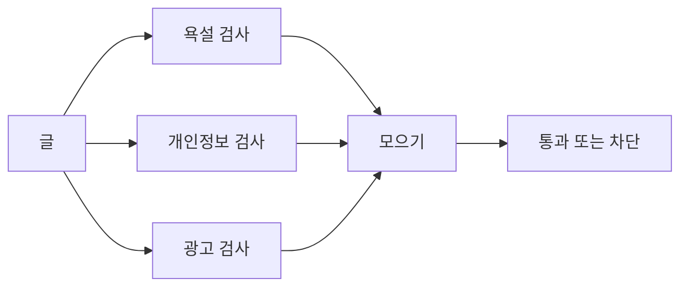
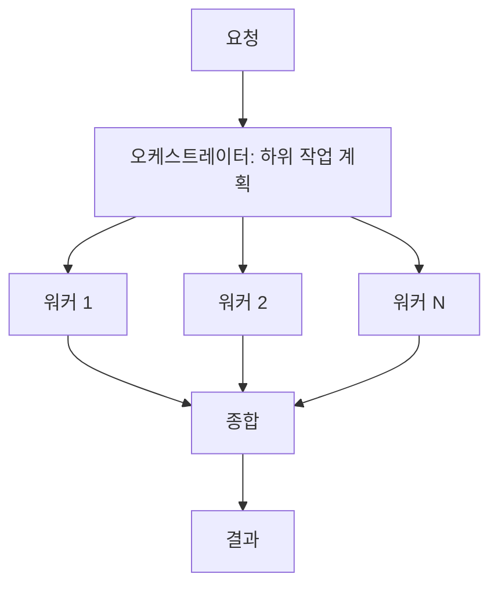
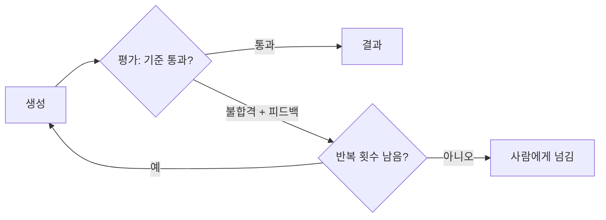
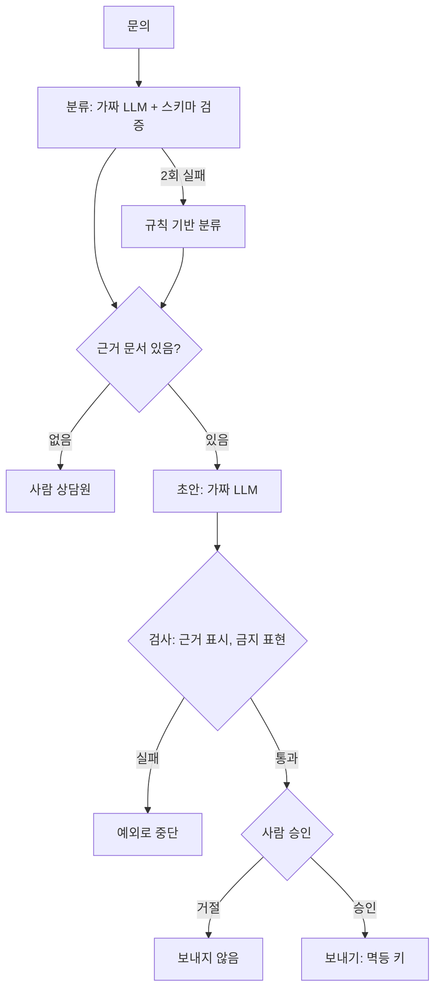
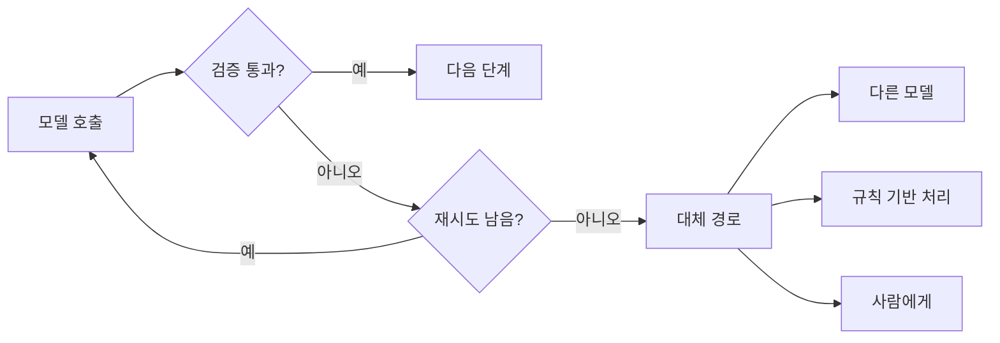

# AI 워크플로
{: .no_toc }



**AI 워크플로는 모델 호출과 일반 코드를 미리 정한 순서와 규칙으로 이어 붙인 작업 흐름이다.** 모델이 할 일과 코드가 할 일, 사람이 확인할 일을 단계로 나누고, 단계 사이에 무엇을 주고받을지 정해 둔다.

고객 문의 한 건을 처리한다고 해 보자. 처음에는 "이 문의에 답해 줘"라는 프롬프트 하나로 시작한다. 그런데 금방 문제가 보인다. 환불 규정을 지어내기도 하고, 급한 문의를 놓치기도 하고, 사람이 보기 전에 답장이 나가 버릴 수도 있다. 그래서 일을 쪼갠다.



이 그림의 각 상자가 단계다. 분류와 초안은 모델이 하고, 문서 찾기와 검사는 코드가 하고, 승인은 사람이 한다. 이 글은 이런 흐름을 처음부터 끝까지 설계하는 방법을 다룬다. 어떤 모양을 고를지, 단계 사이를 어떻게 묶을지, 실패하면 어디로 보낼지를 차례로 본다.

{: .tip }
쉽게 말하면 워크플로는 **공장의 조립 라인**이다. 라인마다 맡은 일이 정해져 있고, 다음 라인으로 넘기기 전에 검사대를 둔다. 모델은 그 라인 몇 곳에 앉은 숙련공이다.

이 글의 예제는 모두 직접 실행했다. 패턴을 보여 주는 예제에서는 진짜 모델 대신 **가짜 LLM 함수**를 쓴다. 입력에 따라 정해진 답을 돌려주는 함수라서, 누가 실행해도 같은 결과가 나온다. 진짜 모델을 쓴 실험은 [실제 모델로 한 단계 바꿔 보기](#실제-모델로-한-단계-바꿔-보기)에서 따로 표시한다. 실행 환경은 Apple M4, Python 3.12.16, pydantic 2.14.4이고, 실제 모델 실험에는 mlx 0.32.5와 mlx-lm 0.32.2를 썼다.

## 워크플로와 에이전트는 무엇이 다를까

Anthropic의 글 [Building effective agents](https://www.anthropic.com/engineering/building-effective-agents)(2024년 12월 19일)는 둘을 이렇게 나눈다.

- **워크플로**: "LLM과 도구가 미리 정의된 코드 경로를 따라 조율되는 시스템" (원문: "systems where LLMs and tools are orchestrated through predefined code paths")
- **에이전트**: "LLM이 스스로 과정과 도구 사용을 동적으로 지시하며, 일을 어떻게 해낼지에 대한 통제권을 유지하는 시스템" (원문: "LLMs dynamically direct their own processes and tool usage, maintaining control over how they accomplish tasks")

핵심은 **다음에 무엇을 할지 누가 정하는가**다. 워크플로에서는 개발자가 쓴 코드가 정한다. 에이전트에서는 모델이 정한다.

{: .tip }
워크플로는 **노선이 정해진 버스**이고, 에이전트는 **목적지만 듣고 길을 고르는 택시 기사**다. 버스는 늦어질 수는 있어도 엉뚱한 동네로 가지 않는다. 택시는 막힌 길을 피해 갈 수 있지만, 어느 길로 갔는지 나중에 확인해야 한다.

같은 글은 두 가지를 함께 강조한다.

- 에이전트 시스템은 "더 나은 작업 성능을 위해 지연 시간과 비용을 내주는 경우가 많다" (원문: "Agentic systems often trade latency and cost for better task performance").
- 에이전트의 자율성은 "더 높은 비용과 오류가 누적될 가능성"을 뜻한다 (원문: "higher costs, and the potential for compounding errors"). 그래서 샌드박스에서 충분히 시험하고 적절한 안전장치를 두라고 권한다.

그 글이 모든 시스템의 바탕으로 두는 것은 **증강된 LLM**(augmented LLM)이다. 검색, 도구, 기억 같은 것을 붙인 LLM이다. 워크플로든 에이전트든 이 블록을 몇 번, 어떤 순서로 부르는가의 차이다.

{: .note }
이 글은 2024년 12월에 나왔고, 페이지 맨 위에 "이 글이 설명한 도구 환경의 상당 부분은 그 뒤 바뀌었다"는 안내가 붙어 있다. 다섯 패턴의 정의와 판단 기준은 지금도 그 글을 출처로 인용하지만, 특정 도구나 프레임워크 이야기는 최신 문서로 다시 확인해야 한다.

에이전트가 도는 반복 구조는 [루프 엔지니어링]({{ '/ai/using-ai/loop-engineering/' | relative_url }})에서, 상태와 체크포인트를 가진 그래프 설계는 [그래프 엔지니어링]({{ '/ai/using-ai/graph-engineering/' | relative_url }})에서 자세히 다룬다. 이 글은 그보다 한 층 위에서 **어떤 모양을 고를지**를 본다.

## 무엇부터 골라야 할까: 가장 단순한 것부터

Anthropic 글의 첫 권고는 이렇다. "가능한 가장 단순한 해법을 찾고, 필요할 때만 복잡도를 높여라" (원문: "finding the simplest solution possible, and only increasing complexity when needed"). 같은 글은 많은 애플리케이션에서 검색과 예시를 넣어 LLM 한 번 호출을 다듬는 것으로 충분하다고 쓴다.

선택지를 단순한 순서로 늘어놓으면 네 칸이다.

| 단계 | 무엇 | 이럴 때 |
| --- | --- | --- |
| 1 | 일반 코드 | 규칙으로 정답이 정해진다. 날짜 계산, 형식 검사, 표 조회 |
| 2 | LLM 한 번 호출 | 입력 하나를 받아 결과 하나를 낸다. 요약, 번역, 분류 |
| 3 | 워크플로 | 하위 작업을 미리 나눌 수 있다. 순서와 분기를 코드로 적을 수 있다 |
| 4 | 에이전트 | 필요한 단계 수와 순서를 미리 알 수 없다. 모델이 도구를 골라 가며 풀어야 한다 |

{: .tip }
실무에서는 위 표를 **아래에서 위로가 아니라 위에서 아래로** 내려간다. 1번으로 풀리면 모델을 부르지 않는다. 2번이 충분히 좋으면 워크플로를 만들지 않는다. 한 칸 내려갈 때마다 비용, 지연, 디버깅 범위가 늘어나기 때문이다. 내려가는 이유는 "이 칸으로는 이런 실패가 반복된다"는 기록이어야 한다.

한 칸 내려갈지 판단할 때 스스로에게 묻는 질문을 적어 둔다. 이것은 공식 기준이 아니라 필자의 실무 판단이다.

- 지금 실패가 **프롬프트 문장**의 문제인가, **일의 구조**의 문제인가? 앞의 것이면 프롬프트부터 고친다([프롬프트 엔지니어링]({{ '/ai/using-ai/prompt-engineering/' | relative_url }})).
- 실패한 지점을 **한 단계로 가리킬 수 있는가**? 가리킬 수 없으면 단계를 나눌 때다.
- 하위 작업의 목록이 **입력마다 달라지는가**? 거의 같다면 워크플로로 충분하다. 매번 다르다면 오케스트레이터-워커나 에이전트를 본다.
- 중간에 **되돌릴 수 없는 일**(돈 이동, 메일 발송, 데이터 삭제)이 있는가? 있다면 그 앞에 코드 검사나 사람 승인을 둔다.

프레임워크에 대해서도 같은 글은 조심하라고 한다. 프레임워크는 저수준 작업을 쉽게 해 주지만 "기반 프롬프트와 응답을 가리는 추상화 층"을 만들기 쉬우니, **먼저 LLM API를 직접 써 보라**고 권한다. 이 글의 예제가 프레임워크 없이 평범한 Python 함수로만 되어 있는 이유다. 프레임워크를 쓴다면 [LangChain]({{ '/ai/using-ai/langchain/' | relative_url }})과 [LangGraph]({{ '/ai/using-ai/langgraph/' | relative_url }})를 참고한다.

## 다섯 가지 기본 패턴

Anthropic 글은 워크플로의 기본 모양을 다섯 개로 정리한다. 하나씩 그림, 쓸 때, 실험, 조심할 점 순서로 본다.

### 1. 프롬프트 체이닝: 앞 단계의 출력이 다음 단계의 입력

**프롬프트 체이닝**(prompt chaining)은 일을 정해진 순서의 단계로 나누고, 한 단계의 출력을 다음 단계의 입력으로 넘기는 패턴이다. 릴레이 경주에서 바통을 넘기는 것과 같다.

Anthropic 글은 중간 단계에 "프로그램으로 하는 검사"를 넣을 수 있다고 하고, 이것을 **관문**(gate)이라고 부른다. 관문을 통과하지 못하면 다음 단계로 가지 않는다.



**쓸 때**: 원문은 "작업을 고정된 하위 작업으로 쉽고 깔끔하게 나눌 수 있는 상황"이라고 한다. 예로 마케팅 문구를 쓴 뒤 번역하기, 문서 개요를 쓰고 기준에 맞는지 확인한 뒤 본문 쓰기를 든다.

아래 예제는 개요를 만들고, 소제목이 3개 이상인지 코드로 검사한 뒤 본문을 쓴다. `fake_outline`은 가짜 LLM이다.

```python
# 가짜 LLM: 입력에 따라 정해진 문자열을 돌려준다.
def fake_outline(topic):
    if "환불" in topic:
        return ["환불 조건", "신청 방법", "처리 기간"]
    return ["소개"]  # 너무 짧은 개요

def fake_write(outline):
    return " / ".join(f"{h}: ..." for h in outline)

def gate(outline):
    # 코드로 검사하는 관문: 소제목 3개 이상
    return len(outline) >= 3

def run(topic):
    outline = fake_outline(topic)
    print("개요:", outline)
    if not gate(outline):
        print("관문 실패: 개요가 3개 미만이라 중단")
        return None
    text = fake_write(outline)
    print("본문:", text)
    return text

run("환불 안내문")
print("---")
run("회사 소개")
```

실행 결과:

```text
개요: ['환불 조건', '신청 방법', '처리 기간']
본문: 환불 조건: ... / 신청 방법: ... / 처리 기간: ...
---
개요: ['소개']
관문 실패: 개요가 3개 미만이라 중단
```

두 번째 주제는 개요가 하나뿐이라 관문에서 멈췄다. 본문 작성 함수는 아예 불리지 않았다. 모델 호출이었다면 그만큼의 비용과 시간이 아껴진 것이다.

{: .warning }
**자주 생기는 실패**: 관문 없이 단계만 이어 붙이는 것이다. 첫 단계가 조금 틀리면 다음 단계는 그 틀린 입력을 그럴듯하게 다듬어 버린다. 단계가 늘수록 처음의 오류가 끝까지 실려 간다. 관문은 "다음 단계가 받아도 되는 입력인가"를 확인하는 자리다.

### 2. 라우팅: 입력을 분류해서 알맞은 길로 보내기

**라우팅**(routing)은 입력을 먼저 분류하고, 분류 결과에 따라 서로 다른 처리 경로로 보내는 패턴이다. 병원 접수 창구가 증상을 듣고 진료과를 정해 주는 것과 같다.



**쓸 때**: 원문은 "따로 다루는 편이 나은 뚜렷한 범주가 있는 복잡한 작업"이라고 한다. 예로 고객 문의를 종류별 절차로 보내기, 쉬운 질문은 작은 모델로 어려운 질문은 더 강한 모델로 보내기를 든다.

```python
# 가짜 분류기: 키워드로 범주를 정한다(실제 모델 아님).
def fake_classify(text):
    if "환불" in text or "결제" in text:
        return "billing"
    if "오류" in text or "안 돼" in text:
        return "tech"
    return "unknown"

ROUTES = {
    "billing": "결제팀 절차",
    "tech": "기술지원 절차",
}
FALLBACK = "사람 상담원"

def route(text):
    label = fake_classify(text)
    return label, ROUTES.get(label, FALLBACK)

for q in ["환불하고 싶어요",
          "앱 로그인이 안 돼요",
          "회사 주소가 어디인가요"]:
    label, target = route(q)
    print(f"{q} -> {label} -> {target}")
```

실행 결과:

```text
환불하고 싶어요 -> billing -> 결제팀 절차
앱 로그인이 안 돼요 -> tech -> 기술지원 절차
회사 주소가 어디인가요 -> unknown -> 사람 상담원
```

세 번째 문의는 어느 범주에도 맞지 않았다. 표에 없는 범주는 `FALLBACK`, 즉 사람 상담원으로 간다.

{: .warning }
**자주 생기는 실패**: "모르겠음"으로 갈 길을 만들지 않는 것이다. 분류 결과를 무조건 아는 범주 중 하나로 고르게 하면, 애매한 문의도 엉뚱한 팀으로 간다. 분류기가 틀렸을 때 그 뒤 단계는 모두 틀린 전제 위에서 일한다. 라우팅에서는 **분류 정확도가 전체 품질의 상한**이 된다.

{: .tip }
실무에서는 라우팅 표를 프롬프트 안이 아니라 **코드의 딕셔너리**로 둔다. 범주가 하나 늘어날 때 무엇이 바뀌는지 diff로 보이고, "billing으로 분류된 문의는 결제팀 절차로 간다"는 사실을 테스트로 고정할 수 있기 때문이다.

### 3. 병렬화: 나눠서 동시에, 또는 여러 번 물어서 투표

**병렬화**(parallelization)는 여러 LLM 호출을 동시에 돌리고 결과를 코드로 모으는 패턴이다. Anthropic 글은 두 가지로 나눈다.

- **분할**(sectioning): 일을 서로 독립된 조각으로 나눠 동시에 처리한다. 시험 채점을 과목별 선생님이 동시에 하는 것과 같다.
- **투표**(voting): 같은 일을 여러 번 시켜 다양한 답을 얻고 모은다. 같은 사진을 심사위원 세 명에게 보여 주는 것과 같다.



**쓸 때**: 분할은 "나눈 하위 작업을 병렬로 돌려 속도를 낼 수 있을 때", 투표는 "더 높은 확신을 위해 여러 관점이나 여러 번의 시도가 필요할 때"다. 원문은 분할의 예로 본 응답과 안전 검사를 동시에 돌리기, 평가 항목마다 따로 평가하기를, 투표의 예로 여러 프롬프트로 코드 취약점 검토하기, 기준 표 수가 다른 콘텐츠 검토를 든다.

아래 예제의 `fake_llm`은 정해진 시간만큼 `asyncio.sleep`으로 기다린 뒤 정해진 판정을 돌려준다. 진짜 모델 호출이 네트워크를 기다리는 모습을 흉내 낸 것이다. Python 문서에 따르면 `asyncio.gather`는 모든 작업이 성공하면 결과를 목록으로 모으고, **결과 순서는 넘긴 순서와 같다**.

```python
import asyncio, time

# 가짜 LLM: 정해진 시간만큼 기다린 뒤
# 정해진 판정을 돌려준다(실제 모델 아님).
async def fake_llm(name, delay, verdict):
    await asyncio.sleep(delay)
    return name, verdict

# 1) 분할: 서로 다른 관점을 동시에 본다
SECTIONS = [("욕설 검사", 0.3, "통과"),
            ("개인정보 검사", 0.4, "차단"),
            ("광고 검사", 0.2, "통과")]

async def one_by_one(jobs):
    return [await fake_llm(*j) for j in jobs]

async def together(jobs):
    return await asyncio.gather(
        *(fake_llm(*j) for j in jobs))

for fn in (one_by_one, together):
    t0 = time.perf_counter()
    res = asyncio.run(fn(SECTIONS))
    dt = time.perf_counter() - t0
    print(f"{fn.__name__}: {dt:.2f}s")
print("분할 결과:", res)

# 2) 투표: 같은 질문을 세 번 묻는다
VOTES = [("시도1", 0.3, "위험"),
         ("시도2", 0.3, "안전"),
         ("시도3", 0.3, "위험")]
res = asyncio.run(together(VOTES))
risky = sum(v == "위험" for _, v in res)
print("투표 결과:", res)
for need in (1, 2, 3):
    final = "위험" if risky >= need else "안전"
    print(f"기준 {need}표 이상 -> {final}")
```

실행 결과:

```text
one_by_one: 0.90s
together: 0.40s
분할 결과: [('욕설 검사', '통과'), ('개인정보 검사', '차단'), ('광고 검사', '통과')]
투표 결과: [('시도1', '위험'), ('시도2', '안전'), ('시도3', '위험')]
기준 1표 이상 -> 위험
기준 2표 이상 -> 위험
기준 3표 이상 -> 안전
```

하나씩 기다리면 0.3 + 0.4 + 0.2초를 다 더한 만큼 걸렸고, 동시에 기다리면 가장 긴 0.4초 근처에서 끝났다. 시간은 실행할 때마다 조금씩 다르다.

투표 쪽을 보자. 같은 세 표를 두고도 **몇 표 이상을 위험으로 볼지**에 따라 결론이 바뀌었다. 기준을 낮추면 놓치는 위험이 줄지만 괜히 막는 경우가 늘고, 기준을 높이면 반대가 된다. 이 기준은 모델이 아니라 설계자가 정한다.

{: .warning }
**자주 생기는 실패**: 사실은 서로 의존하는 작업을 병렬로 돌리는 것이다. B가 A의 결과를 읽어야 한다면 동시에 돌릴 수 없다. 어떤 작업이 어떤 결과를 기다려야 하는지 정리하는 방법은 [DAG와 AI 워크플로]({{ '/ai/dag/' | relative_url }})에서 자세히 다룬다. 또 하나는 투표에서 같은 프롬프트, 같은 설정으로 여러 번 물어 놓고 독립된 의견이라고 믿는 것이다. 이 글 뒤쪽의 실제 모델 실험에서도 같은 입력을 여러 번 넣었을 때 같은 분류가 나왔다. 같은 설정으로 여러 번 묻는 것은 독립된 의견을 보장하지 않는다.

{: .tip }
실무에서는 병렬 호출 수만큼 **요금과 호출 한도도 함께 늘어난다**는 점을 먼저 계산한다. 분할은 시간을 줄여 주지만 총비용은 줄여 주지 않는다. 투표는 비용을 표 수만큼 곱한다.

### 4. 오케스트레이터-워커: 계획은 모델이, 실행은 여럿이

**오케스트레이터-워커**(orchestrator-workers)는 중심 모델(오케스트레이터)이 일을 보고 하위 작업을 그때그때 만들어 일꾼(워커)에게 나눠 주고, 결과를 모아 종합하는 패턴이다. 공사 현장 소장이 그날 도면을 보고 작업을 나눠 주는 것과 같다.



**쓸 때**: 원문은 "필요한 하위 작업을 미리 예측할 수 없는 복잡한 작업"이라고 한다. 예로 매번 여러 파일을 바꿔야 하는 코딩 작업, 여러 출처를 찾아 분석하는 검색 작업을 든다. 병렬화와의 핵심 차이는 "유연성"이다. 병렬화는 조각이 미리 정해져 있고, 오케스트레이터-워커는 조각을 입력을 보고 정한다.

`fake_plan`이 가짜 오케스트레이터다. 실제로는 모델이 하위 작업 목록을 만든다.

```python
import asyncio

# 가짜 오케스트레이터: 요청 문장을 보고
# 하위 작업 목록을 '그때그때' 만든다(실제 모델 아님).
def fake_plan(request):
    tasks = []
    if "로그인" in request:
        tasks.append(("auth", "로그인 화면 수정"))
    if "다크 모드" in request:
        tasks.append(("ui", "색상 토큰 추가"))
        tasks.append(("ui", "설정 화면 토글"))
    if "문서" in request:
        tasks.append(("docs", "README 갱신"))
    return tasks

async def fake_worker(area, job):
    await asyncio.sleep(0.1)
    return f"[{area}] {job} 완료"

async def orchestrate(request):
    plan = fake_plan(request)
    print(f"요청: {request}")
    print(f"계획: 하위 작업 {len(plan)}개")
    done = await asyncio.gather(
        *(fake_worker(a, j) for a, j in plan))
    for line in done:
        print(" ", line)
    # 종합 단계: 결과를 한 보고로 묶는다
    return f"{len(done)}개 작업 종합 보고"

for r in ["로그인 버그 고쳐 줘",
          "다크 모드 넣고 문서도 고쳐 줘"]:
    print(asyncio.run(orchestrate(r)))
    print("---")
```

실행 결과:

```text
요청: 로그인 버그 고쳐 줘
계획: 하위 작업 1개
  [auth] 로그인 화면 수정 완료
1개 작업 종합 보고
---
요청: 다크 모드 넣고 문서도 고쳐 줘
계획: 하위 작업 3개
  [ui] 색상 토큰 추가 완료
  [ui] 설정 화면 토글 완료
  [docs] README 갱신 완료
3개 작업 종합 보고
---
```

같은 코드인데 요청에 따라 하위 작업이 1개가 되기도, 3개가 되기도 했다. 워크플로 코드에는 "몇 개를 만들지"가 적혀 있지 않다. 이 점이 앞의 병렬화와 다르다.

{: .warning }
**자주 생기는 실패**: 계획의 크기에 한도가 없는 것이다. 모델이 하위 작업을 50개 만들면 워커도 50번 돈다. 하위 작업 수의 상한, 워커 하나의 시간 제한, 전체 비용 한도를 코드로 둔다. 또 하나는 워커끼리 같은 파일을 고치는 충돌이다. 계획 단계에서 작업 범위가 겹치지 않는지 검사하는 관문을 두면 좋다.

여러 에이전트가 서로 다른 시스템에 있을 때 일을 맡기는 표준 약속은 [A2A]({{ '/ai/using-ai/a2a/' | relative_url }})에서 다룬다.

### 5. 평가자-최적화: 만들고, 평가받고, 고치기

**평가자-최적화**(evaluator-optimizer)는 한 쪽이 결과를 만들고 다른 쪽이 평가와 피드백을 주며, 기준을 통과할 때까지 반복하는 패턴이다. 글쓴이와 편집자가 원고를 주고받는 것과 같다.



**쓸 때**: 원문은 "평가 기준이 분명할 때 특히 효과적"이라고 한다. 예로 비평을 받아 다듬는 문학 번역, 평가자가 더 찾아볼지를 정하는 여러 차례의 검색을 든다.

이 예제에서 생성기는 가짜 LLM이고, 평가기는 규칙 함수다. 평가기를 모델로 바꿔도 구조는 같다.

```python
# 가짜 생성기: 피드백을 받을 때마다 한 가지만 고친다.
def fake_generate(draft, feedback):
    if draft is None:
        return "환불은 됩니다."
    if "기간" in feedback:
        return draft + " 구매 후 7일 이내입니다."
    if "방법" in feedback:
        return draft + " 앱의 주문 내역에서 신청합니다."
    return draft

# 평가기: 여기서는 규칙으로 채점한다.
def evaluate(text):
    if "일 이내" not in text:
        return False, "기간을 밝혀라"
    if "신청" not in text:
        return False, "방법을 밝혀라"
    return True, "통과"

def loop(max_iter):
    draft, fb = None, ""
    for i in range(1, max_iter + 1):
        draft = fake_generate(draft, fb)
        ok, fb = evaluate(draft)
        print(f"{i}회차 {ok!s:<5} {fb} | {draft}")
        if ok:
            return draft
    print(f"{max_iter}회 안에 통과 못함 -> 사람에게")
    return None

loop(max_iter=5)
print("---")
loop(max_iter=2)
```

실행 결과:

```text
1회차 False 기간을 밝혀라 | 환불은 됩니다.
2회차 False 방법을 밝혀라 | 환불은 됩니다. 구매 후 7일 이내입니다.
3회차 True  통과 | 환불은 됩니다. 구매 후 7일 이내입니다. 앱의 주문 내역에서 신청합니다.
---
1회차 False 기간을 밝혀라 | 환불은 됩니다.
2회차 False 방법을 밝혀라 | 환불은 됩니다. 구매 후 7일 이내입니다.
2회 안에 통과 못함 -> 사람에게
```

반복 한도가 5일 때는 3회차에 통과했다. 한도가 2일 때는 통과하지 못하고 사람에게 넘어갔다. 한도가 없었다면 생성기가 끝내 못 고치는 경우 영원히 돌았을 것이다.

{: .warning }
**자주 생기는 실패**: 반복 한도 없이 "통과할 때까지"라고만 쓰는 것, 그리고 평가 기준이 모호한 것이다. "더 좋게 써라" 같은 피드백은 생성기가 무엇을 고칠지 알려 주지 못한다. 위의 평가기처럼 **무엇이 빠졌는지**를 말해야 다음 회차가 나아진다.

### 다섯 패턴 한눈에 비교

| 패턴 | 흐름을 정하는 것 | 잘 맞는 일 | 먼저 챙길 안전장치 |
| --- | --- | --- | --- |
| 프롬프트 체이닝 | 코드(고정 순서) | 고정된 단계로 나뉘는 일 | 단계 사이 관문 |
| 라우팅 | 코드(분류 결과 + 표) | 범주별로 처리가 다른 일 | "모르겠음" 경로 |
| 병렬화 | 코드(고정 조각) | 독립 조각, 여러 의견 | 의존 관계 확인, 표 기준 |
| 오케스트레이터-워커 | 모델(조각을 그때 정함) | 조각을 미리 모르는 일 | 조각 수·비용 상한 |
| 평가자-최적화 | 코드(반복) + 모델(피드백) | 기준이 분명한 다듬기 | 반복 한도 |

{: .question }
여러분이 맡은 일 하나를 떠올려 보자. 그 일의 단계 목록을 지금 종이에 적을 수 있는가? 적을 수 있다면 앞의 세 패턴, 입력마다 목록이 달라진다면 오케스트레이터-워커나 에이전트 쪽이다.

## 모델 단계, 코드 단계, 사람 단계를 섞기

워크플로의 모든 단계가 모델일 필요는 없다. 오히려 실무에서는 **모델 단계 사이사이에 결정적인 코드 단계를 끼워 넣는 것**이 설계의 대부분이다. 결정적(deterministic)이라는 말은 같은 입력에 항상 같은 출력을 낸다는 뜻이다. 계산기는 결정적이고, 사람에게 묻는 일은 그렇지 않다.

단계마다 누가 맡을지 고르는 기준을 표로 정리한다. 필자의 실무 기준이다.

| 맡길 곳 | 맡기는 일 | 이유 |
| --- | --- | --- |
| 코드 | 형식 검사, 계산, 표 조회, 권한 확인, 반복 한도 | 같은 입력에 같은 결과. 테스트로 고정할 수 있다 |
| 모델 | 분류, 요약, 초안, 자연어 판단 | 규칙으로 다 적을 수 없는 일 |
| 도구 호출 | 검색, 조회, 외부 API | 모델이 지어내면 안 되는 사실 |
| 사람 | 되돌릴 수 없는 일의 승인, 규정 밖 사례 | 책임이 필요한 결정 |

**도구 호출**(tool call)은 모델이 "이 함수를 이 인자로 불러 달라"고 요청하고, 실제 실행은 우리 코드가 하는 방식이다. 모델은 손이 없고 말만 할 수 있다. 실행하는 손은 우리 코드에 있다. 그래서 어떤 도구를 줄지, 인자를 어떻게 검사할지는 우리가 정한다.

**사람 개입**(human-in-the-loop)은 흐름 중간에 사람의 확인을 받는 단계를 두는 것이다. 은행 창구 직원이 큰 금액 송금 전에 팀장 도장을 받는 것과 같다. 승인을 기다리는 동안 흐름을 멈췄다가 나중에 이어서 진행하려면 상태를 저장해야 한다. 이 부분은 [그래프 엔지니어링]({{ '/ai/using-ai/graph-engineering/' | relative_url }})의 체크포인트와 [LangGraph]({{ '/ai/using-ai/langgraph/' | relative_url }})의 중단·재개에서 다룬다.

{: .tip }
실무에서는 사람 승인을 **"되돌릴 수 없는 일 바로 앞"**에 둔다. 초안 단계마다 승인을 받으면 사람이 지쳐서 대충 누르게 되고, 발송 뒤에 확인하면 이미 늦다. 승인 화면에는 모델 출력만이 아니라 근거 문서와 검사 결과를 함께 보여 줘야 사람이 판단할 수 있다.

## 끝까지 따라가는 예: 고객 문의 처리

처음 그림의 고객 문의 처리를 한 단계씩 키워 보자. 각 버전이 바로 앞 버전의 **어떤 실패** 때문에 생겼는지가 중요하다. 아래 실패 이야기는 설계를 설명하기 위한 시나리오다.

| 버전 | 모양 | 바꾼 이유 |
| --- | --- | --- |
| v0 | 프롬프트 하나: "문의에 답해 줘" | 시작 |
| v1 | 분류 → 답장 | 결제 문의와 장애 문의에 같은 말투로 답한다 |
| v2 | 분류 → 라우팅 → 규정 문서 검색 → 초안 | 환불 기간을 지어낸다. 근거를 가져와야 한다 |
| v3 | v2 + 코드 검사 관문 | 근거 표시 없이 나가거나 "무조건 환불" 같은 약속을 한다 |
| v4 | v3 + 사람 승인 + 중복 발송 방지 | 발송은 되돌릴 수 없다. 재시도 때 같은 메일이 두 번 간다 |

v4를 그림으로 그리면 이렇다.



아래가 v4 전체 코드다. 분류와 초안은 **가짜 LLM**이다. 특히 `fake_llm_classify`는 첫 호출에서 일부러 계약을 어긴 JSON을 내도록 만들었다. 재시도가 어떻게 동작하는지 보기 위해서다. 사람 승인은 `approve` 함수로 흉내 냈다.

```python
import hashlib, json, time
from typing import Literal
from pydantic import BaseModel, ValidationError

TRACE = []

def step(fn):
    # 단계마다 이름, 걸린 시간, 결과를 기록한다
    def wrap(*args, **kw):
        t0 = time.perf_counter()
        status = "ok"
        try:
            return fn(*args, **kw)
        except Exception as e:
            status = type(e).__name__
            raise
        finally:
            ms = (time.perf_counter() - t0) * 1000
            TRACE.append((fn.__name__, status, ms))
    return wrap

class Ticket(BaseModel):
    category: Literal["billing", "tech", "other"]
    urgent: bool

# 가짜 LLM: 첫 호출은 일부러 틀린 JSON을 낸다
CALLS = {"n": 0}
def fake_llm_classify(text):
    CALLS["n"] += 1
    time.sleep(0.05)
    if CALLS["n"] == 1:
        return '{"category": "refund", "urgent": "yes"}'
    cat = "billing" if "환불" in text else "other"
    return json.dumps({"category": cat,
                       "urgent": "급" in text})

def rule_classify(text):
    # 모델이 끝내 실패할 때 쓰는 규칙 기반 대체
    cat = "billing" if "환불" in text else "other"
    return Ticket(category=cat, urgent=False)

@step
def classify(text, tries=2):
    for i in range(tries):
        raw = fake_llm_classify(text)
        try:
            return Ticket.model_validate_json(raw)
        except ValidationError as e:
            bad = [x["loc"][0] for x in e.errors()]
            print(f"  계약 위반({i+1}회): {bad}")
    return rule_classify(text)

DOCS = {"billing": ("POL-7", "구매 후 7일 이내 환불")}

@step
def retrieve(t):
    return DOCS.get(t.category)

@step
def draft(text, doc):
    time.sleep(0.08)  # 가짜 LLM 지연
    doc_id, rule = doc
    return f"안내: {rule}입니다. (근거 {doc_id})"

@step
def check(d):
    # 결정적 검사: 근거 표시, 금지 표현
    if "근거" not in d:
        raise ValueError("근거 없음")
    if "무조건" in d:
        raise ValueError("과한 약속")
    return True

SENT = {}
@step
def send(ticket_id, d):
    key = hashlib.sha256(
        f"{ticket_id}:{d}".encode()).hexdigest()[:12]
    if key in SENT:
        return f"이미 보냄(key={key}) -> 건너뜀"
    SENT[key] = d
    return f"보냄(key={key})"

def handle(ticket_id, text, approve):
    t = classify(text)
    print("분류:", t.model_dump())
    doc = retrieve(t)
    if doc is None:
        return "근거 문서 없음 -> 사람 상담원"
    d = draft(text, doc)
    check(d)
    print("초안:", d)
    if not approve(d):
        return "승인 거절 -> 보내지 않음"
    print(send(ticket_id, d))
    print(send(ticket_id, d))  # 재시도 흉내
    return "완료"

print(handle("T-1", "환불 급해요",
             approve=lambda d: True))
print("---")
print(handle("T-2", "회사 주소 알려 주세요",
             approve=lambda d: True))
print("\n단계별 기록")
for name, status, ms in TRACE:
    print(f"  {name:<9}{status:<4}{ms:7.1f} ms")
```

실행 결과:

```text
  계약 위반(1회): ['category']
분류: {'category': 'billing', 'urgent': True}
초안: 안내: 구매 후 7일 이내 환불입니다. (근거 POL-7)
보냄(key=2877798706bd)
이미 보냄(key=2877798706bd) -> 건너뜀
완료
---
분류: {'category': 'other', 'urgent': False}
근거 문서 없음 -> 사람 상담원

단계별 기록
  classify ok    107.0 ms
  retrieve ok      0.0 ms
  draft    ok     83.2 ms
  check    ok      0.0 ms
  send     ok      0.1 ms
  send     ok      0.0 ms
  classify ok     55.4 ms
  retrieve ok      0.0 ms
```

결과를 한 줄씩 읽어 보자.

1. 첫 분류에서 `category`가 `refund`로 와서 계약을 어겼다. 재시도한 두 번째 응답은 통과했다.
2. 근거 문서 `POL-7`을 찾았고, 초안에 근거가 표시되어 검사를 통과했다.
3. 승인을 받아 보냈다. 같은 내용을 한 번 더 보내려 하자 같은 키를 알아보고 건너뛰었다.
4. 두 번째 문의는 근거 문서가 없어서 초안을 만들지 않고 사람에게 넘어갔다.
5. 단계별 기록에서 `classify`가 약 100ms를 넘었다. 가짜 LLM이 한 번에 50ms를 기다리는데 재시도까지 두 번 불렸기 때문이다. 재시도의 비용이 기록에 그대로 드러난다.

{: .warning }
첫 응답의 `urgent`는 `"yes"`라는 문자열이었는데도 계약 위반 목록에 없다. 이유는 [단계 사이의 계약](#단계-사이의-계약-스키마와-검증) 절에서 본다. 이 예제의 이런 동작은 일부러 고치지 않고 남겨 두었다.

이제 이 예제에 들어간 설계 요소를 하나씩 자세히 본다.

## 단계 사이의 계약: 스키마와 검증

**계약**(contract)은 한 단계가 다음 단계에 무엇을, 어떤 모양으로 넘길지 정한 약속이다. 택배 상자의 규격과 같다. 규격이 맞아야 다음 컨베이어에 올라간다.

모델 출력은 자연어라서 모양이 흔들린다. 그래서 단계 사이에는 **스키마**(schema)를 둔다. 스키마는 "어떤 필드가 있고, 각 필드에 어떤 값이 올 수 있는지"를 적은 설계도다. 예제의 `Ticket`이 스키마다. `category`는 세 값 중 하나, `urgent`는 참/거짓이다.

### 모델 쪽 기능: 구조화된 출력

주요 모델 API는 출력을 스키마에 맞추는 기능을 제공한다. 공식 문서가 보장하는 범위와 예외를 정확히 알아 두자.

- [Claude 구조화된 출력](https://platform.claude.com/docs/en/build-with-claude/structured-outputs)은 제약된 디코딩으로 스키마를 따르는 응답을 보장한다고 쓴다. 그러면서도 출력이 스키마와 맞지 않을 수 있는 경우를 따로 적는다. 안전상의 이유로 거절하면(`stop_reason: "refusal"`) 출력이 스키마와 다를 수 있고, `max_tokens`에 걸려 잘리면(`stop_reason: "max_tokens"`) 불완전할 수 있다. 문자열 `enum` 값의 대소문자도 보장하지 않으니 대소문자를 무시하고 비교하라고 한다.
- [OpenAI Structured Outputs](https://developers.openai.com/api/docs/guides/structured-outputs)도 거절은 스키마를 따르지 않을 수 있고, 최대 토큰에 걸려 응답이 불완전할 수 있다고 쓴다. 그리고 스키마가 표현하지 못하는 업무 규칙은 애플리케이션이 검증해야 한다고 쓴다.

{: .note }
스키마가 보장하는 것은 **모양**이지 **내용이 맞다는 것**이 아니다. `category`가 세 값 중 하나라는 것은 보장해도, 그 값이 문의 내용에 맞는지는 보장하지 않는다. 아래 [실제 모델 실험](#실제-모델로-한-단계-바꿔-보기)에서 바로 이 일이 일어난다.

### 우리 코드 쪽: 받는 쪽에서 다시 검증

모델 기능을 쓰든 안 쓰든, **받는 단계에서 다시 검증**한다. 예제에서는 pydantic의 `model_validate_json`을 썼다. 그런데 앞의 실행 결과에서 `urgent: "yes"`가 오류 없이 `True`가 되었다. pydantic 문서는 기본 동작을 이렇게 설명한다. "기본적으로 Pydantic은 가능하면 값을 원하는 타입으로 바꾸려고 시도한다" (원문: "By default, Pydantic will attempt to coerce values to the desired type when possible"). 엄격 모드를 켜면 결과가 달라지는지 직접 확인했다.

```python
from pydantic import BaseModel, ConfigDict

class Lax(BaseModel):
    urgent: bool

class Strict(BaseModel):
    model_config = ConfigDict(strict=True)
    urgent: bool

raw = '{"urgent": "yes"}'
print("기본:", Lax.model_validate_json(raw))
try:
    Strict.model_validate_json(raw)
except Exception as e:
    print("strict:", e.errors()[0]["type"])
```

실행 결과:

```text
기본: urgent=True
strict: bool_type
```

기본 모드는 `"yes"`를 `True`로 바꿔 받았고, 엄격 모드는 `bool_type` 오류로 거부했다. 어느 쪽이 맞는지는 정하기 나름이다. 다만 **우리 검증기가 무엇을 허용하는지 실행해서 알고 있어야 한다**.

실무에서 계약을 정할 때 필자가 챙기는 목록이다.

- 범주 값은 자유 문자열 대신 **닫힌 목록**(`Literal`, `enum`)으로 받는다.
- "모르겠음"에 해당하는 값을 목록에 넣어 둔다. 모델이 억지로 고르지 않게 한다.
- 다음 단계가 실제로 읽는 필드만 둔다. 읽지 않는 필드는 비용과 실패 지점만 늘린다.
- 형식 검사(스키마) 다음에 **업무 규칙 검사**(근거 문서 ID가 실제 있는가, 금액이 한도 안인가)를 따로 둔다.
- 계약이 바뀌면 스키마에 버전을 붙여, 예전 기록과 섞이지 않게 한다.

## 실패 처리와 대체 경로

모델 단계는 실패한다. 네트워크가 끊기고, 시간이 초과되고, 스키마를 어기고, 요청을 거절한다. 실패마다 갈 곳을 미리 정해 두는 것이 워크플로 설계다.



- **재시도**: 같은 요청을 다시 보낸다. 횟수 한도를 둔다. 예제의 `classify`는 2회까지 시도했다.
- **모델 대체**(model fallback): 다른 모델로 같은 요청을 보낸다. Claude 문서의 [Refusals and fallback](https://platform.claude.com/docs/en/build-with-claude/refusals-and-fallback)은 안전 분류기가 요청을 거절해 `stop_reason: "refusal"`이 왔을 때 "같은 요청을 다른 Claude 모델로 보내면 대개 답을 얻을 수 있다"고 쓰고, 그 재시도를 설정하는 방법을 안내한다.
- **규칙 기반 대체**(rule-based fallback): 모델 없이 규칙으로 처리한다. 품질은 낮아도 항상 동작한다. 예제의 `rule_classify`가 이것이다.
- **사람에게 넘기기**: 마지막 안전망이다.

{: .warning }
재시도와 대체 경로는 **같은 실패를 다른 모양으로 숨길 수 있다**. 대체 경로로 간 건수를 따로 세지 않으면, 모델이 계약을 자주 어기는데도 겉으로는 모두 "성공"으로 보인다. 예제의 단계별 기록에 `classify`가 `ok`로만 남은 것이 그 예다. 실무에서는 "재시도 몇 번", "어느 대체 경로로 갔나"를 기록에 함께 남긴다.

{: .tip }
실무에서는 실패를 **다시 해 볼 만한 실패**(시간 초과, 일시적 서버 오류, 스키마 위반)와 **다시 해도 같은 실패**(권한 없음, 입력 자체가 잘못됨)로 먼저 나눈다. 뒤의 것을 재시도하면 비용만 늘어난다.

## 멱등성과 부수 효과

**부수 효과**(side effect)는 단계가 바깥세상을 바꾸는 것이다. 메일 발송, 결제, DB 쓰기, 티켓 닫기가 그렇다. 요약이나 분류는 몇 번 해도 바깥이 바뀌지 않지만, 메일은 두 번 보내면 고객이 두 통을 받는다.

**멱등성**(idempotency)은 같은 요청을 여러 번 보내도 결과가 한 번 보낸 것과 같다는 성질이다. 엘리베이터 버튼과 같다. 열 번 눌러도 엘리베이터는 한 번 온다.

재시도가 있는 워크플로에서 멱등성은 필수다. 응답을 못 받은 것이 "요청이 안 갔다"는 뜻인지 "갔는데 답만 못 받았다"는 뜻인지 알 수 없기 때문이다. [Stripe의 멱등 요청 문서](https://docs.stripe.com/api/idempotent_requests)는 이 문제를 **멱등 키**로 푼다. 클라이언트가 요청마다 고유한 키를 붙이고, 서버는 같은 키로 온 재시도를 알아본다. 문서는 키를 V4 UUID처럼 충돌하지 않는 값으로 만들고, 이메일 같은 민감한 정보를 키로 쓰지 말라고 쓴다.

예제의 `send`는 문의 ID와 본문으로 키를 만들어, 두 번째 호출을 `이미 보냄`으로 건너뛰었다. 실제 서비스에서는 `SENT`가 메모리 딕셔너리가 아니라 영구 저장소여야 한다. 프로세스가 다시 시작되면 메모리는 사라지기 때문이다.

{: .tip }
실무에서는 부수 효과가 있는 단계를 **워크플로 맨 끝으로 모으고**, 그 앞의 단계는 모두 다시 실행해도 안전하게 만든다. 그러면 중간에 실패했을 때 처음부터 다시 돌려도 바깥세상에는 문제가 없다. 모델 단계에는 발송 같은 도구를 직접 주지 않고, 모델은 "보낼 내용"만 만들게 한다.

## 비용과 지연 예산: 추측하지 말고 재기

**예산**(budget)은 단계마다 쓸 수 있는 시간과 돈의 한도다. 전체 응답을 3초 안에 내야 한다면, 그 3초를 단계별로 나눠 가져야 한다.

예산을 정하려면 먼저 **재야** 한다. 예제의 단계별 기록에서 보듯, 재 보면 예상과 다른 곳이 보인다. `classify`는 재시도 때문에 `draft`보다 오래 걸렸다. 병렬화 예제에서는 동시 실행으로 0.90초가 0.40초가 됐다. 이런 숫자는 실행 환경마다 다르니, 남의 숫자를 가져다 쓰지 말고 자기 환경에서 잰다.

실무에서 예산을 다룰 때 필자가 하는 일이다.

- 단계마다 **시간 제한**을 둔다. Python에서는 `asyncio.wait_for`나 `asyncio.timeout`으로 기다리는 시간에 상한을 둘 수 있다.
- 단계마다 입력·출력 토큰 수를 기록한다. 비용은 토큰에서 나온다.
- 가장 긴 단계부터 줄인다. 짧은 단계를 아무리 줄여도 전체는 별로 줄지 않는다.
- 줄이는 방법은 대개 셋이다. 그 단계를 코드로 바꾸기, 작은 모델로 라우팅하기, 독립된 단계를 병렬로 돌리기.
- 재시도 횟수와 평가자-최적화의 반복 한도는 **예산의 일부**다. 최악의 경우 몇 번 호출되는지 곱해 본다.

## 관찰 가능성: 단계마다 기록 남기기

**관찰 가능성**(observability)은 시스템 밖에서 기록만 보고 안에서 무슨 일이 있었는지 알 수 있는 정도다. 비행기의 블랙박스와 같다.

[OpenTelemetry 문서](https://opentelemetry.io/docs/concepts/signals/traces/)는 **트레이스**(trace)를 "요청 하나가 애플리케이션에서 겪는 일의 큰 그림"으로, **스팬**(span)을 "작업 또는 연산 하나의 단위"로 설명한다. 워크플로에 대입하면 문의 한 건 처리가 트레이스, 분류·검색·초안 같은 단계 하나가 스팬이다.

예제의 `@step` 데코레이터가 아주 작은 스팬 기록기다. 단계 이름, 성공 여부, 걸린 시간을 남겼다. 그런데 결과를 보면 부족한 점이 보인다. 두 문의의 기록이 한 목록에 섞여 있어서, 어느 줄이 `T-1`의 것인지 기록만으로는 알 수 없다.

실무에서 단계 기록에 남기는 항목이다.

- 실행 ID(트레이스 ID), 단계 이름, 시작·종료 시각
- 모델 이름, 프롬프트 버전, 스키마 버전
- 입력·출력 토큰 수, 재시도 횟수, 대체 경로 여부
- 검증 결과와 실패 종류
- 입력·출력 원문은 개인정보를 가리거나 접근을 제한해서 저장

## 평가: 단계별로, 그리고 전체로

워크플로를 평가할 때는 두 층을 함께 본다.

- **단계별 평가**: 분류기 하나만 떼어서, 정답이 붙은 문의 목록으로 정확도를 잰다. 실패가 어느 단계에서 생기는지 알려 준다.
- **전체 평가**: 문의를 넣고 최종 답장이 좋은지 본다. 사용자가 실제로 받는 품질이다.

둘 중 하나만 보면 놓치는 것이 있다. 단계별 점수가 모두 좋아도 단계 사이의 계약이 어긋나면 전체가 나쁠 수 있다. 전체 점수만 보면 무엇을 고쳐야 할지 모른다.

워크플로는 평가하기 좋은 구조다. 단계마다 입력과 출력이 나뉘어 있어서, 각 단계를 따로 시험할 수 있기 때문이다. 예제의 `check`, `route`, `rule_classify` 같은 코드 단계는 일반 단위 테스트로 고정한다. 평가 데이터를 만들고 점수를 매기는 방법은 [AI 평가와 개선]({{ '/ai/using-ai/evaluation/' | relative_url }})에서 다룬다.

{: .tip }
실무에서는 운영 중 **대체 경로로 간 사례**와 **사람이 승인을 거절한 사례**를 평가 데이터로 모은다. 실제로 실패한 입력이라서 가장 값진 시험 문제가 된다.

## 버전 관리: 프롬프트도 코드처럼

워크플로의 동작은 코드만으로 정해지지 않는다. 프롬프트 문장, 스키마, 모델 이름, 라우팅 표, 반복 한도가 모두 결과를 바꾼다. 그래서 이것들을 **함께** 버전으로 묶는다.

실무에서 필자가 지키는 규칙이다.

- 프롬프트를 코드 저장소에 파일로 두고, 바꿀 때 diff와 이유를 남긴다.
- 모델 이름은 별칭 대신 정확한 버전 이름을 기록에 남긴다.
- 프롬프트나 모델을 바꾸기 전에 같은 평가 데이터로 전후 점수를 비교한다.
- 실행 기록에 "이 결과는 워크플로 몇 버전, 프롬프트 몇 버전으로 만들었다"를 남긴다. 나중에 결과가 이상할 때 재현할 수 있다.

## 보안: 경계마다 믿지 않기

워크플로의 각 단계 경계는 **믿을 수 없는 입력이 들어오는 문**이다. 고객 문의 본문, 검색해 온 문서, 도구 실행 결과, 그리고 모델 출력까지 모두 그렇다.

[OWASP Top 10 for LLM Applications 2025](https://genai.owasp.org/llm-top-10/)에서 워크플로 설계와 바로 닿는 항목은 셋이다.

- **LLM01 Prompt Injection**: 입력 안에 "앞의 지시를 무시하고…" 같은 문장을 넣어 모델의 행동을 바꾸려는 공격이다. 고객 문의 본문도, 검색해 온 문서도 그 통로가 된다.
- **LLM05 Improper Output Handling**: 모델 출력을 검증 없이 다음 시스템(SQL, HTML, 셸)에 그대로 넘기는 문제다.
- **LLM06 Excessive Agency**: 모델에게 필요 이상의 권한이나 도구를 주는 문제다.

워크플로 구조는 이 위험을 줄이는 데 유리하다. 단계를 나눴기 때문에, 위험한 권한을 특정 단계에만 줄 수 있다.

실무에서 필자가 경계마다 챙기는 것이다.

- 외부 입력(문의 본문, 검색 문서)은 지시문과 구분해 데이터로 넣고, 그 안의 지시를 따르지 말라고 분명히 한다. 그래도 완전히 막을 수 없다고 보고 아래 장치를 함께 둔다.
- 모델 출력은 다음 단계에 넘기기 전에 스키마와 업무 규칙으로 검증한다. 모델 출력으로 쿼리나 명령을 조립하지 않는다.
- 외부 입력을 읽는 단계에는 발송·결제·삭제 같은 도구를 주지 않는다.
- 되돌릴 수 없는 단계 앞에는 코드 검사와 사람 승인을 둔다.

## 실제 모델로 한 단계 바꿔 보기

지금까지는 가짜 LLM이었다. 분류 단계 하나만 진짜 모델로 바꿔 보자. 로컬 Mac에서 [mlx-lm](https://github.com/ml-explore/mlx-lm)으로 `mlx-community/Qwen2.5-1.5B-Instruct-4bit` 모델을 실행했다. 1.5B 크기의 작은 모델을 4비트로 줄인 것이다. 이 모델의 출력은 구조화된 출력 기능으로 제약하지 않았고, 받은 문자열을 pydantic으로 검증만 했다.

```python
import time
from typing import Literal
from mlx_lm import load, generate
from pydantic import BaseModel, ValidationError

class Ticket(BaseModel):
    category: Literal["billing", "tech", "other"]

M = "mlx-community/Qwen2.5-1.5B-Instruct-4bit"
model, tok = load(M)

SYS = ("Classify the customer message. Reply with "
       'JSON only: {"category": "billing"|"tech"'
       '|"other"}')

def classify(text):
    msgs = [{"role": "system", "content": SYS},
            {"role": "user", "content": text}]
    prompt = tok.apply_chat_template(
        msgs, add_generation_prompt=True)
    t0 = time.perf_counter()
    raw = generate(model, tok, prompt=prompt,
                   max_tokens=30)
    ms = (time.perf_counter() - t0) * 1000
    try:
        cat = Ticket.model_validate_json(
            raw.strip()).category
    except ValidationError:
        cat = "계약 위반"
    return raw.strip(), cat, ms

for q in ["환불하고 싶어요",
          "앱 로그인이 안 돼요",
          "회사 주소가 어디인가요"]:
    raw, cat, ms = classify(q)
    print(f"{q} | {raw} | {cat} | {ms:.0f} ms")
```

실행 결과(위 Mac에서 실제로 나온 출력):

```text
환불하고 싶어요 | {"category":"billing"} | billing | 459 ms
앱 로그인이 안 돼요 | {"category":"billing"} | billing | 441 ms
회사 주소가 어디인가요 | {"category":"other"} | other | 458 ms
```

세 응답 모두 JSON 형식이 맞았고 스키마 검증도 통과했다. 그런데 **"앱 로그인이 안 돼요"가 `billing`으로 분류됐다.** 세 번 실행해 세 번 모두 같은 분류를 얻었다. 걸린 시간은 실행마다 달랐다. 위에 붙인 것은 세 번째 실행이고, 앞의 두 번은 첫 문의에 1113ms, 925ms가 걸려 나머지 두 문의(약 510~600ms)보다 길었다.

이 결과가 앞 절의 경고를 그대로 보여 준다. 스키마 검증은 모양을 지켜 줄 뿐, 내용이 맞는지는 알려 주지 않는다. 이 워크플로라면 로그인 문의가 결제팀 절차로 가서 환불 규정을 근거로 답장 초안을 쓰게 된다. 이것을 잡는 장치는 앞에서 본 것들이다.

- 분류 단계를 **정답이 붙은 문의 목록으로 따로 평가**한다. 이 실패는 단계별 평가에서 바로 드러난다.
- 라우팅 뒤 검색한 문서가 문의와 맞는지 보는 **관문**을 둔다.
- 사람 승인 화면에 **분류 결과와 근거 문서**를 보여 준다.
- 분류를 더 강한 모델로 바꾸거나 프롬프트에 예시를 넣고, 같은 평가 목록으로 전후를 비교한다.

{: .note }
이 실험은 문의 세 건으로 한 것이라, 이 모델의 분류 정확도를 말해 주지 않는다. 보여 주는 것은 "스키마를 통과한 틀린 값"이 실제로 나올 수 있다는 한 가지 사례다.

## 설계 체크리스트

새 워크플로를 설계하거나 기존 것을 점검할 때 쓰는 목록이다. 앞에서 다룬 내용을 필자의 실무 순서로 묶었다.

1. 이 일을 코드나 LLM 한 번으로 풀 수 없는가?
2. 단계 목록을 미리 적을 수 있는가? 고른 패턴은 무엇인가?
3. 단계마다 맡을 곳(코드, 모델, 도구, 사람)이 정해졌는가?
4. 단계 사이의 계약(스키마, 업무 규칙)이 있고, 받는 쪽에서 검증하는가?
5. 실패마다 갈 곳(재시도, 다른 모델, 규칙, 사람)이 정해졌는가? 반복과 재시도에 한도가 있는가?
6. 부수 효과가 있는 단계는 끝에 모였고, 멱등 키가 있는가?
7. 단계마다 시간·토큰을 재고 있는가?
8. 실행 ID로 한 건의 모든 단계를 따라갈 수 있는가?
9. 단계별 평가와 전체 평가가 모두 있는가?
10. 프롬프트, 스키마, 모델, 라우팅 표가 버전으로 묶였는가?
11. 외부 입력이 들어오는 경계와 위험한 권한을 가진 단계가 분리됐는가?

## 정리

- **워크플로**는 미리 정의된 코드 경로가 흐름을 정하고, **에이전트**는 모델이 흐름을 정한다. 둘을 가르는 질문은 "다음에 무엇을 할지 누가 정하는가"다.
- 가장 단순한 것부터 고른다. 코드 → LLM 한 번 → 워크플로 → 에이전트 순서로, 실패 기록이 있을 때만 한 칸 내려간다.
- 다섯 패턴은 프롬프트 체이닝(관문), 라우팅("모르겠음" 경로), 병렬화(분할과 투표), 오케스트레이터-워커(조각 수 상한), 평가자-최적화(반복 한도)다. 괄호 안이 각 패턴에서 먼저 챙길 안전장치다.
- 단계 사이에는 스키마로 계약을 두고 받는 쪽에서 검증한다. 스키마는 모양을 보장할 뿐 내용이 맞다는 것은 보장하지 않는다.
- 실패마다 대체 경로를 정하고, 부수 효과는 끝으로 모아 멱등 키로 보호한다.
- 시간과 비용은 단계마다 재서 정한다. 단계별 기록, 단계별·전체 평가, 버전 관리, 경계마다의 보안이 워크플로를 운영 가능한 것으로 만든다.

## 이어서 읽기

- 에이전트가 도는 반복 구조: [루프 엔지니어링]({{ '/ai/using-ai/loop-engineering/' | relative_url }})
- 상태, 리듀서, 체크포인트를 가진 그래프 설계: [그래프 엔지니어링]({{ '/ai/using-ai/graph-engineering/' | relative_url }})
- 워크플로를 감싸는 도구, 검증, 권한 같은 바깥 설비: [하네스 엔지니어링]({{ '/ai/using-ai/harness-engineering/' | relative_url }})
- 작업 의존성과 실행 순서: [DAG와 AI 워크플로]({{ '/ai/dag/' | relative_url }})
- 평가 데이터와 점수 매기기: [AI 평가와 개선]({{ '/ai/using-ai/evaluation/' | relative_url }})
- 프레임워크로 구현하기: [LangChain]({{ '/ai/using-ai/langchain/' | relative_url }}), [LangGraph]({{ '/ai/using-ai/langgraph/' | relative_url }})
- 검색 단계를 만드는 재료: [임베딩]({{ '/ai/using-ai/embedding/' | relative_url }}), [벡터 DB]({{ '/ai/using-ai/vector-db/' | relative_url }})

## 참고

- [Anthropic: Building effective agents](https://www.anthropic.com/engineering/building-effective-agents) (2024-12-19)
- [Claude Docs: Structured outputs](https://platform.claude.com/docs/en/build-with-claude/structured-outputs)
- [Claude Docs: Refusals and fallback](https://platform.claude.com/docs/en/build-with-claude/refusals-and-fallback)
- [OpenAI Docs: Structured Outputs](https://developers.openai.com/api/docs/guides/structured-outputs)
- [Pydantic: Strict Mode](https://pydantic.dev/docs/validation/latest/concepts/strict_mode/)
- [Python: Coroutines and Tasks (asyncio)](https://docs.python.org/3/library/asyncio-task.html)
- [Stripe API: Idempotent requests](https://docs.stripe.com/api/idempotent_requests)
- [OpenTelemetry: Traces](https://opentelemetry.io/docs/concepts/signals/traces/)
- [OWASP Top 10 for LLM Applications 2025](https://genai.owasp.org/llm-top-10/)
- [mlx-lm (GitHub)](https://github.com/ml-explore/mlx-lm)
