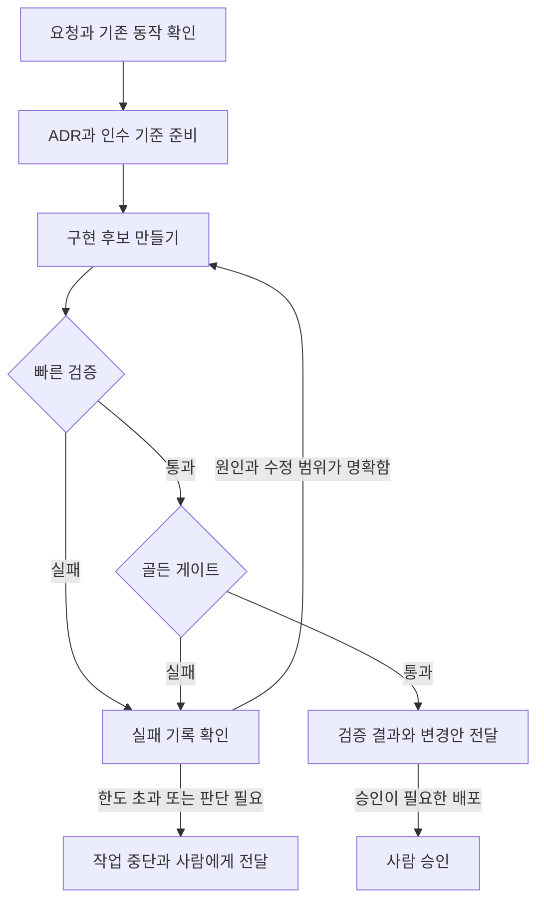
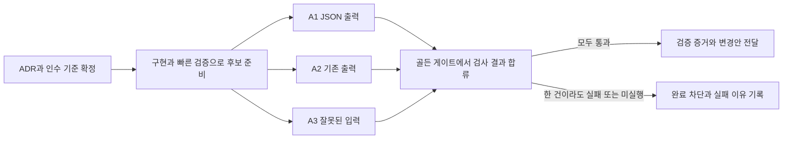

# AI 워크플로우
{: .no_toc }



숫자 파일을 읽고 합계를 표시하는 프로그램이 있다. 사용자가 `python report.py numbers.txt`를 실행하면 `total=5`가 나온다. 여기에 새 요청이 들어왔다.

> 다른 프로그램에서도 읽을 수 있게 JSON 출력을 추가해 줘. 기존 명령을 쓰는 스크립트도 계속 돌아가야 해.

AI에게 바로 코드를 맡기면 어떻게 될까? 새 JSON 출력은 맞게 만들고, 기존 텍스트 출력을 `sum=5`로 바꿀 수 있다. 새 기능만 시험하면 통과다. 하지만 `total=`을 기다리는 기존 스크립트는 깨진다.

AI가 저장소 작업을 자율적으로 진행하려면 **무엇을 지켜야 하는지 먼저 정하고, 그 조건을 실제 실행으로 확인할 수 있어야 한다.** 이 글에서는 결정 이유를 ADR에 남기고, AI가 수정과 검증을 반복한 뒤, 기준을 모두 충족했을 때 골든 게이트를 통과하는 흐름을 만든다.



## 사람이 손으로 하는 순서부터 익히기

먼저 AI 없이 같은 일을 한다고 생각해 보자. 현재 명령을 실행해 결과를 기록한다. 사용자가 추가로 원하는 동작과 계속 유지할 동작을 적는다. 가능한 구현을 비교하고 하나를 고른다. 코드를 바꾼 뒤 새 명령, 기존 명령, 잘못된 입력을 각각 실행한다. 실행 결과와 변경 내용을 함께 검토한다.

AI에 맡길 때도 같은 순서다. 어느 단계에서 출발하는지, 앞 단계에서 받은 자료로 무엇을 판단하는지, 뒤 단계로 넘길 파일이 무엇인지 정한다.

| 단계 | 가져오는 것 | 다음 단계에 남기는 것 |
| --- | --- | --- |
| 기준선 확인 | 기존 코드와 사용법 | 실제 명령, 출력, 종료 코드 |
| ADR 작성 | 사용자 요청, 기준선, 제약 | 선택한 설계, 이유, 대안, 남은 가정 |
| 인수 기준 고정 | 요청과 ADR | 재실행할 입력, 명령, 기대 결과 |
| 구현과 검증 | 기준과 수정 가능한 코드 | 변경안, 실패 기록, 수정 뒤 결과 |
| 골든 게이트 | 같은 변경안과 고정된 기준 | 최종 신호 및 사례별 증거 |
| 검토와 인수인계 | 변경안, ADR, 증거 | 승인이나 수정 요청, 작업 상태 |

**기준선(baseline)**은 변경 전 프로그램이 실제로 한 일의 기록이다. 이 예에서는 입력 파일 `2\n3\n`으로 기존 명령을 실행하고, 종료 코드가 `0`이며 표준 출력이 `total=5`인지 확인한다. 여기서 `\n`은 줄바꿈이다. 저장소에서 작업한다면 어느 기준 커밋에서 실행했는지도 남긴다.

{: .tip }
실무에서는 기존 테스트가 시작부터 실패하면 그 사실을 먼저 적는다. 실패 원인이 새 기능과 관련 있는지 확인하고, 변경 전과 변경 후를 같은 조건에서 비교한다. 기준선이 없으면 원래 있던 실패를 새 수정 탓으로 돌릴 수 있다.

## ADR에 설계 선택과 이유를 남기기

**ADR(Architecture Decision Record, 아키텍처 결정 기록)**은 설계 결정을 하나 골라 당시 상황, 결정, 결과를 저장하는 짧은 문서다. 명령줄 옵션을 추가할지, 기존 명령을 JSON으로 바꿀지 같은 결정에 쓸 수 있다. 코드만 읽으면 현재 동작은 보이지만 다른 방법을 고르지 않은 이유는 알기 어렵다. [Michael Nygard의 ADR 원문](https://cognitect.com/blog/2011/11/15/documenting-architecture-decisions)

이 예에서 중요한 설계 결정은 **JSON 출력을 별도 옵션으로 열고, 기본 동작을 계속 지원한다**는 것이다. 결정을 요구사항과 구분해 적으면 다음과 같다.

| ADR 항목 | 예시 |
| --- | --- |
| 제목 | 합계 CLI의 출력 형식 선택 |
| 상태 | 설계 확인 전에는 제안. 팀이 동의하면 승인 |
| 상황 | 다른 프로그램이 합계 결과를 읽어야 한다. 기존 스크립트는 `total=<정수>` 형식을 읽는다. |
| 고려한 대안 | 기본 출력을 JSON으로 전환하거나, `--format json`을 추가하거나, 별도 명령을 만든다. |
| 결정 | `--format json`을 추가한다. 기본 명령과 종료 코드를 기존 사용법에 맞춘다. |
| 이유와 결과 | 새 호출만 동작을 바꿀 수 있다. 프로그램은 두 형식을 계속 검증해야 한다. |
| 가정 | 입력 데이터는 줄마다 정수 하나다. JSON 객체에 정수 `total` 한 필드를 제공한다. |
| 확인 방법 | 인수 사례 A1, A2, A3을 전체 실행으로 확인한다. |

이 표에는 예제용 인수 사례를 연결했다. 팀에 기존 ADR 양식이 있다면 그 양식을 사용해도 된다. MADR은 상황과 선택지를 정리하고 어떤 방법을 선택했는지 적을 수 있는 템플릿을 제공한다. [Markdown Architectural Decision Records](https://adr.github.io/madr/)

{: .question }
JSON 값이 숫자 `5`인 경우와 문자열 `"5"`인 경우를 둘 다 지원해야 할까? 사용자 요청에서 확정할 수 없다면 ADR의 가정에 넣고, 연결 프로그램의 계약이나 사용자의 답으로 확인한다. 모르는 부분을 정답으로 취급하면 뒤에서 잘못된 기대값을 고정하게 된다.

## 인수 기준을 실제 명령으로 바꾸기

**인수 기준(acceptance criteria)**은 요청을 받는 사람이 결과를 받아들일 조건이다. "JSON이 잘 나온다"는 읽는 사람마다 다르게 해석할 수 있다. "이 파일을 이 옵션으로 실행하면 종료 코드가 0이고 JSON의 `total`이 정수 5다"라고 적으면 검사에 옮길 수 있다.

| 사례 | 파일 내용 | 실행 옵션 | 통과 조건 |
| --- | --- | --- | --- |
| A1 새 기능 | `2\n3\n` | `--format json` | 종료 코드 0. 표준 출력은 정수 `total=5`를 담은 JSON 객체. 표준 오류가 비어 있음. |
| A2 기존 동작 | `2\n3\n` | 없음 | 종료 코드 0. 표준 출력은 `total=5\n` 그대로. 표준 오류가 비어 있음. |
| A3 잘못된 입력 | `2\noops\n` | `--format json` | 종료 코드 1. 표준 출력이 비어 있음. 표준 오류는 `invalid input\n`. |

**종료 코드**는 실행이 끝날 때 프로그램이 호출자에게 돌려주는 숫자다. 이 예에서는 `0`이면 성공, `1`이면 입력을 읽을 수 없어 실패한 것이다. **표준 출력(stdout)**은 정상 결과가 나가는 통로이고, **표준 오류(stderr)**는 실패 메시지가 나가는 통로다. 호출자는 종료 코드로 성공 여부를 먼저 보고 정상 결과를 읽을 수 있다.

A1은 JSON을 파싱해서 필드와 타입을 확인한다. 공백은 결과를 읽는 프로그램에 영향을 주지 않으므로 채점에 쓰지 않는다. A2는 기존 프로그램이 읽는 문자열을 보존하는 조건이므로 줄바꿈까지 검사한다. A3은 오류 메시지만 보는 대신, 잘못된 입력에서 성공 코드나 불완전한 JSON이 나오더라도 잡아낸다.

실무에서는 기존 동작을 잡아 주는 **회귀 테스트**와 새 요구사항을 잡아 주는 인수 사례를 남긴다. 새 인수 테스트가 변경 전에는 의도한 이유로 실패하고 변경 후에는 통과하는지 확인한다. 예를 들어 변경 전에 `--format`을 지원하지 않아 A1이 실패하는 것은 기대한 결과지만, Python 경로가 잘못되어 A1이 실패했다면 새 기능을 판정한 결과가 아니다. [Martin Fowler, Continuous Integration](https://martinfowler.com/articles/continuousIntegration.html)

## AI가 구현하고 검증을 반복한다

**검증 루프**는 작업 후보를 실행하고, 실패 증거를 읽고, 원인을 고친 뒤 같은 조건에서 다시 실행하는 반복이다. 처음부터 모든 검사를 돌리는 데 오래 걸린다면 새 기능의 빠른 시험부터 시작한다. 이 실습의 빠른 시험은 A1 하나다.

1. 변경 후보를 만든다.
2. 빠른 검사를 실행해 사례 ID와 실패 증거를 남긴다.
3. 명령, 입력, 기대값과 실제값을 대조한다. 실패 원인을 한 문장으로 적는다.
4. 관련된 코드만 고친 뒤 같은 검사를 다시 실행한다.
5. 빠른 검사가 통과하면 전체 판정으로 보낸다.

예를 들어 실제 출력이 `{"sum": 5}`라면 계산은 맞고 필드 이름이 다르다. 이때 구현에서 `sum`을 `total`로 고친다. 검증기가 기대하는 `total`을 `sum`으로 바꾸면 실패 기록을 없앨 수 있지만, 다른 프로그램과 약속한 출력 형식은 그대로 틀려 있다.

| 막힌 상황 | 취할 동작 |
| --- | --- |
| 실패 원인과 수정 범위가 명확하다 | 허용한 파일에서 고치고 같은 사례를 다시 실행한다. |
| 실행 환경이 없어 시험이 실행되지 않았다 | 누락된 환경과 명령을 기록한 뒤 준비할 수 있는지 판단한다. |
| 사용자 의도가 불명확하거나 변경 범위가 커진다 | 지금의 조건으로 작업을 멈추고 확인이 필요한 결정을 전한다. |
| 같은 실패가 반복되거나 시도 한도를 썼다 | 마지막 변경안과 증거를 남기고 사람에게 넘긴다. |

{: .tip }
실무에서는 시도 횟수나 시간 한도를 작업 시작 전에 정한다. 로그에 기대값과 실제값이 같아 보이는데 결과가 계속 다르면, 새 구현부터 더 만들기 전에 이전 답이 재사용됐는지, 다른 경로를 실행했는지 확인한다. 입출력과 중단 조건을 설계하는 방법은 [루프 엔지니어링]({{ '/ai/using-ai/loop-engineering/' | relative_url }})에서 더 다룬다.

## 골든 게이트에서 최종 후보를 검사한다

이 글에서 **골든 게이트(Golden Gate)**는 현재 변경안을 완료로 판정해도 되는지 검사하는 최종 관문이다. A1이 통과하면 새 JSON 경로에 대한 신호는 얻었다. 골든 게이트는 고정한 인수 기준 전체를 실행하면서 기존 명령과 잘못된 입력도 확인한다. 저장소에 기존 테스트와 빌드가 있다면 그 결과도 이 단계에 포함한다.

게이트에서 실행할 **진입점**은 사용자가 제품을 켜거나 부르는 방식이다. 이 예에서는 사용자가 부르는 CLI를 실제로 실행한다. `main()`이나 JSON 변환 함수만 불러서는 옵션 연결, 종료 코드, 표준 출력, 표준 오류가 함께 맞는지 확인하기 어렵다. 웹이라면 사용자가 들어오는 화면이나 앱이 노출하는 요청 경로를 실제로 실행해야 할 때가 있다.

| 판정에 필요한 것 | 실제로 남길 자료 |
| --- | --- |
| 무엇을 시험했는가 | 기준 커밋과 변경 커밋, 로컬이라면 후보 파일의 해시 |
| 어떤 기준으로 시험했는가 | 인수 기준의 버전, 사례 ID, 검증 코드 |
| 제대로 실행됐는가 | 명령, 환경, 종료 상태, 사례별 기대값과 실제값 |
| 바깥에 내보내도 되는가 | 배포 권한, 필요한 사람 승인, 상태를 되돌리는 방법 |

해시(hash)는 파일 내용에서 만든 짧은 식별값이다. 실습의 결과 파일은 검사한 코드의 SHA-256 값을 저장한다. 팀에서는 테스트가 통과한 커밋과 실제 병합 또는 배포할 커밋을 대조한다. 검증 후 후보가 바뀌었다면 새 후보로 검사한다. GitHub에서는 브랜치 보호 설정으로 요구된 상태 검사와 리뷰를 통과해야 병합할 수 있게 정할 수 있다. [GitHub의 보호 브랜치 문서](https://docs.github.com/en/repositories/configuring-branches-and-merges-in-your-repository/managing-protected-branches/about-protected-branches)

{: .warning }
실무에서는 구현을 맡은 AI가 테스트를 추가할 수 있어도, 기준을 바꿀 권한은 별도로 정한다. 실패를 피하려고 기존 사례를 빼거나, 오류 메시지를 모두 허용하거나, 골든 게이트를 건너뛰면 결과를 검토한다. 요구사항 자체가 바뀌면 변경 이유와 기준 수정을 먼저 확인하고, 새 기준을 가지고 후보를 다시 검사한다.

**게이트 통과는 검사 결과다.** 운영 데이터 삭제나 되돌리기 어려운 배포처럼 요청이 따로 승인하도록 정한 행동은, 승인 기록과 실행 권한을 확인한 뒤 진행한다. 승인 대기 중에는 검증된 변경안과 실행 예정 작업을 남긴다. 저장소별 권한과 실행 범위를 도구에서 강제하는 방법은 [하네스 엔지니어링]({{ '/ai/using-ai/harness-engineering/' | relative_url }})에서 다룬다.

## 독립된 검사를 DAG로 묶기

검사가 세 개뿐이면 순서대로 실행해도 된다. 저장소에 빌드, 기존 테스트, 새 기능 테스트가 따로 있다면 각 검사가 무엇을 기다리는지 먼저 그려 본다. **DAG**는 화살표 방향을 따라 출발점으로 돌아오지 않는 그래프다. 작업을 점으로, 선행 작업을 기다리는 관계를 화살표로 나타낼 수 있다. [DAG]({{ '/ai/dag/' | relative_url }})에서 개념과 Python 실행기를 따라가 볼 수 있다.



### 시작할 수 있는 검사와 기다려야 할 검사

A1, A2, A3은 같은 후보 파일을 읽고, 각자 별도 임시 폴더와 입력 파일을 쓴다면 서로의 출력을 기다릴 필요가 없다. 실행기는 이 세 검사를 동시에 시작할 수 있다. 이렇게 일을 여러 갈래로 보내는 것을 **분기(fan-out)**라고 한다. 골든 게이트가 같은 후보에 대한 세 결과를 기다렸다가 합치는 지점은 **합류(join 또는 fan-in)**다.

반대로 테스트가 빌드 산출물을 실행한다면 테스트는 빌드가 끝난 뒤에 시작한다. 두 단계가 같은 경로에 파일을 쓰거나, 같은 테스트 계정의 값을 동시에 바꾼다면 실행 환경을 나누거나 실행 순서를 정한다. 아래 실습의 `verify.py`는 읽기 쉬운 순차 실행을 택했다. 위 그림의 의존성은 검사를 어떤 순서로 실행해도 되는지 알려 주고, 실제로 동시에 실행할지는 실행기가 정한다. [Python graphlib의 의존성 정렬](https://docs.python.org/3.12/library/graphlib.html)

{: .tip }
동시에 시작한 검사라도 가장 늦게 끝나는 필수 검사를 기다려야 한다. 준비부터 합류까지 걸리는 작업 경로 중 가장 긴 경로가 **임계 경로**다. A3이 끝날 때까지 기다려야 하는 상태라면 A1만 더 빠르게 해도 전체 완료 시각은 앞당겨지지 않을 수 있다. 운영에서는 각 단계의 대기와 실행 시간을 따로 기록한 뒤 어디를 줄일지 결정한다.

### 실패한 검사와 실행되지 않은 검사를 구분하기

A2가 실패해도 나머지 독립 검사를 끝까지 돌리면 한 번에 여러 문제를 확인할 수 있다. 이때 합류 노드는 실패 결과까지 모아 보고서를 만든다. 검증 증거를 전달하는 일은 계속할 수 있지만, 완료와 배포 단계로 가는 조건은 필수 검사가 **모두 성공**하는 것이다.

빌드에 실패해 CLI를 한 번도 실행하지 못했다면 A1부터 A3까지는 `BLOCKED`로 기록한다. 이것은 실제 명령을 실행한 뒤 기대 출력과 달랐다는 `FAIL`과 다르다. 외부 시스템을 기다리다 정해진 시간에 멈춘 검사나, 필수라서 결과가 있어야 할 검사의 누락도 최종 통과를 막는다. 선택 검사라면 그 검사 없이도 완료할 수 있는 조건을 미리 적고, 검사 없이 진행했다는 사실을 기록한다.

### 재시도는 한 작업 안에 넣거나 시도별로 펼치기

검증 루프에는 수정한 후보를 다시 검사하는 반복이 있다. DAG는 화살표가 뒤로 돌아오지 않는 구조이므로, 아래처럼 표현할 수 있다.

| 표현 | CLI 사례 | 어울리는 상황 |
| --- | --- | --- |
| 한 작업 안에서 반복 | `후보 준비` 작업이 최대 두 번 수정·검증한다. 통과한 후보만 골든 게이트로 전달한다. | 반복 상세는 작업 기록에 남기고 큰 흐름을 짧게 표시할 때 |
| 시도마다 별도 노드로 펼치기 | `후보 1 → 검사 1`에서 실패하면 `후보 2 → 검사 2`로 진행한다. 어느 시도에서든 통과하면 골든 게이트로 보낸다. | 상한이 작고 시도별 진행 상태를 실행 시스템에서 직접 볼 때 |

두 번째 표현에서 첫 시도가 통과하면 두 번째 시도는 건너뛴다. 실행기는 성공 가지 하나에서 들어오는 결과를 받도록 합류 규칙을 정해야 한다. 앞서 A1, A2, A3처럼 **세 검사 모두를 기다리는 합류**와 조건이 다르다. 수정 결과에 따라 계속 이전 단계로 돌아가는 경로를 그래프 자체에 그린다면 순환이 생긴다. 실행 상태와 종료 조건을 다루는 방법은 [그래프 엔지니어링]({{ '/ai/using-ai/graph-engineering/' | relative_url }})에서 살펴볼 수 있다. [Airflow의 작업 의존성과 재시도 설명](https://airflow.apache.org/docs/apache-airflow/stable/core-concepts/dags.html)

### 합류할 때 같은 후보의 검증 결과인지 확인하기

병렬로 실행하고 나면 A1은 최신 코드, A2는 지난 코드를 검사한 것처럼 결과가 섞일 수 있다. 단계 이름만 보고 합치지 말고 실행 ID, 후보 커밋이나 해시, 인수 기준 버전을 함께 확인한다. AI가 바꾼 내용까지 되짚어야 한다면 시도 번호, 검증 명령, 사용한 도구와 설정, 종료 상태, 증거 파일 위치를 기록한다.

예전 검사 결과를 재사용할 때도 같은 원칙을 적용한다. A2라는 이름이 같아도 구현, 입력, 실행 환경이나 검증 기준이 달라지면 결과의 근거가 될 수 없을 수 있다. 후보를 수정했다면 같은 실행으로 취급하지 말고 새 후보에서 필요한 검사를 다시 실행한다.

## 코드로 실패, 수정, 통과를 확인하기

Python 3.9.6에서 아래 세 파일을 같은 디렉터리에 저장했다. 표준 라이브러리만 쓴다. 예제는 로컬 CLI의 세 가지 후보를 시험한다. 모델 요청이나 배포는 실행하지 않는다.

### 사용자가 부르는 프로그램

`report.py`는 입력 파일의 정수 합계를 구하고, 옵션에 맞는 형식으로 출력한다.

```python
import argparse
import json
import sys
from pathlib import Path


def main() -> int:
    parser = argparse.ArgumentParser()
    parser.add_argument("path", type=Path)
    parser.add_argument(
        "--format", choices=("text", "json"), default="text",
    )
    args = parser.parse_args()

    try:
        rows = args.path.read_text(encoding="utf-8").splitlines()
        total = sum(int(row) for row in rows)
    except (OSError, ValueError):
        print("invalid input", file=sys.stderr)
        return 1

    if args.format == "json":
        print(json.dumps({"total": total}))
    else:
        print(f"total={total}")
    return 0


if __name__ == "__main__":
    raise SystemExit(main())
```

### 사용자가 실행하는 명령 그대로 검증하기

`verify.py`는 임시 폴더에 입력 파일을 쓴 뒤 별도 Python 프로세스에서 CLI를 실행한다. 입력이 잘못되었거나 프로그램이 5초 안에 응답하지 않으면 실제 결과에 기록한다. 빠른 검사는 A1만 쓰고, 골든 게이트는 A1에 A2와 A3을 더한다.

```python
import hashlib
import json
import subprocess
import sys
from pathlib import Path
from tempfile import TemporaryDirectory


def matches(actual: dict, expected: dict, json_mode: bool) -> bool:
    if not json_mode:
        return actual == expected
    if (actual.get("exit"), actual.get("stderr")) != (0, ""):
        return False
    try:
        value = json.loads(actual["stdout"])
    except json.JSONDecodeError:
        return False
    return (
        isinstance(value, dict)
        and set(value) == {"total"}
        and type(value["total"]) is int
        and value == json.loads(expected["stdout"])
    )


def run_cases(candidate: Path, stage: str) -> dict:
    candidate = candidate.resolve()
    before = candidate.read_bytes()
    cases = [
        ("A1", "2\n3\n", ["--format", "json"],
         0, '{"total": 5}\n', ""),
    ]
    if stage == "golden":
        cases += [
            ("A2", "2\n3\n", [], 0, "total=5\n", ""),
            ("A3", "2\noops\n", ["--format", "json"],
             1, "", "invalid input\n"),
        ]

    results = []
    with TemporaryDirectory() as folder:
        fixture = Path(folder) / "numbers.txt"
        for name, data, options, code, output, errors in cases:
            fixture.write_text(data, encoding="utf-8")
            command = [
                sys.executable, str(candidate), fixture.name,
                *options,
            ]
            expected = {
                "exit": code, "stdout": output, "stderr": errors,
            }
            try:
                r = subprocess.run(
                    command, cwd=folder, capture_output=True,
                    text=True, encoding="utf-8", timeout=5,
                )
                actual = {
                    "exit": r.returncode, "stdout": r.stdout,
                    "stderr": r.stderr,
                }
            except subprocess.TimeoutExpired:
                actual = {"error": "timeout"}
            results.append({
                "id": name, "input": data, "args": options,
                "expected": expected, "actual": actual,
                "passed": matches(actual, expected, name == "A1"),
            })

    unchanged = before == candidate.read_bytes()
    return {
        "stage": stage,
        "source_sha256": hashlib.sha256(before).hexdigest(),
        "candidate_unchanged": unchanged,
        "passed": unchanged and all(c["passed"] for c in results),
        "cases": results,
    }


def save(report: dict, path: Path) -> None:
    path.write_text(
        json.dumps(report, ensure_ascii=False, indent=2) + "\n",
        encoding="utf-8",
    )


if __name__ == "__main__":
    candidate, evidence = map(Path, sys.argv[1:])
    report = run_cases(candidate, "golden")
    save(report, evidence)
    print("PASS" if report["passed"] else "FAIL")
    raise SystemExit(0 if report["passed"] else 1)
```

`source_sha256`은 시험을 시작할 때 읽은 후보의 식별값이다. `candidate_unchanged`는 검사가 끝날 때 파일 내용이 시작할 때와 같은지 확인한다. 실제 저장소에서 여러 파일이 동작에 참여한다면 후보 파일 하나 대신 검증 대상 커밋으로 기록한다.

### 구현 후보를 바꿔 가며 세 가지 결과 확인하기

`demo.py`에서는 후보를 미리 준비한다. 첫 번째 시나리오는 JSON 필드 이름을 틀리게 만든 뒤 고친 버전으로 바꾼다. 두 번째는 새 JSON은 맞지만 기존 텍스트를 망가뜨린 버전을 시험한다. 세 번째는 같은 실패가 두 번 이어졌을 때 종료한다. 저장소에서 AI가 고치는 단계만 이 실습의 미리 정한 후보로 대신했다.

```python
import argparse
from pathlib import Path
from tempfile import TemporaryDirectory

from verify import run_cases, save


def run_demo(scenario: str, evidence: Path) -> None:
    source = Path(__file__).with_name("report.py").read_text(
        encoding="utf-8",
    )
    bad = source.replace(
        'json.dumps({"total": total})',
        'json.dumps({"sum": total})',
        1,
    )
    regression = source.replace("total={total}", "sum={total}", 1)
    versions = {
        "repair": [bad, source],
        "regression": [regression],
        "limit": [bad, bad],
    }
    evidence.mkdir()

    with TemporaryDirectory() as folder:
        candidate = Path(folder) / "report.py"
        for attempt, version in enumerate(versions[scenario], 1):
            candidate.write_text(version, encoding="utf-8")
            quick = run_cases(candidate, "quick")
            save(quick, evidence / f"{attempt}-quick.json")
            summary = "PASS" if quick["passed"] else "FAIL"
            print(f"attempt={attempt} quick={summary}")
            if not quick["passed"]:
                continue

            golden = run_cases(candidate, "golden")
            save(golden, evidence / f"{attempt}-golden.json")
            if golden["passed"]:
                print("golden=PASS decision=VERIFIED")
            else:
                failed = [
                    c["id"] for c in golden["cases"]
                    if not c["passed"]
                ]
                print(f"golden=FAIL cases={','.join(failed)}")
                print("decision=NEEDS_REVISION")
            return
    print("decision=ESCALATE reason=attempt_limit")


parser = argparse.ArgumentParser()
parser.add_argument("scenario", choices=(
    "repair", "regression", "limit",
))
parser.add_argument("evidence", type=Path)
args = parser.parse_args()
run_demo(args.scenario, args.evidence)
```

아래 명령을 실행한다. 각 시나리오는 결과를 새 디렉터리에 만든다. 같은 명령을 다시 실행하려면 새 디렉터리 이름을 준다.

```bash
python3 demo.py repair repair
python3 demo.py regression regression
python3 demo.py limit limit
python3 verify.py report.py golden.json
```

```text
$ python3 demo.py repair repair
attempt=1 quick=FAIL
attempt=2 quick=PASS
golden=PASS decision=VERIFIED

$ python3 demo.py regression regression
attempt=1 quick=PASS
golden=FAIL cases=A2
decision=NEEDS_REVISION

$ python3 demo.py limit limit
attempt=1 quick=FAIL
attempt=2 quick=FAIL
decision=ESCALATE reason=attempt_limit

$ python3 verify.py report.py golden.json
PASS
```

첫 실행은 A1의 실패를 보고 후보를 바꿨고, 두 번째 후보가 모든 검사를 통과했다. 두 번째 실행은 A1을 통과했지만 A2에서 기존 텍스트가 달라 `NEEDS_REVISION`을 남겼다. 세 번째 실행은 같은 실패를 시도 한도까지 확인하고 `ESCALATE`를 남겼다. 마지막 명령은 고친 프로그램을 골든 게이트에 직접 넣었다.

### 사람이 확인할 기록 읽기

`regression/1-golden.json`의 A2 항목을 확인한다. 파일에서 이 항목만 옮겼다.

```json
{
  "id": "A2",
  "input": "2\n3\n",
  "args": [],
  "expected": {
    "exit": 0,
    "stdout": "total=5\n",
    "stderr": ""
  },
  "actual": {
    "exit": 0,
    "stdout": "sum=5\n",
    "stderr": ""
  },
  "passed": false
}
```

종료 코드와 표준 오류는 기대와 같지만 표준 출력이 바뀌었다. 이 기록이면 A2가 왜 실패했는지 바로 다시 실행해 볼 수 있다. 게이트 전체가 `FAIL`에서 끝났다는 사실만 전달하면 원인을 찾기 위해 다시 로그를 뒤져야 한다.

## Claude나 Codex에 이 흐름을 맡기기

에이전트에 일을 줄 때는 담당자에게 작업을 설명하듯 요청과 증거를 함께 적는다. 다음은 이 예제에 맞춘 지시문이다. 실제 저장소에서는 파일과 명령을 바꿔 쓴다.

```text
목표
합계 CLI에 --format json을 추가한다.
기존 명령의 표준 출력과 오류 동작을 유지한다.

먼저 확인할 것
저장소의 작업 규칙과 기존 테스트를 읽는다.
기준 커밋과 기존 CLI의 명령, 출력, 종료 코드를 적는다.
출력 형식 선택의 대안과 이유를 ADR로 남긴다.
합의되지 않은 가정은 별도로 적는다.

인수 기준
A1 2와 3을 넣고 JSON 옵션으로 실행한다. 결과는 정수 total 5다.
A2 같은 입력으로 기존 명령을 실행한다. 결과는 total=5다.
A3 잘못된 입력으로 실행한다. 실패 코드와 오류 메시지를 확인한다.
위 기준을 바꿔야 하면 변경 이유를 먼저 보고한다.

구현과 검증
실패한 사례의 명령, 기대값, 실제값을 남긴다.
원인이 확인된 수정만 한 뒤 같은 사례를 다시 실행한다.
시도는 최대 두 번으로 제한한다.
빠른 검사 뒤 실제 CLI로 A1, A2, A3과 기존 테스트를 실행한다.

완료 보고
ADR, 변경 파일, 검증한 후보와 결과 파일 위치를 전달한다.
미실행 검사와 알려진 실패가 있으면 각각 기록한다.
권한 밖의 변경이나 배포가 필요하면 승인 단계에서 멈춘다.
```

실무에서는 작은 팀도 이 흐름을 손으로 먼저 한 번 밟아 볼 수 있다. 도구가 있어도 요구사항의 결정권, 재시도 한도, 외부 전송 권한은 이전과 같다. 한 사람이 요청을 정리하고 에이전트가 변경안을 만들며 CI가 실행 결과를 판정하는 구성으로 시작할 수 있다. 여러 작업자에게 검토를 나눌 때 필요한 상태와 권한 전달은 [AI 오케스트레이션]({{ '/ai/using-ai/ai-orchestration/' | relative_url }})에서 다룬다.

## 정리

{: .note }
ADR에는 선택한 설계와 이유를 적는다. 인수 기준은 결과를 받아들일 조건을 실제 명령과 기대값으로 적는다. AI는 실행 기록을 보고 구현을 고친 뒤 같은 검사를 다시 돌린다. 골든 게이트는 완료를 판정할 후보로 새 기능, 기존 동작, 실패 사례를 함께 실행한다. 독립된 검사는 DAG에서 함께 시작하고, 같은 후보의 필수 검사 결과를 합쳐 통과 여부를 결정한다. 사용자가 검토할 수 있게 후보와 실행 증거를 연결해 남긴다.

## 함께 읽기

- [루프 엔지니어링]({{ '/ai/using-ai/loop-engineering/' | relative_url }})
- [하네스 엔지니어링]({{ '/ai/using-ai/harness-engineering/' | relative_url }})
- [AI 평가와 개선]({{ '/ai/using-ai/evaluation/' | relative_url }})

## 참고

- [Michael Nygard, Documenting Architecture Decisions](https://cognitect.com/blog/2011/11/15/documenting-architecture-decisions)
- [Markdown Architectural Decision Records](https://adr.github.io/madr/)
- [Martin Fowler, Continuous Integration](https://martinfowler.com/articles/continuousIntegration.html)
- [GitHub Docs, About protected branches](https://docs.github.com/en/repositories/configuring-branches-and-merges-in-your-repository/managing-protected-branches/about-protected-branches)
