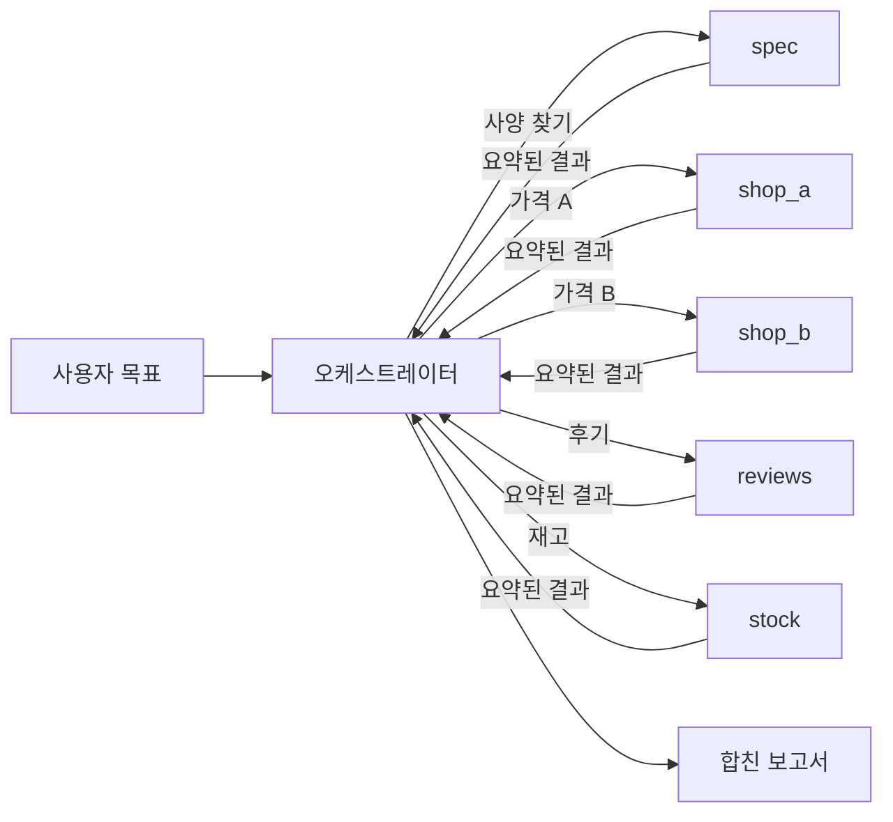
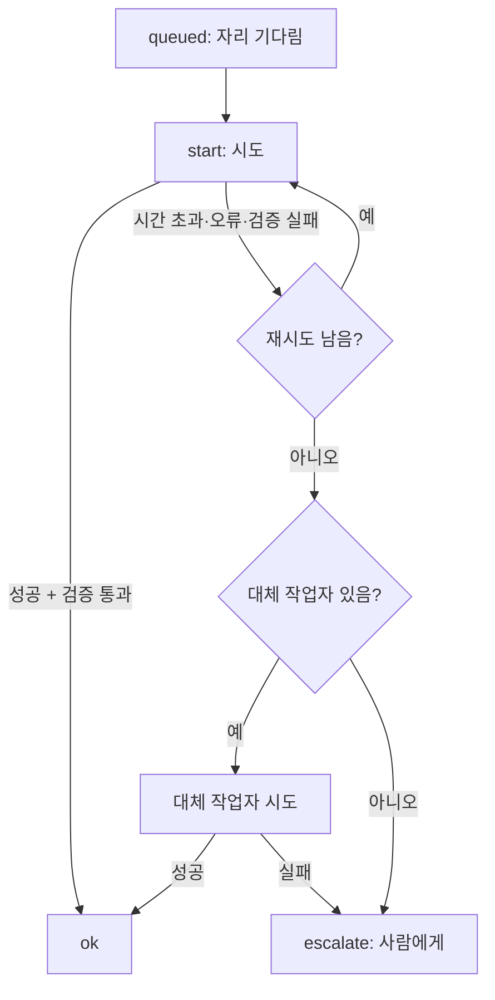

# AI 오케스트레이션
{: .no_toc }



"노트북 하나 추천해 줘"라는 부탁을 AI 여러 개가 나눠서 처리한다고 해 보자. 하나는 사양을 찾고, 둘은 서로 다른 쇼핑몰에서 가격을 보고, 하나는 후기를 모으고, 하나는 재고를 확인한다.

이때 누군가는 다음 일을 정해야 한다.

- **무엇을** 다음에 실행할까?
- 그 일을 맡은 쪽에 **어떤 정보를** 넘길까?
- 돌아온 결과가 서로 다르면 **어떻게 합칠까?**

이 세 질문에 답하는 일이 **오케스트레이션(orchestration)**이다. 오케스트라의 지휘자는 악기를 직접 연주하지 않는다. 누가 언제 들어오고, 얼마나 크게 연주하고, 언제 멈출지를 정한다. AI 오케스트레이터도 직접 답을 만들기보다 여러 모델, 에이전트, 도구가 하나의 목표를 향해 움직이도록 조율한다.



{: .tip }
**에이전트(agent)**는 모델이 스스로 다음 행동을 고르며 도구를 쓰는 프로그램이다. 한 에이전트가 반복하는 구조는 [루프 엔지니어링]({{ '/ai/using-ai/loop-engineering/' | relative_url }})에서, 한 에이전트를 둘러싼 실행 환경은 [하네스 엔지니어링]({{ '/ai/using-ai/harness-engineering/' | relative_url }})에서 다뤘다. 이 글은 **여러 개**를 묶는 이야기다.

## 오케스트레이션과 코레오그래피

여러 참여자를 묶는 방식은 크게 두 가지다.

| | 오케스트레이션 | 코레오그래피(choreography) |
| --- | --- | --- |
| 비유 | 지휘자가 있는 오케스트라 | 정해진 안무를 아는 무용수들 |
| 누가 다음을 정하나 | 가운데 있는 오케스트레이터 | 각 참여자가 이벤트를 보고 스스로 |
| 전체 상태를 아는 쪽 | 오케스트레이터 | 한 곳에 없다 |
| 연결 방식 | 직접 호출 | 메시지 브로커(이벤트 게시·구독) |

Microsoft의 [Choreography 패턴 문서](https://learn.microsoft.com/en-us/azure/architecture/patterns/choreography)는 두 방식을 이렇게 설명한다.

- 오케스트레이터 방식에서는 요청이 오케스트레이터를 거쳐 각 서비스로 나가고, 각 서비스는 **전체 흐름을 모른다**. 장점은 오케스트레이터가 개별 결과를 모아 거래 전체의 상태를 정리할 수 있다는 것이다.
- 대신 오케스트레이터가 부하를 받으면 병목이 되고, **단일 장애 지점(single point of failure)**이 될 수 있다. 한 곳이 멈추면 전체가 멈춘다는 뜻이다.
- 코레오그래피에서는 각 서비스가 언제 무엇을 처리할지 스스로 정한다. 같은 문서는 이때 **어느 한 곳도 진행 중인 작업의 전체 모습을 갖지 않으므로** 분산 추적과 상관관계 ID를 꾸준히 써야 한다고 말한다.

{: .note }
AI 에이전트를 묶는 공식 가이드들(Anthropic, OpenAI Agents SDK, LangChain, Microsoft)이 다루는 구조는 대부분 오케스트레이터가 있는 쪽이다. 이 글도 그쪽을 중심으로 설명하고, 코레오그래피는 비교 대상으로만 둔다.

## 오케스트레이션의 모양(토폴로지)

**토폴로지(topology)**는 참여자들이 누구와 어떻게 연결되어 있는지를 나타내는 연결 모양이다. 회사 조직도를 떠올리면 된다.

### 1. 중앙 감독자(supervisor)

감독자 하나가 작업자들을 **도구처럼** 부르고, 결과를 받아 다음 일을 직접 정한다. 제어권은 늘 감독자에게 돌아온다.

- OpenAI Agents SDK는 이것을 **agents as tools**라고 부른다. [Agent orchestration 문서](https://openai.github.io/openai-agents-python/multi_agent/)는 "매니저 에이전트가 대화의 제어권을 유지하고, `Agent.as_tool()`로 전문 에이전트를 호출한다"고 설명한다.
- LangChain의 [Multi-agent 문서](https://docs.langchain.com/oss/python/langchain/multi-agent)는 같은 모양을 **Subagents** 패턴이라고 부른다. 메인 에이전트가 하위 에이전트를 도구로 부르고, 모든 경로가 메인 에이전트를 거친다.
- Anthropic의 [멀티 에이전트 리서치 시스템](https://www.anthropic.com/engineering/multi-agent-research-system)도 이 모양이다. 리드 에이전트가 계획을 세우고, 하위 에이전트들이 병렬로 검색한 뒤 결과를 돌려준다.

### 2. 계층형(감독자의 감독자)

팀장 위에 본부장이 있는 구조다. 최상위 감독자가 여러 팀을 관리하고, 각 팀도 자기 감독자를 둔다.

LangGraph용 [langgraph-supervisor](https://github.com/langchain-ai/langgraph-supervisor-py) 라이브러리는 감독자를 겹쳐 쌓는 다단계 계층을 지원했다. 다만 이 저장소는 현재 보관(archived) 상태이고, 관리자들은 대부분의 경우 **도구 호출로 감독자 패턴을 직접 구현하라**고 권한다. 그 방식이 컨텍스트를 더 세밀하게 다룰 수 있다는 이유다.

### 3. 핸드오프(handoff)

에이전트가 다른 에이전트에게 **제어권을 넘긴다**. 넘긴 쪽은 빠지고, 받은 쪽이 이어서 대화를 맡는다. 고객센터에서 상담원이 "환불 담당자에게 연결해 드릴게요"라고 하는 장면과 같다.

- OpenAI Agents SDK의 [Handoffs 문서](https://openai.github.io/openai-agents-python/handoffs/)에서 핸드오프는 모델이 부를 수 있는 도구로 표현된다. 환불 에이전트로 넘기는 핸드오프는 모델에게 `transfer_to_refund_agent`라는 도구로 보인다.
- 기본값으로 받는 에이전트는 **앞의 대화 전체**를 본다. `input_filter`로 넘길 내용을 바꿀 수 있다. 앞의 대화를 요약해 넘기는 `nest_handoff_history`는 문서 기준으로 아직 베타이고 기본으로 꺼져 있다.
- LangChain 문서의 **Handoffs** 패턴은 도구 호출이 상태 변수를 바꾸고, 그 값에 따라 활성 에이전트가 바뀌는 방식이다.
- 여러 에이전트가 서로 자유롭게 넘겨 주는 구조를 흔히 **스웜(swarm)**이라고 부른다. 벌 떼처럼 중심 없이 움직인다는 뜻이다.

### 4. 공유 상태(블랙보드)

**블랙보드(blackboard)**는 모두가 보는 칠판이다. 참여자들은 서로 직접 말하지 않고, 칠판에 결과를 쓰고 칠판을 읽어서 다음 일을 정한다. LangGraph의 그래프 상태가 이 역할을 할 수 있다. 상태 설계는 [그래프 엔지니어링]({{ '/ai/using-ai/graph-engineering/' | relative_url }})에서 다뤘다.

Microsoft의 [AI agent orchestration patterns](https://learn.microsoft.com/en-us/azure/architecture/ai-ml/guide/ai-agent-design-patterns)에 있는 **Group chat**(여러 에이전트가 하나의 대화 기록에 함께 쓰는 방식)도 공유 상태의 한 모양이다. 이 문서는 대화 흐름을 통제하기 어려우므로 group chat은 **에이전트 셋 이하**로 제한하는 것을 고려하라고 권한다.

{: .warning }
같은 문서는 흔한 실수로 "동시에 도는 에이전트끼리 바꿀 수 있는 상태를 공유하는 것"을 든다. 한쪽이 쓴 값이 다른 쪽에 바로 보인다고 가정하면 데이터가 어긋난다. 공유 상태를 쓸 때는 누가 어느 칸을 쓸 수 있는지 정해 둔다.

### 5. 전문가 파이프라인

일을 정해진 순서로 전문가에게 넘긴다. 조사 → 작성 → 검토처럼 순서가 고정된 경우다. Microsoft 문서의 **Sequential** 패턴이 여기에 해당한다. 한 흐름 안에서 단계를 잇는 설계는 [AI 워크플로]({{ '/ai/using-ai/ai-workflow/' | relative_url }}) 글에서 자세히 다룬다.

### 6. 라우터와 모델 라우팅

**라우터(router)**는 들어온 요청을 분류해서 알맞은 전문가에게 보내는 안내 데스크다. LangChain 문서의 **Router** 패턴은 분류 단계가 입력을 하나 이상의 전문 에이전트로 보내고 결과를 합친다.

에이전트 대신 **모델**을 고르는 데도 쓸 수 있다. Microsoft 문서는 비용 관리 방법으로 "작업의 복잡도에 맞는 모델을 각 에이전트에 배정하라"고 쓴다. 분류, 추출, 서식 맞추기 같은 일은 작고 싼 모델로도 전체 품질이 떨어지지 않는 경우가 있다고 한다.

### 한눈에 비교

| 모양 | 제어권 | 잘 맞는 일 | 조심할 점 |
| --- | --- | --- | --- |
| 중앙 감독자 | 감독자에게 돌아옴 | 나눠서 병렬로 할 수 있는 일 | 감독자가 병목 |
| 계층형 | 층마다 감독자 | 팀이 여러 개인 큰 일 | 층마다 전달 손실 |
| 핸드오프 | 받은 쪽으로 옮겨감 | 처리 중에 맞는 전문가가 드러나는 일 | 무한 핸드오프 |
| 공유 상태 | 상태를 보고 각자 | 함께 다듬는 일 | 동시 쓰기 충돌 |
| 파이프라인 | 순서대로 | 순서가 정해진 일 | 앞 단계 오류 전파 |
| 라우터 | 라우터가 한 번 정함 | 요청 종류가 뚜렷한 일 | 분류 실수 |

"무한 핸드오프"와 "예측하기 어려운 경로"는 Microsoft 문서가 핸드오프 패턴의 주의점으로 직접 든 항목이다.

## 직접 만들어 보기: 작은 오케스트레이터

이제 앞의 노트북 추천 예를 코드로 만든다. 실제 모델은 쓰지 않는다.

{: .warning }
아래의 작업자(`spec`, `shop_a` 등)는 모두 **가짜(fake)**다. 정해진 시간만큼 기다린 뒤 정해진 값을 돌려주는 함수다. 가격, 점수 같은 값은 실험용으로 지어낸 것이다. 실패와 시간 초과도 일부러 심어 두었다. 이렇게 해야 오케스트레이터의 동작만 떼어서 볼 수 있다.

### 준비

```bash
uv venv .venv
.venv/bin/python -V
```

```text
Python 3.12.16
```

`asyncio.timeout()`과 `asyncio.TaskGroup`은 Python 3.11부터 들어간 기능이다. 그보다 낮은 버전에서는 아래 코드가 돌지 않는다. 표준 라이브러리만 쓰므로 따로 설치할 패키지는 없다.

### 1단계: 일을 맡길 때의 계약

**계약(contract)**은 일을 맡기는 쪽과 받는 쪽이 미리 정한 약속이다. 택배를 맡길 때 받는 주소, 내용물, 도착 기한을 적는 송장과 같다. 계약이 흐릿하면 받는 쪽은 짐작으로 일한다.

Anthropic은 리서치 시스템을 만들면서 하위 에이전트에게 일을 맡길 때 **목표, 출력 형식, 쓸 도구와 출처에 대한 안내, 작업 경계**를 분명히 주어야 했다고 적었다. 지시가 모호하면 하위 에이전트끼리 같은 일을 겹쳐서 했다고 한다.

이 실험에서는 계약을 이렇게 만든다.

```python
# 가짜 작업자(fake worker)로 만든 작은 오케스트레이터.
# LLM은 쓰지 않는다. 작업자는 정해진 값을 돌려주는
# 결정적(deterministic) 함수다.
import asyncio
import sys
import time
import uuid
from dataclasses import dataclass

T0 = time.perf_counter()


def ms():
    return round((time.perf_counter() - T0) * 1000)


TRACE = []


def log(run, task, event, **kw):
    TRACE.append((ms(), run, task, event, kw))


# ---------- 계약(contract): 일을 맡길 때의 약속 ----------
@dataclass
class Task:
    id: str
    worker: str          # 누구에게 맡길까
    needs: tuple         # 결과에 꼭 있어야 하는 키
    timeout: float = 0.3  # 한 번 시도의 제한 시간(초)
    retries: int = 1     # 실패하면 몇 번 더 할까
    fallback: str = ""   # 끝내 실패하면 누구에게 넘길까
```

- `needs`는 **기대하는 출력 형식**이다. 돌아온 결과에 이 키가 없으면 실패로 본다.
- `timeout`은 **기한**이다.
- `retries`와 `fallback`은 실패했을 때의 **다음 수**다.
- 비용 한도는 작업마다 두지 않고, 뒤에서 **전체 예산**으로 따로 관리한다.

`log()`는 모든 사건을 `(시각, 실행 ID, 작업, 사건)`으로 남긴다. 시각은 `time.perf_counter()`로 잰 실제 경과 시간이다.

### 2단계: 가짜 작업자와 비용

```python
# ---------- 가짜 작업자들 ----------
CALLS = {}


async def spec():
    await asyncio.sleep(0.10)
    return {"cpu": "M4", "ram_gb": 16}


async def shop_a():
    await asyncio.sleep(0.15)
    return {"price": 1_590_000, "seen": "2026-11-26"}


async def shop_b():
    await asyncio.sleep(0.20)
    return {"price": 1_490_000, "seen": "2026-11-27"}


async def reviews():
    CALLS["reviews"] = CALLS.get("reviews", 0) + 1
    await asyncio.sleep(0.05)
    if CALLS["reviews"] == 1:      # 첫 호출만 실패
        raise ConnectionError("reset by peer")
    return {"score": 4.4}


async def stock():
    await asyncio.sleep(5)          # 항상 시간 초과
    return {"in_stock": True}


async def stock_cache():
    await asyncio.sleep(0.02)
    return {}                       # 필요한 키가 없다


WORKERS = {f.__name__: f for f in
           [spec, shop_a, shop_b, reviews,
            stock, stock_cache]}
COST = {"spec": 2, "shop_a": 2, "shop_b": 2,
        "reviews": 3, "stock": 3, "stock_cache": 1}
```

심어 둔 사건은 네 가지다.

1. `shop_a`와 `shop_b`의 가격이 **서로 다르다**.
2. `reviews`는 **첫 호출만 실패**한다. 재시도하면 성공한다.
3. `stock`은 5초를 기다리므로 0.3초 제한에 **항상 걸린다**.
4. 대체 작업자 `stock_cache`는 빈 결과를 돌려줘서 **검증에 실패**한다.

`COST`는 호출 한 번의 비용이다. 실제로는 토큰 수나 금액이 들어갈 자리를 단위 숫자로 바꿔 놓았다.

### 3단계: 전체 예산

작업마다 비용을 따로 보면 전체가 얼마나 쓰는지 놓친다. 그래서 실행 전체에 하나의 예산을 둔다.

```python
# ---------- 전체 예산 ----------
class BudgetExceeded(Exception):
    pass


class Budget:
    def __init__(self, limit):
        self.limit, self.spent = limit, 0

    def charge(self, cost):
        if self.spent + cost > self.limit:
            raise BudgetExceeded(
                f"{self.spent}+{cost}>{self.limit}")
        self.spent += cost
```

호출하기 **전에** 비용을 확인한다. 이번 호출로 한도를 넘으면 호출하지 않고 예외를 던진다.

{: .note }
멀티 에이전트는 비용이 빠르게 늘어난다. Anthropic은 자사 데이터 기준으로 에이전트가 일반 채팅보다 토큰을 약 4배, 멀티 에이전트 시스템은 약 15배 쓴다고 밝혔다. 그래서 그 비용을 감당할 만큼 가치가 큰 작업에만 경제성이 맞는다고 했다.

### 4단계: 작업 분해

```python
# ---------- 1. 작업 분해 ----------
def make_plan(goal):
    # 실제 시스템에서는 모델이 계획을 만든다.
    # 여기서는 고정 규칙으로 만든다.
    return [
        Task("spec", "spec", ("cpu", "ram_gb")),
        Task("price_a", "shop_a", ("price", "seen")),
        Task("price_b", "shop_b", ("price", "seen")),
        Task("reviews", "reviews", ("score",)),
        Task("stock", "stock", ("in_stock",),
             fallback="stock_cache"),
    ]
```

**작업 분해(task decomposition)**는 큰 목표를 맡길 수 있는 작은 일로 쪼개는 것이다. 이사를 할 때 "짐 싸기, 차 예약, 주소 변경"으로 나누는 것과 같다.

실제 오케스트레이터에서는 이 계획을 모델이 만든다. Anthropic의 리드 에이전트는 질문의 난이도에 맞춰 하위 에이전트 수를 정하도록 프롬프트에 규칙을 넣었다. 단순한 사실 찾기는 에이전트 하나가 도구 호출 3~10번, 직접 비교는 하위 에이전트 2~4개, 복잡한 조사는 10개가 넘는 하위 에이전트를 쓰는 식이다.

### 5단계: 위임, 시간 제한, 재시도, 대체, 사람에게 넘기기

```python
# ---------- 2. 위임: 시간 제한, 재시도, 검증 ----------
async def call(run, t, worker, attempt, budget):
    budget.charge(COST[worker])
    log(run, t.id, "start", worker=worker,
        attempt=attempt, spent=budget.spent)
    async with asyncio.timeout(t.timeout):
        out = await WORKERS[worker]()
    missing = [k for k in t.needs if k not in out]
    if missing:                       # 결과 검증
        raise ValueError(f"missing {missing}")
    log(run, t.id, "ok", worker=worker)
    return out


async def run_task(run, t, sem, budget, humans):
    log(run, t.id, "queued")
    try:
        async with sem:               # 동시 실행 제한
            for n in range(1, t.retries + 2):
                try:
                    return await call(
                        run, t, t.worker, n, budget)
                except (TimeoutError, ConnectionError,
                        ValueError) as e:
                    log(run, t.id, "fail",
                        error=type(e).__name__)
                    await asyncio.sleep(0.05)
            if t.fallback:
                try:
                    return await call(
                        run, t, t.fallback, 1, budget)
                except (TimeoutError, ValueError) as e:
                    log(run, t.id, "fail",
                        error=f"{type(e).__name__}: {e}")
            log(run, t.id, "escalate")  # 사람에게
            humans.append(t.id)
            return {"status": "needs_human"}
    except BudgetExceeded as e:
        log(run, t.id, "over_budget", error=str(e))
        raise
    except asyncio.CancelledError:
        log(run, t.id, "cancelled")
        raise
```

한 작업은 이 순서로 처리된다.



- `asyncio.Semaphore`는 **동시에 들어갈 수 있는 인원을 정한 회전문**이다. 여기서는 2명이다. 나머지 작업은 `queued` 상태로 기다린다. 실제 모델 API에는 호출 속도 제한이 있으므로 동시 실행 수를 정해 두어야 한다.
- `asyncio.timeout()`은 정한 시간이 지나면 기다리던 작업을 취소하고 `TimeoutError`를 낸다.
- 검증에 실패한 결과도 **실패로 본다**. 틀린 결과를 그대로 다음 단계에 넘기지 않기 위해서다.
- 끝까지 실패한 작업은 지어낸 값으로 채우지 않는다. `needs_human` 표시를 남기고 사람이 볼 목록(`humans`)에 넣는다.

{: .note }
Microsoft의 orchestration patterns 문서도 신뢰성 항목에서 같은 내용을 권한다. 시간 제한과 재시도를 두고, 오류를 숨기지 말고 드러내고, 에이전트의 출력을 **다음 에이전트에 넘기기 전에 검증**하라고 한다. 형식이 틀렸거나 엉뚱한 응답은 파이프라인을 따라 번질 수 있기 때문이다.

### 6단계: 결과 합치기와 충돌 해결

```python
# ---------- 3. 결과 합치기와 충돌 해결 ----------
def aggregate(res):
    report, notes = {}, []
    if "spec" in res:
        report["spec"] = res["spec"]
    prices = [res[k] for k in ("price_a", "price_b")
              if k in res]
    if len(prices) == 2 and \
            prices[0]["price"] != prices[1]["price"]:
        # 규칙: 더 최근에 확인한 값을 쓴다
        pick = max(prices, key=lambda p: p["seen"])
        notes.append(f"price conflict {prices[0]['price']}"
                     f" vs {prices[1]['price']}"
                     f" -> newest {pick['price']}")
        report["price"] = pick["price"]
    elif prices:
        report["price"] = prices[0]["price"]
    for k in ("reviews", "stock"):
        if k in res:
            report[k] = res[k]
    return report, notes
```

두 작업자가 다른 답을 내면 오케스트레이터가 하나를 골라야 한다. 이 예의 규칙은 "더 최근에 확인한 값"이다. 중요한 점은 두 가지다.

1. 규칙을 **코드로 미리 정해 둔다**. 그때그때 감으로 고르지 않는다.
2. 충돌이 있었다는 사실을 `notes`에 **남긴다**. 조용히 하나만 남기면 나중에 왜 그 값이 나왔는지 알 수 없다.

### 7단계: 오케스트레이터 본체

```python
# ---------- 4. 오케스트레이터 ----------
async def orchestrate(goal, limit, max_parallel=2):
    run = uuid.uuid4().hex[:6]       # 상관관계 ID
    budget, humans = Budget(limit), []
    sem = asyncio.Semaphore(max_parallel)
    plan = make_plan(goal)
    print(f"run={run} plan={[t.id for t in plan]}")
    jobs = {}
    try:
        async with asyncio.TaskGroup() as tg:
            for t in plan:
                jobs[t.id] = tg.create_task(
                    run_task(run, t, sem, budget, humans))
    except* BudgetExceeded:
        log(run, "-", "budget_stop")
    res = {k: j.result() for k, j in jobs.items()
           if j.done() and not j.cancelled()
           and j.exception() is None}
    report, notes = aggregate(res)
    report["missing"] = [t.id for t in plan
                         if t.id not in res]
    return run, report, notes, humans, budget


def show(run, report, notes, humans, budget):
    for t, r, task, ev, kw in TRACE:
        extra = " ".join(f"{k}={v}" for k, v in kw.items())
        print(f"{t:5d}ms {r} {task:8s} {ev:11s} {extra}")
    print("report :", report)
    print("notes  :", notes)
    print("humans :", humans)
    print("budget :", f"{budget.spent}/{budget.limit}")


if __name__ == "__main__":
    limit = int(sys.argv[1]) if len(sys.argv) > 1 else 20
    show(*asyncio.run(orchestrate("노트북 추천", limit)))
```

- **상관관계 ID(correlation id)** `run`은 한 번의 실행에 붙이는 번호표다. 모든 기록에 같은 번호가 붙으므로, 여러 작업의 기록이 섞여 있어도 한 실행만 골라낼 수 있다.
- `asyncio.TaskGroup`은 작업 하나가 예외로 끝나면 **나머지 작업을 취소**한다. 이 성질을 예산 초과 시 남은 일을 멈추는 데 쓴다.
- `except*`는 `TaskGroup`이 모아서 던지는 예외 묶음(`ExceptionGroup`)에서 원하는 종류만 잡는 문법이다.
- 취소된 뒤에도 이미 끝난 작업의 결과는 `res`에 남는다. 받지 못한 작업은 `missing`에 적는다.

### 실행 1: 예산이 넉넉할 때 (한도 20)

```bash
.venv/bin/python orchestrator.py 20
```

```text
run=b2ec45 plan=['spec', 'price_a', 'price_b', 'reviews', 'stock']
    1ms b2ec45 spec     queued
    1ms b2ec45 spec     start       worker=spec attempt=1 spent=2
    1ms b2ec45 price_a  queued
    1ms b2ec45 price_a  start       worker=shop_a attempt=1 spent=4
    1ms b2ec45 price_b  queued
    1ms b2ec45 reviews  queued
    1ms b2ec45 stock    queued
  102ms b2ec45 spec     ok          worker=spec
  102ms b2ec45 price_b  start       worker=shop_b attempt=1 spent=6
  152ms b2ec45 price_a  ok          worker=shop_a
  152ms b2ec45 reviews  start       worker=reviews attempt=1 spent=9
  203ms b2ec45 reviews  fail        error=ConnectionError
  254ms b2ec45 reviews  start       worker=reviews attempt=2 spent=12
  303ms b2ec45 price_b  ok          worker=shop_b
  303ms b2ec45 stock    start       worker=stock attempt=1 spent=15
  304ms b2ec45 reviews  ok          worker=reviews
  604ms b2ec45 stock    fail        error=TimeoutError
  655ms b2ec45 stock    start       worker=stock attempt=2 spent=18
  956ms b2ec45 stock    fail        error=TimeoutError
 1007ms b2ec45 stock    start       worker=stock_cache attempt=1 spent=19
 1027ms b2ec45 stock    fail        error=ValueError: missing ['in_stock']
 1027ms b2ec45 stock    escalate
report : {'spec': {'cpu': 'M4', 'ram_gb': 16}, 'price': 1490000, 'reviews': {'score': 4.4}, 'stock': {'status': 'needs_human'}, 'missing': []}
notes  : ['price conflict 1590000 vs 1490000 -> newest 1490000']
humans : ['stock']
budget : 19/20
```

`run=` 뒤의 ID는 실행할 때마다 새로 만들어지므로 다시 돌리면 달라진다. 시간도 몇 ms씩 달라질 수 있다.

기록을 위에서부터 읽어 보자.

- **동시 실행 제한**: 처음 1ms에 `spec`과 `price_a`만 `start`하고, 나머지 셋은 `queued`로 기다린다. `spec`이 102ms에 끝나자마자 `price_b`가 그 자리에 들어간다.
- **재시도**: `reviews`는 첫 시도(152ms)에 `ConnectionError`로 실패하고, 0.05초 쉰 뒤 두 번째 시도(254ms)에 성공한다.
- **시간 제한**: `stock`은 303ms에 시작해 604ms에 `TimeoutError`가 난다. 제한 0.3초가 그대로 보인다.
- **대체와 사람에게 넘기기**: 두 번 다 시간 초과가 나자 `stock_cache`로 넘어가지만 `in_stock` 키가 없어 검증에 실패한다. 그래서 `escalate`로 끝나고 `humans`에 `stock`이 들어간다.
- **충돌 해결**: 가격 1,590,000과 1,490,000이 달랐고, 더 최근인 11월 27일 값 1,490,000을 골랐다는 기록이 `notes`에 남았다.
- **예산**: 실패한 시도도 비용을 썼다. 전체 19를 썼고 한도 20 안이다.

### 실행 2: 예산이 모자랄 때 (한도 8)

```bash
.venv/bin/python orchestrator.py 8
```

```text
run=4177f8 plan=['spec', 'price_a', 'price_b', 'reviews', 'stock']
    0ms 4177f8 spec     queued
    0ms 4177f8 spec     start       worker=spec attempt=1 spent=2
    1ms 4177f8 price_a  queued
    1ms 4177f8 price_a  start       worker=shop_a attempt=1 spent=4
    1ms 4177f8 price_b  queued
    1ms 4177f8 reviews  queued
    1ms 4177f8 stock    queued
  102ms 4177f8 spec     ok          worker=spec
  102ms 4177f8 price_b  start       worker=shop_b attempt=1 spent=6
  152ms 4177f8 price_a  ok          worker=shop_a
  152ms 4177f8 reviews  over_budget error=6+3>8
  152ms 4177f8 stock    over_budget error=6+3>8
  152ms 4177f8 price_b  cancelled
  152ms 4177f8 -        budget_stop
report : {'spec': {'cpu': 'M4', 'ram_gb': 16}, 'price': 1590000, 'missing': ['price_b', 'reviews', 'stock']}
notes  : []
humans : []
budget : 6/8
```

- 152ms에 `reviews`가 비용 3을 쓰려다 한도를 넘는다(`6+3>8`). `reviews`가 자리를 비우자 기다리던 `stock`도 같은 시각에 들어와 같은 이유로 멈춘다.
- `TaskGroup`이 실행 중이던 `price_b`를 **취소**한다. 0.2초짜리 작업이 끝나기 전에 멈췄다.
- 보고서에는 받은 결과만 들어가고, 못 받은 작업이 `missing`에 적힌다.

{: .warning }
실행 2의 가격 `1590000`은 `shop_a` 한 곳의 값이다. `shop_b`가 취소되어 **비교 자체를 하지 못했으므로** `notes`에 충돌 기록도 없다. 부분 결과를 완성된 답처럼 보여 주면 틀린 결론이 된다. 그래서 `missing`을 함께 돌려주어 "덜 끝난 보고서"임을 알린다.

## 감독자와 핸드오프를 나란히 보기

같은 고객 문의를 두 방식으로 처리해 본다. 이번에도 에이전트는 모두 **규칙 함수로 만든 가짜**다.

> 주문 A-1001 키보드가 안 켜져요. 환불해 주세요. 내일 출국이라 오늘 안에 답이 필요해요.

### 핸드오프 방식

```python
# 핸드오프 방식: 에이전트가 다음 에이전트에게
# 제어권을 넘긴다. 에이전트는 모두 가짜(규칙 함수)다.
MSG = ("주문 A-1001 키보드가 안 켜져요. 환불해 주세요."
       " 내일 출국이라 오늘 안에 답이 필요해요.")


def triage(ctx):
    # 대화 전체 대신 요약만 넘긴다
    summary = {"intent": "refund", "order": "A-1001",
               "reason": "불량"}
    return ("handoff", "refund", summary)


def refund(ctx):
    if ctx.get("paid_by") is None:
        return ("handoff", "billing", ctx)
    return ("final",
            f"{ctx['order']} 환불 접수 ({ctx['paid_by']})")


def billing(ctx):
    ctx = {**ctx, "paid_by": "card"}
    return ("handoff", "refund", ctx)


def billing_bug(ctx):
    return ("handoff", "refund", ctx)  # 정보를 안 채움


def run(agents, start, ctx, max_hops=4):
    active, hops = start, 0
    while True:
        kind, *rest = agents[active](ctx)
        if kind == "final":
            print(f"  [{active}] final: {rest[0]}")
            return rest[0]
        target, ctx = rest
        hops += 1
        print(f"  hop {hops}: {active} -> {target}"
              f" ctx={ctx}")
        if hops >= max_hops:
            print("  stop: max_hops reached,"
                  " escalate to human")
            return None
        active = target


A = {"triage": triage, "refund": refund,
     "billing": billing}
print("user:", MSG)
print("[정상 흐름]")
run(A, "triage", {"text": MSG})
print("[billing이 정보를 못 채우는 경우]")
run({**A, "billing": billing_bug}, "triage",
    {"text": MSG})
```

```text
user: 주문 A-1001 키보드가 안 켜져요. 환불해 주세요. 내일 출국이라 오늘 안에 답이 필요해요.
[정상 흐름]
  hop 1: triage -> refund ctx={'intent': 'refund', 'order': 'A-1001', 'reason': '불량'}
  hop 2: refund -> billing ctx={'intent': 'refund', 'order': 'A-1001', 'reason': '불량'}
  hop 3: billing -> refund ctx={'intent': 'refund', 'order': 'A-1001', 'reason': '불량', 'paid_by': 'card'}
  [refund] final: A-1001 환불 접수 (card)
[billing이 정보를 못 채우는 경우]
  hop 1: triage -> refund ctx={'intent': 'refund', 'order': 'A-1001', 'reason': '불량'}
  hop 2: refund -> billing ctx={'intent': 'refund', 'order': 'A-1001', 'reason': '불량'}
  hop 3: billing -> refund ctx={'intent': 'refund', 'order': 'A-1001', 'reason': '불량'}
  hop 4: refund -> billing ctx={'intent': 'refund', 'order': 'A-1001', 'reason': '불량'}
  stop: max_hops reached, escalate to human
```

두 가지가 보인다.

1. **전달 중 정보 손실**: `triage`가 만든 요약에 "오늘 안에 답이 필요하다"는 내용이 없다. 그 뒤의 에이전트는 요약만 받으므로 급하다는 사실을 알 길이 없고, 최종 답에도 빠졌다.
2. **무한 핸드오프**: `billing`이 필요한 정보를 못 채우면 `refund`와 `billing`이 서로 공을 넘긴다. `max_hops`가 없었다면 끝나지 않는다. 여기서는 4번째에 멈추고 사람에게 넘긴다.

### 감독자 방식

```python
# 감독자(supervisor) 방식: 감독자가 작업자를 도구처럼
# 부르고, 결과를 받아 다음 일을 직접 정한다.
# 작업자는 모두 가짜(규칙 함수)다.
MSG = ("주문 A-1001 키보드가 안 켜져요. 환불해 주세요."
       " 내일 출국이라 오늘 안에 답이 필요해요.")


def billing_tool(order):
    return {"order": order, "paid_by": "card"}


def refund_tool(order, paid_by):
    return {"refund_id": "R-77", "eta_days": 3}


def supervisor(msg):
    log = []
    # 1) 감독자가 직접 필요한 정보를 뽑는다
    order = "A-1001"
    urgent = "오늘" in msg
    # 2) 작업자를 차례로 부르고 결과는 요약만 받는다
    pay = billing_tool(order)
    log.append(("billing_tool", pay))
    ref = refund_tool(order, pay["paid_by"])
    log.append(("refund_tool", ref))
    # 3) 제어권은 계속 감독자에게 있다
    for name, out in log:
        print(f"  supervisor <- {name}: {out}")
    note = " 오늘 안 처리 요청 표시" if urgent else ""
    return (f"{order} 환불 {ref['refund_id']} 접수,"
            f" {ref['eta_days']}일 소요.{note}")


print("user:", MSG)
print("  final:", supervisor(MSG))
```

```text
user: 주문 A-1001 키보드가 안 켜져요. 환불해 주세요. 내일 출국이라 오늘 안에 답이 필요해요.
  supervisor <- billing_tool: {'order': 'A-1001', 'paid_by': 'card'}
  supervisor <- refund_tool: {'refund_id': 'R-77', 'eta_days': 3}
  final: A-1001 환불 R-77 접수, 3일 소요. 오늘 안 처리 요청 표시
```

감독자는 원래 메시지를 계속 들고 있으므로 "오늘 안"이라는 요구를 최종 답에 반영했다. 작업자는 필요한 인자만 받고 짧은 결과만 돌려준다. 결제 정보를 먼저 구하고 환불을 부르는 순서도 감독자가 정하므로 서로 공을 넘길 일이 없다.

{: .question }
그러면 감독자 방식이 늘 낫다는 뜻일까? 그렇지 않다. 감독자는 모든 결과가 자신을 거쳐야 하므로 대화가 길어지면 감독자의 컨텍스트가 커지고, 호출이 한 번 더 늘어난다. 핸드오프는 받은 전문가가 사용자와 바로 이어서 대화할 수 있다. 위 실험의 정보 손실도 핸드오프 자체의 결함이라기보다 **요약을 어떻게 만들었느냐**의 문제다. 핸드오프를 쓴다면 무엇을 반드시 넘길지 정해야 한다.

## 오케스트레이터가 맡는 일

위 실험에서 본 것을 책임별로 다시 정리한다.

### 컨텍스트를 나누고, 결과는 줄여서 받기

**컨텍스트(context)**는 모델이 한 번에 보는 글 전체다. 책상 위에 펼쳐 놓은 자료라고 생각하면 된다. 책상이 좁으면 중요한 자료가 밀려난다.

- Anthropic 리서치 시스템의 하위 에이전트는 **각자 자기 컨텍스트 창**에서 일한다. 리드 에이전트는 하위 에이전트가 압축해 돌려준 결과만 받는다.
- 같은 글의 부록은 하위 에이전트가 결과물을 외부 저장소에 쓰고, 조정자에게는 **가벼운 참조만 돌려주는** 방식을 소개한다. 정보 손실과 토큰을 줄이기 위해서다.
- Microsoft 문서는 다음 에이전트가 무엇을 필요로 하는지 정하라고 한다. 원본 전체가 필요한 경우도 있고, 요약이 맞는 경우도 있고, 쌓인 컨텍스트 없이 새 지시만 있으면 되는 경우도 있다.

컨텍스트를 고르는 방법 자체는 [컨텍스트 엔지니어링]({{ '/ai/using-ai/context-engineering/' | relative_url }})에서 다뤘다.

### 위임할 때 계약을 적기

{: .tip }
실무에서는 위임 메시지에 아래 다섯 줄을 빠짐없이 넣는다. 하나라도 비면 받는 쪽은 짐작해야 하고, 짐작은 겹치는 일과 엉뚱한 결과로 돌아오기 때문이다. Anthropic이 든 항목(목표, 출력 형식, 도구·출처 안내, 경계)에 예산과 기한을 더한 것이다.
- **목표**: 무엇을 알아내야 하나
- **입력**: 무엇을 근거로 하나
- **출력 형식**: 어떤 키와 형식으로 돌려줘야 하나
- **경계**: 무엇은 하지 말아야 하나
- **예산과 기한**: 최대 몇 번 호출, 몇 초까지

### 동시 실행과 스케줄

동시에 몇 개를 돌릴지 정한다. Microsoft 문서는 여러 에이전트가 병렬로 돌 때 하나의 모델 엔드포인트나 공유 지식 저장소가 **호출 속도 제한**에 걸릴 수 있다고 경고한다. 실험의 `Semaphore(2)`가 이 제한 역할이다.

Anthropic은 현재 리드 에이전트가 하위 에이전트를 **동기적으로** 실행한다고 적었다. 한 묶음이 다 끝나야 다음으로 넘어간다는 뜻이다. 그래서 가장 느린 하위 에이전트가 전체를 붙잡는 병목이 생긴다고 했다.

### 검증

작업자가 "다 했다"고 말하는 것과 실제로 맞는 결과는 다르다. 실험에서는 `needs` 키 검사로 단순하게 했지만, 실제로는 스키마 검사, 테스트, 별도 평가자를 둔다. 작성자와 검증자를 나누는 이유는 [하네스 엔지니어링]({{ '/ai/using-ai/harness-engineering/' | relative_url }})에서 설명했다.

### 재시도, 대체, 사람에게 넘기기

{: .tip }
실무에서는 실패를 종류별로 다르게 다룬다. 네트워크 끊김처럼 **다시 하면 될 수 있는 실패**만 재시도한다. 인자가 틀렸거나 권한이 없는 실패는 몇 번을 다시 해도 같은 결과이고, 비용만 쓴다. 재시도에는 횟수 상한을 두고, 끝까지 안 되면 지어낸 값 대신 "모름"을 돌려준다.

Microsoft 문서는 여기에 **서킷 브레이커(circuit breaker)**를 고려하라고 덧붙인다. 집의 차단기처럼, 계속 실패하는 의존 대상을 잠시 끊어서 실패가 번지지 않게 하는 장치다.

### 전체 예산과 취소

작업마다 한도를 두어도 전체가 넘칠 수 있다. 실험 2처럼 실행 전체의 예산을 두고, 넘으면 **남은 일을 취소**한다. 이미 받은 결과는 버리지 않고, 못 받은 것을 표시한다.

## 상태와 내구성

**내구성 있는 실행(durable execution)**은 실행이 중간에 죽어도, 다시 켰을 때 끝난 단계는 건너뛰고 이어서 하는 실행 방식이다. 게임의 세이브 포인트와 같다.

여러 에이전트가 오래 일할수록 이것이 중요해진다. Anthropic은 "에이전트는 상태를 가지고, 오류는 누적된다"고 적었다. 그래서 실패 지점부터 다시 시작할 수 있게 재시도 로직과 정기적인 체크포인트를 함께 쓴다고 했다. 또 배포 중에도 에이전트가 일하고 있을 수 있어서, 옛 버전과 새 버전을 함께 돌리며 트래픽을 천천히 옮기는 **레인보 배포(rainbow deployment)**를 쓴다고 했다.

### 체크포인트만으로는 부족한 이유

LangGraph의 [Fault tolerance 문서](https://docs.langchain.com/oss/python/langgraph/fault-tolerance)는 중요한 점을 짚는다.

- 재시도는 노드를 다시 실행하므로 **최소 한 번(at-least-once)** 실행을 보장할 뿐이다. 외부에 미치는 효과(결제, 메일 발송)가 **정확히 한 번** 일어나게 해 주지는 않는다.
- 그래서 외부 효과는 애플리케이션이 **멱등(idempotent)**하게 만들어야 한다. 멱등은 같은 일을 여러 번 해도 결과가 한 번 한 것과 같다는 뜻이다. 엘리베이터 버튼을 여러 번 눌러도 한 번 부른 것과 같은 것처럼.
- 이를 위한 **멱등 키**는 외부 효과를 실행하기 **전에** 이미 저장되어 있어야 한다. 노드 안에서 새로 만든 키는 죽었다 살아나면 다른 값이 되기 때문이다.
- 로컬 기록이 없다고 해서 외부 효과가 안 일어났다고 단정하지 말고, 외부 서비스에 상태를 물어보라고 한다.

### 직접 확인: 죽었다 살아나기

체크포인트와 멱등 키를 가장 작게 만들어 본다. 메일 서버도 파일 하나로 흉내 낸 **가짜**다.

```python
# 체크포인트와 멱등 키 실습. 외부 서비스도 가짜다.
import json
import pathlib
import sys

JOURNAL = pathlib.Path("journal.json")
SENT = pathlib.Path("provider.json")  # 가짜 메일 서버


def load(p):
    return json.loads(p.read_text()) if p.exists() else {}


def send_mail(key, body):
    sent = load(SENT)
    if key in sent:                 # 같은 키는 한 번만
        return "duplicate ignored"
    sent[key] = body
    SENT.write_text(json.dumps(sent))
    return "sent"


STEPS = ["research", "draft", "notify", "publish"]


def run(run_id, crash_at=None):
    j = load(JOURNAL)
    for step in STEPS:
        if j.get(step) == "done":
            print(f"  {step:8s} skip (checkpoint)")
            continue
        if step == "notify":
            key = f"{run_id}:notify"  # 실행 ID에서 만든 키
            print(f"  {step:8s}", send_mail(key, "draft"))
        else:
            print(f"  {step:8s} run")
        if step == crash_at:
            print("  !! crash before checkpoint")
            sys.exit(1)
        j[step] = "done"
        JOURNAL.write_text(json.dumps(j))


if __name__ == "__main__":
    run("run-42", crash_at=sys.argv[1]
        if len(sys.argv) > 1 else None)
```

메일을 보낸 직후, 체크포인트를 쓰기 전에 죽는 상황을 만든다. 그다음 다시 실행한다.

```text
$ python durable.py notify
  research run
  draft    run
  notify   sent
  !! crash before checkpoint
exit=1
$ python durable.py
  research skip (checkpoint)
  draft    skip (checkpoint)
  notify   duplicate ignored
  publish  run
$ cat provider.json
{"run-42:notify": "draft"}
```

- 두 번째 실행은 `research`, `draft`를 체크포인트 덕분에 건너뛴다.
- `notify`는 체크포인트가 없어서 **다시 실행된다**. 앞에서 본 "최소 한 번"이 바로 이것이다.
- 그래도 메일은 한 통만 나갔다. 멱등 키 `run-42:notify`를 저장된 실행 ID에서 만들었으므로 두 번째 호출에서도 같은 키가 되고, 메일 서버가 중복을 무시했다.

{: .warning }
이 실습의 멱등 처리는 가짜 메일 서버가 키를 기억하기 때문에 된 것이다. 실제 외부 서비스가 멱등 키를 지원하는지는 그 서비스의 문서에서 확인해야 한다. 지원하지 않으면 보내기 전에 기록을 남기고 상태를 조회하는 식으로 직접 막아야 한다.

## 에이전트끼리, 도구와는 어떻게 이어 붙이나

| 방식 | 언제 | 예 |
| --- | --- | --- |
| 같은 프로세스 안 함수 호출 | 한 팀이 한 프로그램 안에서 다 만들 때 | 실험의 `await WORKERS[w]()` |
| 메시지 큐 | 느슨하게 연결하고, 처리 속도를 따로 늘릴 때 | 코레오그래피의 브로커 |
| A2A | 다른 팀·회사가 만든 **에이전트**에게 일을 맡길 때 | Agent Card, Task |
| MCP | 에이전트가 **도구와 데이터**에 붙을 때 | 파일, DB, 검색 |

- [MCP](https://modelcontextprotocol.io/docs/getting-started/intro)는 공식 문서에 따르면 "AI 애플리케이션을 외부 시스템에 연결하는 오픈소스 표준"이다. 문서는 이것을 AI 애플리케이션용 USB-C 포트에 비유한다.
- A2A는 에이전트와 에이전트를 잇는 규격이다. 자세한 내용과 실습은 [A2A]({{ '/ai/using-ai/a2a/' | relative_url }}) 글에 있다.

{: .tip }
실무에서는 처음부터 큐나 프로토콜을 넣지 않는다. 한 프로그램 안의 함수 호출로 시작하고, 다른 팀이 만든 에이전트를 불러야 하거나 처리량을 따로 늘려야 할 때 경계를 옮긴다. 경계가 하나 늘 때마다 직렬화, 인증, 재시도, 추적을 새로 챙겨야 하기 때문이다.

## 관찰과 평가

### 추적: 여러 에이전트를 하나의 이야기로 묶기

여러 에이전트가 섞여 돌면 로그를 시간순으로 나열해도 무슨 일이 있었는지 알기 어렵다. 그래서 **추적(tracing)**을 쓴다.

OpenAI Agents SDK의 [Tracing 문서](https://openai.github.io/openai-agents-python/tracing/)는 용어를 이렇게 정의한다.

- **trace**: 하나의 워크플로를 처음부터 끝까지 실행한 기록이다. 여러 span으로 이루어진다.
- **span**: 시작과 끝 시각이 있는 작업 하나다. 부모 span을 가질 수 있다.
- **group_id**: 같은 대화에서 나온 여러 trace를 묶는 ID다.
- SDK는 에이전트 실행, 모델 호출, 함수 도구 호출, 가드레일, **핸드오프**를 기본으로 각각 span으로 남긴다.

실험의 `run` ID와 작업별 `start`/`ok` 기록은 이것을 아주 작게 흉내 낸 것이다. 실행 1의 기록만 봐도 어느 작업이 몇 ms에 시작해서 몇 번 실패했고 예산을 얼마나 썼는지 한 줄씩 따라갈 수 있었다.

Anthropic도 운영 환경에서 전체 추적을 붙인 뒤에야 에이전트가 왜 실패하는지 진단할 수 있었다고 했다. 이때 개별 대화 내용은 보지 않고 **결정 패턴과 상호작용 구조**를 관찰했다고 밝혔다.

### 평가: 전체와 부분을 따로 재기

Microsoft 문서는 각 에이전트를 따로 시험하고, 시스템 전체도 따로 시험하라고 한다. 에이전트 출력은 매번 달라질 수 있으므로 통합 테스트에서는 정확히 같은 글자를 비교하지 말고 채점 기준표나 **모델 채점자(LLM-as-judge)**를 쓰라고 한다.

{: .tip }
실무에서는 최소한 세 가지 숫자를 함께 본다. 하나만 보면 다른 쪽에서 생긴 손해를 놓치기 때문이다.
- **전체 성공률**: 사용자가 원한 결과를 끝까지 받았나
- **에이전트별 품질**: 어느 에이전트가 실패를 만들었나
- **실행당 비용과 시간**: 토큰, 금액, 걸린 시간

Anthropic은 평가를 시작할 때 실제 사용을 대표하는 질문 약 20개로 시작했다고 했다. 초기에는 변화의 효과가 커서 적은 표본으로도 차이가 보였기 때문이다. 채점은 사실 정확성, 인용 정확성, 완전성, 출처 품질, 도구 효율 같은 기준표로 했고, 그래도 사람의 테스트가 자동 평가가 놓친 문제를 잡았다고 했다. 평가 설계는 [AI 평가와 개선]({{ '/ai/using-ai/evaluation/' | relative_url }})에서 다뤘다.

## 자주 생기는 실패와 막는 법

| 실패 | 어떻게 보이나 | 막는 법 |
| --- | --- | --- |
| 오류 증폭 | 앞 에이전트의 틀린 값이 뒤로 갈수록 커진다 | 넘기기 전에 검증, 실패를 숨기지 않기 |
| 중복 작업 | 두 에이전트가 같은 것을 조사한다 | 위임 계약에 경계를 적기 |
| 전달 중 정보 손실 | 핸드오프 뒤 중요한 조건이 사라진다 | 반드시 넘길 필드를 정하기 |
| 무한 위임 | 서로 공을 넘긴다 | 홉 수 상한, 넘으면 사람에게 |
| 교착(deadlock) | 서로 상대의 결과를 기다리며 멈춘다 | 의존 관계를 계획에 적기, 기다림에 시간 제한 |
| 비용 폭증 | 재시도와 병렬 실행이 겹쳐 예산이 녹는다 | 전체 예산, 동시 실행 제한, 취소 |

- 오류 증폭과 출력 검증은 Microsoft 문서, 중복 작업은 Anthropic 글, 무한 핸드오프는 Microsoft 문서가 직접 든 문제다.
- 전달 중 정보 손실과 무한 위임은 위 핸드오프 실습에서 직접 재현했다.
- **교착(deadlock)**은 두 사람이 좁은 문 앞에서 서로 "먼저 가세요"만 하며 아무도 못 지나가는 상태다. 실습으로 재현하지는 않았다. 막는 법은 필자의 실무 판단이다.

## 멀티 에이전트를 쓰지 말아야 할 때

여기까지 읽으면 무엇이든 에이전트 여러 개로 나누고 싶어진다. 공식 문서들은 반대로 말한다.

- Anthropic의 [Building effective agents](https://www.anthropic.com/engineering/building-effective-agents)는 "가능한 가장 단순한 해법을 찾고, 필요할 때만 복잡도를 높이라"고 권한다.
- Microsoft 문서는 단일 에이전트와 도구 조합이 **기업 사용 사례에서 흔히 맞는 기본값**이라고 쓰고, 요구를 믿을 만하게 충족하는 **가장 낮은 복잡도**를 쓰라고 한다. 단일 에이전트로 해결된다면 그 방식을 고려하라고도 한다. 다만 보안 경계나 네트워크 접근 같은 이유로 단일 에이전트가 불가능한 경우도 있다고 덧붙인다.
- LangChain의 Multi-agent 문서도 "모든 복잡한 작업에 이 방식이 필요하지는 않다"며, 알맞은 도구와 프롬프트를 가진 단일 에이전트가 비슷한 결과를 내는 경우가 많다고 쓴다.
- Anthropic 리서치 시스템 글은 모든 에이전트가 **같은 컨텍스트를 공유해야 하는 작업**이나 에이전트 사이에 **의존 관계가 많은 작업**은 지금의 멀티 에이전트에 잘 맞지 않는다고 했다. 대부분의 코딩 작업은 조사보다 병렬로 나눌 수 있는 부분이 적다는 예도 들었다.

반대로 잘 맞는 경우도 있다. Anthropic의 내부 리서치 평가에서 Claude Opus 4를 리드로, Claude Sonnet 4를 하위 에이전트로 둔 멀티 에이전트 시스템이 단일 Claude Opus 4 에이전트보다 90.2% 더 좋은 결과를 냈다. 같은 글은 BrowseComp 평가에서 성능 차이의 80%를 토큰 사용량 하나로 설명할 수 있었다고 밝혔다. 즉 이득의 큰 부분은 **더 많은 토큰을 나눠서 쓸 수 있다**는 데서 온다.

{: .note }
이 숫자들은 Anthropic의 특정 리서치 작업과 내부 평가에서 나온 결과다. 다른 종류의 작업에서도 같은 차이가 난다는 뜻은 아니다.

{: .tip }
필자의 실무 판단으로는 아래 질문에 "예"가 둘 이상일 때 멀티 에이전트를 검토한다. 하나도 없다면 단일 에이전트에 도구를 더하는 쪽이 디버깅도 쉽고 비용도 적다.
- 서로 **독립적으로 병렬 처리**할 수 있는 하위 작업이 여러 개인가?
- 한 에이전트에 넣기엔 **도구나 지식이 너무 많아** 잘못 고르는가?
- 에이전트마다 **권한이나 보안 경계**를 나눠야 하는가?
- 늘어난 비용을 감당할 만큼 **작업의 가치가 큰가**?

## 정리

- **오케스트레이션**은 여러 모델, 에이전트, 도구를 하나의 목표로 묶는 일이다. 다음에 무엇을 실행할지, 어떤 컨텍스트를 넘길지, 결과를 어떻게 합칠지를 정한다. 가운데 지휘자 없이 이벤트로 움직이는 방식은 **코레오그래피**다.
- 모양은 중앙 감독자, 계층형, 핸드오프, 공유 상태, 파이프라인, 라우터가 있다. 감독자는 제어권을 쥐고, 핸드오프는 제어권을 넘긴다.
- 오케스트레이터의 일은 작업 분해, **계약**을 적은 위임, 컨텍스트 분리, 동시 실행 제한, 검증, 재시도·대체·사람에게 넘기기, **전체 예산과 취소**, 충돌 해결이다.
- 실험에서 `Semaphore`로 동시 실행을 2개로 묶고, `asyncio.timeout`으로 시간 제한을, `TaskGroup`으로 예산 초과 시 남은 일 취소를 확인했다. 부분 결과는 `missing`과 함께 돌려줘야 한다.
- 오래 도는 실행은 **체크포인트**로 이어 가고, 외부 효과는 **멱등 키**로 중복을 막는다. 재시도는 최소 한 번 실행일 뿐이다.
- 여러 에이전트의 기록은 **상관관계 ID**와 추적으로 묶는다. 평가는 전체 성공, 에이전트별 품질, 비용을 함께 본다.
- 공식 가이드들은 모두 **가장 단순한 구조에서 시작하라**고 권한다.

## 함께 읽기

- [루프 엔지니어링]({{ '/ai/using-ai/loop-engineering/' | relative_url }}): 에이전트 하나가 반복하며 일하는 구조
- [그래프 엔지니어링]({{ '/ai/using-ai/graph-engineering/' | relative_url }}): 상태와 분기를 그래프로 설계하기
- [하네스 엔지니어링]({{ '/ai/using-ai/harness-engineering/' | relative_url }}): 에이전트 하나를 둘러싼 실행 환경
- [AI 워크플로]({{ '/ai/using-ai/ai-workflow/' | relative_url }}): 체이닝, 라우팅, 병렬화 같은 한 흐름 안의 패턴
- [A2A]({{ '/ai/using-ai/a2a/' | relative_url }}): 서로 다른 팀의 에이전트를 잇는 프로토콜

## 참고

- [Anthropic: How we built our multi-agent research system](https://www.anthropic.com/engineering/multi-agent-research-system)
- [Anthropic: Building effective agents](https://www.anthropic.com/engineering/building-effective-agents)
- [OpenAI Agents SDK: Agent orchestration](https://openai.github.io/openai-agents-python/multi_agent/)
- [OpenAI Agents SDK: Handoffs](https://openai.github.io/openai-agents-python/handoffs/)
- [OpenAI Agents SDK: Tracing](https://openai.github.io/openai-agents-python/tracing/)
- [LangChain: Multi-agent](https://docs.langchain.com/oss/python/langchain/multi-agent)
- [LangGraph: Fault tolerance](https://docs.langchain.com/oss/python/langgraph/fault-tolerance)
- [langgraph-supervisor (보관된 저장소)](https://github.com/langchain-ai/langgraph-supervisor-py)
- [Microsoft Azure Architecture Center: AI agent orchestration patterns](https://learn.microsoft.com/en-us/azure/architecture/ai-ml/guide/ai-agent-design-patterns)
- [Microsoft Azure Architecture Center: Choreography pattern](https://learn.microsoft.com/en-us/azure/architecture/patterns/choreography)
- [Microsoft Agent Framework: Workflow orchestrations](https://learn.microsoft.com/en-us/agent-framework/workflows/orchestrations/)
- [Model Context Protocol: What is MCP?](https://modelcontextprotocol.io/docs/getting-started/intro)
- [Python 문서: asyncio Task Groups와 Timeouts](https://docs.python.org/3/library/asyncio-task.html)
