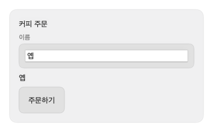
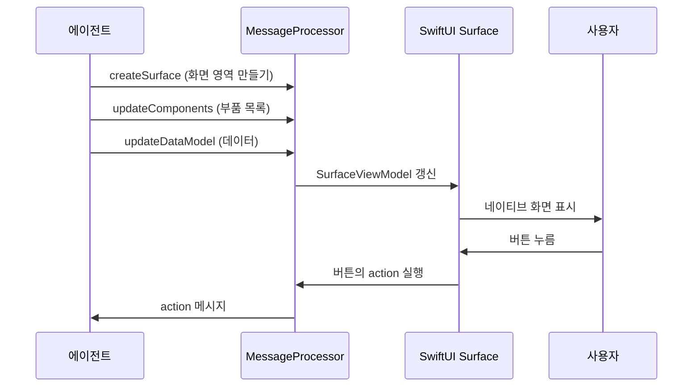
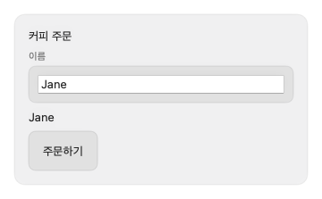
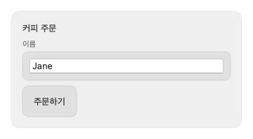

# A2UI와 SwiftUI
{: .no_toc }



AI 에이전트와 채팅하다가 "커피 주문할래"라고 말했다고 해 보자. 에이전트가 "이름을 알려 주세요"라고 글자로만 답할 수도 있다. 그런데 이름 입력칸과 "주문하기" 버튼이 있는 작은 카드를 바로 보여 주면 훨씬 편하다.

A2UI(Agent-to-User Interface)는 이 카드를 **코드가 아니라 데이터**로 보내는 약속(프로토콜)이다. 에이전트는 "카드 안에 제목, 입력칸, 버튼이 있다"는 JSON을 보낸다. 앱은 그 JSON을 읽고 **자기가 가진 SwiftUI 부품**으로 화면을 그린다.

아래 그림이 이 글에서 직접 실행해서 얻은 화면이다. 에이전트가 보냈다고 가정한 JSON 메시지 세 개를 공식 Swift 렌더러에 넣었더니 이 카드가 나왔다.



{: .tip }
식당에 비유하면 이렇다. 손님(에이전트)은 주방에 들어가 요리하지 않는다. 메뉴판에 있는 음식 이름으로 **주문서**만 쓴다. 요리는 주방(앱)이 자기 재료와 방식으로 한다. 메뉴판에 없는 음식은 주문해도 나오지 않는다.

## 왜 HTML이나 코드를 보내지 않을까

에이전트가 HTML이나 Swift 코드를 만들어 보내고 앱이 그대로 실행하면 어떨까. 공식 문서는 이 방식을 피하는 이유를 이렇게 설명한다.

- **안전하다.** A2UI 메시지는 선언형 JSON이다. 실행할 코드가 아니다. 앱은 자기가 등록한 컴포넌트만 그린다. 그래서 에이전트가 앱에 없는 일을 시킬 수 없다.
- **앱다운 화면이 나온다.** 같은 JSON이라도 웹 렌더러는 웹 부품으로, SwiftUI 렌더러는 SwiftUI 부품으로 그린다. 글꼴, 색, 접근성은 앱의 것을 따른다.
- **조금씩 그릴 수 있다.** 메시지가 여러 개로 나뉘어 흘러오므로, 받은 만큼 먼저 그리고 나중에 고칠 수 있다.

v1.0 명세는 함수 호출에 대해서도 "실행 코드를 보내지 않으려고 이름으로 부른다"고 적고 있다. 에이전트는 함수 이름과 인자만 보내고, 실제 함수는 앱의 카탈로그에 있어야 한다.

## 전체 흐름

A2UI에는 두 쪽이 있다. JSON을 만드는 **에이전트**와, JSON을 화면으로 바꾸는 **렌더러**다. 이 글에서 렌더러는 공식 Swift 패키지의 `MessageProcessor`와 SwiftUI `Surface` 뷰다.



v1.0 명세에서 메시지 종류는 방향에 따라 나뉜다.

| 방향 | 메시지 | 하는 일 |
| --- | --- | --- |
| 에이전트 → 앱 | `createSurface` | 화면 영역(surface)을 새로 만든다 |
| 에이전트 → 앱 | `updateComponents` | 부품 목록을 넣거나 바꾼다 |
| 에이전트 → 앱 | `updateDataModel` | 화면에 쓸 데이터를 넣거나 바꾼다 |
| 에이전트 → 앱 | `deleteSurface` | 화면 영역을 지운다 |
| 에이전트 → 앱 | `callRendererFunction`, `agentFunctionResponse` | 앱 함수 호출, 에이전트 함수의 결과 (v1.0에서 추가) |
| 앱 → 에이전트 | `action` | 사용자가 버튼 등을 눌렀다 |
| 앱 → 에이전트 | `error` | 받은 메시지에 문제가 있다 |
| 앱 → 에이전트 | `callAgentFunction`, `rendererFunctionResponse` | 에이전트 함수 호출, 앱 함수의 결과 (v1.0에서 추가) |

**surface**는 "에이전트가 그릴 수 있는 화면 한 칸"이다. 채팅 말풍선 하나, 시트 하나처럼 앱이 자리를 정해 준다.

## 메시지 세 개 뜯어보기

예제에서 보낸 메시지를 하나씩 보자. 실제 실행에 쓴 JSON과 내용이 같다.

### 1. createSurface: 자리 만들기

```json
{"version": "1.0",
 "createSurface": {
   "surfaceId": "order",
   "catalogId": "https://a2ui.org/specification/v1_0/catalogs/basic/catalog.json"
 }}
```

- `surfaceId`: 이 화면 칸의 이름이다. 뒤 메시지는 이 이름으로 같은 칸을 가리킨다.
- `catalogId`: "어떤 메뉴판으로 주문할지"다. 여기서는 공식 **기본 카탈로그**(Basic Catalog)를 쓴다.

기본 카탈로그 v1에는 컴포넌트 18개가 있다. 저장소의 `catalogs/basic/v1/catalog.json`을 읽어 이름을 세어 보면 이렇다.

```text
Text, Image, Icon, Video, AudioPlayer, Row, Column,
List, Card, Tabs, Modal, Divider, Button, TextField,
CheckBox, ChoicePicker, Slider, DateTimeInput
```

### 2. updateComponents: 부품 목록

```json
{"version": "1.0",
 "updateComponents": {
   "surfaceId": "order",
   "components": [
     {"id": "root", "component": "Card",
      "child": "col"},
     {"id": "col", "component": "Column",
      "children": ["title", "name_field",
                   "hello", "submit"]},
     {"id": "title", "component": "Text",
      "text": "커피 주문"},
     {"id": "name_field", "component": "TextField",
      "label": "이름",
      "value": {"@path": "/user/name"}},
     {"id": "hello", "component": "Text",
      "text": {"@path": "/user/name"}},
     {"id": "submit", "component": "Button",
      "child": "submit_label",
      "action": {"event": {
        "name": "submit_order",
        "context": {
          "name": {"@path": "/user/name"}}
      }}},
     {"id": "submit_label", "component": "Text",
      "text": "주문하기"}
   ]
 }}
```

처음 보면 이상한 점이 있다. 부품이 **트리(나무 모양)가 아니라 납작한 목록**이다.

- 모든 부품에 `id`가 있다.
- 부모는 자식을 직접 품지 않고 **id로 가리킨다**. `Card`는 `"child": "col"`, `Column`은 `"children": [...]`로 가리킨다.
- `id`가 `root`인 부품이 맨 위다.

목록이 납작하면 부품 하나만 따로 고쳐 보내기 쉽다. `id`가 같은 부품을 다시 보내면 그 부품만 바뀐다.

{: .note }
`{"@path": "/user/name"}`는 "값을 여기 직접 쓰지 않고, 데이터 모델의 `/user/name` 자리에서 가져와라"라는 뜻이다. 이렇게 데이터 위치를 가리키는 문자열 형식을 **JSON Pointer**라고 한다. 파일 경로처럼 `/`로 단계를 나눈다.

### 3. updateDataModel: 데이터 넣기

```json
{"version": "1.0",
 "updateDataModel": {
   "surfaceId": "order",
   "path": "/user/name",
   "value": "옙"
 }}
```

데이터 모델의 `/user/name` 자리에 `"옙"`을 넣는다. 입력칸과 그 아래 `Text`가 둘 다 이 자리를 가리키므로, 둘 다 "옙"을 보여 준다. 맨 위 그림이 이 상태다.

## Swift 렌더러로 실행하기

공식 저장소의 `swift/` 폴더에 Apple 플랫폼용 렌더러가 있다. README에 적힌 지원 범위는 **iOS·iPadOS 17 이상, macOS 14 이상**이다.

### 실행 환경

{: .note }
이 글의 코드는 macOS 15.6에서 Swift 6.4.3으로 실행했다. A2UI 소스는 2026-11-26의 `main` 브랜치(커밋 `36725ee`)를 썼다. 그림은 **macOS**에서 `NSHostingView`로 찍은 것이다. 같은 `Surface` 뷰가 iOS 17 이상에서도 동작한다고 README에 적혀 있지만, 이 글에서 iOS 기기로 찍지는 않았다.

### 1단계: 렌더러 준비하고 메시지 넣기

```swift
import A2UICore
import A2UISwiftUI
import BasicCatalogSwiftUI
import SwiftUI

// 기본 카탈로그 + 메시지 처리기
let catalog = BasicCatalogImplementation
  .makeCatalog(version: .v10)
let processor = MessageProcessor(catalogs: [catalog])

// 앱 → 에이전트로 나가는 메시지를 받는 곳
processor.outboundListener = { message in
  let encoder = JSONEncoder()
  encoder.outputFormatting = [.prettyPrinted,
                              .sortedKeys]
  let data = try! encoder.encode(message)
  print("에이전트로 보낼 메시지:")
  print(String(data: data, encoding: .utf8)!)
}

// messages: 위에서 본 JSON 문자열 세 개
let parser = MessageParser()
for raw in messages {
  processor.process(
    message: try parser.parse(jsonString: raw))
}

let surface = processor.surfaceGroupModel
  .surfacesMap["order"]!
print("만들어진 surface:", surface.surfaceID)
print("데이터 모델:", surface.dataModel.data)
```

순서를 짚어 보자.

1. `MessageParser`가 JSON 문자열을 메시지 값으로 바꾼다.
2. `MessageProcessor`가 메시지를 처리해 surface를 만들고 고친다.
3. 만들어진 surface는 `surfaceGroupModel.surfacesMap`에 `surfaceId`로 들어간다. 값의 타입은 `SurfaceViewModel`이다.

실제 출력이다.

```text
만들어진 surface: order
데이터 모델: {"user": {"name": "옙"}}
```

### 2단계: SwiftUI로 그리기

그리기는 한 줄이다. `Surface` 뷰에 surface와 카탈로그를 넘긴다.

```swift
Surface(viewModel: surface, catalogs: [catalog])
```

예제에서는 이 뷰를 `NSHostingView`에 넣고 PNG로 저장했다. 저장 코드는 A2UI와 상관없는 부분이라 생략한다. 결과가 글 맨 위의 그림이다.

`Card`는 둥근 배경, `Column`은 세로 배치, `TextField`는 입력칸이 됐다. 에이전트는 모양을 하나도 지정하지 않았다. 모양은 SwiftUI 쪽 구현이 정했다.

{: .tip }
v1.0 명세는 테마(브랜드 색 같은 것)를 메시지에서 뺐다. "모양은 앱의 네이티브 테마를 따른다"는 방향이다. v1.0의 `createSurface`에 `theme`가 들어 있으면 잘못된 메시지로 본다.

## 데이터만 바꾸면 화면이 따라온다

이번에는 부품은 그대로 두고, 데이터만 바꾸는 메시지를 하나 더 보냈다.

```swift
processor.process(message: try parser.parse(
  jsonString: """
  {"version": "1.0",
   "updateDataModel": {
     "surfaceId": "order",
     "path": "/user/name", "value": "Jane"
   }}
  """))
print("데이터 모델:", surface.dataModel.data)
```

출력이다.

```text
데이터 모델: {"user": {"name": "Jane"}}
```

다시 찍은 화면이다. 입력칸과 아래 글자가 함께 "Jane"으로 바뀌었다.



두 부품이 같은 자리(`/user/name`)를 가리키고 있어서다. 에이전트가 부품 목록을 다시 보낼 필요가 없다. 이것을 **데이터 바인딩**이라고 한다. 화면(부품)과 내용(데이터)을 따로 보내고, 둘을 경로로 이어 두는 방식이다.

{: .note }
명세는 입력 부품(`TextField`, `CheckBox`, `Slider`, `ChoicePicker`, `DateTimeInput`)을 **양방향 바인딩**으로 정해 둔다. 사용자가 입력칸에 글자를 치면 앱 안의 데이터 모델이 바로 바뀌고, 같은 경로를 보는 `Text`도 따라 바뀌어야 한다. 이 글의 예제는 에이전트 쪽에서 데이터를 바꾸는 방향만 실행했다. 직접 타이핑하는 경우는 실행해 보지 않았다.

{: .warning }
명세에 따르면 양방향 바인딩은 **앱 안에서만** 일어난다. 사용자가 글자를 칠 때마다 에이전트에게 보내지 않는다. 에이전트가 입력값을 받는 때는 버튼 같은 **action**이 일어날 때다.

## 버튼을 누르면: action이 에이전트로 간다

버튼의 `action`을 다시 보자.

```json
"action": {"event": {
  "name": "submit_order",
  "context": {"name": {"@path": "/user/name"}}
}}
```

"누르면 `submit_order`라는 이벤트를 보내고, 그때 `/user/name` 값을 `name`이라는 이름으로 담아라"는 뜻이다.

예제에서는 화면을 클릭하는 대신, 렌더러가 만든 버튼 노드의 action을 코드로 실행했다.

```swift
let column = surface.rootNode!.child(for: "child")!
let button = column.children(for: "children")[3]
print("누른 버튼:", button.id)
button.action(for: "action")?()
```

`rootNode`는 `Card`, 그 `child`는 `Column`, `Column`의 네 번째 자식이 버튼이다. 실행하니 `outboundListener`에 이 메시지가 들어왔다.

```text
누른 버튼: submit
에이전트로 보낼 메시지:
{
  "action" : {
    "context" : {
      "name" : "Jane"
    },
    "name" : "submit_order",
    "sourceComponentId" : "submit",
    "surfaceId" : "order",
    "timestamp" : "2026-11-26T15:03:38Z"
  },
  "version" : "1.0"
}
```

`@path`였던 자리가 실제 값 `"Jane"`으로 바뀌어 있다. 어느 surface의 어느 부품에서 왔는지(`surfaceId`, `sourceComponentId`)와 시각도 붙었다. 이 JSON을 에이전트에게 보내는 일은 앱이 한다. A2UI 렌더러는 메시지를 만들어 줄 뿐, 네트워크로 보내지는 않는다.

{: .question }
`context`에 `@path`를 쓰지 않고 `"name": "옙"`처럼 값을 직접 적었다면, 사용자가 입력칸을 고친 뒤 버튼을 눌렀을 때 에이전트는 어떤 값을 받을까?

## 메뉴판에 없는 부품을 보내면

식당 비유에서 "메뉴판에 없는 음식은 나오지 않는다"고 했다. 정말 그런지 실행해 봤다. 기본 카탈로그에 없는 `RunScript`라는 부품을, 화면에 보이던 `hello` 자리에 보냈다.

```json
{"version": "1.0",
 "updateComponents": {
   "surfaceId": "order",
   "components": [
     {"id": "hello", "component": "RunScript",
      "code": "rm -rf /"}
   ]
 }}
```

출력이다.

```text
--- 모르는 컴포넌트 ---
에이전트로 보낼 메시지:
{
  "error" : {
    "code" : "UNKNOWN_COMPONENT_TYPE",
    "message" : "Component 'hello' has type 'RunScript', which is not in catalog 'https:\/\/a2ui.org\/specification\/v1_0\/catalogs\/basic\/catalog.json'.",
    "surfaceId" : "order"
  },
  "version" : "1.0"
}
```

화면에서는 그 자리가 그냥 비었다. "Jane" 글자 줄이 사라진 것을 볼 수 있다.



`code`에 무엇을 적든 실행할 길이 없다. 렌더러는 그 부품을 그리지 않고, 에이전트에게 `error` 메시지로 알렸다.

{: .note }
Swift 렌더러의 `MessageProcessor`는 기본값이 `ValidationConfig.relaxed`다. 소스 주석에 따르면 이 설정은 카탈로그에 없는 부품을 메시지 단계에서 거절하지 않고 받아 둔다. 그 부품이 화면 트리에 걸리면 위처럼 `UNKNOWN_COMPONENT_TYPE` 오류를 보내고 빈칸으로 그린다. 받는 단계에서부터 엄격하게 막고 싶으면 `validationConfig: .strict`를 넘길 수 있다. `.strict`로는 실행해 보지 않았다.

## 앱에 넣기

### 패키지 추가

Swift README에 적힌 설치 방법이다. Xcode에서는 `File > Add Package Dependencies...`에 저장소 주소를 넣으면 된다.

```swift
dependencies: [
  .package(
    url: "https://github.com/a2ui-project/a2ui",
    .upToNextMinor(from: "0.12.0")),
],
targets: [
  .target(
    name: "YourApp",
    dependencies: [
      .product(name: "A2UISwiftCore",
               package: "a2ui"),
      .product(name: "A2UISwiftUI",
               package: "a2ui"),
      .product(name: "BasicCatalog",
               package: "a2ui"),
      .product(name: "BasicCatalogSwiftUI",
               package: "a2ui"),
    ]
  ),
]
```

| 제품 | 들어 있는 것 |
| --- | --- |
| `A2UISwiftCore` | 메시지 해석, 데이터 모델, 검증 (`import A2UICore`) |
| `BasicCatalog` | 기본 카탈로그의 스키마와 함수 |
| `A2UISwiftUI` | `Surface` 뷰 같은 SwiftUI 연결부 |
| `BasicCatalogSwiftUI` | 기본 카탈로그 부품의 SwiftUI 구현 |

README에 따르면 SwiftUI를 쓰지 않는 타깃은 `A2UISwiftCore`와 `BasicCatalog`만 받아도 된다.

### 화면 코드의 뼈대

앱에서는 메시지 처리기를 한 곳에 두고, surface 목록을 SwiftUI로 보여 주면 된다. 아래 코드는 이 글의 예제 패키지에 넣어 **macOS에서 빌드가 되는 것까지** 확인했다. 실제 에이전트와 연결해서 돌려 보지는 않았다.

```swift
@MainActor
final class AgentUIModel {
  let catalog = BasicCatalogImplementation
    .makeCatalog(version: .v10)
  let processor: MessageProcessor

  init(send: @escaping @Sendable (Data) -> Void) {
    processor = MessageProcessor(catalogs: [catalog])
    // 앱 → 에이전트 (action, error)
    processor.outboundListener = { message in
      if let data = try? JSONEncoder()
        .encode(message) {
        send(data)
      }
    }
  }

  // 에이전트 → 앱: JSON 메시지 하나씩
  func receive(_ json: String) throws {
    let message = try MessageParser()
      .parse(jsonString: json)
    processor.process(message: message)
  }
}

struct AgentSurfaces: View {
  @ObservedObject var group: SurfaceGroupModel
  let model: AgentUIModel

  var body: some View {
    ScrollView {
      ForEach(group.surfacesMap.keys.sorted(),
              id: \.self) { id in
        if let vm = group.surfacesMap[id] {
          Surface(viewModel: vm,
                  catalogs: [model.catalog])
        }
      }
    }
  }
}
```

`AgentSurfaces(group: model.processor.surfaceGroupModel, model: model)`처럼 쓰면 된다. 에이전트가 `createSurface`를 보내면 목록에 surface가 생기고 화면에 나타난다.

{: .warning }
`MessageProcessor`는 `@MainActor` 클래스다. 네트워크에서 받은 메시지를 넣을 때는 메인 액터에서 `process(message:)`를 불러야 한다.

`send`에 들어갈 실제 전송 코드는 어떤 통로를 쓰느냐에 따라 다르다. 이것은 다음 절에서 본다.

### 링크 열기와 언어 설정

README에 적힌 두 가지 기본 동작도 알아 두자.

- 기본 카탈로그의 `openUrl` 함수는 `http`, `https`, `mailto`, `tel`만 허락한다. 그리고 카탈로그를 만들 때 `openURLHandler`를 넘기지 않으면 **아무 링크도 열지 않는다.**
- `formatNumber`, `formatCurrency`, `pluralize`는 기기 언어와 상관없이 기본으로 `en_US`를 쓴다. 바꾸려면 `makeCatalog(version: .v10, locale: .current)`처럼 만든다.

## 내 부품 등록하기

기본 카탈로그에 없는 부품, 예를 들어 "사용자 카드"를 쓰고 싶을 수 있다. 공식 README는 두 단계로 설명한다.

1. **부품 설명서(스키마)** 를 `ComponentAPI`로 만든다. 이름이 `UserCard`이고 `name`(필수), `avatarUrl` 속성을 받는다는 JSON Schema다.
2. **SwiftUI 구현**을 `ComponentImplementation`으로 만든다.

```swift
// swift/swiftui/README.md의 예
let customProfileImplementation =
  ComponentImplementation(api: UserCardAPI()) {
    node in
    VStack {
      Text(node.string(for: "name") ?? "Unknown")
        .font(.headline)
    }
  }
```

이것을 `Catalog<ComponentImplementation>`에 넣고 `Surface(viewModel:catalogs:)`에 넘긴다. README는 기본 카탈로그에서 일부만 골라 새 ID의 카탈로그를 만드는 `derive(id:components:functions:)`도 보여 준다. 에이전트가 쓸 수 있는 부품을 줄이고 싶을 때 쓸 수 있다.

{: .note }
에이전트가 무엇을 그릴 수 있는지는 **앱이 등록한 카탈로그가 정한다.** 명세에서는 앱이 지원하는 카탈로그 목록(`supportedCatalogIds`)을 에이전트에게 알려 주고, 에이전트는 그 안에서 화면을 만든다. 이 절의 사용자 부품 코드는 README에서 옮긴 것이고, 직접 실행하지는 않았다.

## A2A, MCP, AG-UI와는 무슨 관계일까

A2UI는 **무엇을 보낼지**(JSON 메시지 모양)만 정한다. **어떻게 보낼지**(통로)는 정하지 않는다. v1.0 명세는 이것을 "transport-agnostic(통로에 매이지 않는다)"이라고 부른다.

{: .tip }
A2UI는 편지 내용의 양식이고, A2A(에이전트끼리 일을 주고받는 프로토콜), MCP(모델이 외부 도구·데이터에 접속하는 프로토콜), AG-UI(에이전트와 사용자 화면 사이의 이벤트 프로토콜), WebSocket은 우체국이다. 같은 양식의 편지를 어느 우체국으로든 부칠 수 있다.

명세에 나온 통로는 이렇다.

| 통로 | 명세의 설명 |
| --- | --- |
| AG-UI | 에이전트와 사용자 화면을 잇는 표준 통로로 소개 |
| A2A 확장 | A2A 프로토콜 위에 A2UI를 얹는 공식 확장 |
| MCP | 초기화 단계에서 능력(지원 카탈로그 등)을 주고받는 예로 언급 |
| SSE(서버가 연결을 열어 둔 채 이벤트를 흘려보내는 HTTP 방식), WebSocket, REST | 그 밖의 통로 |

명세가 통로에 요구하는 것은 크게 셋이다. 메시지를 하나씩 끊어 전달할 것, 메타데이터(지원 카탈로그 같은 정보)를 함께 실을 것, 그리고 상호작용이 필요하면 `action`이 돌아갈 길을 둘 것.

앞의 `AgentUIModel`에서 `receive`와 `send`가 바로 이 통로와 만나는 자리다.

## 버전 주의

{: .warning }
A2UI는 아직 빠르게 바뀌는 중이다. 2026-11-26 기준 저장소의 `specification/versions.json`에는 **v1.0이 현재 버전**, v0.9.1·v0.9가 이전 버전, v0.8은 지원 중단으로 적혀 있다. 이 글의 메시지는 모두 v1.0 형식이다. v0.9 형식과 섞어 쓰면 안 된다.

- 공식 Swift 렌더러는 v0.9.1과 v1.0 카탈로그를 모두 다룬다. 공식 외에 v0.9.x만 지원하는 커뮤니티 Swift 렌더러도 있으니, 다른 자료를 볼 때 어느 버전인지 먼저 확인한다.
- README가 안내하는 패키지 버전은 `0.12.0`(태그 `v0.12.0+swift`)이다. 이 글은 그보다 새 `main` 커밋(`36725ee`)으로 실행했다. 두 시점 사이의 API 차이는 확인하지 않았다.
- 루트 `Package.swift`는 `swift-tools-version 6.1`을 요구한다. 이 컴퓨터의 Xcode 16.2(Swift 6.0.3)로는 열리지 않아 Swift 6.4.3 툴체인을 따로 썼다.

{: .warning }
이 환경(Swift 6.4.3 + macOS 15 SDK)에서는 빌드에 우회 두 가지가 필요했다. 의존성 `swift-json-schema`의 언어 모드를 로컬에서 Swift 5로 바꿨고, `-Xswiftc -Xfrontend -Xswiftc -enable-cross-import-overlays` 플래그를 붙였다(기본 카탈로그의 `Video`가 쓰는 `VideoPlayer`를 찾지 못했다). A2UI 코드는 고치지 않았다. 최신 Xcode에서도 이 우회가 필요한지는 확인하지 않았다.

## 정리

- A2UI는 에이전트가 화면을 **JSON 데이터**로 보내고, 앱이 **자기 네이티브 부품**으로 그리는 프로토콜이다.
- 에이전트 → 앱 기본 메시지는 `createSurface`, `updateComponents`, `updateDataModel`, `deleteSurface`다. 앱 → 에이전트는 `action`, `error` 등이다.
- 부품은 `id`로 서로를 가리키는 **납작한 목록**이고, `id`가 `root`인 부품이 맨 위다.
- `{"@path": "/user/name"}`로 데이터 모델에 연결하면, 데이터만 바꿔도 화면이 따라 바뀐다.
- 버튼을 누르면 `action` 메시지가 만들어지고, `@path` 자리는 실제 값으로 채워진다. 보내는 일은 앱이 한다.
- 카탈로그에 없는 부품은 그려지지 않고 `UNKNOWN_COMPONENT_TYPE` 오류가 에이전트로 간다.
- SwiftUI에서는 `MessageProcessor`로 메시지를 처리하고 `Surface(viewModel:catalogs:)`로 그린다.
- A2UI는 통로를 정하지 않는다. A2A, MCP, AG-UI, WebSocket 등 어디에든 실을 수 있다.

## 함께 읽기

- [Foundation Models](/ios/foundation-models/): 앱 안에서 Apple 언어 모델을 부르는 방법
- [Siri AI와 App Intents](/ios/siri-ai-app-intents/): 시스템 AI가 앱 기능을 부르는 방법
- [LangChain](/ai/using-ai/langchain/): 에이전트 쪽을 만드는 Python 도구

## 참고

- [A2UI 공식 사이트](https://a2ui.org)
- [A2UI v1.0 명세](https://a2ui.org/specification/v1.0-a2ui/)
- [a2ui-project/a2ui 저장소 (Apache-2.0)](https://github.com/a2ui-project/a2ui)
- [Swift 렌더러 README](https://github.com/a2ui-project/a2ui/blob/main/swift/README.md)
- [SwiftUI 어댑터 README](https://github.com/a2ui-project/a2ui/blob/main/swift/swiftui/README.md)
- [Swift Core README](https://github.com/a2ui-project/a2ui/blob/main/swift/core/README.md)
- [기본 카탈로그 v1](https://github.com/a2ui-project/a2ui/blob/main/catalogs/basic/v1/catalog.json)
- [AG-UI 문서](https://docs.ag-ui.com/introduction)
- [A2A 프로토콜](https://a2a-protocol.org)
