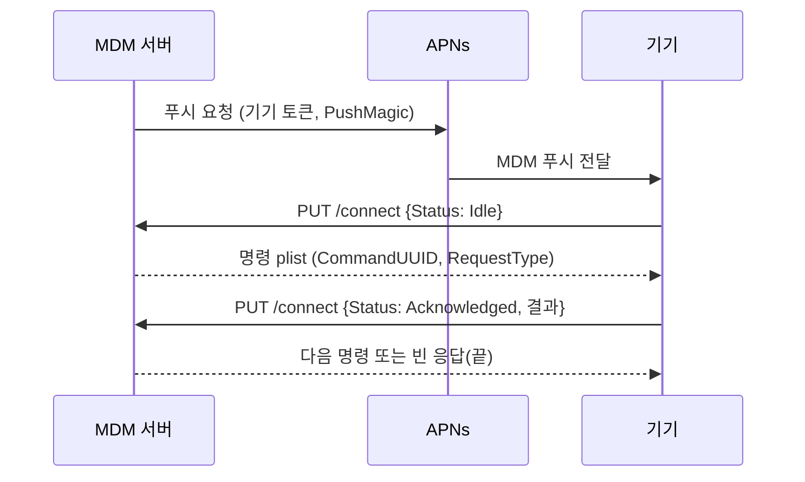

# MDM 구조와 통신 흐름
{: .no_toc }



MDM을 처음 보면 "서버가 기기에 명령을 보낸다"고 생각하기 쉽다. 실제로는 반대다. **서버는 기기에 직접 접속하지 않는다.** 서버는 APNs로 "확인할 게 있다"는 신호만 보내고, 신호를 받은 기기가 서버에 접속해 할 일을 가져간다. 이 구조를 이해하면 MDM의 나머지 부분이 모두 이 위에 얹힌다는 것이 보인다.

## 구성 요소

| 구성 요소 | 역할 |
| --- | --- |
| MDM 서버 | 기기 목록, 정책, 명령 대기열을 관리한다. 기관이 직접 운영하거나 Jamf, Intune, Kandji 같은 상용 제품을 쓴다 |
| APNs | 서버가 기기를 깨우는 통로. 서버는 Apple의 APNs에 푸시를 요청하고, APNs가 기기에 전달한다 |
| 기기의 MDM 클라이언트 | 운영체제에 내장된 관리 기능(macOS에서는 `mdmclient` 프로세스). 푸시를 받으면 서버에 접속해 명령을 처리한다 |
| ABM / ASM | 기관이 소유한 기기의 일련번호를 어느 MDM 서버에 배정할지 정하고, 앱 라이선스를 관리하는 Apple 포털 |
| Apple 서버들 | 기기 활성화, 자동 등록 정보 제공, 앱 라이선스 API 등 |

## 통신 흐름: 깨우고, 가져간다



1. 서버에 기기로 보낼 명령이 생기면, 명령을 대기열에 넣고 APNs에 푸시를 요청한다.
2. 푸시에는 명령 내용이 들어 있지 않다. 기기가 등록할 때 알려 준 `PushMagic`이라는 값만 담긴다. APNs는 전달을 보장하지 않으므로 중요한 정보를 푸시에 싣지 않는다.
3. 푸시를 받은 기기는 등록 때 받은 서버 주소(ServerURL)에 접속해 "지금 한가하다(`Idle`)"고 알린다.
4. 서버는 응답으로 대기열의 첫 명령을 보낸다.
5. 기기는 명령을 실행하고 결과를 다시 같은 주소로 보낸다. 서버는 응답으로 다음 명령을 보낸다.
6. 대기열이 비면 서버는 빈 응답을 보내고 연결이 끝난다.

푸시가 늦거나 유실돼도 기기는 주기적으로, 그리고 네트워크 변화나 재부팅 같은 계기에 스스로 서버에 접속하므로 명령은 결국 전달된다. 다만 "즉시"는 보장되지 않는다. 기기가 꺼져 있거나 비행기 모드면 다음 접속까지 기다린다.

## 두 개의 엔드포인트

MDM 서버는 기기용 주소를 두 개 둔다. 둘을 같은 URL로 써도 되지만 역할은 다르다.

| 엔드포인트 | 등록 프로파일의 키 | 주고받는 것 |
| --- | --- | --- |
| 체크인(Check-in) | `CheckInURL` | 등록·토큰 갱신·탈퇴 같은 기기 상태 변화 알림 |
| 명령(Connect) | `ServerURL` | 명령 받기와 결과 보고 |

체크인 메시지는 `MessageType`으로 구분한다.

| MessageType | 언제 | 서버가 저장할 것 |
| --- | --- | --- |
| `Authenticate` | 등록을 시작할 때 | 기기 UDID, 일련번호, 모델 |
| `TokenUpdate` | 등록 직후와 푸시 토큰이 바뀔 때 | 푸시 토큰(`Token`), `PushMagic`, 암호 해제용 `UnlockToken` |
| `CheckOut` | 관리 프로파일이 제거될 때(설정한 경우) | 기기를 관리 해제 상태로 표시 |
| `DeclarativeManagement` | DDM을 쓸 때 | 선언 동기화 요청 ([6편]({{ '/ios/mdm/ddm/' | relative_url }})) |

`TokenUpdate`를 받기 전에는 푸시를 보낼 수 없다. 등록이 끝났는데 명령이 안 간다면 먼저 이 메시지를 받아 저장했는지 확인한다.

## 메시지 형식

기기와 서버는 JSON이 아니라 Apple의 **property list(plist)** XML을 주고받는다. 서버가 보내는 명령은 이런 모양이다.

```xml
<plist version="1.0">
<dict>
  <key>CommandUUID</key>
  <string>0001-DEVINFO</string>
  <key>Command</key>
  <dict>
    <key>RequestType</key>
    <string>DeviceInformation</string>
    <key>Queries</key>
    <array>
      <string>DeviceName</string>
      <string>OSVersion</string>
      <string>IsSupervised</string>
    </array>
  </dict>
</dict>
</plist>
```

기기는 같은 `CommandUUID`와 처리 결과(`Status`)를 담아 응답한다.

| Status | 뜻 | 서버가 할 일 |
| --- | --- | --- |
| `Acknowledged` | 성공 | 결과 저장, 다음 명령 전송 |
| `Error` | 실패. `ErrorChain`에 원인 | 기록하고 재시도 여부 판단 |
| `CommandFormatError` | 명령 형식이 잘못됨 | 서버 버그. 재시도해도 같다 |
| `NotNow` | 지금은 처리할 수 없음(예: 기기가 잠겨 있음) | 대기열에 남겨 두고 나중에 다시 |
| `Idle` | 할 일 달라는 신호 | 대기열의 명령 전송 |

## 인증서 세 종류

MDM은 인증서가 많이 나와서 처음에 헷갈린다. 역할별로 셋이다.

| 인증서 | 누가 갖나 | 용도 | 유효 기간 |
| --- | --- | --- | --- |
| APNs MDM 푸시 인증서 | MDM 서버 | APNs에 "이 서버가 이 토픽으로 푸시할 자격이 있다"를 증명 | 1년, 갱신 필요 |
| 기기 ID 인증서 | 각 기기 | 기기가 서버에 접속할 때 자신을 증명하는 클라이언트 인증서 | 서버가 정함 |
| 서버 TLS 인증서 | MDM 서버 | 일반 HTTPS 서버 인증서 | 일반 TLS와 같음 |

**APNs MDM 푸시 인증서**는 일반 앱 푸시 인증서와 다르다. MDM 제품 개발사(벤더)가 Apple에서 받은 서명 권한으로 고객의 인증서 요청(CSR)에 서명해 주고, 고객 기관은 그 서명된 요청을 [Apple Push Certificates Portal](https://identity.apple.com/pushcert/)에 올려 인증서를 받는다. 인증서 안의 토픽(`com.apple.mgmt.External.<UUID>`)이 등록 프로파일의 `Topic`과 같아야 한다.

이 인증서는 **반드시 처음 만든 Apple 계정으로 갱신**해야 한다. 새로 발급받으면 토픽이 바뀌어, 이미 등록된 모든 기기에 푸시를 보낼 수 없게 되고 기기를 전부 다시 등록해야 한다. [7편]({{ '/ios/mdm/operations/' | relative_url }})에서 운영 관점으로 다시 다룬다.

**기기 ID 인증서**는 등록할 때 기기가 SCEP나 ACME 프로토콜로 서버에서 발급받거나, 등록 프로파일 안에 PKCS #12로 넣어 준다. 이후 모든 체크인·명령 요청은 이 인증서로 TLS 클라이언트 인증을 하거나 요청 본문에 서명(`Mdm-Signature` 헤더)한다. 서버는 이 인증서로 "이 요청이 정말 등록된 그 기기에서 왔는가"를 확인한다.

## 기기 소유 모델

MDM이 기기에서 할 수 있는 일은 **누가 기기를 소유하느냐**에 따라 달라진다.

| 소유 | 등록 방식 | 관리 범위 |
| --- | --- | --- |
| 기관 소유, 감독 | ADE 자동 등록, Apple Configurator | 가장 넓음. 앱 무음 설치, 대부분의 제한, OS 업데이트 강제, 원격 초기화 |
| 기관 소유, 비감독 | 프로파일 수동 등록 | 기본 관리. 일부 제한과 명령은 불가 |
| 개인 소유(BYOD) | 사용자 등록(User Enrollment) | 업무 데이터 영역만. 기기 일련번호·개인 앱·위치를 볼 수 없고 초기화도 못 한다 |

개인 기기의 사생활을 보호하기 위해, Apple은 BYOD에서 기관이 볼 수 있는 정보와 할 수 있는 일을 운영체제 수준에서 제한한다. 등록 방식은 [2편]({{ '/ios/mdm/enrollment/' | relative_url }})에서 자세히 본다.

## 정리

- MDM 서버는 기기에 직접 접속하지 않는다. APNs로 깨우면 기기가 서버에 접속해 명령을 가져간다.
- 푸시에는 명령 내용이 없고, 전달도 보장되지 않는다. 명령은 서버 대기열에 남아 있다가 기기가 접속할 때 전달된다.
- 체크인 엔드포인트는 기기 상태 변화를, 명령 엔드포인트는 명령과 결과를 주고받는다. 형식은 plist다.
- 인증서는 APNs 푸시 인증서, 기기 ID 인증서, 서버 TLS 인증서 세 가지이며, 푸시 인증서는 같은 Apple 계정으로 갱신해야 한다.
- 관리 범위는 기기 소유 모델(감독, 비감독, BYOD)에 따라 달라진다.

## 참고

- [Apple Platform Deployment](https://support.apple.com/guide/deployment/welcome/web)
- [Apple Developer: Device Management](https://developer.apple.com/documentation/devicemanagement)
- [Apple Developer: Check-in](https://developer.apple.com/documentation/devicemanagement/check-in)
- [Apple Push Certificates Portal](https://identity.apple.com/pushcert/)
