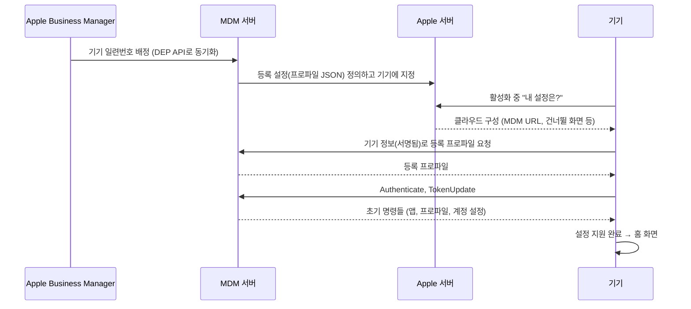

# MDM 등록: 프로파일, ADE(DEP), 사용자 등록
{: .no_toc }



**등록(enrollment)**은 기기가 특정 MDM 서버를 "나를 관리하는 서버"로 받아들이는 과정이다. 등록이 끝나면 기기에는 서버 주소, 푸시 토픽, 기기 ID 인증서가 남고, 서버에는 기기의 푸시 토큰이 저장된다. 그 뒤로는 [1편]({{ '/ios/mdm/architecture/' | relative_url }})의 흐름대로 명령을 주고받는다.

등록 방법은 기기 소유와 상황에 따라 네 가지다.

| 방법 | 대상 | 사용자가 하는 일 | 감독 모드 | 사용자가 관리 해제 |
| --- | --- | --- | --- | --- |
| 프로파일 수동 등록 | 기관 소유 기기를 나중에 등록 | 프로파일 내려받아 설치 | 아니오 | 가능 |
| ADE (예전 DEP) | ABM에 등록된 기관 소유 기기 | 전원 켜고 설정 진행 | 예 | 막을 수 있음 |
| 계정 기반 기기 등록 | 기관 소유 기기, 설정 앱에서 시작 | 관리형 Apple 계정으로 로그인 | 아니오 | 가능 |
| 사용자 등록 (BYOD) | 개인 소유 기기 | 관리형 Apple 계정으로 로그인 | 아니오 | 언제든 가능 |

## 등록 프로파일의 구조

어떤 방법이든 결국 기기에는 **등록 프로파일**이 설치된다. 핵심은 `com.apple.mdm` 페이로드다.

```xml
<dict>
  <key>PayloadType</key>
  <string>com.apple.mdm</string>
  <key>ServerURL</key>
  <string>https://mdm.example.com/mdm/connect</string>
  <key>CheckInURL</key>
  <string>https://mdm.example.com/mdm/checkin</string>
  <key>Topic</key>
  <string>com.apple.mgmt.External.00000000-0000-0000-0000-000000000000</string>
  <key>IdentityCertificateUUID</key>
  <string>8A7B2C3D-0000-4000-8000-000000000002</string>
  <key>AccessRights</key>
  <integer>8191</integer>
  <key>CheckOutWhenRemoved</key>
  <true/>
  <key>SignMessage</key>
  <true/>
  <!-- PayloadIdentifier, PayloadUUID, PayloadVersion 생략 -->
</dict>
```

| 키 | 뜻 |
| --- | --- |
| `ServerURL` | 명령을 주고받는 주소 |
| `CheckInURL` | 등록·토큰 갱신·탈퇴를 알리는 주소 |
| `Topic` | APNs 푸시 인증서의 토픽. 다르면 푸시가 오지 않는다 |
| `IdentityCertificateUUID` | 같은 프로파일 안의 어떤 인증서 페이로드를 기기 ID로 쓸지 |
| `AccessRights` | 서버에 허용할 권한의 비트 합. 8191은 모든 권한 |
| `CheckOutWhenRemoved` | 사용자가 프로파일을 지우면 서버에 `CheckOut`을 보낼지 |
| `SignMessage` | 요청 본문에 기기 ID 인증서로 서명해 `Mdm-Signature` 헤더로 보낼지 |

같은 프로파일 안에 기기 ID 인증서를 발급받는 SCEP 페이로드(`com.apple.security.scep`)나 ACME 페이로드(`com.apple.security.acme`)를 함께 넣는다. **SCEP**(Simple Certificate Enrollment Protocol)와 **ACME**(Automatic Certificate Management Environment)는 기기가 키 쌍을 직접 만들고 공개 키만 보내 인증서를 받는 프로토콜이다. 개인 키가 기기 밖으로 나가지 않는다는 점에서, 서버가 만든 PKCS #12 파일을 넣어 주는 방식보다 안전하다. ACME는 iOS 16부터 쓸 수 있고, 키를 Secure Enclave에 만들고 그 사실을 Apple이 증명하는 하드웨어 증명(attestation)도 지원한다.

## 1. 프로파일 수동 등록

가장 단순한 방법이다. 사용자가 Safari로 등록 페이지에 접속해 프로파일을 내려받고, 설정 앱에서 설치한다.

1. 사용자가 사내 등록 페이지에 로그인한다.
2. 서버가 그 사용자에게 맞춘 등록 프로파일(일회용 SCEP challenge 포함)을 내려준다.
3. 설정 > 일반 > VPN 및 기기 관리에서 프로파일을 설치한다.
4. 기기가 SCEP로 기기 ID 인증서를 받고, `CheckInURL`로 `Authenticate`, `TokenUpdate`를 보낸다.

이 방법으로는 **감독 모드가 되지 않고**, 사용자가 언제든 프로파일을 지워 관리에서 벗어날 수 있다. 등록 프로파일은 [PKCS #7]({{ '/pki/pkcs7/' | relative_url }}) 형식으로 서명해 두면 설치 화면에 "확인됨"이 표시되어 사용자가 신뢰하기 쉽다.

## 2. ADE: 상자를 뜯고 켜면 등록된다

**ADE(Automated Device Enrollment)**는 예전에 **DEP(Device Enrollment Program)**라고 불렀다. 지금도 API와 문서 곳곳에 DEP라는 이름이 남아 있다.

### 무엇이 다른가

ADE로 배정된 기기는 처음 켜서 설정 지원(Setup Assistant)을 진행하는 도중, Apple 서버에서 "이 기기는 이 기관의 MDM 서버로 등록해야 한다"는 정보를 받는다. 사용자는 별도 작업 없이 설정만 진행하면 등록된다. 기기를 초기화해도 다시 켜면 같은 과정이 반복되므로, 사용자가 관리에서 빠져나갈 수 없다. 그리고 ADE로 등록한 iOS·iPadOS 기기는 **자동으로 감독 모드**가 된다.

### 기기가 ABM에 들어가는 방법

1. **Apple이나 공인 리셀러·통신사에서 기관 명의로 구입**하면, 판매처가 기기 일련번호를 기관의 ABM 계정에 자동으로 올려 준다.
2. 이미 가지고 있는 기기는 **Apple Configurator**(Mac용 앱, 또는 iPhone용 Apple Configurator 앱)로 ABM에 추가할 수 있다. 이렇게 추가한 기기는 등록 후 30일 동안 사용자가 관리에서 해제할 수 있는 기간이 있다.

### 전체 흐름



### MDM 서버와 ABM 연결: 서버 토큰

1. MDM 서버가 공개 키 인증서를 만든다.
2. 관리자가 ABM에 "MDM 서버"를 추가하고 그 공개 키를 올린다.
3. ABM이 서버 토큰 파일(`.p7m`)을 내려준다. 서버 공개 키로 암호화돼 있어 그 서버만 열 수 있다.
4. 토큰 안에는 DEP API에 접속하는 OAuth 자격 증명이 들어 있다. 유효 기간은 1년이다.

### DEP API

MDM 서버는 `https://mdmenrollment.apple.com`의 API로 기기 목록을 받고 등록 설정을 지정한다.

| 요청 | 하는 일 |
| --- | --- |
| `GET /session` | 토큰의 OAuth 자격 증명으로 세션을 만든다. 이후 요청은 `X-ADM-Auth-Session` 헤더를 쓴다 |
| `GET /account` | 연결된 기관 정보 |
| `POST /server/devices` | 이 서버에 배정된 기기 전체 목록(커서로 나눠 받음) |
| `POST /devices/sync` | 마지막 커서 이후 바뀐 기기(추가, 배정 해제 등) |
| `POST /profile` | 등록 설정(아래)을 정의하고 UUID를 받는다 |
| `PUT /profile/devices` | 일련번호 목록에 등록 설정을 지정한다 |

등록 설정은 JSON이다. 주요 키는 이렇다.

```json
{
  "profile_name": "영업팀 iPad",
  "url": "https://mdm.example.com/mdm/enroll",
  "is_mandatory": true,
  "is_mdm_removable": false,
  "await_device_configured": true,
  "department": "IT 지원팀",
  "support_phone_number": "02-0000-0000",
  "skip_setup_items": ["Siri", "ScreenTime", "Privacy", "Appearance"]
}
```

| 키 | 뜻 |
| --- | --- |
| `url` | 기기가 등록 프로파일을 받으러 올 주소 |
| `is_mandatory` | 등록을 건너뛸 수 없게 한다 |
| `is_mdm_removable` | `false`면 설정에서 관리 프로파일을 지울 수 없다 |
| `await_device_configured` | 서버가 `DeviceConfigured` 명령을 보낼 때까지 설정 지원을 멈춰 두고, 그 사이 필요한 앱·설정을 먼저 넣는다 |
| `skip_setup_items` | 건너뛸 설정 지원 화면 |
| `configuration_web_url` | 설정 지원 중에 사내 로그인 웹 페이지를 띄워 사용자를 인증한다 |

`url`로 들어오는 요청 본문에는 기기의 일련번호, UDID, 제품 종류 등이 담기고 Apple이 발급한 기기 인증서로 서명돼 있다. 서버는 서명을 검증해 "ABM에 등록된 진짜 그 기기"인지 확인한 뒤 등록 프로파일을 돌려준다.

### Return to Service

iOS 17부터는 초기화 명령(`EraseDevice`)에 Wi-Fi 정보와 등록 정보를 함께 넘겨, 초기화 후 사람이 손대지 않아도 자동으로 다시 등록되게 할 수 있다(Return to Service). 매장 공용 기기나 학교의 공유 iPad를 다음 사용자에게 넘길 때 쓴다.

## 3. 계정 기반 등록

iOS 17·macOS 14부터는 설정 앱에서 관리형 Apple 계정으로 로그인해 등록을 시작할 수 있다. 사용자가 이메일 형식의 계정을 입력하면, 기기는 그 도메인의 `https://<도메인>/.well-known/com.apple.remotemanagement`에서 MDM 서버 정보를 찾아 등록을 진행한다. 프로파일을 직접 내려받는 단계가 없어 사용자 경험이 단순하다.

이 방식에는 기관 소유 기기용(**계정 기반 기기 등록**)과 개인 기기용(**사용자 등록**) 두 가지가 있다.

## 4. 사용자 등록: 개인 기기(BYOD)

직원 개인 iPhone에 업무 메일과 앱만 관리하고 싶을 때 쓴다. 핵심은 **업무 데이터와 개인 데이터를 운영체제가 분리**한다는 점이다.

- 업무용 앱과 데이터는 별도로 암호화된 저장 영역에 들어간다.
- 서버는 기기 일련번호, UDID, 개인 앱 목록, 위치를 볼 수 없다. 기기는 등록마다 다른 `EnrollmentID`라는 익명 식별자를 쓴다.
- 서버는 기기를 초기화하거나 잠글 수 없다. 관리 해제하면 업무 영역만 지워진다.
- 개인 계정과 관리형 Apple 계정이 함께 로그인된다.

| 할 수 있는 것 | 할 수 없는 것 |
| --- | --- |
| 업무 앱 설치·삭제 | 개인 앱 목록 조회 |
| 업무용 Wi-Fi, VPN(앱별 VPN), 메일 설정 | 기기 전체 초기화, 원격 잠금 |
| 업무 앱의 데이터 유출 제한 | 일련번호·전화번호·위치 수집 |
| 암호 사용 여부 요구 | 복잡한 암호 정책 강제 |

## 정리

- 등록은 기기에 서버 주소·토픽·기기 ID 인증서를, 서버에 기기의 푸시 토큰을 남기는 과정이다.
- 프로파일 수동 등록은 쉽지만 감독되지 않고 사용자가 해제할 수 있다.
- ADE(DEP)는 ABM에 등록된 기관 소유 기기를 처음 켜는 순간 자동으로 등록하고 감독 모드로 만든다. MDM 서버는 서버 토큰과 DEP API로 기기 목록과 등록 설정을 관리한다.
- iOS 17부터 관리형 Apple 계정으로 시작하는 계정 기반 등록이 있다.
- 개인 기기는 사용자 등록으로 업무 영역만 관리하며, 운영체제가 사생활 정보를 서버로부터 가린다.

## 참고

- [Apple Platform Deployment 가이드](https://support.apple.com/guide/deployment/welcome/web): 자동 기기 등록, 사용자 등록, Return to Service 항목
- [Apple Developer: Device Assignment (DEP API)](https://developer.apple.com/documentation/devicemanagement/device-assignment)
- [Apple Developer: MDM (com.apple.mdm payload)](https://developer.apple.com/documentation/devicemanagement/mdm)
