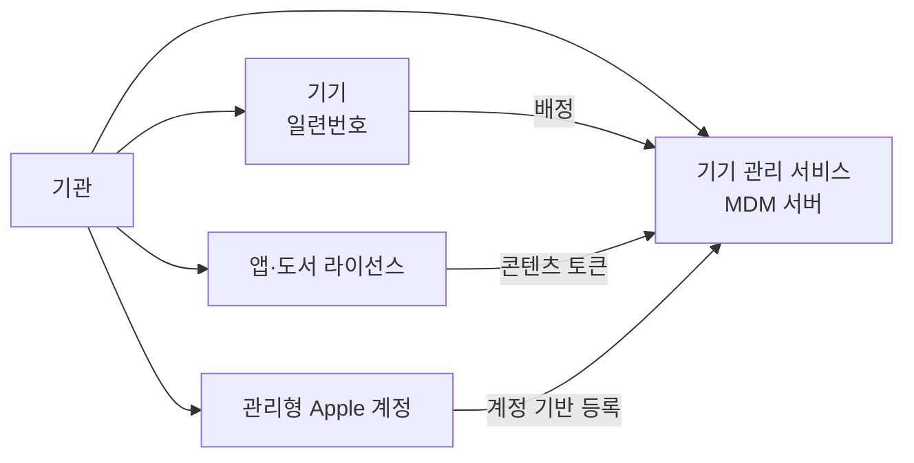

# ABM과 ASM: 기관의 Apple 관리 포털
{: .no_toc }



회사가 iPad 200대를 샀다고 하자. 상자를 직원에게 나눠 주면, 직원이 전원을 켜는 순간 회사 MDM 서버에 자동으로 등록되어야 한다([2편]({{ '/ios/mdm/enrollment/' | relative_url }})의 ADE). 그런데 Apple은 "이 200대가 이 회사 것이고, 이 회사의 MDM 서버는 저것"이라는 사실을 어떻게 알까?

그 정보를 적어 두는 곳이 **ABM(Apple Business Manager)**과 **ASM(Apple School Manager)**이다. 기관이 웹 브라우저로 들어가 쓰는 Apple의 관리 포털이다. 회사는 ABM을, 학교는 ASM을 쓴다.

{: .tip }
ABM·ASM은 **기관 이름으로 된 Apple 등기소**라고 생각하면 쉽다. "이 기기는 우리 것", "이 앱 라이선스 300개는 우리 것", "이 계정들은 우리 직원 것"을 등록해 두고, 실제 관리(설정·명령)는 MDM 서버에 맡긴다. 등기소는 기록과 권한을 맡고, MDM 서버는 실제 일을 한다.

{: .warning }
**ABM의 이름이 바뀌었다.** Apple의 Apple Business Manager 사용 설명서는 지금 "Apple Business Manager is now Apple Business"라는 안내 한 장만 남기고, 새 [Apple Business 사용 설명서](https://support.apple.com/guide/business/welcome/web)로 안내한다. 그 안내에 따르면 **Apple Business**는 예전 Apple Business Manager, **Apple Business Essentials**, Apple Business Connect의 기능을 하나로 합친 것이다. 새 설명서의 문서들은 2026년 4월 14일에 게시됐다. 이 글에서 "ABM"은 이 Apple Business를 가리키고, 화면 이름과 규칙은 새 설명서를 따른다. ASM은 이름이 그대로다.

## 한눈에 보기: ABM(Apple Business)과 ASM

| 항목 | Apple Business (예전 ABM) | Apple School Manager |
| --- | --- | --- |
| 대상 | 기업, 단체 | 학교 (가입 때 K–12 또는 고등 교육 선택) |
| 기관 확인 | 가입 후 60일 안에 서로 다른 확인 방법 두 가지 제출 | 기관이 지정한 확인 담당자에게 Apple이 연락 |
| 지원 기기 | iPhone, iPad, Mac, Apple TV, Apple Vision Pro, Apple Watch | 같음 |
| 기기 관리 서비스 | **내장 기기 관리 서비스** + 외부 MDM 서버 연결 | 외부 MDM 서버 연결 |
| 기관 나누기 | 조직 단위(Organizational Unit) | 위치(Location) |
| 관리자 역할 | Organization Administrator(최대 10명), IT Administrator 등 | Administrator, Site Manager, People Manager 등 |
| 학생·수업 | 없음 | 학생 명부(SIS·SFTP·OneRoster), 수업, Classroom·Schoolwork |
| 그 밖의 기능 | 메일·캘린더, iCloud 저장 공간, AppleCare+ for Business, 지도 광고, Tap to Pay 등 (국가별로 다름) | 없음 |
| API | Apple Business API (`api-business.apple.com`) | Apple School Manager API (`api-school.apple.com`) |

두 포털은 뼈대가 같다. 설명서의 목차와 문서 이름도 대부분 같다. 그래서 이 글은 공통 부분을 먼저 설명하고, 다른 점을 따로 짚는다. 두 설명서의 내용이 다를 때는 어느 쪽을 따랐는지 적는다.

{: .note }
한국에서 쓸 수 있는 Apple Business 기능은 [기능 제공 현황](https://support.apple.com/guide/business/feature-availability-axmef1c47twq/web) 기준으로 **내장 기기 관리, 앱 구입(Get Apps), 관리형 Apple 계정, 무접촉 배포(Zero-touch deployment)** 네 가지다. 도서 구입(Get Books), 메일·캘린더, iCloud 저장 공간 구입 같은 기능은 한국 목록에 없다.

## 네 가지를 묶는 곳

ABM·ASM 안에는 네 가지가 들어 있고, 모두 **기관**에 매달려 있다.

| 대상 | ABM·ASM에 적히는 것 | MDM 서버로 이어지는 통로 | 자세히 |
| --- | --- | --- | --- |
| 기기 | 일련번호, 주문 번호, 구입처 | 기기 배정 + 서버 토큰 (ADE) | 이 글, [2편]({{ '/ios/mdm/enrollment/' | relative_url }}) |
| 앱·도서 | 라이선스 수량 | 콘텐츠 토큰 (Apps and Books) | [5편]({{ '/ios/mdm/apps/' | relative_url }}) |
| 계정 | 관리형 Apple 계정, 역할 | 계정 기반 등록, 사용자 배정 라이선스 | 이 글, [2편]({{ '/ios/mdm/enrollment/' | relative_url }}) |
| MDM 서버 | 이름, 공개 키 인증서, 서버 토큰 | — | 이 글, [7편]({{ '/ios/mdm/operations/' | relative_url }}) |

**기기 관리 서비스(device management service)**는 Apple 설명서가 MDM 서버를 부르는 이름이다. 이 글에서는 "MDM 서버"와 같은 뜻으로 쓴다.

## 가입과 기관 확인

ABM·ASM은 아무나 만들 수 없다. 가입한 뒤 Apple이 **그 기관이 실제로 있는지 확인(verification)**해야 제대로 쓸 수 있다. 확인 전에는 관리형 Apple 계정으로 기기에 로그인할 수 없다. 두 설명서 모두 이렇게 적고 있다.

### Apple Business

[가입과 기관 확인](https://support.apple.com/guide/business/sign-up-and-verify-your-organization-axm402206497/web) 문서 기준이다.

1. business.apple.com에서 가입한다. 기관 이름, 주소, 가입하는 사람의 이름과 전화번호를 넣는다. 웹사이트 주소는 선택이지만 넣으면 확인이 빨라질 수 있다.
2. 가입자의 이름은 **실제 사람의 법적 이름**이어야 한다. "IT Coordinator", "Apple Deployment" 같은 이름은 고치라고 돌려보낸다.
3. 가입 이메일은 **다른 Apple Business나 ASM 기관이 이미 확인한 도메인**의 주소일 수 없다.
4. 가입 뒤 **60일 안에** 기관 확인을 마쳐야 한다. 기간 안에 승인되지 않으면 **기관, 데이터, 관리형 Apple 계정이 삭제된다.**

확인은 **서로 다른 방법 두 가지**를 골라 제출한다.

| 방법 | 내용 |
| --- | --- |
| Business ID | **D-U-N-S 번호** 또는 미국 고용주 식별 번호(EIN) |
| 도메인 확인 | DNS에 TXT 레코드 추가 |
| App Store Connect | 기관이 낸 앱 선택 (제3자 파트너·대행사는 불가) |
| 공식 서류 업로드 | 사업자 등록증, 임대 계약서, 공과금 고지서 등 |

**D-U-N-S 번호**는 기업마다 붙는 고유 식별 번호다. 회사의 "주민등록번호" 같은 것이다. 지금 Apple Business 문서에서 D-U-N-S 번호는 필수 항목이 아니라 **여러 확인 방법 중 하나**로 나온다.

확인에는 최대 영업일 5일이 걸릴 수 있고, 신청이 몰리면 더 걸린다고 문서에 적혀 있다.

### Apple School Manager

[ASM 가입과 기관 확인](https://support.apple.com/guide/apple-school-manager/sign-up-and-verify-your-organization-axm402206497/web) 문서 기준이다. ASM은 방식이 다르다.

- 가입 때 기관의 **법적 이름**, 주소, 전화번호, 웹사이트, 기관 종류(K–12 또는 고등 교육)를 넣는다. 웹사이트 도메인은 관리형 Apple 계정 이름을 미리 채우는 데 쓰인다.
- 가입자의 이메일은 App Store, iCloud 등 **기존 Apple 계정에 묶이지 않은 업무용 주소**여야 한다.
- **확인 담당자(verification contact)**를 따로 적는다. 교육감, 교장, 재무 담당자 같은 사람이다. Apple은 이 사람에게 연락해 기관을 확인하고, 이 사람이 가입자가 기관을 대신해 약관에 동의하는 것을 승인한다.
- 승인되면 관리자는 "Enrollment Complete" 메일을 받고 관리형 Apple 계정을 만든 뒤 약관에 동의한다.
- 문서는 그다음 단계로 **곧바로 Administrator를 한 명 더 만들라**고 적고 있다.

ASM 문서에는 D-U-N-S 번호 이야기가 없다.

{: .question }
가입한 사람이 ABM·ASM의 유일한 관리자인데 그 사람이 퇴사하면 어떻게 될까? ASM 설명서가 가입 직후 관리자를 한 명 더 만들라고 하는 이유가 여기에 있다.

## 기기를 기관에 넣기

기기가 ABM·ASM 목록에 올라가는 길은 두 가지다. [기기 작업 흐름](https://support.apple.com/guide/business/device-workflow-axm6a88f692e/web) 문서 기준이다.

1. **구입하면 저절로 올라온다.** Apple, Apple 공인 리셀러, 공인 통신사에서 기관 명의로 사면 된다.
2. **Apple Configurator로 직접 넣는다.** 이미 가지고 있거나 다른 곳에서 산 기기에 쓴다.

어느 쪽이든, 목록에 올라왔다고 바로 MDM 서버에 붙지는 않는다. 문서는 "구입하거나 직접 추가한 기기는 자동으로 배정되거나 등록되지 않는다"고 적고 있다. 따로 **배정**해야 한다(아래 "기기를 MDM 서버에 배정하기").

### 구입처 연결: 세 가지 번호

[기기 공급처 관리](https://support.apple.com/guide/business/manage-device-suppliers-axmef1c47493/web) 문서에 나오는 번호다.

| 번호 | 누가 만드나 | 쓰는 곳 |
| --- | --- | --- |
| **Organization ID** | Apple Business가 기관에 붙인다 | 리셀러·통신사에 알려 준다. 맞춤형 앱을 받을 때도 쓴다 |
| **Reseller Number** | 리셀러·통신사마다 하나 | 기관 쪽 Apple Business에 등록한다 |
| **Apple Customer Number** | Apple이 기관에 붙인 구매 계정 번호 | Apple에서 직접 살 때. 앞의 0은 빼고 넣는다 |

리셀러에게 Organization ID를 주고, 그 리셀러의 Reseller Number를 Apple Business에 넣으면, 리셀러가 기관이 산 기기의 일련번호를 Apple에 제출할 수 있다. 번호를 주고받은 뒤에도 **주문을 리셀러 포털로 제출하도록 리셀러와 따로 약속해야 한다.** 저절로 되지 않는다.

{: .warning }
Reseller Number는 **한 번 넣으면 지울 수 없다.** (2026년 11월 19일 Apple Business 릴리스 노트에 추가된 내용이다.) 넣기 전에 번호가 맞는지 확인한다.

### Apple Configurator로 직접 넣기

**Apple Configurator**는 Apple이 만든 기기 준비 도구다. iPhone용 앱과 Mac용 앱이 있다. [Apple Configurator로 기기 추가](https://support.apple.com/guide/business/add-devices-using-apple-configurator-axm200a54d59/web) 문서 기준으로 조건은 이렇다.

| 넣을 기기 | 최소 OS | 설정 지원에서 멈춰 둘 화면 | 쓰는 도구 |
| --- | --- | --- | --- |
| Mac | macOS 12.0.1 (Apple silicon 또는 T2 칩) | 국가 또는 지역 선택 | iPhone용 Configurator |
| iPhone, iPad | iOS 16 | Wi-Fi 네트워크 선택 | iPhone용 또는 Mac용 Configurator |
| Apple Vision Pro | visionOS 26 | Hello | iPhone용 Configurator |
| Apple TV | 문서에 최소 버전 없음 (이더넷 있는 모델만) | — | Mac용 Configurator |

iPhone용 Configurator를 돌리는 iPhone은 iOS 16 이상, iPad라면 iPadOS 16 이상이어야 한다. 기기 관리 권한이 있는 관리형 Apple 계정으로 로그인해야 한다.

방법은 간단하다. 넣을 기기를 켜서 설정 지원(Setup Assistant)의 정해진 화면에서 멈추고, Configurator를 연 iPhone을 가까이 대 화면의 그림을 찍거나 여섯 자리 코드를 입력한다. 끝나면 기기 정보가 Apple Business에 올라가고, 기기는 지워진 뒤 꺼진다. 이미 쓰던 Mac은 먼저 **모든 콘텐츠와 설정을 지워야** 한다.

Configurator 설정에서 배정 방식을 미리 고를 수 있다. **None**(나중에 직접 배정), **Default**(기기 종류별 기본 서버에 자동 배정), **Specific**(고른 서버에 자동 배정)이다.

{: .warning }
**30일 임시 기간.** Configurator로 넣은 기기를 받은 사용자에게는 **30일의 임시 기간(provisional period)**이 있다. 이 기간에는 사용자가 기기를 기관(ABM·ASM), 감독, MDM 서버에서 **스스로 풀어 낼 수 있다.** 30일은 기기가 MDM 서버에 **배정되고 등록에 성공한 뒤부터** 센다. 상자째 보관해 둔 기간은 세지 않는다. 문서는 30일이 끝난 뒤의 동작을 따로 적지 않는다.

임시 기간 말고도 알아 둘 규칙이 있다.

- **직원 개인 기기는 Configurator로 넣지 않는다.** 이 방법은 기기를 지운다.
- iOS 14·iPadOS 14 이상에서 Mac용 Configurator로 등록한 기기는 등록 프로파일을 지우면 **공장 초기화되고 Apple Business에서도 자동으로 해제된다.**
- Configurator로 넣은 기기는 목록에서 **Apple Configurator** 그룹으로 모인다. 출처(Source) 필터로 골라 배정한다.

ASM 설명서의 같은 문서도 30일 임시 기간과 최소 OS가 같다. 다만 ASM에는 내장 서비스가 없으므로, 임시 기간이 시작되는 조건으로 "ASM에 연결된 외부 MDM 서버에 배정·등록"만 적혀 있다.

## MDM 서버 연결하기

ABM·ASM이 기기를 MDM 서버에 넘기려면, 먼저 그 서버를 등록해야 한다. [외부 기기 관리 서비스 연결](https://support.apple.com/guide/business/link-to-an-external-device-management-service-axm1c1be359d/web) 문서 기준 순서다.

1. 기기 관리 서비스를 보고·추가·삭제할 권한이 있는 사용자로 로그인한다.
2. **기기 > 관리 서비스(Devices > Management Services)**로 간다.
3. 서비스 이름을 넣는다. **기기 해제(Release Devices)** 체크 상자는 이 서버가 기기를 해제해야 할 때만 켠다.
4. MDM 서버가 만든 **공개 키 인증서** 파일을 올린다.
5. **서비스 토큰을 내려받는다(Download Service Token).**
6. 그 토큰을 MDM 서버에 올린다.

[기기 관리 서비스 소개](https://support.apple.com/guide/business/intro-to-device-management-services-axm659f6bd48/web) 문서에 따르면 공개 키 인증서는 `.pem` 또는 `.der`이고, 서버마다 따로 하나씩 필요하다. 서비스 토큰은 그 공개 키로 암호화돼 내려오므로 해당 서버만 열 수 있다. 토큰 안의 자격 증명으로 서버가 기기 목록을 받는 과정은 [2편의 DEP API]({{ '/ios/mdm/enrollment/' | relative_url }})에서 다뤘다.

이름에는 규칙이 있다. 서로 겹치면 안 되고, `Unassigned`나 `Reassigned`는 쓸 수 없다. 도메인 이름 형식일 필요는 없다. 공개 키 인증서 파일은 250개를 넘게 올릴 수 없다.

### 토큰은 1년마다 바꾼다

문서는 "외부 서비스 토큰은 1년 뒤 만료되며 교체해야 한다"고 적고 있다. 만료 경고를 주는 MDM 제품도 있고 아닌 제품도 있다. 아래 경우에도 토큰을 바꾼다.

- 새 공개 키를 만들었거나 새 토큰을 만들었을 때
- 토큰을 내려받은 사용자가 **관리형 Apple 계정 암호를 바꿨을 때**
- 토큰을 내려받은 사용자가 기관을 떠났을 때(보안 조치)

갱신 달력과 만료 때 생기는 일은 [7편]({{ '/ios/mdm/operations/' | relative_url }})에 정리했다.

서비스 편집 화면에서는 이름, 연결된 기기 종류, 기기 해제 허용, **마지막 접속 IP**, 인증서, 토큰을 보고 바꿀 수 있다. 배정된 기기의 일련번호를 `.csv`로 내려받을 수도 있다.

## 기기를 MDM 서버에 배정하기

**배정(assign)**은 "이 일련번호는 저 MDM 서버가 관리한다"고 적는 일이다. 배정해야 기기가 설정 지원에서 등록 화면을 보여 준다. [배정·재배정·배정 해제](https://support.apple.com/guide/business/assign-reassign-or-unassign-devices-axmf500c0851/web) 문서 기준이다.

| 방법 | 쓰는 경우 |
| --- | --- |
| 한 대씩 | 기기를 골라 Assign Device Management |
| 여러 대 한꺼번에 | 주문 번호, 출처, 현재 MDM 서버, 기기 종류·모델, 저장 용량, 일련번호(쉼표로 구분해 최대 1,024개 붙여 넣기)로 골라서 |
| 기본 배정 | 기기 종류별 기본 서버를 정해 두면, **저장한 뒤 들어오는** 기기가 자동으로 그 서버에 배정된다 |

{: .warning }
기본 배정은 **앞으로 들어올 기기에만** 적용된다. 이미 목록에 있던 기기는 직접 배정해야 한다.

또 하나 중요한 규칙이 있다. 소개 문서는 "기기 관리 서비스를 배정해도 기기의 현재 등록에는 영향을 주지 않는다"고 적고 있다. 이미 A 서버에 등록돼 쓰고 있는 기기를 ABM에서 B 서버로 배정을 바꿔도, 기기는 그대로 A 서버에 남아 있다. 등록까지 옮기는 방법은 바로 아래에서 본다.

기본 배정은 계정 기반 등록에도 쓰인다. [Apple 플랫폼 배포 가이드의 계정 기반 등록](https://support.apple.com/guide/deployment/account-driven-enrollment-methods-dep4d9e9cd26/web) 문서에 따르면, iOS 18.2·iPadOS 18.2·macOS 15.2·visionOS 2.2부터 기기는 기관 도메인의 `.well-known` 파일을 찾지 못하면 ABM·ASM에 대체 위치를 묻는다. 이때 어느 서버로 보낼지는 기기 종류별 **기본 배정**으로 정해진다.

### 다른 MDM 서버로 옮기기 (iOS 26)

[새 관리 서비스로 기기 옮기기](https://support.apple.com/guide/business/migrate-devices-to-a-new-management-service-axm3a49a769d/web) 문서에 따르면, iOS 26·iPadOS 26·macOS 26 이상 기기는 초기화 없이 다른 MDM 서버로 옮길 수 있다. 배정을 바꿀 때 **마감일(deadline)**을 붙이면 된다.

- 마감일은 1일보다 길고 90일보다 짧게 정한다.
- 사용자가 마감일까지 옮기지 않으면, iPhone·iPad는 재시작되고 Mac에는 닫을 수 없는 전체 화면 안내가 뜬다.
- 새 서버가 `DeviceConfigured` 명령을 보내기 전에 앱을 먼저 넣으면 iPhone·iPad의 앱과 데이터를 지킬 수 있다.
- 공유 iPad, 30일 임시 기간이 끝나지 않은 Configurator 기기, 내장 서비스로 들어가거나 나오는 이동은 지원하지 않는다.
- 대량 구입 앱을 쓰면 마감일을 30일보다 길게 잡지 말라고 문서에 적혀 있다.

## 기기 해제하기

**해제(release)**는 기기를 기관에서 완전히 빼는 일이다. 팔았거나, 잃어버렸거나, 고칠 수 없는 기기에 쓴다. [기기 해제](https://support.apple.com/guide/business/release-devices-axmec4d28461/web) 문서 기준이다.

- 해제한 기기는 목록에는 남지만 더 이상 MDM 서버에 배정할 수 없다.
- 해제 뒤에는 Apple Business에서 **활성화 잠금을 관리할 수 없다.** 활성화 잠금은 해제 **전에** 처리한다.
- 해제 뒤 기기는 지우고 복원해야 한다.
- 해제한 기기를 Apple이 수리하면서 교체해 줘도, 새 기기는 Apple Business에 나타나지 않는다. 그래서 **수리 보내는 기기는 해제하지 않는다.**
- 다시 넣으려면 Apple Configurator를 쓰거나, 판 리셀러·통신사에 연락한다.
- 확인 창에는 "되돌릴 수 없다"는 체크 상자가 있다.

MDM 서버를 추가할 때 **기기 해제** 옵션을 켜 두면, 그 서버가 Apple Business에 로그인하지 않고도 기기를 해제할 수 있다. 해제 문서는 이 옵션이 기본으로 켜져 있다고 적고, 연결 문서는 필요할 때만 켜라고 적는다. 이 글은 연결 문서의 권고를 따랐다.

## 역할과 권한

ABM·ASM에 로그인하는 사람은 모두 **역할(role)**을 하나 이상 가진다. 역할은 "이 사람이 할 수 있는 일"의 묶음이다. 회사 출입증의 등급과 같다. 등급에 따라 들어갈 수 있는 방이 다르다.

### Apple Business의 역할

[역할과 권한 소개](https://support.apple.com/guide/business/intro-to-roles-and-permissions-axm97dd59159/web) 문서 기준이다.

| 역할 | 하는 일 |
| --- | --- |
| **Organization Administrator** | 모든 기능. 가입한 첫 사용자가 받는다. **최대 10명** |
| **IT Administrator** | IT 관리 (다른 IT Administrator, Staff, 맞춤 역할 관리 가능) |
| **Marketing Administrator** | 마케팅 담당 (세부 권한은 "기본 역할과 권한" 문서에 따로 있다) |
| **Ads Administrator** | 광고 담당 (세부 권한은 같은 문서에 있다) |
| **Staff** | 일반 직원. 베타 소프트웨어 받기, 피드백 보내기, FaceTime·iMessage 사용 |
| People Manager | 맡은 조직 단위의 사람과 콘텐츠 관리 |
| Content Manager | 맡은 조직 단위의 앱·도서 라이선스 구입과 관리 |
| Device Enrollment Manager | 기기와 기기 관리 서비스 관리 |
| Device API Manager | 기존 ABM·Apple Business Essentials 기관이 API 계정을 가진 채 옮겨 왔을 때만 보인다 |
| Brand Manager | Apple Business Connect 기관이 옮겨 왔을 때만 보인다 |

위 다섯 개는 **기본 역할**이고, 아래는 **맞춤 역할**로 분류된다. 기관이 직접 만든 맞춤 역할은 **최대 15개**까지 둘 수 있고, 권한은 Organization, People, Devices, Apps & Services, Brands 다섯 묶음에서 고른다. 기본 역할의 권한을 바꾸면 그 역할을 가진 모든 사람의 권한이 함께 바뀐다.

### ASM의 역할

[ASM 기본 역할과 권한](https://support.apple.com/guide/apple-school-manager/default-roles-and-privileges-axm27678acfb/web) 문서 기준이다.

| 역할 | 하는 일 |
| --- | --- |
| **Administrator** | 가장 넓은 권한. 기관 설정, 기관 확인, 약관, 페더레이션, 계정, 기기 등록, 라이선스 |
| **Site Manager** | 일상 운영. 계정, SIS 연동, 수업, 기기·앱 관리. 기관 정보 변경·약관 동의는 못 한다 |
| **People Manager** | 사람 담당. 계정, 역할, 페더레이션, 암호 재설정, SIS 연동. 기기·앱 권한 없음 |
| **Device Enrollment Manager** | 기기 담당. 기기 배정, MDM 서버 관리, 기기 해제, 활성화 잠금 해제, 구입처 번호 추가 |
| **Content Manager** | 앱·도서 담당. 라이선스 보기·구입·배정 |
| **Manager** | 계정 관리. 기관·기기 권한 없음 |
| **Instructor** | 교사. 수업 만들기, 학생 암호 재설정, 학생 확인 코드 만들기, Classroom·Schoolwork 사용 |
| **Staff** | 교직원 |
| **Student** | 학생. 관리형 기기와 iCloud.com 로그인, 관리형 앱·도서 사용 |

ASM 문서에는 몇 가지 규칙이 더 있다.

- 학생이 아닌 역할은 기관이 있는 나라의 **성인 연령** 이상이어야 한다.
- Administrator, Manager, Instructor 역할을 가진 사람에게 Student 역할도 주면, 그 사람은 앱·도서 라이선스를 받을 수 없다.
- 역할은 **위치마다** 줄 수 있다. 한 사람이 A 학교에서는 Device Enrollment Manager, B 학교에서는 Content Manager일 수 있다.

{: .warning }
페더레이션(아래 "관리형 Apple 계정")을 설정할 수 있는 관리자는 **페더레이션으로 로그인할 수 없다.** Apple Business에서는 Organization Administrator와 페더레이션 권한이 있는 맞춤 역할이, ASM에서는 Administrator, Site Manager, People Manager가 그렇다.

## 조직 단위와 위치

큰 기관은 안을 나눠야 한다. 본사와 지사, 여러 학교 캠퍼스 같은 경우다.

- **ASM**은 이것을 **위치(Location)**라고 부른다. 가입하면 기관 이름으로 된 **기본 위치**가 생기고, 이것만 고칠 수 없다. 앱·도서 라이선스와 사용자 역할을 위치에 묶는다. 위치마다 학생 기본 암호 정책이 있다. ([위치 구성](https://support.apple.com/guide/apple-school-manager/configure-locations-axmfdbe2cb0d/web))
- **Apple Business**는 **조직 단위(Organizational Unit)**라고 부른다. 가입할 때 기관 이름으로 첫 조직 단위가 생기고, 이것은 고치거나 지울 수 없다. 사용자, 사용자 그룹, 앱·도서 라이선스를 조직 단위에 묶는다. ([조직 단위 구성](https://support.apple.com/guide/business/configure-organizational-units-axmfdbe2cb0d/web))

두 문서 모두 직접 만든 단위만 지울 수 있고, 지우기 전에 안의 계정과 라이선스를 다른 단위로 옮겨야 하며, 지우면 되돌릴 수 없다고 적고 있다. Apple Business 역할 규칙으로는, 첫 조직 단위에 준 역할은 모든 조직 단위에 적용되고, 다른 조직 단위에 준 역할은 그 단위 안에서만 적용된다.

{: .note }
Apple Business에서 "위치(Locations)"는 다른 뜻이다. 지도에 나오는 매장 위치(장소 카드)를 관리하는 브랜드 기능의 이름이다. ASM의 "위치"와 혼동하지 않는다.

## 관리형 Apple 계정

**관리형 Apple 계정(Managed Apple Account)**은 기관이 만들고 소유하는 Apple 계정이다. 회사 메일 주소와 같다. 직원이 쓰지만 주인은 회사이고, 퇴사하면 회사가 닫는다. 개인이 만든 Apple 계정과 따로 있어서 기관 데이터와 개인 데이터가 섞이지 않는다. ([관리형 Apple 계정 소개](https://support.apple.com/guide/business/intro-to-managed-apple-accounts-axm78b477c81/web))

만드는 방법은 다섯 가지다.

1. 직접 만들기
2. Google Workspace, Microsoft Entra ID, 기타 ID 공급자(IdP)와 **페더레이션 인증**
3. Google Workspace와 동기화
4. Microsoft Entra ID와 OIDC로 동기화
5. 기타 IdP와 OIDC 또는 SCIM으로 동기화

**IdP(Identity Provider)**는 회사 계정과 암호를 한곳에서 관리하는 서비스다. "회사 로그인 창구"라고 보면 된다.

암호를 10번 넘게 틀리면 계정이 잠긴다. 권한 있는 사람이 암호를 재설정할 수 있다. 사기 의심으로 잠긴 계정은 Organization Administrator가 Apple에 연락해야 풀린다.

### 1단계: 도메인 확인

페더레이션, 디렉터리 동기화, 그 도메인으로 관리형 Apple 계정 만들기는 모두 **도메인 확인**이 먼저다. [도메인 추가와 확인](https://support.apple.com/guide/business/add-and-verify-a-domain-axm48c3280c0/web) 문서 기준이다.

- Apple이 `apple-domain-verification=` 으로 시작하는 문자열을 주면, 그것을 DNS의 **TXT 레코드**로 넣고 **Check Now**를 누른다.
- 직접 확인은 **14일** 안에 끝내야 한다. 지나면 처음부터 다시 한다.
- 다른 기관이 이미 확인한 도메인은 쓸 수 없다.
- 기관 확인이나 페더레이션만을 위해 확인했다면, 끝난 뒤 TXT 레코드를 지워도 된다.

### 2단계: 페더레이션 인증

**페더레이션 인증(federated authentication)**은 직원이 회사 IdP의 아이디와 암호로 Apple 기기에 로그인하게 하는 것이다. 회사 출입증 하나로 다른 건물에도 들어가는 것과 같다. [페더레이션 인증 소개](https://support.apple.com/guide/business/intro-to-federated-authentication-axmb19317543/web) 문서 기준 조건이다.

- 기기: iOS 15.5, iPadOS 15.5, macOS 12.4, visionOS 1.1 이상
- 도메인을 확인하고, **잠그고(lock)**, **도메인 캡처**를 켜야 한다
- IdP는 한 번에 하나만 연결한다
- Google Workspace: 사용자 이름이 이메일 주소여야 한다. 별칭은 안 된다
- Microsoft Entra ID: 전역 서비스(login.microsoftonline.com)만 된다. 연결 승인에는 Entra ID **전역 관리자** 계정이 필요하다. userPrincipalName이 이메일 주소와 같아야 한다
- 연결이 만료되면 페더레이션과 동기화가 멈춘다. 다시 연결해야 한다

### 3단계: 디렉터리 동기화

**디렉터리 동기화**는 IdP에서 사람을 만들고·바꾸고·지우면 Apple Business에도 그대로 반영되게 하는 것이다. **SCIM(System for Cross-domain Identity Management)**은 이런 계정 정보를 주고받는 표준 규약이다. [디렉터리 동기화 소개](https://support.apple.com/guide/business/intro-to-directory-syncing-axmcf6446c6e/web) 문서 기준이다.

- 동기화에는 페더레이션이 켜져 있어야 한다.
- 동기화된 계정은 Apple Business에서 **읽기 전용**이다. 기본 역할은 **Staff**다. 역할은 Apple Business에서 바꿀 수 있지만 IdP로 되돌아가 기록되지는 않는다.
- 사용자 그룹은 동기화되지 않는다.
- IdP에서 사람이 지워지면 Apple Business 계정은 **비활성화되고 기기에서 로그아웃되며**, 다시 동기화되지 않으면 **30일 뒤 자동 삭제된다.**
- 동기화 주기는 IdP에 따라 다르다. 첫 동기화가 가장 오래 걸린다.

### 계정 기반 등록과의 관계

관리형 Apple 계정이 있으면 사용자가 설정 앱에서 그 계정으로 로그인해 MDM 등록을 시작할 수 있다. 이것이 계정 기반 등록이고, 등록 흐름은 [2편]({{ '/ios/mdm/enrollment/' | relative_url }})에서 다뤘다. ABM·ASM 쪽에서 할 일은 도메인 확인, 관리형 Apple 계정 준비, 그리고 앞에서 본 기기 종류별 **기본 배정**이다.

## ASM에만 있는 것

### 학생 명부 가져오기: SIS, SFTP, OneRoster

**SIS(Student Information System)**는 학교의 학사 관리 시스템이다. 학생, 교사, 수업, 수강 명단이 들어 있다. ASM은 SIS에서 명부를 가져와 관리형 Apple 계정과 수업을 한꺼번에 만든다. [SIS 연동](https://support.apple.com/guide/apple-school-manager/integrate-with-your-sis-axmff5b12e69/web) 문서 기준이다.

| 방법 | 내용 |
| --- | --- |
| SIS 직접 연동 | Claris Connect를 거쳐 연결한다. Aeries, ClassLink, Infinite Campus, PowerSchool, Skyward 등 문서에 적힌 SIS만 된다 |
| OneRoster 직접 연결 | OneRoster 1.1 또는 1.2를 지원하는 SIS |
| SFTP 업로드 | Apple 양식 또는 OneRoster 양식의 `.csv` 파일을 올린다 |

**OneRoster**는 학교 명부 데이터를 주고받는 교육용 표준 형식이다. **SFTP**는 암호화된 파일 전송 방식이다.

- 데이터는 SIS → ASM 한 방향으로만 흐른다. ASM은 SIS에 아무것도 다시 쓰지 않는다.
- 설정은 Administrator, Site Manager, People Manager가 하고, 확인된 도메인이 필요하다.
- 연동 뒤 ASM에서 계정 정보를 고치면, 그 계정은 SIS와 연결이 끊긴 **로컬 계정**이 된다.

[SFTP 업로드](https://support.apple.com/guide/apple-school-manager/upload-student-information-system-data-axmca6a10439/web)는 이렇게 한다. ASM이 SFTP 주소, 사용자 이름, 암호를 만들어 준다. Apple 양식이라면 학생·교직원·과목·수업·명단·위치 여섯 개 `.csv`를 하나의 zip으로 묶어 SFTP 서버의 `Dropbox` 폴더에 올린다. 상태가 "Waiting for upload" → "Processing" → "Ready to review"로 바뀌면 검토하고 계정과 수업을 만든다.

{: .warning }
SFTP로 갱신할 때는 **바뀌지 않은 파일까지 매번 모두** 올려야 한다. 새 학생만 생겼더라도 교직원, 수업, 명단 파일을 함께 올린다.

### 수업과 Classroom·Schoolwork

**수업(class)**은 주로 학생 계정의 묶음이다. SIS에서 오거나 직접 만든다. 직접 만들 수 있는 사람은 Administrator, Site Manager, People Manager, Instructor다. 과목(course)은 SIS나 SFTP로만 만들어진다. ([수업 직접 만들기](https://support.apple.com/guide/apple-school-manager/manually-create-a-class-axmcb80a904b/web))

- **Classroom**은 교사가 수업 중 학생 기기를 이끄는 앱이다. MDM 서버가 ASM의 수업을 Classroom에 넘겨준다.
- **Schoolwork**는 과제를 내고 학생 진도를 보는 앱이다. 수업을 지우면 Schoolwork의 진도 데이터도 지워진다.

### 공유 iPad

**공유 iPad(Shared iPad)**는 iPad 한 대를 여러 학생이 돌아가며 각자 관리형 Apple 계정으로 로그인해 쓰는 방식이다. ASM에서는 사용자에게 공유 iPad 로그인용 **임시 암호**를 만들어 PDF(한 장에 1명 또는 8명), `.csv`, 이메일로 나눠 줄 수 있다. ([공유 iPad 암호 만들기](https://support.apple.com/guide/apple-school-manager/create-shared-ipad-passcodes-axm124535e27/web)) Apple Business 설명서에도 같은 문서가 있다.

## 앱 라이선스: 콘텐츠 토큰

앱·도서 라이선스를 MDM 서버로 넘기는 통로는 **콘텐츠 토큰**이다. 라이선스 배정 방식은 [5편]({{ '/ios/mdm/apps/' | relative_url }})에서 다뤘으니, 여기서는 ABM·ASM 쪽 규칙만 적는다. ([콘텐츠 토큰 관리](https://support.apple.com/guide/business/manage-content-tokens-axme0f8659ec/web))

- 토큰은 조직 단위(ASM은 위치)마다 내려받는다.
- 만든 지 **1년** 뒤 만료된다.
- 토큰을 내려받은 관리형 Apple 계정의 **암호가 바뀌어도** 무효가 된다.
- 무효가 되면 Apple Business와 외부 MDM 서버 사이의 라이선스 통신이 멈춘다.
- Apple Business에서 내장 서비스를 켠 조직 단위에서는 토큰 내려받기가 보이지 않는다.

문서는 끊김을 막기 위해 **"Apps and Books 라이선스 배정" 권한만 가진 맞춤 역할과 전용 관리형 Apple 계정**을 만들어 그 계정으로 토큰을 관리하라고 권한다.

## 활동 기록과 API

### 활동 기록

**설정 > 활동(Settings > Activity)**에서 기관에서 일어난 일을 볼 수 있다. 계정 만들기·삭제, 역할 배정, 기기 배정·배정 해제·해제, 페더레이션 켜기·끄기, SCIM 계정 생성·삭제, 공유 iPad 암호 만들기 같은 활동이다. 기간 필터는 최근 1시간, 24시간, 7일, 30일이고, 활동마다 로그 파일을 내려받을 수 있다. ([활동 보기](https://support.apple.com/guide/business/view-activity-axmf7d043c03/web)) 문서에는 기록을 얼마나 보관하는지 적혀 있지 않다.

### Apple Business API와 Apple School Manager API

ABM·ASM은 MDM 서버용 DEP API와 별도로, **기관이 직접 쓰는 API**를 제공한다. [Apple Developer 문서](https://developer.apple.com/documentation/apple-school-and-business-manager-api)의 이름은 "Apple School Manager and Apple Business APIs"다.

| 항목 | Apple Business API | Apple School Manager API |
| --- | --- | --- |
| 주소 | `https://api-business.apple.com/v1/` | `https://api-school.apple.com/v1/` |
| OAuth scope | `business.api` | `school.api` |
| API 계정 만드는 사람 | Organization Administrator | Administrator, Site Manager |
| API 계정 수 | 최대 50개 | 최대 50개 |
| 할 수 있는 일 | 기기 목록·정보, MDM 서버 목록·배정·해제·이동, 활성화 잠금 상태, 사용자·그룹, 조직 단위, Blueprint, 구성, 패키지, 앱, 웹훅, 감사 이벤트 | 기기 목록·정보, MDM 서버 목록·배정·배정 해제, 이동 예약, 활성화 잠금 상태 |

예를 들어 기관의 기기 목록은 `GET /v1/orgDevices`, MDM 서버 목록은 `GET /v1/mdmServers`, 기기 배정·배정 해제는 `POST /v1/orgDeviceActivities`다.

인증 방식은 [OAuth 구현 문서](https://developer.apple.com/documentation/apple-school-and-business-manager-api/implementing-oauth-for-the-apple-school-manager-and-apple-business-api)에 나와 있다.

1. 포털에서 API 계정을 만들고 **개인 키(`.pem`)**를 내려받는다. 키는 한 번만 만들어진다.
2. 그 키로 ES256 서명한 JWT(**클라이언트 어설션**)를 만든다. 어설션의 만료 시각은 발급 시각부터 **180일**을 넘을 수 없다.
3. 어설션을 `https://account.apple.com/auth/oauth2/token`에 보내 **액세스 토큰**을 받는다.
4. 액세스 토큰은 **1시간** 뒤 만료된다. 1시간마다, 그리고 `401` 응답을 받을 때마다 새로 받는다.

{: .note }
DEP API([2편]({{ '/ios/mdm/enrollment/' | relative_url }}))는 **MDM 서버**가 서버 토큰으로 "내게 배정된 기기"를 다루는 API다. Apple Business API·ASM API는 **기관**이 API 계정으로 "기관 전체의 기기와 배정"을 다루는 API다. 주체가 다르다.

## 실무에서는

아래는 Apple 문서의 규칙을 바탕으로 한 필자의 판단이다.

{: .tip }
**최고 관리자는 처음부터 두 명 이상 둔다.** ASM 설명서는 가입 직후 Administrator를 한 명 더 만들라고 적고 있다. Apple Business도 Organization Administrator를 최대 10명까지 둘 수 있다. 한 사람만 있으면 그 사람이 휴가 중이거나 퇴사했을 때 기관 확인, 역할 변경, 사기 의심 잠금 해제 같은 일을 할 사람이 없다.

{: .tip }
**역할을 나눈다.** 기기 담당은 Device Enrollment Manager, 앱 구입 담당은 Content Manager처럼 필요한 권한만 준다. 최고 관리자 계정은 일상 업무에 쓰지 않는다. 최고 관리자는 페더레이션으로 로그인할 수도 없으므로 어차피 별도 계정으로 관리해야 한다.

{: .tip }
**구입할 때 Organization ID를 먼저 준다.** 주문이 리셀러 포털로 제출돼야 기기가 저절로 올라온다. 주문 뒤에 알려 주면 이미 출고된 기기는 Configurator로 한 대씩 넣어야 할 수 있고, 그 기기에는 30일 임시 기간이 붙는다. Reseller Number는 지울 수 없으니 넣기 전에 확인한다.

{: .tip }
**MDM 서버 이름에 용도를 적는다.** 예를 들어 `MDM-Prod-iOS`, `MDM-Test-Mac`처럼 운영·시험과 기기 종류를 이름에 넣는다. 배정 화면에서 서버를 이름으로 고르기 때문에, 비슷한 이름은 잘못 배정하는 원인이 된다. 시험용 서버를 따로 두면 기본 배정을 바꾸기 전에 몇 대로 먼저 확인할 수 있다.

{: .tip }
**토큰은 전용 계정으로 받고 달력에 적는다.** 서버 토큰과 콘텐츠 토큰은 1년마다 만료되고, 내려받은 사람의 암호가 바뀌거나 그 사람이 떠나면 바꿔야 한다. 개인 관리자 계정 대신 토큰 관리 전용 관리형 Apple 계정을 쓰고, 만료일을 [7편]({{ '/ios/mdm/operations/' | relative_url }})의 갱신 달력에 함께 적어 둔다.

{: .tip }
**기기 해제는 서버에 맡기지 않는다.** 해제는 되돌리기 어렵고, 해제 뒤에는 활성화 잠금도 관리할 수 없다. MDM 서버의 기기 해제 옵션은 필요할 때만 켜고, 해제는 활성화 잠금을 먼저 처리한 뒤 사람이 직접 한다.

## 정리

- ABM(현재 이름 **Apple Business**)과 ASM은 기관의 기기, 앱 라이선스, 관리형 Apple 계정, MDM 서버를 기록하는 Apple의 웹 포털이다. Apple Business는 예전 ABM, Apple Business Essentials, Apple Business Connect를 합친 것이다.
- 가입 뒤 Apple의 **기관 확인**이 필요하다. Apple Business는 60일 안에 두 가지 방법(D-U-N-S 번호도 그중 하나)으로, ASM은 확인 담당자를 통해 확인한다.
- 기기는 **구입처 연결**(Organization ID, Reseller Number, Customer Number)로 저절로 올라오거나 **Apple Configurator**로 직접 넣는다. Configurator로 넣은 기기에는 배정·등록 뒤 **30일 임시 기간**이 있다.
- MDM 서버는 공개 키를 올리고 **서비스 토큰**(1년)을 받아 연결한다. 기기는 한 대씩, 한꺼번에, 또는 기기 종류별 **기본 배정**으로 서버에 배정한다. 배정을 바꿔도 현재 등록은 그대로다.
- **역할**로 권한을 나눈다. Apple Business는 Organization Administrator(최대 10명) 등, ASM은 Administrator, Site Manager, Instructor, Student 등이 있다. 기관 안은 조직 단위(ASM은 위치)로 나눈다.
- 관리형 Apple 계정은 도메인 확인 → 페더레이션 → 디렉터리 동기화 순서로 회사 IdP와 연결한다.
- ASM은 SIS·SFTP·OneRoster로 학생 명부를 가져와 계정과 수업을 만들고, Classroom·Schoolwork·공유 iPad를 지원한다.
- 기관은 OAuth로 인증하는 Apple Business API·ASM API로 기기 목록과 배정을 자동화할 수 있다.

## 다음 편

[10편]({{ '/ios/mdm/uem/' | relative_url }})에서는 시야를 Apple 밖으로 넓힌다. Apple, Android, Windows 기기를 한 콘솔에서 관리하는 UEM에서 무엇이 같고 무엇이 다른지 살펴본다.

## 참고

- [Apple Business Manager is now Apple Business](https://support.apple.com/guide/apple-business-manager/apple-business-manager-is-now-apple-business-axmd79d79dea/web)
- [Apple Business 사용 설명서](https://support.apple.com/guide/business/welcome/web): [가입과 기관 확인](https://support.apple.com/guide/business/sign-up-and-verify-your-organization-axm402206497/web), [기능 제공 현황](https://support.apple.com/guide/business/feature-availability-axmef1c47twq/web), [기기 공급처 관리](https://support.apple.com/guide/business/manage-device-suppliers-axmef1c47493/web), [Apple Configurator로 기기 추가](https://support.apple.com/guide/business/add-devices-using-apple-configurator-axm200a54d59/web), [외부 기기 관리 서비스 연결](https://support.apple.com/guide/business/link-to-an-external-device-management-service-axm1c1be359d/web), [기기 배정](https://support.apple.com/guide/business/assign-reassign-or-unassign-devices-axmf500c0851/web), [기기 옮기기](https://support.apple.com/guide/business/migrate-devices-to-a-new-management-service-axm3a49a769d/web), [기기 해제](https://support.apple.com/guide/business/release-devices-axmec4d28461/web), [역할과 권한](https://support.apple.com/guide/business/intro-to-roles-and-permissions-axm97dd59159/web), [조직 단위](https://support.apple.com/guide/business/configure-organizational-units-axmfdbe2cb0d/web), [관리형 Apple 계정](https://support.apple.com/guide/business/intro-to-managed-apple-accounts-axm78b477c81/web), [도메인 확인](https://support.apple.com/guide/business/add-and-verify-a-domain-axm48c3280c0/web), [페더레이션 인증](https://support.apple.com/guide/business/intro-to-federated-authentication-axmb19317543/web), [디렉터리 동기화](https://support.apple.com/guide/business/intro-to-directory-syncing-axmcf6446c6e/web), [콘텐츠 토큰](https://support.apple.com/guide/business/manage-content-tokens-axme0f8659ec/web), [활동 보기](https://support.apple.com/guide/business/view-activity-axmf7d043c03/web), [API 계정 만들기](https://support.apple.com/guide/business/create-an-apple-business-api-account-axm33189f66a/web), [릴리스 노트](https://support.apple.com/guide/business/release-notes-axm357705f83/web)
- [Apple School Manager 사용 설명서](https://support.apple.com/guide/apple-school-manager/welcome/web): [가입과 기관 확인](https://support.apple.com/guide/apple-school-manager/sign-up-and-verify-your-organization-axm402206497/web), [기본 역할과 권한](https://support.apple.com/guide/apple-school-manager/default-roles-and-privileges-axm27678acfb/web), [위치 구성](https://support.apple.com/guide/apple-school-manager/configure-locations-axmfdbe2cb0d/web), [SIS 연동](https://support.apple.com/guide/apple-school-manager/integrate-with-your-sis-axmff5b12e69/web), [SIS 데이터 업로드](https://support.apple.com/guide/apple-school-manager/upload-student-information-system-data-axmca6a10439/web), [수업 직접 만들기](https://support.apple.com/guide/apple-school-manager/manually-create-a-class-axmcb80a904b/web), [공유 iPad 암호](https://support.apple.com/guide/apple-school-manager/create-shared-ipad-passcodes-axm124535e27/web), [API 계정 만들기](https://support.apple.com/guide/apple-school-manager/create-an-apple-school-manager-api-account-axm33189f66a/web)
- [Apple 플랫폼 배포: 계정 기반 등록 방법](https://support.apple.com/guide/deployment/account-driven-enrollment-methods-dep4d9e9cd26/web)
- [Apple Developer: Apple School Manager and Apple Business APIs](https://developer.apple.com/documentation/apple-school-and-business-manager-api)
- [Apple Developer: Implementing OAuth for the Apple School Manager and Apple Business API](https://developer.apple.com/documentation/apple-school-and-business-manager-api/implementing-oauth-for-the-apple-school-manager-and-apple-business-api)
