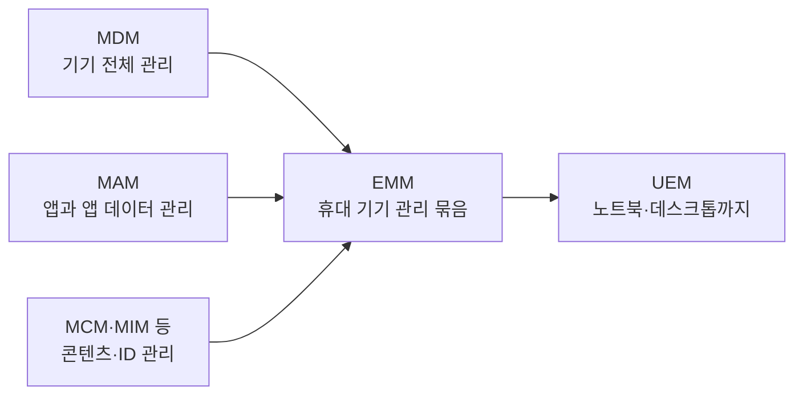
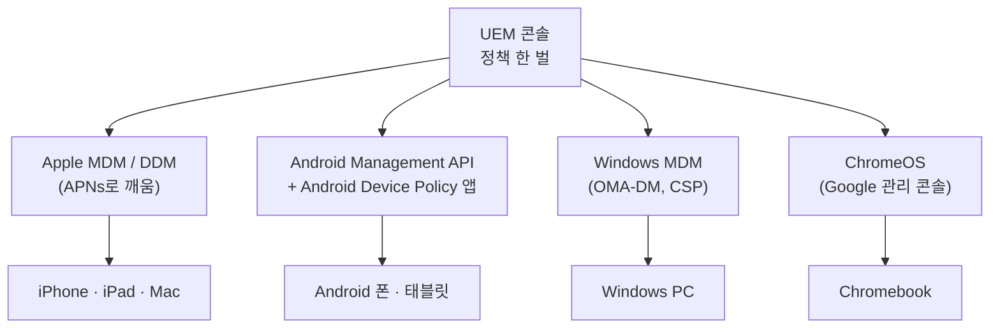
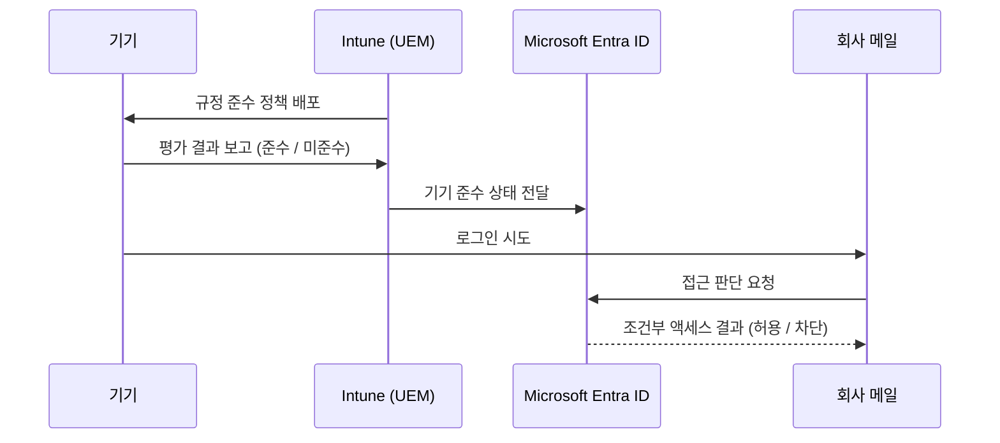

# UEM: 모든 기기를 한 곳에서 관리하기
{: .no_toc }



어느 회사의 IT 담당자가 관리하는 기기를 세어 보자. 직원 iPhone 300대, 영업팀 Android 폰 150대, 사무실 Windows 노트북 400대, 디자인팀 Mac 80대, 교육실 Chromebook 40대. 이 연재의 1~7편에서 본 Apple MDM은 이 중 iPhone과 Mac만 맡는다. 나머지는 각자 다른 방식으로 관리된다.

운영체제마다 관리 콘솔이 따로 있으면 "화면 잠금 암호 6자리 이상"이라는 같은 규칙을 다섯 곳에서 다섯 번 설정해야 한다. 퇴사자가 생기면 다섯 곳을 돌며 기기를 회수해야 한다.

**UEM(Unified Endpoint Management, 통합 엔드포인트 관리)**은 이 여러 종류의 기기를 **한 콘솔에서, 한 벌의 정책으로** 관리하려는 제품군을 부르는 말이다. **엔드포인트(endpoint)**는 네트워크 끝에서 사람이 직접 쓰는 기기, 즉 휴대폰·태블릿·노트북·데스크톱 같은 단말을 말한다.

{: .tip }
UEM은 여러 나라 말을 하는 통역사와 같다. 관리자는 "암호 6자리 이상"이라고 한 번만 말한다. 통역사(UEM)가 iPhone에는 Apple MDM의 말로, Windows에는 Windows MDM의 말로, Android에는 Android Enterprise의 말로 옮겨 전한다. 통역사가 새 언어를 만드는 것이 아니라, **각 운영체제가 이미 가진 관리 언어**를 쓴다는 점이 중요하다.

## 용어가 생긴 순서: MDM에서 UEM까지

이 분야의 이름들은 표준 기관이 정한 규격 이름이 아니라 업계에서 제품군을 부르던 말이다. 그래서 문서마다 경계가 조금씩 다르다. 이 글은 미국 표준기술연구소(NIST)의 공개 지침인 **SP 800-124 Rev. 2**(2023년 5월, "Guidelines for Managing the Security of Mobile Devices in the Enterprise")와 각 운영체제·제품의 공식 문서에 적힌 정의만 쓴다.

### MDM: 기기를 관리한다

**MDM(Mobile Device Management)**은 서버가 기기에 설정을 넣고, 상태를 묻고, 잠금·초기화 같은 명령을 내리는 방식이다. 관리 대상의 단위가 **기기 한 대 전체**다. Apple MDM의 동작은 [1편]({{ '/ios/mdm/architecture/' | relative_url }})부터 자세히 봤다.

Microsoft Intune 문서는 MDM을 이렇게 설명한다. 기기를 등록하면 "Intune이 설정, 보안, 앱을 포함한 기기 전체를 관리하고, 기기를 잃어버리면 초기화할 수 있다."

### MAM: 앱만 관리한다

**MAM(Mobile Application Management)**은 기기 전체가 아니라 **업무 앱과 그 안의 데이터만** 관리하는 방식이다. 개인 휴대폰을 회사가 통째로 관리하는 것은 부담스러우니, 업무 앱 안쪽만 회사 규칙을 따르게 하는 것이다.

NIST SP 800-124 Rev. 2(4.2.2절)는 MAM의 핵심 차이를 이렇게 적는다. MAM은 MDM과 달리 기기 소유자가 기기를 기관 관리에 등록하지 않아도 되고, 기관 프로파일 설치를 받아들이지 않아도 된다. 그리고 BYOD 기관에서 MDM 대신 MAM을 쓰면 개인 기기에 대한 사용자의 사생활 걱정을 덜 수 있다고 적는다.

MAM은 [11편]({{ '/ios/mdm/mam/' | relative_url }})에서 따로 자세히 다룬다.

### MCM, MIM: 그 밖의 관리 제품

NIST 문서(4.2절)는 이 밖에 **모바일 ID 관리(mobile identity management)**, **모바일 콘텐츠 관리(mobile content management)**, 모바일 데이터 관리 같은 제품도 있다고 이름만 언급하고, 그 문서에서는 다루지 않는다고 밝힌다. 업계에서는 앞의 두 가지를 MIM, MCM으로 줄여 부른다. 콘텐츠 관리는 업무 문서를, ID 관리는 사용자 계정과 인증을 관리하는 쪽이다.

### EMM: 휴대 기기 관리의 묶음

**EMM(Enterprise Mobility Management)**은 위 기능들을 한 제품군으로 묶은 이름이다. NIST SP 800-124 Rev. 2(4.2.1절)의 정의는 이렇다.

> EMM, which is sometimes referred to as UEM (unified endpoint management), is a solution used to deploy, configure, and actively manage mobile devices in an enterprise environment. An EMM suite may encompass mobile device management (MDM), mobile application management (MAM), MTD, and other management technologies.

풀어 쓰면 이렇다.

- EMM은 기관 안에서 **휴대 기기**를 배포하고, 설정하고, 계속 관리하는 솔루션이다.
- EMM 묶음 안에는 MDM, MAM, **MTD**(Mobile Threat Defense, 악성 앱·네트워크 공격·피싱을 탐지하는 기술) 등이 들어갈 수 있다.
- NIST는 EMM을 "UEM이라고도 불린다"고 적는다.

같은 절은 EMM이 운영체제가 제공하는 MDM API와 프로토콜 위에서 동작한다고 설명한다. EMM이 마법을 부리는 것이 아니라, 운영체제가 열어 준 관리 통로를 쓴다는 뜻이다.

### UEM: 노트북과 데스크톱까지

NIST가 EMM과 UEM을 거의 같은 말로 쓰면서도 짚어 두는 차이가 있다. 바로 **노트북**이다. 이 문서의 범위(1.2절)는 휴대폰과 태블릿, 그리고 Android 앱을 돌릴 수 있는 Chromebook처럼 현대 모바일 OS를 쓰는 기기다. 노트북은 범위에서 명시적으로 뺐다. 이유는 지금 노트북에 쓸 수 있는 보안 제어가 휴대폰·태블릿과 상당히 다르기 때문이라고 적는다. 동시에 요약부에서 "일부 노트북·데스크톱 관리 기술이 모바일 기기 관리 기술과 합쳐지고 있다"고도 적는다.

UEM이라는 이름은 바로 이 합쳐짐을 가리킨다. 휴대 기기 관리(EMM)의 방식을 노트북·데스크톱까지 넓혀 **모든 엔드포인트를 한 콘솔에서** 다루는 것이다.

실제 제품 문서에서 이 범위를 확인할 수 있다. Microsoft Intune 문서는 Intune을 "클라우드 기반 엔드포인트 관리 서비스"라고 소개하고, 지원 플랫폼으로 Android, iOS/iPadOS, Linux, macOS, tvOS, visionOS, Windows를 든다. 휴대폰부터 데스크톱 운영체제, TV와 헤드셋까지 한 서비스에 들어 있다.

{: .note }
NIST 정의를 기준으로 하면, MDM과 MAM은 **기능**의 이름이고 EMM과 UEM은 그 기능들을 묶은 **제품군**의 이름이다. EMM과 UEM의 차이는 주로 관리 대상의 범위(휴대 기기만인가, 노트북·데스크톱까지인가)에 있다. 다만 업계 용어라서 회사와 문서마다 선을 긋는 위치가 다르다.

{: .question }
NIST는 기본 기능만 있는 휴대폰, 웨어러블, IoT 기기도 범위에서 뺐다. 이유는 제대로 된 운영체제가 없고 쓸 수 있는 보안 기능이 적기 때문이라고 적는다. 그렇다면 UEM이 "모든 엔드포인트"를 관리한다고 할 때, 관리할 수 있는 한계는 누가 정할까? (힌트: 아래에서 보듯, 운영체제가 관리 통로를 얼마나 열어 주느냐다.)

## UEM은 운영체제의 관리 통로를 빌려 쓴다

UEM 제품이 각 기기에 직접 손을 대는 것은 아니다. NIST SP 800-124 Rev. 2(4.1.3절)는 주요 모바일 OS가 **관리용 API와 프로토콜**을 제3자 관리 도구에 열어 준다고 설명한다. 이 API는 일반 앱 개발자에게는 열리지 않는 기능, 즉 앱 동작 통제, 기기·보안 설정, 민감한 기기 정보 조회를 제공한다. 그리고 이렇게 덧붙인다. "대부분의 기기 플랫폼은 이 API를 하나의 MDM 솔루션만 제어하도록 허용한다."

그래서 UEM의 구조는 "콘솔 하나 + 운영체제별 커넥터 여러 개"다.

### Apple: MDM 프로토콜과 DDM

이 연재에서 본 내용이다. Apple 기기에는 관리 기능이 운영체제에 내장돼 있어서 별도 관리 앱을 깔지 않는다. 서버는 [APNs로 기기를 깨우고]({{ '/ios/mdm/architecture/' | relative_url }}), 기기가 서버에 접속해 plist 형식의 명령을 가져간다. 최근에는 원하는 상태를 선언하는 [DDM]({{ '/ios/mdm/ddm/' | relative_url }})으로 옮겨 가고 있다.

Apple의 배포 안내서는 "한 기기에는 한 번에 하나의 등록 프로파일만 있을 수 있다"고 적는다.

### Android: Android Enterprise

**Android Enterprise**는 Google 문서의 표현으로 "Android 기기와 앱을 업무에 쓸 수 있게 하는 Google 주도의 프로그램"이다. Google 개발자 문서는 EMM 솔루션이 세 가지로 이뤄진다고 설명한다.

| 구성 요소 | 역할 |
| --- | --- |
| EMM 콘솔 | 관리자가 조직·기기·앱을 관리하는 웹 앱. EMM 회사가 만들고 Android Enterprise API와 연동한다 |
| Android Device Policy | Android가 제공하는 앱. 관리 대상 기기는 설정 과정에서 이 앱을 설치하고, 이 앱이 콘솔의 정책을 기기에 적용한다 |
| 관리형 Google Play | 관리 기기용 앱 스토어. 사용자는 조직이 승인한 앱만 설치할 수 있다 |

정책 전달 흐름은 이렇다. 기기나 업무 프로필이 준비되면 **Android Management API**가 고유한 기기 ID를 붙인다. 관리자가 콘솔에서 정책을 만들어 기기 ID에 배정하면, API가 정책을 기기로 보내고 Android Device Policy가 적용한다. Google 문서는 이 마지막 두 단계를 API와 Android Device Policy가 알아서 처리하므로 EMM 회사가 정책 전달 로직을 직접 만들 필요가 없다고 적는다. 정책은 비밀번호 정책(`passwordPolicies`), 앱 정책(`applications`), OS 업데이트 방식(`systemUpdate`) 같은 필드로 표현된다.

Apple과 비교하면 차이가 보인다. Apple은 관리 기능이 운영체제 안에 있고 서버가 APNs로 기기를 깨운다. Android Enterprise에서는 Google이 제공하는 API와 기기 쪽 앱(Android Device Policy)이 정책 전달을 맡는다.

Android의 관리 방식(Google 문서 기준)은 기기 소유에 따라 나뉜다.

| 방식 | 대상 | 조직이 할 수 있는 것 |
| --- | --- | --- |
| 개인 기기의 업무 프로필 | 직원 소유(BYOD) | 업무 프로필 안의 앱·데이터·설정을 관리한다. 개인 프로필은 보거나 접근할 수 없다 |
| 회사 기기의 업무 프로필 | 회사 소유, 개인 사용 허용 | 업무 프로필 관리에 더해 Wi-Fi 설정, USB 파일 전송 차단 같은 기기 전체 정책과 개인 프로필의 일부 제한(특정 앱 금지 등)을 건다. 개인 프로필의 앱·데이터·사용 내역은 여전히 볼 수 없다 |
| 완전 관리(fully managed) | 회사 소유, 업무 전용 | 업무 프로필에서는 쓸 수 없는 기기 수준 정책까지 Android의 모든 관리 정책을 건다 (Android 5.0 이상) |
| 전용 기기(dedicated) | 완전 관리의 한 종류 | 앱 하나나 몇 개로 기기를 고정한다. 예전 이름은 COSU (Android 6.0 이상에서 잠금 화면·상태 표시줄 등을 세밀하게 제어) |

**업무 프로필(work profile)**은 한 기기 안에 업무용 앱과 데이터만 담는 별도 공간이다. 한 집 안에 잠긴 업무용 방을 하나 따로 만드는 것과 비슷하다. 회사는 그 방만 관리하고, 나머지 집(개인 프로필)에는 들어가지 못한다.

### Windows: OMA-DM과 CSP

Windows에도 관리 기능이 운영체제에 들어 있다. Microsoft 문서는 Windows 관리 구성 요소가 두 부분으로 이뤄진다고 설명한다.

- **등록 클라이언트**: 기기를 기관 관리 서버에 등록하고 통신하도록 설정한다.
- **관리 클라이언트**: 관리 서버와 주기적으로 동기화하며 IT가 정한 최신 정책을 적용한다.

같은 문서는 "MDM 서버는 Windows를 관리하기 위해 클라이언트를 만들거나 내려받게 할 필요가 없다"고 적는다. 이 점은 Apple과 같다. 등록에는 MS-MDE2, 관리에는 MS-MDM 프로토콜을 쓰며, 둘 다 공개 규격으로 나와 있다.

관리 통신은 **OMA-DM**이라는 표준을 따른다. OMA-DM(Open Mobile Alliance Device Management)은 원래 휴대폰 관리를 위해 만든 업계 표준 프로토콜이고, Windows는 **OMA DM v1.2**를 쓴다. Microsoft 문서에 따르면 기기의 DMClient가 HTTPS로 서버와 통신하고, 메시지는 **SyncML**이라는 XML 형식이다. 세션은 기기가 시작한다. 정해진 일정에 따라 DMClient가 실행되어 서버에 접속하거나, 서버가 보낸 트리거 메시지를 받고 접속한다. 그 뒤 서버가 `Get`, `Replace`, `Add`, `Delete`, `Exec` 같은 명령을 보내고 기기가 결과를 돌려준다. "서버는 신호만 주고 기기가 접속해 할 일을 가져간다"는 큰 틀은 Apple MDM과 닮았다.

명령이 무엇을 바꾸는지는 **CSP(Configuration Service Provider)**가 정한다. CSP는 Windows 설정을 나무 모양 주소로 열어 둔 창구다. 예를 들어 Microsoft 문서의 Policy CSP 주소는 이런 모양이다.

- 기기 전체 정책 설정: `./Device/Vendor/MSFT/Policy/Config/AreaName/PolicyName`
- 적용된 결과 조회: `./Device/Vendor/MSFT/Policy/Result/AreaName/PolicyName`
- 사용자별 정책: `./User/Vendor/MSFT/Policy/Config/AreaName/PolicyName`

`AreaName` 자리에는 `DeviceLock`, `Bitlocker`, `Defender`, `Update` 같은 영역 이름이 들어간다. 원격 초기화도 `./device/vendor/MSFT/RemoteWipe/DoWipe` 같은 CSP 노드로 한다.

{: .tip }
CSP는 아파트 우편함과 비슷하다. "3동 1201호(경로)"에 편지(값)를 넣으면 그 집 주인(Windows 구성 요소)이 받아서 처리한다. MDM 서버는 Windows 내부를 몰라도 주소만 알면 설정을 바꿀 수 있다.

Windows도 선언형으로 가는 길이 있다. **Windows declared configuration(WinDC)**은 Microsoft 문서의 표현으로 "원하는 상태(desired state)" 기반 구성 모델이다. OMA-DM SyncML로 설정 한 묶음을 한 번에 보내면, 기기의 WinDC 스택이 그 상태를 맞추고 유지한다. 기본 4시간마다 현재 설정과 서버의 의도를 비교해 어긋난 것(drift)을 다시 맞춘다. Apple DDM과 생각이 같다. 다만 WinDC는 기본 MDM 서버에 이미 등록된 기기에 별도의 OMA-DM 등록을 하나 더 하는 방식이다.

Microsoft 문서의 자주 묻는 질문에는 "Windows에서 여러 MDM 서버로 등록·관리할 수 있나?"에 대한 답이 "아니요. MDM은 하나만 허용된다"로 나와 있다.

### ChromeOS: Google 관리 콘솔

Google 고객센터 문서에 따르면 Chromebook 같은 ChromeOS 기기는 **Google 관리 콘솔(Admin console)**에서 관리한다. 기기는 자격이 있는 관리형 사용자 계정으로 조직에 등록하고, 등록이 끝나면 관리 콘솔에서 정책을 적용한다. 기기마다 **ChromeOS Enterprise Upgrade** 또는 **Education Upgrade**가 필요하다. 이 업그레이드가 포함된 채로 파는 기기도 있고, 따로 사야 하는 기기도 있다.

Android Enterprise 문서에는 조직이 **관리형 Google 도메인**으로 연결돼 있으면 관리자가 ChromeOS 기기도 관리할 수 있다는 설명이 있다. ChromeOS 관리를 제3자 UEM에 어떻게 연결하는지는 이 글에서 확인한 문서 범위 밖이라 다루지 않는다.

## 한눈에 비교

| | Apple (iOS·iPadOS·macOS) | Android | Windows | ChromeOS |
| --- | --- | --- | --- | --- |
| 관리 통로 | OS 내장 MDM 프로토콜 | Android Management API | OS 내장 MDM (MS-MDE2 등록, MS-MDM 관리) | Google 관리 콘솔 |
| 메시지 형식 | plist (DDM은 JSON) | API의 정책 리소스 | OMA-DM v1.2 SyncML (XML) | (해당 문서에 없음) |
| 기기 쪽 구성 요소 | OS 내장, 별도 앱 없음 | Android Device Policy 앱 | OS 내장 (등록·관리 클라이언트) | (해당 문서에 없음) |
| 서버가 기기를 깨우는 방법 | APNs 푸시 | API와 Android Device Policy가 처리 | 일정 실행 또는 서버 트리거 메시지 | (해당 문서에 없음) |
| 설정 단위 | 구성 프로파일 페이로드, DDM 선언 | 정책 필드 (`passwordPolicies` 등) | CSP 노드 경로 | 관리 콘솔 정책 |
| 원하는 상태 선언 | DDM | (해당 문서에 없음) | WinDC | — |
| 앱 배포 | Apps and Books(ABM) | 관리형 Google Play | (제품별) | (해당 문서에 없음) |
| 회사 기기 자동 등록 | ADE (ABM) | (Google 문서의 프로비저닝 방법 목록 참고) | Windows Autopilot | 관리형 계정으로 등록 |
| 개인 기기(BYOD) | 사용자 등록 | 개인 기기의 업무 프로필 | Entra 등록(register) + MAM | — |
| 동시에 붙는 MDM 수 | 등록 프로파일 하나 | (해당 문서에 없음) | 하나 (WinDC는 추가 등록) | — |

{: .warning }
"(해당 문서에 없음)"과 "—"는 이 글에서 읽은 공식 문서로 확인하지 못한 칸이다. 기능이 없다는 뜻이 아니다. 실제로 설계할 때는 각 플랫폼 문서에서 다시 확인한다.

## UEM이 하는 일

NIST SP 800-124 Rev. 2와 Intune 문서가 공통으로 드는 기능을 묶으면 아래와 같다.

| 기능 | 하는 일 | Apple 쪽에서 본 글 |
| --- | --- | --- |
| 등록 | 기기를 관리 서버에 연결한다. 회사 기기는 자동으로, 개인 기기는 사용자가 직접 | [2편]({{ '/ios/mdm/enrollment/' | relative_url }}) |
| 구성·정책 | Wi-Fi, VPN, 인증서, 암호 규칙, 기능 제한을 넣는다 | [3편]({{ '/ios/mdm/profiles/' | relative_url }}) |
| 원격 명령 | 잠금, 초기화, 정보 조회 | [4편]({{ '/ios/mdm/commands/' | relative_url }}) |
| 앱 관리 | 앱 배포·삭제, 앱 설정, 업무 앱 데이터 보호 | [5편]({{ '/ios/mdm/apps/' | relative_url }}), [11편]({{ '/ios/mdm/mam/' | relative_url }}) |
| OS 업데이트 | 버전과 설치 기한을 정한다 | [6편]({{ '/ios/mdm/ddm/' | relative_url }}) |
| 인벤토리·보고 | 기기 목록, OS 버전, 설치된 앱, 정책 적용 상태 | [4편]({{ '/ios/mdm/commands/' | relative_url }}), [6편]({{ '/ios/mdm/ddm/' | relative_url }}) |
| 규정 준수와 조치 | 규칙에 맞는지 판정하고, 어긋나면 알림·잠금·회수 | 아래 |
| ID·접근 제어 연동 | 준수 결과를 로그인 시스템에 넘겨 접근을 허용·차단 | 아래 |

NIST(4.2.1.1절)는 EMM이 정책 위반을 자동으로 감시·탐지·보고하고, 가능하면 자동으로 조치할 수 있다고 적는다. 예로 승인된 보안 구성 기준선에서 바뀐 것을 탐지하고, OS 버전(루팅·탈옥 여부 포함)이나 제조사, 모델에 따라 기관 서비스 접근을 제한하는 것을 든다.

### 규정 준수가 접근 제어로 이어지는 흐름

UEM의 핵심 가치 중 하나는 **"규칙을 지키는 기기만 회사 메일을 열 수 있게"** 하는 것이다. Microsoft Intune과 Microsoft Entra(Microsoft의 ID·로그인 서비스) 문서로 이 흐름을 따라가 보자.

1. 관리자가 **규정 준수 정책(compliance policy)**을 만든다. 예: 최소 OS 버전, 탈옥·루팅되지 않았을 것, 위협 수준이 일정 이하일 것.
2. 기기가 Intune에 등록되면 Microsoft Entra ID에도 등록된다.
3. 기기는 정책 규칙을 평가해 준수 상태를 보고하고, 이 상태가 Entra ID에 전달된다.
4. **조건부 액세스(Conditional Access)** 정책에 "기기가 준수 상태로 표시돼야 함(Require device to be marked as compliant)"이 있으면, 사용자가 메일 같은 회사 자원에 로그인할 때 Entra가 이 상태를 보고 허용하거나 막는다.

조건부 액세스는 회사 건물 출입문의 경비원과 같다. 경비원(Entra)은 사원증(사용자 계정)만 보지 않고, 관리실(Intune)이 넘겨준 "이 노트북은 점검을 통과했다"는 확인서도 본다. 확인서가 없으면 사원증이 있어도 들어갈 수 없다.

Intune 문서는 미준수 기기에 대한 조치를 조건부 액세스와 **따로** 둔다. 기본 조치는 "미준수로 표시"이고, 플랫폼에 따라 사용자에게 이메일 보내기, 일정 기간 뒤 원격 잠금, 회수(retire) 대상으로 표시하기를 더할 수 있다.

같은 문서는 미준수를 운영체제가 어떻게 다루는지 두 가지로 나눈다.

| 구분 | 뜻 | 예 (Intune 문서의 표) |
| --- | --- | --- |
| 교정됨(Remediated) | 운영체제가 규칙을 강제로 맞춘다 | iOS와 macOS의 암호 설정: 사용자가 암호를 정하게 강제 |
| 격리됨(Quarantined) | 운영체제가 강제하지 않는다. 조건부 액세스가 적용되면 차단되고, 회사 포털 앱이 사용자에게 알린다 | Android Enterprise의 기기 암호화, 모든 플랫폼의 최소 OS 버전 |

{: .warning }
Intune의 테넌트 설정 "규정 준수 정책이 할당되지 않은 기기 표시"의 **기본값은 "준수"**다. 정책을 하나도 받지 않은 기기도 준수로 취급된다는 뜻이다. Microsoft 문서는 조건부 액세스와 함께 쓴다면 이 값을 "미준수"로 바꾸라고 안내한다. 또 기기가 기본 30일(1~120일로 설정 가능) 안에 준수 상태를 보고하지 않으면 미준수로 처리된다.

## 기기 소유 모델

UEM에서 정책을 나누는 가장 큰 기준은 **누가 기기를 샀느냐**다. NIST SP 800-124 Rev. 2(5.1.3절)는 배포 모델을 이렇게 나눈다.

| 모델 | 소유 | 뜻 (NIST) |
| --- | --- | --- |
| 업무 전용 (정부에서는 GFE) | 기관 | 기관이 발급하고 업무에만 쓴다. 개인 사용을 엄격히 제한한다 |
| COPE (Corporate-Owned, Personally Enabled) | 기관 | 기관 소유지만 일부 개인 사용(개인 앱 설치, 개인 문자 등)을 허용한다. 기기와 그 안의 정보는 기관 것이다 |
| BYOD (Bring Your Own Device) | 직원 | 직원 개인 기기로 업무 데이터와 서비스에 접근한다 |
| CYOD (Choose Your Own Device) | 직원 | 직원이 사지만 기관이 정한 목록에서 고른다 |

이 모델을 각 플랫폼의 관리 방식에 맞춰 보면 이렇다. 각 칸은 해당 플랫폼 공식 문서에 나온 등록 방식이다.

| 모델 | Apple | Android | Windows (Intune 문서) |
| --- | --- | --- | --- |
| 업무 전용 | ADE로 감독 모드 등록 | 완전 관리, 전용 기기 | Windows Autopilot, Entra 조인(join) |
| COPE | ADE 감독 모드 + 개인 사용을 허용하는 정책 | 회사 기기의 업무 프로필 | (Intune 문서에 별도 구분 없음) |
| BYOD | 사용자 등록 | 개인 기기의 업무 프로필 | Entra 등록(register) + MAM 사용자 범위 |

Windows에서는 등록할 때 고르는 메뉴에 따라 결과가 크게 갈린다. Intune 문서에 따르면 설정 앱의 **회사 또는 학교 계정** 연결에서 **이메일 주소**를 넣으면 기기는 Entra에 "등록(registered)"되고 개인 기기로 표시된다. 이때 조직 계정은 Intune이 관리하지만 기기는 관리하지 않는다. 반대로 **이 기기를 Azure Active Directory에 조인**을 고르면 기기는 조직 소유로 표시되고, 누가 로그인하든 기기 전체가 Intune 관리를 받는다. 같은 문서는 Windows Autopilot이 조직 소유 기기 전용이라고 명시한다.

{: .note }
세 운영체제 모두 "개인 기기는 업무 영역만, 회사 기기는 기기 전체"라는 같은 원칙을 각자의 방식으로 구현한다. Apple은 사용자 등록, Android는 업무 프로필, Windows는 Entra 등록과 MAM이다. UEM 콘솔에서 "BYOD 정책"을 하나 만들어도 실제로 기기에 닿는 것은 이 각각의 메커니즘이고, 그래서 플랫폼마다 할 수 있는 일의 범위가 다르다.

## 실무에서는

여기부터는 공식 문서의 내용이 아니라 지은이의 판단이다. 각 항목에 이유를 함께 적는다.

### UEM을 고를 때

{: .tip }
**실무에서는** 기능 목록보다 "우리 기기 비율에서 가장 많은 플랫폼의 새 OS 기능을 얼마나 빨리 지원하는가"를 먼저 본다. 이유: UEM은 운영체제의 관리 통로를 빌려 쓰므로, 운영체제가 새 관리 기능(예: Apple의 새 DDM 선언)을 내놓아도 UEM 콘솔이 그 기능을 화면에 올려 주기 전에는 쓸 수 없다. 6편에서 본 것처럼 Apple은 일부 기존 MDM 기능을 DDM으로 옮기고 있어서, 지원이 늦으면 바뀐 방식으로 갈아타는 시점도 늦어진다.

**실무에서는** 규정 준수 결과를 우리가 쓰는 ID 서비스(로그인 시스템)에 넘길 수 있는지를 꼭 확인한다. 이유: 위에서 본 것처럼 UEM의 큰 가치는 "준수 기기만 접근"인데, 이 연결이 없으면 UEM은 설정 배포 도구에 그친다.

### Apple 깊이 vs 여러 플랫폼 넓이

**실무에서는** Apple 기기가 대부분이고 Apple 기능을 깊게 써야 하는 조직이라면 Apple 전용 관리 제품을, 여러 운영체제가 섞여 있고 정책을 한곳에서 통일하는 것이 더 중요하다면 범용 UEM을 먼저 검토한다. 이유: 범용 UEM은 여러 플랫폼의 공통분모를 한 화면에 모으는 대신, 특정 플랫폼만의 세부 설정은 "사용자 지정 프로파일"처럼 우회로로 넣어야 할 때가 있다. 반대로 플랫폼 전용 제품은 그 플랫폼은 깊지만 다른 OS를 위해 두 번째 콘솔이 필요하다. 어느 쪽이 맞는지는 기기 비율과 팀의 운영 능력에 달려 있다.

### 관리 주체는 하나로

{: .warning }
**실무에서는** 한 기기에 관리 주체를 하나만 둔다. 이유: Apple은 한 기기에 등록 프로파일을 하나만 허용하고, Windows 문서도 MDM은 하나만 허용된다고 적으며, NIST도 대부분의 플랫폼이 관리 API를 하나의 MDM 솔루션에만 연다고 적는다. UEM을 바꿀 때는 기존 제품에서 등록을 해제한 뒤 새 제품에 등록하는 이전 계획이 필요하다. Intune 문서도 다른 MDM이 관리하는 Windows 기기는 먼저 등록을 해제해야 Intune이 완전히 관리할 수 있다고 적는다.

**실무에서는** MTD나 백신처럼 기기에 따로 깔리는 보안 에이전트도 "같은 일을 하는 것이 둘 이상 깔려 있지 않은가"를 점검한다. 이유: 같은 기능의 에이전트가 겹치면 정책이 서로 충돌하거나 어느 쪽 결과가 진짜인지 판단하기 어려워진다. Intune 문서도 규정 준수 정책이 구성 정책의 설정을 덮어쓸 수 있다며 충돌 해결 문서를 따로 안내한다. 한 제품 안에서도 충돌이 생기는데, 제품이 둘이면 더 어렵다.

### 플랫폼별 기준선

**실무에서는** 정책을 "공통 규칙 + 플랫폼별 기준선"의 두 층으로 설계한다. 이유: Intune 문서가 말하듯 규정 준수 정책은 플랫폼마다 설정 항목이 달라 플랫폼별로 따로 만들어야 하고, 같은 규칙이라도 iOS는 교정(Remediated), Android Enterprise는 격리(Quarantined)처럼 운영체제 반응이 다르다.

| 층 | 내용 | 예 |
| --- | --- | --- |
| 공통 규칙 | 모든 기기에 같은 뜻으로 적용할 것 | 화면 잠금 필수, 최소 OS 버전, 탈옥·루팅 금지, 미준수 시 접근 차단 |
| 플랫폼별 기준선 | 그 OS에만 있는 보안 기능 | Apple: 감독 모드 제한, DDM 업데이트 강제 / Android: 업무 프로필 정책 / Windows: BitLocker, Defender |

Windows 쪽은 출발점이 공식으로 나와 있다. Microsoft는 BitLocker, Microsoft Defender 바이러스 백신, 방화벽 등을 다루는 **MDM 보안 기준선(security baseline)**을 내려받을 수 있게 제공하고, "어떤 MDM 솔루션에도 통합할 수 있다"고 적는다.

## 정리

- **MDM**은 기기 전체를, **MAM**은 업무 앱과 그 데이터만 관리한다. MAM은 기기 등록 없이도 쓸 수 있어 BYOD의 사생활 걱정을 줄인다(NIST SP 800-124 Rev. 2).
- **EMM**은 MDM, MAM, MTD 등을 묶은 휴대 기기 관리 제품군이고, NIST는 "UEM이라고도 불린다"고 적는다.
- **UEM**은 그 관리 범위를 노트북·데스크톱까지 넓혀 모든 엔드포인트를 한 콘솔에서 다루는 것이다. Intune은 Android, iOS/iPadOS, Linux, macOS, tvOS, visionOS, Windows를 지원한다고 적는다.
- UEM은 운영체제의 관리 통로를 빌려 쓴다. Apple은 MDM·DDM, Android는 Android Management API와 Android Device Policy, Windows는 OMA-DM SyncML과 CSP(선언형은 WinDC), ChromeOS는 Google 관리 콘솔이다.
- 규정 준수 결과는 ID 서비스로 넘어가 **조건부 액세스**의 판단 근거가 된다. Intune에서 정책 미할당 기기의 기본값이 "준수"라는 점에 주의한다.
- 기기 소유 모델(업무 전용, COPE, BYOD, CYOD)이 정책 설계의 큰 기준이고, 각 OS는 "개인 기기는 업무 영역만"을 각자의 방식(사용자 등록, 업무 프로필, Entra 등록과 MAM)으로 구현한다.
- 한 기기에는 관리 주체를 하나만 둔다. Apple, Windows, NIST 문서가 모두 이 제약을 적고 있다.

## 다음 편 예고

[11편]({{ '/ios/mdm/mam/' | relative_url }})에서는 기기를 등록하지 않고 업무 앱만 관리하는 MAM을 자세히 본다. 앱 보호 정책이 앱 안의 데이터를 어떻게 지키는지, Apple의 관리형 앱과는 무엇이 다른지 다룬다.

## 참고

- [NIST SP 800-124 Rev. 2: Guidelines for Managing the Security of Mobile Devices in the Enterprise (2023)](https://csrc.nist.gov/pubs/sp/800/124/r2/final): 1.2절 범위, 4.1.3절 플랫폼 관리 API, 4.2.1절 EMM, 4.2.2절 MAM, 5.1.3절 배포 모델
- [Apple Platform Deployment: Intro to device management](https://support.apple.com/guide/deployment/intro-to-mdm-depc0aadd3fe/web)
- [Android Enterprise: Overview (Google for Developers)](https://developers.google.com/android/work/overview)
- [Android Management API: Policy 리소스](https://developers.google.com/android/management/reference/rest/v1/enterprises.policies)
- [Google Admin 고객센터: ChromeOS 기기 관리](https://support.google.com/chrome/a/answer/1289314)
- [Microsoft Learn: Mobile Device Management overview (Windows)](https://learn.microsoft.com/en-us/windows/client-management/mdm-overview)
- [Microsoft Learn: OMA DM protocol support](https://learn.microsoft.com/en-us/windows/client-management/oma-dm-protocol-support)
- [Microsoft Learn: Policy CSP](https://learn.microsoft.com/en-us/windows/client-management/mdm/policy-configuration-service-provider)
- [Microsoft Learn: Windows declared configuration protocol](https://learn.microsoft.com/en-us/windows/client-management/declared-configuration)
- [Microsoft Learn: What is Microsoft Intune?](https://learn.microsoft.com/en-us/intune/fundamentals/what-is-intune)
- [Microsoft Learn: Device compliance policies in Microsoft Intune](https://learn.microsoft.com/en-us/intune/device-security/compliance/overview)
- [Microsoft Learn: Windows device enrollment guide for Microsoft Intune](https://learn.microsoft.com/en-us/intune/device-enrollment/windows/guide)
