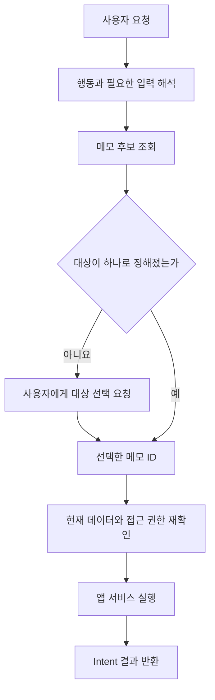

# Siri AI와 App Intents
{: .no_toc }



사용자가 Siri에게 ‘내 메모 앱에서 미완료 메모 개수 알려 줘’라고 말했다고 하자. 시스템이 요청을 이해하더라도 앱이 데이터를 읽는 기능을 공개하지 않았다면 원하는 결과를 얻기 어렵다. App Intents는 앱의 행동과 데이터를 시스템이 사용할 수 있는 형태로 설명하는 프레임워크다.

이 글의 기본 코드는 iOS 16부터 제공되는 App Intents의 개념을 사용한다. Apple의 최신 문서에 포함된 Siri AI Developer Preview와 추가 시스템 연동 기능은 별도의 배포 상태·SDK·지원 조건을 확인해야 한다. 기본 Intent 구현만으로 모든 자연어 요청이 모든 OS에서 실행되는 것은 아니다.

## Siri가 요청을 이해한 뒤 앱에서는 무슨 일이 일어날까

‘여행 준비 메모를 읽어 줘’라는 요청을 실행하려면 ‘읽기’라는 행동과 ‘어느 메모인지’라는 대상을 모두 정해야 한다.



이 그림은 역할을 나눈 개념도다. 시스템이 모든 버전에서 이 화면 순서 그대로 표시한다는 뜻은 아니다. 중요한 경계는 자연어 해석과 앱의 실제 데이터 접근이다. 앱은 해석된 요청이라도 대상이 존재하는지, 지금 접근할 수 있는지, 어떤 변경을 허용할지 확인해야 한다.

Foundation Models로 직접 문장을 생성하지 않아도 이 연결은 만들 수 있다. App Intent의 `perform()`은 모델에 쓰는 프롬프트가 아니라 앱 기능을 실행하는 메서드다. 시스템은 파라미터를 해석한 뒤 이를 호출한다. 반환값으로 대화 응답이나 후속 동작을 제공할 수 있다. [perform 공식 문서](https://developer.apple.com/documentation/appintents/appintent/perform())에서 이 실행 계약을 확인한다.

## 앱 버튼과 Intent를 같은 행동으로 보기

앱의 ‘메모 추가’ 버튼과 Siri의 ‘메모 추가해 줘’는 들어오는 경로가 다를 뿐 같은 저장 규칙을 사용해야 한다. Intent는 시스템 요청을 앱의 기존 기능에 연결하는 진입점이다.

처음에는 입력과 데이터 저장이 없는 안내 Intent를 실행해 보자. 그다음 문자열 입력, 저장 서비스, Entity 검색을 차례로 추가하면 어느 단계에서 연결이 끊겼는지 찾기 쉽다.

## Foundation Models와 역할 구분하기

| 원하는 기능 | 주로 사용하는 API |
| --- | --- |
| 앱 안의 문장을 요약한다 | Foundation Models |
| 앱의 검색·생성·완료 처리를 Siri나 단축어에 공개한다 | App Intents |
| 특정 메모를 시스템이 식별하게 한다 | AppEntity와 Query |
| 앱 콘텐츠를 검색할 수 있게 한다 | Spotlight 연동 |

둘은 함께 사용할 수 있다. Intent가 사용자의 메모를 찾고, 앱의 서비스가 Foundation Models로 요약한 뒤 결과를 돌려주는 식이다. 시스템 진입점과 모델 생성 로직을 구분하면 테스트하기 쉽다.

이 구분을 코드의 경계로 옮기면 Intent는 ‘무엇을 할지’, Entity는 ‘어느 대상을 말하는지’, Query는 ‘그 대상을 지금 어디서 찾는지’를 담당한다. `@Parameter`는 행동의 입력을 선언하고, `AppShortcutsProvider`는 미리 구성한 행동과 호출 표현을 시스템에 제공한다. Core Data 객체 자체를 공개할 필요는 없다. 안정적인 ID와 표시 정보만 Entity로 옮기고 저장 규칙은 앱 서비스에 남긴다.

## 가장 작은 Intent 만들기

처음에는 DB 없이 결과를 반환하는 행동부터 연결해 보자.

```swift
import AppIntents

struct ExplainAppIntent: AppIntent {
    static var title: LocalizedStringResource = "앱 사용법 안내"
    static var description = IntentDescription("메모 앱의 기본 사용법을 알려 줍니다.")

    func perform() async throws -> some IntentResult & ProvidesDialog {
        .result(dialog: "새 메모를 만들고 완료 상태를 관리할 수 있어요.")
    }
}
```

이 예제는 시스템에 행동 이름을 알려 주고, 실행되면 안내문을 반환한다. `ProvidesDialog`는 시스템이 사용자에게 보여 주거나 말할 수 있는 응답을 제공한다는 뜻이다. 앱 데이터 변경은 포함하지 않는다.

## 입력값이 있는 행동

```swift
struct EchoMemoTitleIntent: AppIntent {
    static var title: LocalizedStringResource = "메모 제목 확인"

    @Parameter(title: "제목")
    var memoTitle: String

    func perform() async throws -> some IntentResult & ProvidesDialog {
        let title = memoTitle.trimmingCharacters(in: .whitespacesAndNewlines)
        guard !title.isEmpty else {
            return .result(dialog: "빈 제목은 사용할 수 없어요.")
        }
        return .result(dialog: "입력한 제목은 \(title)입니다.")
    }
}
```

`@Parameter`는 시스템이 사용자 입력을 받아 채울 값이다. 실제 저장 기능을 만들려면 검증 이후 앱의 저장 서비스를 호출한다. Intent에 DB 구현을 전부 넣으면 화면과 Siri가 서로 다른 저장 규칙을 갖게 될 수 있다. 두 진입점 모두 같은 서비스를 사용하도록 구성한다.

## App Shortcut으로 호출 경로 제공하기

```swift
struct MemoShortcuts: AppShortcutsProvider {
    static var appShortcuts: [AppShortcut] {
        AppShortcut(
            intent: ExplainAppIntent(),
            phrases: ["\(.applicationName) 사용법 알려 줘"],
            shortTitle: "사용법 안내",
            systemImageName: "note.text"
        )
    }
}
```

`applicationName` 자리에는 시스템이 앱 이름을 연결한다. 예제 문구를 출발점으로 삼아 실제 앱의 표시 이름과 지역화에 맞는 표현을 제공한다. 앱을 설치한 뒤 단축어 앱에서 행동을 먼저 실행해 보고, Siri 호출을 시험하면 코드 실행 문제와 음성 인식 문제를 나눠 확인할 수 있다.

## App Entity와 Query는 왜 필요할까

‘어제 쓴 여행 메모를 열어 줘’라는 요청에는 행동뿐 아니라 특정 메모를 고르는 과정도 필요하다.

```text
사용자 표현
  → 후보 메모 검색
  → 후보가 여러 개면 선택
  → 안정적인 메모 ID 확정
  → 해당 메모를 열거나 처리
```

Entity에는 ‘여행 메모’라는 이름과 고유 ID를 표현한다. Query는 그 ID를 현재 저장소의 레코드로 바꾼다. 메모가 삭제됐거나 접근 권한이 바뀌었다면 조회 실패로 처리해야 한다. 사용자의 자연어 제목만으로 다른 메모를 임의 선택하지 않는다.

## 같은 제목의 메모 두 개로 Entity를 이해하기

다음 두 메모를 저장했다고 하자.

| 저장 ID | 제목 | 본문 |
| --- | --- | --- |
| `memo-001` | 여행 준비 | 여권을 확인한다. |
| `memo-002` | 여행 준비 | 충전기를 챙긴다. |

제목은 둘 다 같으므로 제목 검색은 후보를 찾는 단계다. 선택한 대상을 다음 실행에서도 가리키려면 안정적인 ID가 필요하다. 앱을 실행할 때마다 새 UUID를 만들어 같은 메모의 ID를 바꾸면 저장된 단축어가 원래 대상을 다시 찾기 어려워진다.

아래는 [실행 가능한 전체 예제]({{ '/assets/examples/swift/memo-entities.swift' | relative_url }})의 Entity 선언이다.

```swift
struct MemoEntity: AppEntity {
    static let typeDisplayRepresentation: TypeDisplayRepresentation = "메모"
    static let defaultQuery = MemoQuery()
    let id: String
    let title: String

    var displayRepresentation: DisplayRepresentation {
        DisplayRepresentation(title: "\(title)", subtitle: "\(id)")
    }
}
```

`typeDisplayRepresentation`은 ‘메모’라는 데이터 종류의 표시 이름이다. `displayRepresentation`은 메모 하나를 표시할 정보다. 이 예제는 두 제목이 같아 ID를 부제로 표시하지만, 제품에서는 날짜나 폴더처럼 사용자가 구분하기 좋은 정보를 선택할 수 있다.

`defaultQuery`는 시스템이 이 종류의 데이터를 다시 찾을 때 사용할 조회 구현이다. 메모 본문 전체를 Entity에 복제하지 않고 ID와 제목만 전달했다. 본문은 실제 기능 실행 시 현재 저장소에서 읽는 구조로 확장할 수 있다. [AppEntity 문서](https://developer.apple.com/documentation/appintents/appentity)는 지속적인 식별자와 표시 정보의 역할을 설명한다.

### 이름으로 찾는 조회와 ID로 복원하는 조회

| 메서드 | 입력 의미 | 반환해야 할 것 |
| --- | --- | --- |
| `entities(matching:)` | 사용자가 표현한 검색 문자열 | 일치하는 후보들 |
| `entities(for:)` | 이미 선택되거나 저장된 ID들 | 지금 존재하는 해당 항목들 |
| `suggestedEntities()` | 선택 화면의 초기 후보 요청 | 앱이 제안할 항목들 |

이 예제의 Query는 `EntityStringQuery`를 채택한다. `EntityQuery`가 ID 기반 조회를 담당하고, `EntityStringQuery`가 문자열 검색을 더한다. 직접 작성한 문자열 검색이 자동으로 의미 검색 모델이 되는 것은 아니다. 예제는 제목에 문자열이 포함됐는지 검사한다. 두 프로토콜은 [EntityQuery](https://developer.apple.com/documentation/appintents/entityquery), [EntityStringQuery](https://developer.apple.com/documentation/appintents/entitystringquery) 문서에서 구분할 수 있다.

### 직접 실행한 결과

전체 파일을 내려받아 macOS에서 다음 명령으로 컴파일하고 실행한다. 생성할 실행 파일이 없는 작업 폴더에서 사용한다.

```bash
swiftc -parse-as-library memo-entities.swift -o memo-entities
./memo-entities
```

macOS 15.6·Xcode 16.2의 Swift 6.0.3으로 실행한 결과다.

```text
title search: ["memo-001", "memo-002"]
selected: ["memo-002"]
read body: 충전기를 챙긴다.
revoked access: denied
deleted ID: 0 results
deleted read: missing
```

‘여행’으로 찾으면 후보 두 개가 나온다. `memo-002`를 ID로 조회하면 그 항목 하나만 나온다. 선택한 Entity로 Intent를 직접 호출하면 두 번째 메모의 본문을 읽는다. 이어서 접근을 철회하면 Query의 후보에서 사라지고, 이미 선택한 Entity로 실행해도 저장 서비스가 거부한다. 마지막으로 해당 항목을 지우고 같은 ID로 조회하면 빈 배열을 반환하며 읽기는 존재하지 않는 항목 오류로 끝난다. 삭제된 ID를 받았다고 제목이 같은 `memo-001`로 대체하면 사용자가 선택한 대상을 바꾸는 오류가 된다.

이 실행은 AppEntity·Query·Intent의 `perform()`과 앱의 actor 저장소를 macOS 프로세스에서 직접 호출한 검증이다. 단축어 앱의 발견 과정, 음성 인식, Siri AI의 전체 호출 성공을 검증한 결과는 아니다. 실제 앱에서는 `@main` 실행 부분을 제외하고 앱 타깃에 Entity·Query·저장 서비스 코드를 연결한다. 샘플 저장소는 프로세스 메모리에만 있으므로 재시작하면 초기 데이터로 돌아간다.

## 선택한 뒤에도 저장소를 다시 읽는 이유

Entity는 선택 시점의 ID와 표시 정보를 가진 값이다. 권한이 계속 유효하다거나 본문이 그대로라는 보증서는 아니다. 전체 예제의 읽기 Intent는 Entity에 들어 있던 제목으로 본문을 추정하지 않고 ID로 현재 레코드를 다시 읽는다.

```swift
struct ReadMemoIntent: AppIntent {
    static let title: LocalizedStringResource = "메모 읽기"
    static var authenticationPolicy: IntentAuthenticationPolicy { .requiresAuthentication }

    @Parameter(title: "메모")
    var memo: MemoEntity

    init() {}
    init(memo: MemoEntity) { self.memo = memo }

    func perform() async throws -> some IntentResult & ReturnsValue<String> {
        let current = try await MemoStore.shared.read(id: memo.id)
        return .result(value: current.body)
    }
}
```

`MemoStore.read(id:)`는 같은 actor 호출 안에서 존재 여부와 현재 접근 규칙을 검사하고 본문을 반환한다. Query에도 같은 접근 규칙을 적용해 볼 수 없는 메모를 후보로 노출하지 않는다. 후보 검색과 실제 실행 사이에는 시간이 있으므로 두 검사 모두 필요하다. 예제의 `deniedIDs`는 이 차이를 보여 주는 메모리상의 규칙이며 실제 계정 인증을 구현한 코드는 아니다.

`ReturnsValue<String>`은 본문을 후속 단축어가 사용할 값으로 반환한다. 앞의 `ProvidesDialog`처럼 말할 문장을 제공하는 것과 반환 데이터는 역할이 다르다. 본문 전체를 음성으로 읽을지, 미리보기만 표시할지는 기능 요구에 맞춰 정한다.

또한 [authenticationPolicy](https://developer.apple.com/documentation/appintents/appintent/authenticationpolicy)의 기본값은 잠금 상태에서도 실행을 허용하는 `alwaysAllowed`다. 이 읽기 Intent는 사용자 인증을 요구하도록 선언했다. 시스템의 기기 인증과 앱의 계정별 접근 규칙은 서로 다른 검사다. `perform()`을 코드로 직접 부른 이번 실행은 시스템 인증 화면의 동작을 검증하지 않는다. 제품에서는 `MemoError`를 사용자에게 이해되는 안내로 변환하고 원문을 오류 로그에 남기지 않는다.

## 최신 Siri AI 연동에서 추가되는 요소

2026년 11월 19일 확인한 [Siri AI Developer Preview 문서](https://developer.apple.com/documentation/appintents/siri-ai-developer-preview)는 제공 범위를 명확히 나눈다. 지원 기기·지역에서 개발용 프로필로 실행하거나 TestFlight 내부 테스터에게 제공해 시험할 수 있다. 외부 TestFlight 테스터와 App Store 배포본에는 이 Preview 기능이 제공되지 않는다고 명시한다. 기본 App Intents의 단축어 연동까지 제한된다는 뜻은 아니다.

따라서 아래의 최신 연동 요소를 구현했다고 일반 배포 사용자가 같은 동작을 곧바로 사용할 수 있다고 설명해서는 안 된다. Preview API와 Siri 동작은 바뀔 수 있으며, 사용하는 SDK와 배포 경로에서 확인해야 한다. Apple의 안내는 행동과 데이터 공개를 바탕으로 다음 요소를 함께 설명한다.

| 요소 | 필요한 이유 | 메모 앱의 예 |
| --- | --- | --- |
| Spotlight 인덱싱 | 콘텐츠를 검색할 수 있게 함 | ‘여행 관련 메모’ 찾기 |
| Transferable 표현 | 앱 사이에 콘텐츠 전달 | 메모 텍스트를 다른 작업에 넘기기 |
| 시스템 스키마 | 행동의 의미를 공통 구조로 표현 | 알려진 생성·열기 동작에 맞추기 |
| 화면 문맥 연결 | 화면의 대상을 Entity와 연결 | ‘이 메모’가 가리키는 항목 확인 |
| Donation | 사용 행동을 시스템에 알림 | 자주 실행하는 작업의 발견 보조 |

화면 문맥은 스크린샷을 보고 DB 내용을 모두 알아내는 기능으로 이해하면 안 된다. 앱이 화면에 보이는 항목과 Entity의 관계를 제공해야 한다. Donation도 임의의 개인정보 전체를 업로드하라는 뜻으로 해석하지 말고 각 API의 데이터 범위를 확인한다.

### EntityQuery와 Spotlight는 같은 검색이 아니다

앞의 Query는 앱이 받은 ID나 검색어를 저장소에서 찾는 코드다. Spotlight 인덱싱은 시스템 검색이 앱의 콘텐츠를 발견하도록 별도 정보를 제공하는 경로다. Query를 선언했다고 모든 데이터가 자동으로 Spotlight에 등록되는 것은 아니다.

Apple의 [Entity 인덱싱 문서](https://developer.apple.com/documentation/appintents/making-app-entities-available-in-spotlight)는 `IndexedEntity`, 인덱스에 포함할 속성, 인덱스 갱신과 재색인을 설명한다. 기능을 붙일 때는 새 메모 추가뿐 아니라 수정·삭제·계정 전환 때 인덱스를 어떻게 맞출지도 설계한다. 예전 검색 결과가 남을 수 있으므로 실행 시점의 ID 조회와 접근 검사를 생략하지 않는다.

### 스키마는 앱 기능의 의미를 맞추는 계약이다

메서드 이름을 `createMemo`라고 지었다고 시스템이 모든 입력의 의미를 자동으로 알지는 못한다. 시스템 스키마는 알려진 동작과 데이터 구조에 앱 타입을 대응시키는 방법이다. 예를 들어 메모 작성과 메모 열기는 서로 다른 행동이다.

[App schema domains](https://developer.apple.com/documentation/appintents/app-schema-domains) 문서는 도메인별 동작과 적용 매크로를 구분한다. 모든 스키마가 Siri 노출에 같은 범위를 제공하지도 않는다. 실제 기능과 맞는 도메인인지, 해당 스키마가 어떤 시스템 표면을 지원하는지 확인한다. 스키마를 붙이는 것은 DB 접근 권한이나 사용자 확인을 면제받는 절차가 아니다.

### ‘이 메모’가 무엇인지 알려 주는 정보

앱 화면에 메모 A가 열려 있을 때 사용자가 ‘이 메모를 공유해 줘’라고 하면 ‘이 메모’라는 말만으로는 ID가 없다. 화면과 Entity의 연결은 현재 보이는 대상을 시스템이 참조할 단서를 제공한다.

하지만 사용자가 다른 메모로 이동했거나 공유 직전에 원본이 삭제될 수 있다. 화면 문맥으로 받은 Entity도 실행 시 저장소의 현재 상태와 대조해야 한다. 표시 이름은 사용자를 위한 정보, 안정적인 ID는 대상을 다시 찾기 위한 정보, 접근 검사는 그 대상으로 행동해도 되는지 판단하는 규칙이다. 세 역할을 합치지 않는다.

## Core Data와 연결하는 순서

먼저 화면에서 호출하는 메모 조회 서비스를 만든다. Intent에서도 같은 서비스를 사용하고, Query는 메모 ID로 조회한다. 실제 `NSManagedObject` 접근은 해당 context의 큐 규칙을 따른다. Intent는 앱 화면과 별도 실행 환경에서 호출될 수 있으므로 전역 화면 객체가 이미 만들어져 있다고 가정하지 않는다.

외부에 전달할 값은 ID, 제목, 필요한 텍스트처럼 범위가 분명한 형태로 변환한다. 잠금 상태에서 민감한 내용을 읽을 수 있는지도 인증 정책과 함께 검토한다.

## 요약 Intent와 Foundation Models를 함께 연결한다면

```text
Intent: 어떤 메모를 요약할지 입력 받음
  → 저장 서비스: 현재 사용자 권한으로 ID 조회
  → 요약 서비스: 모델 가용성 확인, 입력 범위 제한, 생성
  → 결과 검증: 원문·요청 ID와 결과의 대응 확인
  → Intent: 요약 결과 반환
```

이때 Intent는 시스템 진입점이고 Foundation Models는 내용 생성 도구다. 둘 사이에는 저장소 조회와 앱의 정책이 들어간다. 모델이 사용할 수 없으면 요약만 실패한 것으로 안내하고, 메모 조회나 열기까지 무조건 막을 필요는 없다.

메일 발송이나 메모 삭제를 붙일 때는 생성된 문장과 실제 변경 명령을 분리한다. 대상 ID, 변경 내용, 사용자 확인을 정한 뒤 앱 서비스가 수행하도록 한다. 네트워크 지연이나 재시도로 같은 요청이 다시 들어올 가능성까지 포함해 중복 변경 정책도 정해야 한다.

## 발견·대상 해석·실행을 따로 진단하기

| 증상 | 먼저 확인할 경계 |
| --- | --- |
| 단축어에 행동이 보이지 않음 | 앱 타깃 포함 여부와 시스템의 행동 발견 |
| 행동은 보이지만 메모 선택이 안 됨 | Query 반환값과 저장소 접근 |
| 같은 제목의 다른 메모가 실행됨 | 후보 선택과 안정적인 ID 유지 |
| 삭제한 메모가 계속 후보에 보임 | 인덱스 갱신과 실행 시 재조회 |
| 화면 버튼은 되는데 Intent는 실패 | UI 객체에 대한 의존, 인증·저장소 초기화 차이 |
| 기본 단축어는 되는데 최신 Siri 연동은 안 됨 | 해당 기능의 OS·SDK·언어·제공 조건 |

한 번에 ‘Siri가 안 된다’고 묶으면 원인을 좁힐 수 없다. Query를 코드로 직접 시험하고, 단축어 실행을 확인하고, 그다음 Siri 호출과 최신 기능을 확인하는 순서가 각 경계를 분리하는 데 도움이 된다.

검증은 코드 호출에서 시스템 호출로 넓힌다. 먼저 위의 작은 데이터로 동명 후보, 선택한 ID, 접근 철회와 삭제를 확인한다. 그다음 앱 타깃에 연결해 단축어에서 발견과 실행을 확인하고, 지원 언어의 Siri 호출을 시험한다. 최신 Preview의 문맥 해석·앱 간 동작은 해당 배포 조건에서 별도로 확인한다. 코드가 실행된다는 것과 시스템이 올바른 대상을 찾아 실행한다는 것은 각각 증거가 필요하다.

## 주요 API

| API | 역할 |
| --- | --- |
| `AppIntent` | 시스템에 공개하는 앱의 행동. `perform()`을 구현한다 |
| `@Parameter` | Intent가 받는 입력 |
| `IntentResult`, `ReturnsValue`, `ProvidesDialog` | `perform()`의 결과 종류 |
| `AppEntity` | 시스템이 가리킬 수 있는 앱의 데이터 항목 |
| `EntityQuery` | ID나 검색어로 Entity를 찾는다 |
| `DisplayRepresentation`, `TypeDisplayRepresentation` | 항목과 타입을 화면에 보여 줄 이름 |
| `AppShortcutsProvider`, `AppShortcut` | 설치 즉시 쓸 수 있는 단축어와 호출 문구 |
| `IntentAuthenticationPolicy` | 잠금 상태에서 실행할 수 있는지 |
| `LocalizedStringResource` | 지역화된 제목과 설명 |

## 이어서 읽기

- [Foundation Models]({{ '/ios/foundation-models/' | relative_url }})
- [Core Data 아키텍처와 Swift 구현]({{ '/ios/core-data-swift/' | relative_url }})

## 참고

- [Apple: Apple Intelligence and Siri AI](https://developer.apple.com/documentation/appintents/apple-intelligence-and-siri-ai)
- [Apple: AppIntent](https://developer.apple.com/documentation/appintents/appintent)
- [Apple: AppShortcutsProvider](https://developer.apple.com/documentation/appintents/appshortcutsprovider)
