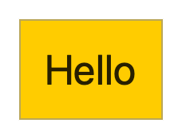
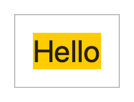
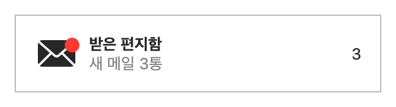

# SwiftUI 핵심 개념
{: .no_toc }



버튼을 누르면 숫자가 1씩 올라가는 화면을 UIKit으로 만든다고 해 보자. 버튼 액션에서 숫자를 올리고, 레이블의 `text`를 직접 바꾼다. 숫자를 바꾸는 일과 화면을 바꾸는 일을 **둘 다 내가** 한다.

```swift
final class CounterViewController: UIViewController {
    private var count = 0
    private let label = UILabel()

    @objc private func plusTapped() {
        count += 1
        label.text = "count: \(count)"
    }
}
```

SwiftUI에서는 이렇게 쓴다.

```swift
struct CounterView: View {
    @State private var count = 0

    var body: some View {
        VStack {
            Text("count: \(count)")
            Button("+1") { count += 1 }
        }
    }
}
```

버튼은 `count`만 바꾼다. 레이블을 고치는 코드가 없다. 대신 `body`에 "`count`가 이 값일 때 화면은 이렇게 생겼다"를 적어 둔다. 값이 바뀌면 SwiftUI가 `body`를 다시 읽고 화면을 맞춘다.

{: .tip }
UIKit은 요리사에게 "양파 썰고, 볶고, 접시에 담아"를 하나씩 시키는 방식이다(명령형). SwiftUI는 "이런 요리가 나와야 한다"는 주문서를 주는 방식이다(선언형). 재료(상태)가 바뀌면 주문서를 다시 읽고 요리를 맞추는 일은 SwiftUI가 한다.

이 글의 실행 결과는 모두 **macOS에서** 직접 돌려서 얻었다. SwiftUI는 macOS와 iOS가 같은 프레임워크라서 상태와 갱신 규칙을 Mac에서 확인할 수 있다. iOS 전용 코드는 iOS SDK로 컴파일만 확인했고, 그 경우 따로 적었다.

## View는 화면이 아니라 화면의 설명서다

SwiftUI에서 화면 조각은 `View` 프로토콜을 따르는 타입이다. Apple 문서는 `View`를 따르는 타입을 만들고, 필수 프로퍼티인 `body`에 내용을 적으라고 설명한다.

```swift
struct Greeting: View {
    var body: some View {
        Text("안녕하세요")
    }
}
```

UIKit 개발자에게 낯선 점이 세 가지 있다.

- **class가 아니라 struct다.** `UIView`처럼 화면에 붙어 오래 사는 객체가 아니다. 값(value)이라서 가볍게 만들고 버린다.
- **`body`는 계산 프로퍼티다.** 저장된 화면이 아니라 "지금 상태라면 이렇게 보인다"를 매번 계산해서 돌려준다.
- **`some View`** 는 "구체적인 타입은 컴파일러가 알고, 나는 View라는 것만 밝힌다"는 뜻이다. `VStack` 안에 `Text`와 `Button`이 들어가면 실제 타입은 길고 복잡해지는데, 그걸 직접 쓰지 않게 해 준다.

{: .note }
Apple 문서에 따르면 `View`를 따르는 타입은 메인 액터(main actor) 격리를 물려받는다. 메인 액터는 "메인 스레드에서만 실행되는 구역"이라고 생각하면 된다. 그래서 `body` 안의 코드는 메인 스레드에서 돈다.

struct가 자주 새로 만들어진다면, 값은 어디에 남을까? 그 답이 뒤에 나올 `@State`다. 먼저 화면을 꾸미는 방법부터 보자.

## 수정자는 뷰를 한 겹씩 감싼다

`.padding()`, `.background()`, `.font()` 같은 메서드를 **수정자(modifier)** 라고 한다. Apple 문서는 수정자가 "원래 뷰를 감싼 새 뷰를 돌려준다"고 설명한다. 그래서 **순서가 결과를 바꾼다.**

아래 두 코드는 수정자 순서만 다르다.

```swift
// A: 여백을 먼저 넣고 배경을 칠한다
Text("Hello")
    .font(.largeTitle)
    .padding()
    .background(.yellow)

// B: 배경을 먼저 칠하고 여백을 넣는다
Text("Hello")
    .font(.largeTitle)
    .background(.yellow)
    .padding()
```

macOS에서 `ImageRenderer`로 그린 결과다. 회색 선은 뷰의 최종 크기를 보이려고 그림을 만들 때 바깥에 덧그린 것이다.

| A: `padding` → `background` | B: `background` → `padding` |
| --- | --- |
|  |  |

두 그림의 바깥 크기는 같다(228×174픽셀, 2배율). 다른 것은 노란색이 칠해진 범위다.

- A는 `Text`를 여백이 있는 뷰로 감싼 다음, **그 큰 뷰**에 배경을 칠했다.
- B는 `Text`에 바로 배경을 칠한 다음, 그 바깥에 투명한 여백을 둘렀다.

{: .tip }
수정자는 선물 포장지다. 상자(여백)에 먼저 넣고 포장지(배경)를 싸면 상자 전체가 포장된다. 포장지를 먼저 싸고 상자에 넣으면 포장지는 안쪽 물건에만 붙어 있다.

{: .warning }
`Text`가 따로 가진 수정자는 일반 수정자 뒤에 붙일 수 없다. Apple 문서의 예는 `Text`의 `bold()`다. `.padding()`은 `Text`가 아니라 다른 타입을 돌려주기 때문에, 그 뒤에서는 `Text`용 `bold()`를 부를 수 없다. `Text` 전용 수정자를 먼저 쓰고 `.padding()`을 나중에 쓴다.

## 레이아웃: 스택, Spacer, frame, padding

UIKit의 Auto Layout은 제약(constraint)을 걸어 위치를 정했다. SwiftUI는 **상자를 쌓는 방식**이다.

| 도구 | 하는 일 | UIKit에서 비슷한 것 |
| --- | --- | --- |
| `VStack` | 세로로 쌓는다 | 세로 `UIStackView` |
| `HStack` | 가로로 쌓는다 | 가로 `UIStackView` |
| `ZStack` | 앞뒤로 겹친다 | `addSubview`로 겹치기 |
| `Spacer()` | 남는 공간을 차지해 밀어낸다 | 늘어나는 빈 뷰 |
| `.frame(...)` | 크기를 정한다 | 너비·높이 제약 |
| `.padding()` | 바깥 여백을 준다 | `layoutMargins` |

메일 앱의 한 줄을 만들어 보자. 아이콘 위에 빨간 점을 겹치고(`ZStack`), 제목 두 줄을 세로로 쌓고(`VStack`), 숫자를 오른쪽 끝으로 민다(`Spacer`).

```swift
struct RowView: View {
    var body: some View {
        HStack {
            ZStack(alignment: .topTrailing) {
                Image(systemName: "envelope.fill")
                    .font(.largeTitle)
                Circle()
                    .fill(.red)
                    .frame(width: 12, height: 12)
            }
            VStack(alignment: .leading) {
                Text("받은 편지함")
                    .font(.headline)
                Text("새 메일 3통")
                    .foregroundStyle(.secondary)
            }
            Spacer()
            Text("3")
        }
        .padding()
        .frame(width: 300)
    }
}
```

macOS에서 그린 결과다.



- `ZStack(alignment: .topTrailing)`이라서 빨간 점이 아이콘의 오른쪽 위에 겹쳤다.
- `VStack(alignment: .leading)`이라서 두 줄이 왼쪽 정렬됐다.
- `Spacer()`가 남는 가로 공간을 모두 차지해서 `3`이 오른쪽 끝으로 밀렸다. `.frame(width: 300)`으로 줄 전체 너비를 정했기 때문에 밀어낼 공간이 생긴 것이다.

`Spacer()`의 넓이는 바깥에서 주는 공간에 따라 달라진다. `HStack { Text("받은 편지함"); Spacer(); Text("3") }`만 따로 떼어 `ImageRenderer`로 폭을 재 봤다.

```text
frame(width: 160) -> 160
frame(width: 320) -> 320
no frame -> 77 x 16
```

폭을 160, 320으로 주면 줄도 그만큼 넓어졌다. 폭을 정하지 않고 그리자 77포인트로 줄어, `Spacer`가 밀어낼 공간이 거의 없었다.

{: .question }
같은 `RowView`를 아이폰 목록 안에 넣으면 `Spacer`는 얼마나 넓어질까? 위 결과를 떠올리면, 답은 `RowView` 안이 아니라 바깥(목록이 주는 폭)에 있다.

## 상태와 데이터 흐름

이제 핵심이다. SwiftUI에서 화면은 상태의 결과다. 상태를 어디에 두고, 누가 바꾸고, 누가 읽는지 정하는 도구가 여럿 있다.

### @State: 뷰가 직접 가진 값

`@State`는 iOS 13부터 쓸 수 있다. Apple 문서는 `@State`를 "뷰 계층에 저장하는 값 타입의 단일 진실 공급원(single source of truth)"으로 쓰라고 하고, **`private`으로 선언하라**고 권한다.

{: .tip }
단일 진실 공급원은 "이 값의 원본은 딱 한 곳"이라는 뜻이다. 복사본이 여러 곳에 있으면 어느 것이 맞는지 헷갈린다. 원본은 하나만 두고, 나머지는 원본을 빌려 쓴다.

View는 struct라서 자주 새로 만들어진다고 했다. 그래도 `@State` 값은 사라지지 않는다. 값의 저장 공간을 **SwiftUI가 따로 관리**하기 때문이다.

`body`가 언제 다시 계산되는지 직접 찍어 보자. `body` 안에서 `let _ = print(...)`을 쓰면 계산될 때마다 출력된다.

```swift
struct CounterView: View {
    @State private var count = 0

    var body: some View {
        let _ = print("CounterView.body count=\(count)")
        VStack {
            Text("count: \(count)")
            StaticLabel()
            PlusTen(count: $count)
        }
        .task {
            count += 1
        }
    }
}

struct StaticLabel: View {
    var body: some View {
        let _ = print("StaticLabel.body")
        Text("고정 문구")
    }
}

struct PlusTen: View {
    @Binding var count: Int

    var body: some View {
        let _ = print("PlusTen.body count=\(count)")
        Button("+10") { count += 10 }
            .task {
                try? await Task.sleep(
                    for: .milliseconds(100))
                count += 10
            }
    }
}
```

실행 환경에서 버튼을 누를 수 없어서, 화면이 뜨면 실행되는 `.task`(iOS 15부터)로 값을 바꿨다. `CounterView`가 뜨면 1을 더하고, 0.1초 뒤 `PlusTen`이 10을 더한다.

```text
CounterView.body count=0
StaticLabel.body
PlusTen.body count=0
CounterView.body count=1
PlusTen.body count=1
CounterView.body count=11
PlusTen.body count=11
```

출력에서 세 가지를 읽을 수 있다.

1. `count`가 바뀔 때마다 `CounterView.body`가 다시 계산됐다.
2. `count`를 받는 `PlusTen`도 다시 계산됐다.
3. `StaticLabel.body`는 처음 한 번만 찍혔다. 받는 값이 없으니 다시 계산할 이유가 없었다.

즉 SwiftUI는 **화면 전체를 다시 그리지 않는다.** 바뀐 값에 기대는 부분만 다시 계산한다.

### @Binding: 남의 값을 빌려 쓰고 고치기

`PlusTen`은 `count`를 직접 갖지 않는다. `@Binding`으로 **`CounterView`의 `count`를 빌려** 왔다. 부모가 `$count`처럼 `$`를 붙여 넘기면 바인딩이 된다.

위 출력의 마지막 두 줄을 보자. 자식인 `PlusTen`이 `count += 10`을 했는데, 부모 `CounterView`의 값이 `11`이 됐다. 자식이 고친 것이 원본에 반영됐다.

{: .note }
Apple 문서 기준 정리다. 자식이 값을 **읽기만** 하면 그냥 값으로 넘긴다. 자식이 값을 **고쳐야** 하면 `$`를 붙여 바인딩으로 넘긴다.

UIKit에서 delegate나 클로저로 "값 바뀌었어요"를 부모에게 알리던 일을 바인딩 한 줄이 대신한다. 클로저로 직접 바인딩을 만드는 방식은 [클로저 기반 데이터 바인딩과 Box]({{ '/swift/data-binding/' | relative_url }})에서 다뤘다.

### 무엇 때문에 다시 계산됐는지 묻기

`Self._printChanges()`를 `body`에 넣으면 SwiftUI가 다시 계산한 이유를 출력한다. 이름이 밑줄로 시작하는 디버깅용 메서드라서, 확인할 때만 넣고 지운다. iOS 15부터 쓸 수 있다.

```swift
struct ChangesView: View {
    @State private var count = 0

    var body: some View {
        let _ = Self._printChanges()
        Text("\(count)")
            .task { count += 1 }
    }
}
```

```text
ChangesView: @self, @identity, _count changed.
ChangesView: _count changed.
```

첫 줄은 처음 나타났을 때다. 두 번째 줄은 `count`(내부 이름 `_count`)가 바뀌어서 다시 계산했다는 뜻이다.

### @Observable: 모델 객체를 관찰하기 (iOS 17)

화면 하나에 담기 어려운 데이터는 클래스 모델로 뺀다. iOS 17, macOS 14부터는 `@Observable` 매크로를 붙이면 된다. 프로퍼티에 따로 표시할 것이 없다.

```swift
import Observation

@Observable
final class Profile {
    var name = "Kim"
    var score = 0
}

struct NameView: View {
    let profile: Profile
    var body: some View {
        let _ = print("NameView.body")
        Text(profile.name)
    }
}

struct ScoreView: View {
    let profile: Profile
    var body: some View {
        let _ = print("ScoreView.body")
        Text("\(profile.score)")
    }
}

struct ProfileScreen: View {
    let profile: Profile
    var body: some View {
        let _ = print("ProfileScreen.body")
        VStack {
            NameView(profile: profile)
            ScoreView(profile: profile)
        }
    }
}
```

`NameView`는 `name`만, `ScoreView`는 `score`만 읽는다. 화면을 띄운 다음 바깥에서 `score`와 `name`을 차례로 바꿨다.

```text
ProfileScreen.body
NameView.body
ScoreView.body
--- score += 1
ScoreView.body
--- name = Lee
NameView.body
```

`score`를 바꾸면 `ScoreView`만, `name`을 바꾸면 `NameView`만 다시 계산됐다. `ProfileScreen`은 `profile`의 프로퍼티를 읽지 않으니 한 번도 다시 계산되지 않았다.

Apple 문서도 같은 규칙을 적어 두었다. `@Observable` 객체는 **`body`가 실제로 읽은 프로퍼티**가 바뀔 때만 그 뷰를 갱신한다.

{: .tip }
`@Observable`은 뷰마다 "네가 읽은 칸"을 메모해 두는 사서다. `score` 칸이 바뀌면 `score`를 읽어 간 사람에게만 연락한다.

### 예전 방식: ObservableObject와 비교

iOS 16 이하도 지원해야 한다면 예전 방식인 `ObservableObject`(iOS 13)와 `@Published`를 쓴다. 같은 실험을 해 보자.

```swift
final class OldProfile: ObservableObject {
    @Published var name = "Kim"
    @Published var score = 0
}

struct OldNameView: View {
    @ObservedObject var profile: OldProfile
    var body: some View {
        let _ = print("OldNameView.body")
        Text(profile.name)
    }
}
// OldScoreView는 score를 읽는다 (구조는 같다)
```

```text
OldNameView.body
OldScoreView.body
--- score += 1
OldNameView.body
OldScoreView.body
```

`score`만 바꿨는데 `name`만 읽는 `OldNameView`도 다시 계산됐다. Apple 문서 설명 그대로, `ObservableObject`는 **어떤 `@Published` 프로퍼티가 바뀌든** 그 객체를 관찰하는 뷰를 모두 갱신한다.

두 방식의 도구는 이렇게 짝지어진다. Apple의 마이그레이션 문서 기준이다.

| 하는 일 | 예전 (`ObservableObject`) | 지금 (`@Observable`, iOS 17) |
| --- | --- | --- |
| 모델 표시 | `ObservableObject` 채택 + `@Published` | `@Observable` 매크로 하나 |
| 뷰가 모델을 소유 | `@StateObject` (iOS 14) | `@State` |
| 받은 모델을 관찰 | `@ObservedObject` | 표시 없이 그냥 프로퍼티 |
| 받은 모델의 바인딩 | `@ObservedObject` + `$` | `@Bindable` |
| 환경으로 전달 | `.environmentObject(_:)` | `.environment(_:)` |
| 환경에서 읽기 | `@EnvironmentObject` | `@Environment(타입.self)` |

{: .note }
Apple 문서는 한 번에 다 바꿀 필요가 없다고 설명한다. 모델 타입 하나씩 `@Observable`로 옮겨도 되고, 두 방식이 한 앱에 섞여 있어도 된다.

### @StateObject와 @ObservedObject의 차이

예전 방식에서 자주 헷갈리는 부분이 있다. 둘 다 객체를 관찰하지만, **누가 객체를 소유하느냐**가 다르다. Apple 문서는 `@StateObject`가 "그 뷰가 사는 동안 객체를 한 번만 만든다"고 설명한다.

```swift
@MainActor
final class Ticket: ObservableObject {
    let no: Int
    // 만들 때마다 1, 2, 3... 번호를 받는다
    init() { no = nextSerial() }
}

struct OwnerView: View {
    @StateObject private var ticket = Ticket()
    // body에서 ticket.no를 출력
}

struct BorrowView: View {
    @ObservedObject var ticket = Ticket()
    // body에서 ticket.no를 출력
}
```

두 뷰를 담은 부모 화면을 다시 계산하게 만들었다.

```text
TicketScreen other=0
  nextSerial() -> 1
  nextSerial() -> 2
OwnerView ticket=2
BorrowView ticket=1
--- other += 1
TicketScreen other=1
  nextSerial() -> 3
BorrowView ticket=3
```

부모가 다시 계산되자 `BorrowView`는 새 `Ticket`(3번)을 받았다. 이전 객체에 담겨 있던 값은 사라진다. `OwnerView`는 새로 만들지 않았다.

{: .warning }
`@ObservedObject`는 "남이 만든 객체를 빌려 본다"는 표시다. 그 자리에서 `= Ticket()`처럼 직접 만들면 부모가 다시 계산될 때마다 새 객체가 생긴다. 뷰가 직접 만드는 객체는 `@StateObject`(iOS 17 이상에서 `@Observable`이면 `@State`)에 둔다.

### @Bindable과 @Environment (iOS 17)

`@Observable` 모델의 프로퍼티를 `TextField`처럼 바인딩이 필요한 곳에 넘기려면 `@Bindable`을 붙인다. 그러면 `$profile.name` 같은 바인딩을 만들 수 있다.

```swift
struct NameEditor: View {
    @Bindable var profile: Profile
    var body: some View {
        TextField("이름", text: $profile.name)
    }
}
```

여러 단계 아래 뷰까지 같은 모델을 넘겨야 하면, 중간 뷰마다 인자로 넘기는 대신 **환경(environment)** 에 넣는다.

```swift
struct ScoreBadge: View {
    @Environment(Profile.self) private var profile
    var body: some View {
        let _ = print(
            "ScoreBadge.body score=\(profile.score)")
        Text("\(profile.score)점")
    }
}

// 위쪽 어딘가에서
ScoreBadge()
    .environment(profile)
```

환경에 넣은 모델의 `score`를 5 올렸다.

```text
ScoreBadge.body score=0
--- score += 5
ScoreBadge.body score=5
```

{: .tip }
환경은 건물의 방송 시스템이다. 1층에서 한 번 틀면 위층 어느 방에서든 들을 수 있다. 중간 층마다 쪽지를 전달할 필요가 없다.

`@Bindable`, `@Environment(타입.self)`, `@Observable`은 모두 iOS 17이 필요하다. 배포 대상을 iOS 13으로 두고 컴파일하자 컴파일러가 이렇게 알려 줬다(Xcode 16.2, iOS 18.2 SDK).

```text
error: 'Observable()' is only available in iOS 17.0 or newer
error: 'Bindable' is only available in iOS 17.0 or newer
error: 'StateObject' is only available in iOS 14.0 or newer
error: 'task(priority:_:)' is only available in iOS 15.0 or newer
```

(같은 파일의 `@State`, `ObservableObject`, `#Preview`는 iOS 13에서 오류가 나지 않았다.)

## 목록과 화면 이동

### List와 ForEach는 "누가 누구인지"를 알아야 한다

`List`나 `ForEach`에 배열을 주면 항목마다 뷰를 만든다. Apple 문서는 이때 요소가 `Identifiable`을 따르거나, `id:` 인자로 구분할 값을 알려 줘야 한다고 설명한다. `Identifiable`은 `id` 프로퍼티 하나만 있으면 되는 프로토콜이다.

```swift
struct Mail: Identifiable, Hashable {
    let id: Int
    var title: String
}
```

`id`가 필요한 이유는 배열이 바뀔 때 SwiftUI가 "3번 메일이 삭제됐다", "1번 메일은 그대로다"를 구분하기 위해서다. `UITableView`의 diffable data source에 식별자를 주던 것과 비슷한 역할이다.

### NavigationStack (iOS 16)

화면 이동은 `NavigationStack`(iOS 16)으로 한다. `UINavigationController`처럼 화면을 쌓는다.

```swift
struct MailListView: View {
    let mails = [
        Mail(id: 1, title: "회의 일정"),
        Mail(id: 2, title: "청구서"),
    ]

    var body: some View {
        NavigationStack {
            List(mails) { mail in
                NavigationLink(mail.title, value: mail)
            }
            .navigationDestination(for: Mail.self) { mail in
                Text(mail.title)
            }
            .navigationTitle("메일")
        }
    }
}
```

`NavigationLink`는 "어디로 갈지(뷰)"가 아니라 **"무슨 값을 보여 줄지(`mail`)"** 만 넘긴다. 그 값을 받아 어떤 화면을 띄울지는 `.navigationDestination(for:)`이 정한다. Apple 문서의 설명대로, 링크를 누르면 상세 화면이 스택 위에 올라가고 뒤로 가면 빠진다.

{: .warning }
이 코드는 iOS 16 SDK 대상으로 컴파일만 확인했고 실제로 화면을 눌러 보지는 않았다. iOS 15 대상으로 컴파일하면 `'NavigationStack' is only available in iOS 16.0 or newer` 오류가 난다. iOS 15 이하는 예전 `NavigationView`를 써야 한다.

## 뷰의 정체성과 수명

앞에서 "View struct는 자주 새로 만들어지지만 `@State`는 남는다"고 했다. 그럼 `@State`는 **언제** 사라질까? 답은 뷰의 **정체성(identity)** 이 바뀔 때다.

{: .tip }
정체성은 SwiftUI가 붙이는 이름표다. struct 값이 새로 만들어져도 이름표가 같으면 "같은 뷰"로 보고 상태를 이어 준다. 이름표가 바뀌면 "다른 뷰"로 보고 상태를 새로 만든다.

실험용으로 `@State`의 초깃값을 만들 때마다 번호를 하나씩 올리는 함수 `nextSerial()`을 만들었다.

```swift
struct Child: View {
    @State private var serial = nextSerial()
    var body: some View {
        let _ = print("Child.body serial=\(serial)")
        Text("serial \(serial)")
    }
}
```

### .id로 정체성을 바꾸기

`.id(_:)` 수정자는 정체성을 직접 정한다. Apple 문서는 "`id` 값이 바뀌면 뷰의 정체성, 예를 들어 상태가 초기화된다"고 설명한다.

```swift
struct IdScreen: View {
    // Root: version, other를 가진 @Observable 모델
    let root: Root
    var body: some View {
        let _ = print("IdScreen.body other=\(root.other)")
        Child()
            .id(root.version)
    }
}
```

`other`(관계없는 값)를 바꾼 다음, `version`(`.id`에 쓴 값)을 바꿨다.

```text
IdScreen.body other=0
  nextSerial() -> 1
Child.body serial=1
--- other += 1
IdScreen.body other=1
  nextSerial() -> 2
Child.body serial=1
--- version += 1
IdScreen.body other=1
  nextSerial() -> 3
Child.body serial=3
```

- `other`를 바꾸자 부모가 다시 계산되며 `Child()`도 새로 만들어졌다(`nextSerial() -> 2`). 그런데 화면의 `serial`은 **여전히 1**이다. 정체성이 같으니 SwiftUI가 기존 상태를 이어 주고, 새로 만든 2는 버렸다.
- `version`을 바꾸자 `serial`이 **3**이 됐다. 정체성이 바뀌어 상태가 새로 만들어졌다.

{: .note }
목록 화면에서 "필터를 바꾸면 스크롤 위치와 입력 상태를 처음부터 시작"하고 싶을 때 `.id`를 쓴다. 반대로 상태가 이유 없이 초기화된다면, 어딘가에서 정체성이 바뀌고 있는지 의심해 본다.

### if/else도 정체성을 바꾼다

`.id`를 쓰지 않아도 정체성이 바뀌는 경우가 있다. SwiftUI는 **코드 구조 속 위치**도 이름표로 쓴다. 이것을 구조적 정체성(structural identity)이라고 한다. `if`의 참 쪽과 거짓 쪽은 서로 다른 자리다.

```swift
// 방법 1: 분기로 나누기
if root.flag {
    Child().padding()
} else {
    Child()
}

// 방법 2: 수정자 값만 바꾸기
Child()
    .padding(root.flag ? 20 : 0)
```

두 방법 모두 `flag`를 `false`에서 `true`로 바꿨다.

```text
[방법 1: if/else]
  nextSerial() -> 1
Child.body serial=1
--- flag = true
  nextSerial() -> 2
Child.body serial=2

[방법 2: 수정자 값]
  nextSerial() -> 1
Child.body serial=1
--- flag = true
  nextSerial() -> 2
Child.body serial=1
```

보기에는 둘 다 "여백이 생긴다"로 같다. 하지만 방법 1은 상태가 초기화됐고(`serial=2`), 방법 2는 유지됐다(`serial=1`).

{: .question }
토글 스위치를 켤 때마다 화면 안의 입력값이 지워지는 버그가 있다. 위 두 방법 중 어느 쪽으로 코드가 짜여 있을 가능성이 높을까?

{: .warning }
위 출력에서 `nextSerial()`이 뷰를 만들 때마다 불린 것은 Xcode 16.2의 `@State` 프로퍼티 래퍼 동작이다. Apple 문서도 `State`가 뷰를 만들 때마다 기본값을 만든다고 설명하며, 무거운 객체를 기본값으로 만들지 말라고 한다. 한편 2026년 11월 27일 확인한 Apple 문서는 **Xcode 27 이상으로 빌드하면 `@State`가 `State()` 매크로로 바뀌고, 기본값을 처음 한 번만 만든다**고 적고 있다. 이 동작은 직접 실행해 보지 않았다.

## UIKit과 함께 쓰기

기존 UIKit 앱을 한 번에 바꿀 필요는 없다. 두 방향 모두 연결할 수 있다.

### UIKit 화면 안에 SwiftUI 넣기: UIHostingController

`UIHostingController`(iOS 13)는 SwiftUI 뷰를 담은 `UIViewController`다. Apple 문서 설명대로 다른 뷰 컨트롤러처럼 push, present, 자식 뷰 컨트롤러로 쓸 수 있다.

```swift
final class HomeViewController: UIViewController {
    func showSettings() {
        let vc = UIHostingController(
            rootView: SettingsView()
        )
        navigationController?
            .pushViewController(vc, animated: true)
    }
}
```

### SwiftUI 안에 UIKit 뷰 넣기: UIViewRepresentable

반대로 SwiftUI에 아직 없는 UIKit 뷰를 쓰고 싶으면 `UIViewRepresentable`(iOS 13)로 감싼다. 메서드 두 개가 핵심이다.

- `makeUIView`: UIKit 뷰를 **처음 한 번** 만든다.
- `updateUIView`: SwiftUI 상태가 바뀌면 불린다. 여기서 UIKit 뷰를 **새 상태에 맞춘다.**

```swift
struct ActivityIndicator: UIViewRepresentable {
    var isAnimating: Bool

    func makeUIView(context: Context)
        -> UIActivityIndicatorView {
        UIActivityIndicatorView(style: .large)
    }

    func updateUIView(
        _ view: UIActivityIndicatorView,
        context: Context
    ) {
        if isAnimating {
            view.startAnimating()
        } else {
            view.stopAnimating()
        }
    }
}
```

위 두 iOS 코드는 iOS 17 SDK 대상으로 컴파일만 확인했다. 대신 같은 구조인 macOS의 `NSViewRepresentable`로 `NSTextField`를 감싸서 호출 순서를 찍었다.

```swift
struct LabelBox: NSViewRepresentable {
    var text: String
    func makeNSView(context: Context) -> NSTextField {
        print("makeNSView")
        return NSTextField(labelWithString: text)
    }
    func updateNSView(_ v: NSTextField,
                      context: Context) {
        print("updateNSView text=\(text)")
        v.stringValue = text
    }
}
```

`text`에 연결된 `@Observable` 모델의 `name`을 두 번 바꿨다.

```text
makeNSView
updateNSView text=Kim
--- name = Lee
updateNSView text=Lee
--- name = Park
updateNSView text=Park
```

뷰는 한 번만 만들어졌고, 이후에는 `update`만 불렸다. `body`처럼 매번 새로 만드는 것이 아니라, **진짜 UIKit 뷰는 살려 두고 값만 덮어쓴다.**

{: .warning }
Apple 문서에 따르면 SwiftUI가 감싼 UIKit 뷰의 `frame`, `bounds`, `center`, `transform`을 직접 바꾸면 안 된다. 레이아웃은 SwiftUI가 맡는다. 또 UIKit 뷰 안에서 생긴 변화(delegate, target-action)는 자동으로 SwiftUI에 전달되지 않는다. 전달하려면 `Coordinator`를 만들어야 한다.

## 미리보기: #Preview

Xcode는 코드 옆 캔버스에 뷰를 바로 그려 준다. 파일 아래에 `#Preview` 매크로를 쓰면 된다.

```swift
#Preview {
    MailListView()
}
```

Apple 문서에 따르면 한 파일에 미리보기를 여러 개 둘 수 있고, `#Preview("이름")`처럼 이름을 붙여 캔버스에서 구분할 수 있다. 배포 대상을 iOS 13으로 둔 위 컴파일 확인에서도 `#Preview`는 오류가 나지 않았다.

{: .note }
이 글을 쓴 환경에서는 Xcode 캔버스를 열어 보지 않았다. `#Preview`는 컴파일만 확인했다.

## 실행 환경과 확인 범위

- macOS 15.6, Apple M4, Xcode 16.2, Swift 6.0.3, macOS 15.2 SDK
- SwiftPM 실행 파일(배포 대상 macOS 14)에서 `NSHostingView`를 창에 띄우고 값을 바꿔 `body` 출력을 기록했다.
- 그림은 `ImageRenderer`(iOS 16, macOS 13)로 macOS에서 그렸다. 같은 코드를 iOS에서 그려 보지는 않았다.
- iOS 코드(`UIHostingController`, `UIViewRepresentable`, `NavigationStack`)는 iOS 18.2 시뮬레이터 SDK로 컴파일만 확인했다.

## 정리

| 개념 | 한 줄 요약 |
| --- | --- |
| 선언형 UI | 상태만 바꾸면 SwiftUI가 `body`를 다시 읽어 화면을 맞춘다 |
| View | `body`를 가진 struct. 화면이 아니라 화면의 설명서 |
| 수정자 | 뷰를 한 겹씩 감싼다. 순서가 결과를 바꾼다 |
| 레이아웃 | `VStack`/`HStack`/`ZStack`으로 쌓고 `Spacer`로 민다 |
| `@State` | 뷰가 가진 값. `private`, 저장은 SwiftUI가 한다 |
| `@Binding` | 남의 값을 빌려 읽고 고친다 (`$` 붙여 넘김) |
| `@Observable` | iOS 17. `body`가 읽은 프로퍼티가 바뀔 때만 갱신 |
| `ObservableObject` | iOS 13. `@Published` 하나만 바뀌어도 관찰 뷰 모두 갱신 |
| `@Bindable` / `@Environment` | iOS 17. 모델 바인딩 / 멀리 있는 뷰에 전달 |
| 정체성 | `.id`나 `if` 분기가 바뀌면 `@State`가 초기화된다 |
| UIKit 연동 | `UIHostingController`, `UIViewRepresentable` |

## 이어서 읽기

- [MVVM의 역할과 데이터 흐름]({{ '/swift/mvvm-swift/' | relative_url }}): SwiftUI에서 `@Observable` 모델을 ViewModel처럼 나눌 때 기준이 된다.
- [클로저 기반 데이터 바인딩과 Box]({{ '/swift/data-binding/' | relative_url }}): 바인딩을 직접 만들어 보면 SwiftUI가 대신해 주는 일이 보인다.
- [Auto Layout]({{ '/ios/auto-layout/' | relative_url }}): UIKit 레이아웃과 SwiftUI 스택 방식을 비교해 볼 수 있다.

## 참고

- [Apple: SwiftUI](https://developer.apple.com/documentation/swiftui)
- [Apple: View](https://developer.apple.com/documentation/swiftui/view)
- [Apple: Configuring views](https://developer.apple.com/documentation/swiftui/configuring-views)
- [Apple: State](https://developer.apple.com/documentation/swiftui/state)
- [Apple: Binding](https://developer.apple.com/documentation/swiftui/binding)
- [Apple: Migrating from the Observable Object protocol to the Observable macro](https://developer.apple.com/documentation/swiftui/migrating-from-the-observable-object-protocol-to-the-observable-macro)
- [Apple: Bindable](https://developer.apple.com/documentation/swiftui/bindable)
- [Apple: Environment](https://developer.apple.com/documentation/swiftui/environment)
- [Apple: StateObject](https://developer.apple.com/documentation/swiftui/stateobject)
- [Apple: ForEach](https://developer.apple.com/documentation/swiftui/foreach)
- [Apple: NavigationStack](https://developer.apple.com/documentation/swiftui/navigationstack)
- [Apple: id(_:)](https://developer.apple.com/documentation/swiftui/view/id(_:))
- [Apple: UIHostingController](https://developer.apple.com/documentation/swiftui/uihostingcontroller)
- [Apple: UIViewRepresentable](https://developer.apple.com/documentation/swiftui/uiviewrepresentable)
- [Apple: Previews in Xcode](https://developer.apple.com/documentation/swiftui/previews-in-xcode)
- [Apple: ImageRenderer](https://developer.apple.com/documentation/swiftui/imagerenderer)
- [WWDC21: Demystify SwiftUI](https://developer.apple.com/videos/play/wwdc2021/10022/)
