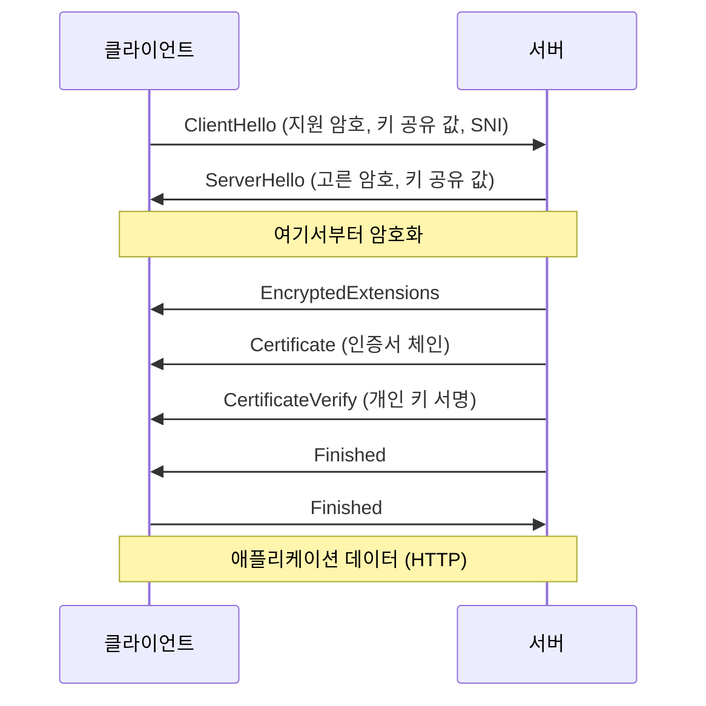

# TLS 1.3 핸드셰이크
{: .no_toc }



**TLS(Transport Layer Security)**는 인터넷 통신을 암호화하고 상대 서버가 진짜인지 확인하는 프로토콜이다. HTTPS는 HTTP를 TLS 위에서 주고받는 것이다. 예전 이름이 SSL이라 지금도 "SSL 인증서"라는 말이 남아 있다.

TLS 연결은 두 단계로 나뉜다.

1. **핸드셰이크**: 처음 만난 클라이언트와 서버가 암호 방식을 고르고, 둘만 아는 키를 만들고, 서버가 인증서로 자신을 증명한다.
2. **데이터 전송**: 만든 키로 데이터를 [AES-GCM]({{ '/pki/aes-gcm/' | relative_url }}) 같은 인증 암호로 주고받는다.

이 글은 현재 표준인 TLS 1.3(RFC 8446)의 핸드셰이크를 다룬다.

## 직접 관찰하기

[X.509 글]({{ '/pki/x509/' | relative_url }})에서 만든 학습용 인증서로 로컬 TLS 서버를 띄우고, 클라이언트로 접속하며 주고받는 메시지를 출력했다(OpenSSL 3.0.13).

```bash
# 서버
openssl s_server -accept 8443 -cert leaf.pem -key leaf.key -tls1_3 -www

# 클라이언트: -msg로 핸드셰이크 메시지 출력
openssl s_client -connect 127.0.0.1:8443 -servername api.example.test \
  -CAfile ca.pem -verify_hostname api.example.test -tls1_3 -msg
```

핸드셰이크 메시지만 추린 결과다(`>>>`는 클라이언트가 보냄, `<<<`는 받음).

```text
>>> TLS 1.3, Handshake, ClientHello
<<< TLS 1.3, Handshake, ServerHello
<<< TLS 1.3, Handshake, EncryptedExtensions
<<< TLS 1.3, Handshake, Certificate
<<< TLS 1.3, Handshake, CertificateVerify
<<< TLS 1.3, Handshake, Finished
>>> TLS 1.3, ChangeCipherSpec
>>> TLS 1.3, Handshake, Finished
```

연결 요약도 출력된다.

```text
Server Temp Key: X25519, 253 bits
Peer signature type: ECDSA
Verification: OK
New, TLSv1.3, Cipher is TLS_AES_256_GCM_SHA384
```

## 메시지별로 보기



### 1. ClientHello

클라이언트가 먼저 보낸다.

- 지원하는 암호 조합: `TLS_AES_256_GCM_SHA384`, `TLS_AES_128_GCM_SHA256`, `TLS_CHACHA20_POLY1305_SHA256`
- **키 공유(key_share)**: 클라이언트가 만든 일회용 [Diffie-Hellman]({{ '/pki/pkcs3/' | relative_url }}) 공개 값. 서버가 고를 것을 예상해 미리 보낸다
- **SNI(Server Name Indication)**: 접속하려는 서버 이름(`api.example.test`). 한 IP에 여러 사이트가 있을 때 서버가 어떤 인증서를 보낼지 정하는 데 쓴다

### 2. ServerHello

서버는 암호 조합 하나를 고르고, 자신의 일회용 DH 공개 값을 보낸다. 위 실행에서는 **X25519** 곡선이 선택됐다(`Server Temp Key: X25519`). 최신 브라우저와 서버는 여기에 양자 내성 [ML-KEM]({{ '/pki/pqc-kyber/' | relative_url }})을 섞은 X25519MLKEM768을 쓰기도 한다.

이 순간 양쪽은 서로의 공개 값과 자신의 비밀 값으로 **같은 공유 비밀**을 계산할 수 있다. 이 비밀에서 HKDF(HMAC 기반 키 유도 함수, [해시와 HMAC]({{ '/pki/hash-hmac/' | relative_url }}))로 핸드셰이크용 키와 데이터용 키를 뽑는다. **ServerHello 이후의 메시지는 모두 암호화된다.** 인증서도 암호화되어 도청자는 어느 사이트의 인증서인지 볼 수 없다.

### 3. EncryptedExtensions

나머지 협상 결과(예: HTTP/2를 쓸지 정하는 ALPN)를 암호화해 보낸다.

### 4. Certificate

서버 인증서 체인이다. 클라이언트는 [X.509 검증]({{ '/pki/x509/' | relative_url }})을 수행한다. 위 실행의 `Verification: OK`가 그 결과다.

### 5. CertificateVerify

인증서는 공개된 문서라 누구나 복사해 보낼 수 있다. 서버는 **지금까지의 핸드셰이크 내용 전체의 해시에 인증서의 개인 키로 서명**해 보낸다. 이 서명이 맞으면 "인증서의 주인(개인 키를 가진 쪽)이 지금 이 대화에 참여하고 있다"가 증명된다. 위 실행에서는 ECDSA로 서명했다(`Peer signature type: ECDSA`).

키 합의(DH)와 서버 인증(서명)이 이렇게 묶여 있어서, 중간자가 끼어들어 자신의 DH 값으로 바꿔치기하면 서명이 맞지 않는다. [PKCS #3]({{ '/pki/pkcs3/' | relative_url }}) 글에서 본 "인증 없는 DH의 중간자 공격"을 막는 지점이 여기다.

### 6. Finished

양쪽이 핸드셰이크 전체의 해시에 대한 HMAC을 보내 서로 같은 내용을 봤는지 확인한다. 누군가 ClientHello의 암호 목록을 약한 것으로 바꿔치기했다면(다운그레이드 공격) 여기서 값이 맞지 않는다.

클라이언트가 보낸 `ChangeCipherSpec`은 TLS 1.3에서는 아무 의미가 없는 메시지다. 오래된 중간 장비가 TLS 1.3을 TLS 1.2처럼 보고 통과시키도록 호환성 때문에 남겨 둔 것이다.

## TLS 1.2와 무엇이 달라졌나

| | TLS 1.2 | TLS 1.3 |
| --- | --- | --- |
| 첫 연결 왕복 | 2번(2-RTT) | 1번(1-RTT) |
| 키 교환 | RSA 키 전송도 허용 | 일회용 (EC)DHE만 |
| 순방향 비밀성 | 설정에 따라 없음 | 항상 있음 |
| 암호 조합 | 수십 개, 약한 것 포함(CBC, RC4 등) | AEAD 5개만 |
| 인증서 | 평문으로 전송 | 암호화되어 전송 |

**RSA 키 전송이 사라진 것**이 가장 중요한 변화다. TLS 1.2의 RSA 키 교환에서는 클라이언트가 세션 키를 서버의 RSA 공개 키로 암호화해 보냈다. 그러면 나중에 서버 개인 키가 유출됐을 때, 저장해 둔 과거 통신을 모두 풀 수 있다. TLS 1.3은 연결마다 새 DH 키를 만들고 버리므로, 서버 인증서의 개인 키는 서명에만 쓰인다. 개인 키가 나중에 유출돼도 과거 통신은 안전하다. 이것을 **순방향 비밀성(forward secrecy)**이라고 한다.

## 재접속: 세션 재개와 0-RTT

한 번 연결한 서버에 다시 접속할 때, 서버가 이전에 준 티켓(NewSessionTicket)으로 핸드셰이크를 줄일 수 있다. 더 나아가 **0-RTT**는 ClientHello와 함께 첫 HTTP 요청을 바로 보낸다.

0-RTT 데이터는 공격자가 복사해 다시 보내는 **재전송 공격**을 막지 못한다. 그래서 GET처럼 여러 번 실행돼도 괜찮은 요청에만 쓰고, 결제나 상태를 바꾸는 요청에는 쓰지 않는다. 서버가 0-RTT를 받아들일지는 설정으로 정한다.

## iOS에서

`URLSession`은 기본으로 TLS 1.2 이상을 요구하고, 서버가 지원하면 TLS 1.3으로 연결한다. App Transport Security(ATS)는 평문 HTTP와 약한 TLS 설정을 기본으로 막는다. 인증서 검증을 더 엄격하게 하고 싶을 때가 [피닝]({{ '/pki/ssl-pinning/' | relative_url }})이다.

## 정리

- TLS 1.3 핸드셰이크는 ClientHello → ServerHello → (암호화) EncryptedExtensions → Certificate → CertificateVerify → Finished 순서다. 로컬 OpenSSL로 같은 순서를 확인했다.
- 키는 일회용 DH(X25519 등)로 합의하고, 서버는 핸드셰이크 전체에 서명해 자신을 증명한다.
- ServerHello 이후는 암호화되어 인증서도 도청자에게 보이지 않는다.
- TLS 1.3은 1-RTT, 순방향 비밀성 필수, AEAD만 허용한다.
- 0-RTT는 재전송될 수 있으므로 안전한 요청에만 쓴다.

## 참고

- [RFC 8446: TLS 1.3](https://www.rfc-editor.org/rfc/rfc8446.html)
- [The Illustrated TLS 1.3 Connection](https://tls13.xargs.org/)
- [Cloudflare: A Detailed Look at RFC 8446 (TLS 1.3)](https://blog.cloudflare.com/rfc-8446-aka-tls-1-3/)
- [OpenSSL: openssl-s_client](https://docs.openssl.org/3.0/man1/openssl-s_client/)
