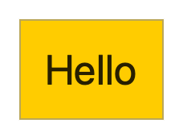
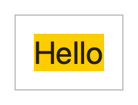

# 선언형 UI와 View
{: .no_toc }



## 선언형 UI에서 상태가 화면이 되는 순서 {#declarative-ui}

버튼을 누르면 숫자가 1씩 올라가는 화면을 UIKit으로 만든다고 해 보자. 버튼 액션에서 숫자를 올리고, 레이블의 `text`를 직접 바꾼다. 숫자를 바꾸는 일과 화면을 바꾸는 일을 **둘 다 내가** 한다.

```swift
final class CounterViewController: UIViewController {
    private var count = 0
    private let label = UILabel()

    @objc private func plusTapped() {
        count += 1
        label.text = "count: \(count)"
    }
}
```

SwiftUI에서는 이렇게 쓴다.

```swift
struct CounterView: View {
    @State private var count = 0

    var body: some View {
        VStack {
            Text("count: \(count)")
            Button("+1") { count += 1 }
        }
    }
}
```

버튼은 `count`만 바꾼다. 레이블을 고치는 코드가 없다. 대신 `body`에 "`count`가 이 값일 때 화면은 이렇게 생겼다"를 적어 둔다. 값이 바뀌면 SwiftUI가 `body`를 다시 읽고 화면을 맞춘다.

{: .tip }
UIKit은 요리사에게 "양파 썰고, 볶고, 접시에 담아"를 하나씩 시키는 방식이다(명령형). SwiftUI는 "이런 요리가 나와야 한다"는 주문서를 주는 방식이다(선언형). 재료(상태)가 바뀌면 주문서를 다시 읽고 요리를 맞추는 일은 SwiftUI가 한다.

### 버튼을 누른 뒤 SwiftUI가 하는 일 {#swiftui-update-cycle}

```text
사용자 입력 → 상태 변경 → 의존하는 body 계산 → 이전 뷰 구조와 맞추기 → 레이아웃과 표시
```

1. 버튼의 액션이 `count`를 바꾼다. 입력과 상태 변경이 앱 코드가 맡는 일이다.
2. SwiftUI가 `count`에 의존하는 뷰의 `body`를 다시 평가할 수 있게 표시한다. **의존성**은 그 뷰가 화면을 설명할 때 읽어야 하는 값이다. 상태 외에 부모가 넘긴 입력과 `@Environment`에서 읽는 값도 의존성이 된다.
3. 새 `body`가 돌려준 뷰 구조를 이전 구조와 맞춘다. 같은 이름표를 가진 뷰는 이전 상태 저장 공간을 이어 쓴다. 뷰를 맞추는 기준을 **정체성(identity)**이라고 부른다.
4. 필요한 부분의 크기와 위치를 계산하고 화면에 반영한다. `body`가 다시 계산된 횟수와 픽셀을 다시 그린 횟수는 따로 봐야 한다.

이 흐름은 코드를 읽기 위한 설명이다. SwiftUI가 내부에서 쓰는 비교 알고리즘 전체나 `body` 호출 횟수는 공개 계약에 포함되지 않는다. `body`는 언제든 다시 평가할 수 있게 화면 조립에 집중한다. 버튼을 눌러 서버에 저장하는 일은 버튼 액션에, 뷰의 수명에 맞춰 돌릴 비동기 작업은 `.task`에 둔다. [WWDC21 · Demystify SwiftUI](https://developer.apple.com/videos/play/wwdc2021/10022/)

## View는 화면이 아니라 화면의 설명서다
{: id="view는-화면이-아니라-화면의-설명서다" }

SwiftUI에서 화면 조각은 `View` 프로토콜을 따르는 타입이다. Apple 문서는 `View`를 따르는 타입을 만들고, 필수 프로퍼티인 `body`에 내용을 적으라고 설명한다.

```swift
struct Greeting: View {
    var body: some View {
        Text("안녕하세요")
    }
}
```

UIKit 개발자에게 낯선 점이 세 가지 있다.

- **앱에서 만드는 SwiftUI 뷰는 주로 struct로 작성한다.** 값 자체와 화면에 연결된 상태의 수명을 따로 본다.
- **`body`는 계산 프로퍼티다.** 저장된 화면이 아니라 "지금 상태라면 이렇게 보인다"를 매번 계산해서 돌려준다.
- **`some View`** 는 "구체적인 타입은 컴파일러가 알고, 나는 View라는 것만 밝힌다"는 뜻이다. `VStack` 안에 `Text`와 `Button`이 들어가면 실제 타입은 길고 복잡해지는데, 그걸 직접 쓰지 않게 해 준다.

{: .note }
이 글에서 `struct ...: View`로 선언한 뷰의 `body`는 메인 액터에 격리된다. **메인 액터**는 화면과 같이 메인 실행 맥락에서 접근할 상태를 안전하게 다루기 위한 Swift의 경계다. 파일 전체를 읽거나 큰 이미지를 해석하는 동기 코드를 `body`에 넣으면 그동안 화면이 입력에 응답하기 어렵다.

struct가 자주 새로 만들어진다면, 값은 어디에 남을까? 그 답이 뒤에 나올 `@State`다. 먼저 화면을 꾸미는 방법부터 보자.

### some View와 ViewBuilder의 역할 {#view-builder}

`some View`는 `View`를 따르는 구체적인 결과 타입을 호출하는 쪽에서 숨긴다. 구현 안에서는 컴파일러가 결과 타입을 알고 있다. 예를 들어 `.padding()` 전후의 타입이 달라도, 둘 다 `View`라서 반환 타입 이름을 직접 쓰지 않아도 된다.

여러 뷰를 괄호 안에 한 줄씩 작성할 수 있는 이유는 **결과 빌더(result builder)**다. SwiftUI의 `ViewBuilder`는 여러 표현식을 한 결과로 모으고, 조건문의 결과를 하나의 구조로 만든다. `VStack`의 콘텐츠 클로저와 `View.body`는 이 기능을 사용한다. 뷰를 돌려주는 별도 프로퍼티에서 `if/else`로 다른 타입의 뷰를 쓰려면 아래 `status`처럼 `@ViewBuilder`를 명시할 수 있다.

### 버튼, 입력 필드, 토글이 상태를 바꾸는 지점 {#swiftui-controls}

작은 설정 화면에서 값이 오가는 길을 확인한다. `TextField`와 `Toggle`은 현재 값을 읽고 사용자 입력을 써야 하므로 바인딩을 받는다. `Button`은 탭했을 때 실행할 액션을 받는다. 인사말과 버튼의 활성 여부는 이미 가지고 있는 값에서 계산한다.

```swift
import SwiftUI

struct DraftEditor: View {
    @State private var name = ""
    @State private var notifications = false

    private var trimmedName: String {
        name.trimmingCharacters(in: .whitespacesAndNewlines)
    }

    var body: some View {
        Form {
            TextField("이름", text: $name)
            Toggle("알림 받기", isOn: $notifications)
            status
            Button("초기화") {
                name = ""
                notifications = false
            }
            .disabled(name.isEmpty && !notifications)
        }
    }

    @ViewBuilder
    private var status: some View {
        if trimmedName.isEmpty {
            Label("이름을 입력하세요.", systemImage: "pencil")
        } else {
            Text("\(trimmedName)님, 안녕하세요.")
        }
    }
}
```

`trimmedName`이나 버튼 활성 여부를 별도 `@State`로 저장하면 입력값과 함께 두 곳을 고쳐야 한다. 계산 프로퍼티로 두면 이름을 바꿀 때 다음 `body` 평가에서 계산 결과가 따라온다. 이 설정 화면은 iOS 16 배포 대상으로 컴파일을 확인했다. 시뮬레이터에서 직접 입력해 보지는 않았다. [Apple · ViewBuilder](https://developer.apple.com/documentation/swiftui/viewbuilder)

## 수정자는 뷰를 한 겹씩 감싼다
{: id="수정자는-뷰를-한-겹씩-감싼다" }

`.padding()`, `.background()`, `.font()` 같은 메서드를 **수정자(modifier)** 라고 한다. Apple 문서는 수정자가 "원래 뷰를 감싼 새 뷰를 돌려준다"고 설명한다. 그래서 **순서가 결과를 바꾼다.**

아래 두 코드는 수정자 순서만 다르다.

```swift
// A: 여백을 먼저 넣고 배경을 칠한다
Text("Hello")
    .font(.largeTitle)
    .padding()
    .background(.yellow)

// B: 배경을 먼저 칠하고 여백을 넣는다
Text("Hello")
    .font(.largeTitle)
    .background(.yellow)
    .padding()
```

macOS에서 `ImageRenderer`로 그린 결과다. 회색 선은 뷰의 최종 크기를 보이려고 그림을 만들 때 바깥에 덧그린 것이다.

| A: `padding` → `background` | B: `background` → `padding` |
| --- | --- |
|  |  |

두 그림의 바깥 크기는 같다(228×174픽셀, 2배율). 다른 것은 노란색이 칠해진 범위다.

- A는 `Text`를 여백이 있는 뷰로 감싼 다음, **그 큰 뷰**에 배경을 칠했다.
- B는 `Text`에 바로 배경을 칠한 다음, 그 바깥에 투명한 여백을 둘렀다.

{: .tip }
수정자는 선물 포장지다. 상자(여백)에 먼저 넣고 포장지(배경)를 싸면 상자 전체가 포장된다. 포장지를 먼저 싸고 상자에 넣으면 포장지는 안쪽 물건에만 붙어 있다.

{: .warning }
`Text`가 따로 가진 수정자는 일반 수정자 뒤에 붙일 수 없다. `Text("안녕").bold()`의 결과는 `Text`다. `.padding()`을 거치면 일반적인 `View` 타입이므로 이후의 `.bold()`는 iOS 16부터 있는 `View.bold(_:)` 오버로드로 해석된다. `Text`를 그대로 돌려받아 다른 `Text`와 조합해야 할 때는 텍스트 수정자를 먼저 적용한다. [Apple · View.bold(_:)](https://developer.apple.com/documentation/swiftui/view/bold(_:))

## 이어서 읽기

- 다음 글: [SwiftUI 레이아웃]({{ '/swiftui/layout/' | relative_url }})
- [SwiftUI 연재 목차]({{ '/swiftui/' | relative_url }})
