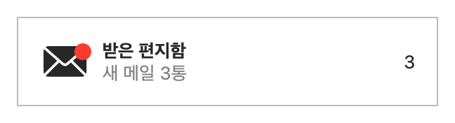

# SwiftUI 레이아웃
{: .no_toc }



## 레이아웃: 스택, Spacer, frame, padding
{: id="레이아웃-스택-spacer-frame-padding" }

SwiftUI 레이아웃에서는 부모가 자식에게 크기를 **제안**하고, 자식이 자기 크기를 **응답**한다. 부모는 응답을 바탕으로 자식을 **배치**한다. `HStack`은 자식에게 가로 공간을 어떻게 나눌지 결정한다. `Text`는 받은 폭에 따라 줄바꿈을 하고, `Spacer`는 배정된 남는 폭을 차지한다.

| 도구 | 하는 일 | UIKit에서 비슷한 것 |
| --- | --- | --- |
| `VStack` | 세로로 쌓는다 | 세로 `UIStackView` |
| `HStack` | 가로로 쌓는다 | 가로 `UIStackView` |
| `ZStack` | 앞뒤로 겹친다 | `addSubview`로 겹치기 |
| `Spacer()` | 남는 공간을 차지해 밀어낸다 | 늘어나는 빈 뷰 |
| `.frame(...)` | 자식에게 전달할 제안과 프레임 크기를 지정한다 | 너비·높이 제약 |
| `.padding()` | 바깥 여백을 준다 | `layoutMargins` |

메일 앱의 한 줄을 만들어 보자. 아이콘 위에 빨간 점을 겹치고(`ZStack`), 제목 두 줄을 세로로 쌓고(`VStack`), 숫자를 오른쪽 끝으로 민다(`Spacer`).

```swift
struct RowView: View {
    var body: some View {
        HStack {
            ZStack(alignment: .topTrailing) {
                Image(systemName: "envelope.fill")
                    .font(.largeTitle)
                Circle()
                    .fill(.red)
                    .frame(width: 12, height: 12)
            }
            VStack(alignment: .leading) {
                Text("받은 편지함")
                    .font(.headline)
                Text("새 메일 3통")
                    .foregroundStyle(.secondary)
            }
            Spacer()
            Text("3")
        }
        .padding()
        .frame(width: 300)
    }
}
```

macOS에서 그린 결과다.



- `ZStack(alignment: .topTrailing)`이라서 빨간 점이 아이콘의 오른쪽 위에 겹쳤다.
- `VStack(alignment: .leading)`이라서 두 줄이 왼쪽 정렬됐다.
- `Spacer()`가 남는 가로 공간을 모두 차지해서 `3`이 오른쪽 끝으로 밀렸다. `.frame(width: 300)`으로 줄 전체 너비를 정했기 때문에 밀어낼 공간이 생긴 것이다.

`Spacer()`의 넓이는 바깥에서 주는 공간에 따라 달라진다. `HStack { Text("받은 편지함"); Spacer(); Text("3") }`만 따로 떼어 `ImageRenderer`로 폭을 재 봤다.

```text
frame(width: 160) -> 160
frame(width: 320) -> 320
no frame -> 77 x 16
```

폭을 160, 320으로 주면 줄도 그만큼 넓어졌다. 폭을 정하지 않고 그리자 77포인트로 줄어, `Spacer`가 밀어낼 공간이 거의 없었다.

{: .question }
`RowView`의 `.frame(width: 300)`을 유지하면 목록에 넣어도 안쪽 프레임 폭은 300포인트다. 고정 너비를 제거하거나 유연한 프레임으로 바꾸면 부모인 목록이 제안하는 폭에 따라 `Spacer`의 크기가 달라진다.

### frame이 만드는 바깥 영역과 자식의 크기 {#swiftui-layout-proposals}

`Text("짧은 제목").frame(width: 300, alignment: .leading)`에서 바깥 프레임은 300포인트이고, 글자는 그 안에서 왼쪽에 놓인다. 같은 문장 뒤에 `.background(.yellow)`를 붙이면 프레임 영역을 칠한다. 배경을 `.frame` 앞에 붙이면 글자가 차지한 안쪽 영역을 칠한다.

레이아웃이 좁아졌을 때는 어떤 부모가 폭을 제안했는지 살핀다. `.frame(maxWidth: .infinity)`는 받은 제안 안에서 가로로 펼쳐지는 프레임을 만든다. 스크롤 방향처럼 부모가 폭이나 높이를 정하지 않는 상황에서는 별도 크기나 컨테이너가 필요할 수 있다. [Apple · Laying out a simple view](https://developer.apple.com/documentation/swiftui/laying-out-a-simple-view)

## 이어서 읽기

- 이전 글: [선언형 UI와 View]({{ '/swiftui/declarative-view/' | relative_url }})
- 다음 글: [상태와 데이터 흐름]({{ '/swiftui/state/' | relative_url }})
- [SwiftUI 연재 목차]({{ '/swiftui/' | relative_url }})
