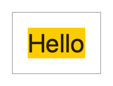

# SwiftUI
{: .no_toc }

<details class="article-toc" open markdown="block">
  <summary>이 글의 목차</summary>

1. [선언형 UI에서 상태가 화면이 되는 순서](#declarative-ui)
   1. [버튼을 누른 뒤 SwiftUI가 하는 일](#swiftui-update-cycle)
1. [View는 화면이 아니라 화면의 설명서다](#view는-화면이-아니라-화면의-설명서다)
   1. [some View와 ViewBuilder의 역할](#view-builder)
   1. [버튼, 입력 필드, 토글이 상태를 바꾸는 지점](#swiftui-controls)
1. [수정자는 뷰를 한 겹씩 감싼다](#수정자는-뷰를-한-겹씩-감싼다)
1. [레이아웃: 스택, Spacer, frame, padding](#레이아웃-스택-spacer-frame-padding)
   1. [frame이 만드는 바깥 영역과 자식의 크기](#swiftui-layout-proposals)
1. [상태와 데이터 흐름](#상태와-데이터-흐름)
   1. [@State: 뷰가 직접 가진 값](#state-뷰가-직접-가진-값)
   1. [@Binding: 남의 값을 빌려 쓰고 고치기](#binding-남의-값을-빌려-쓰고-고치기)
   1. [원본과 바인딩을 어디에 둘까](#state-ownership)
   1. [무엇 때문에 다시 계산됐는지 묻기](#무엇-때문에-다시-계산됐는지-묻기)
   1. [@Observable: 모델 객체를 관찰하기 (iOS 17)](#observable-모델-객체를-관찰하기-ios-17)
   1. [예전 방식: ObservableObject와 비교](#예전-방식-observableobject와-비교)
   1. [@StateObject와 @ObservedObject의 차이](#stateobject와-observedobject의-차이)
   1. [@Bindable과 @Environment (iOS 17)](#bindable과-environment-ios-17)
1. [뷰의 정체성과 수명](#뷰의-정체성과-수명)
   1. [.id로 정체성을 바꾸기](#id로-정체성을-바꾸기)
   1. [if/else도 정체성을 바꾼다](#ifelse도-정체성을-바꾼다)
1. [목록과 화면 이동](#목록과-화면-이동)
   1. [List와 ForEach는 "누가 누구인지"를 알아야 한다](#list와-foreach는-누가-누구인지를-알아야-한다)
   1. [NavigationStack (iOS 16)](#navigationstack-ios-16)
1. [Combine과 SwiftUI를 연결하기](#combine)
   1. [Publisher, 연산자, 구독의 역할](#combine-publisher-subscription)
   1. [@Published의 값과 objectWillChange의 차이](#combine-published)
   1. [검색 흐름에서 자주 쓰는 연산자](#combine-operators)
1. [실습: 검색어부터 화면 상태까지 연결하기](#combine-search)
   1. [SearchModel과 검색 서비스](#combine-search-model)
   1. [SwiftUI 화면에서 바인딩하기](#combine-search-view)
   1. [macOS에서 이전 요청 취소와 실패 복구 확인](#combine-search-verification)
   1. [Observation과 async/await를 쓰는 경우](#observation-async-await)
1. [UIKit과 함께 쓰기](#uikit과-함께-쓰기)
   1. [UIKit 화면 안에 SwiftUI 넣기: UIHostingController](#uikit-화면-안에-swiftui-넣기-uihostingcontroller)
   1. [SwiftUI 안에 UIKit 뷰 넣기: UIViewRepresentable](#swiftui-안에-uikit-뷰-넣기-uiviewrepresentable)
1. [미리보기: #Preview](#미리보기-preview)
1. [실행 환경과 확인 범위](#실행-환경과-확인-범위)
1. [정리](#정리)
1. [이어서 읽기](#이어서-읽기)
1. [참고](#참고)
</details>

## 선언형 UI에서 상태가 화면이 되는 순서 {#declarative-ui}

버튼을 누르면 숫자가 1씩 올라가는 화면을 UIKit으로 만든다고 해 보자. 버튼 액션에서 숫자를 올리고, 레이블의 `text`를 직접 바꾼다. 숫자를 바꾸는 일과 화면을 바꾸는 일을 **둘 다 내가** 한다.

```swift
final class CounterViewController: UIViewController {
    private var count = 0
    private let label = UILabel()

    @objc private func plusTapped() {
        count += 1
        label.text = "count: \(count)"
    }
}
```

SwiftUI에서는 이렇게 쓴다.

```swift
struct CounterView: View {
    @State private var count = 0

    var body: some View {
        VStack {
            Text("count: \(count)")
            Button("+1") { count += 1 }
        }
    }
}
```

버튼은 `count`만 바꾼다. 레이블을 고치는 코드가 없다. 대신 `body`에 "`count`가 이 값일 때 화면은 이렇게 생겼다"를 적어 둔다. 값이 바뀌면 SwiftUI가 `body`를 다시 읽고 화면을 맞춘다.

{: .tip }
UIKit은 요리사에게 "양파 썰고, 볶고, 접시에 담아"를 하나씩 시키는 방식이다(명령형). SwiftUI는 "이런 요리가 나와야 한다"는 주문서를 주는 방식이다(선언형). 재료(상태)가 바뀌면 주문서를 다시 읽고 요리를 맞추는 일은 SwiftUI가 한다.

### 버튼을 누른 뒤 SwiftUI가 하는 일 {#swiftui-update-cycle}

```text
사용자 입력 → 상태 변경 → 의존하는 body 계산 → 이전 뷰 구조와 맞추기 → 레이아웃과 표시
```

1. 버튼의 액션이 `count`를 바꾼다. 입력과 상태 변경이 앱 코드가 맡는 일이다.
2. SwiftUI가 `count`에 의존하는 뷰의 `body`를 다시 평가할 수 있게 표시한다. **의존성**은 그 뷰가 화면을 설명할 때 읽어야 하는 값이다. 상태 외에 부모가 넘긴 입력과 `@Environment`에서 읽는 값도 의존성이 된다.
3. 새 `body`가 돌려준 뷰 구조를 이전 구조와 맞춘다. 같은 이름표를 가진 뷰는 이전 상태 저장 공간을 이어 쓴다. 뷰를 맞추는 기준을 **정체성(identity)**이라고 부른다.
4. 필요한 부분의 크기와 위치를 계산하고 화면에 반영한다. `body`가 다시 계산된 횟수와 픽셀을 다시 그린 횟수는 따로 봐야 한다.

이 흐름은 코드를 읽기 위한 설명이다. SwiftUI가 내부에서 쓰는 비교 알고리즘 전체나 `body` 호출 횟수는 공개 계약에 포함되지 않는다. `body`는 언제든 다시 평가할 수 있게 화면 조립에 집중한다. 버튼을 눌러 서버에 저장하는 일은 버튼 액션에, 뷰의 수명에 맞춰 돌릴 비동기 작업은 `.task`에 둔다. [WWDC21 · Demystify SwiftUI](https://developer.apple.com/videos/play/wwdc2021/10022/)

## View는 화면이 아니라 화면의 설명서다
{: id="view는-화면이-아니라-화면의-설명서다" }

SwiftUI에서 화면 조각은 `View` 프로토콜을 따르는 타입이다. Apple 문서는 `View`를 따르는 타입을 만들고, 필수 프로퍼티인 `body`에 내용을 적으라고 설명한다.

```swift
struct Greeting: View {
    var body: some View {
        Text("안녕하세요")
    }
}
```

UIKit 개발자에게 낯선 점이 세 가지 있다.

- **앱에서 만드는 SwiftUI 뷰는 주로 struct로 작성한다.** 값 자체와 화면에 연결된 상태의 수명을 따로 본다.
- **`body`는 계산 프로퍼티다.** 저장된 화면이 아니라 "지금 상태라면 이렇게 보인다"를 매번 계산해서 돌려준다.
- **`some View`** 는 "구체적인 타입은 컴파일러가 알고, 나는 View라는 것만 밝힌다"는 뜻이다. `VStack` 안에 `Text`와 `Button`이 들어가면 실제 타입은 길고 복잡해지는데, 그걸 직접 쓰지 않게 해 준다.

{: .note }
이 글에서 `struct ...: View`로 선언한 뷰의 `body`는 메인 액터에 격리된다. **메인 액터**는 화면과 같이 메인 실행 맥락에서 접근할 상태를 안전하게 다루기 위한 Swift의 경계다. 파일 전체를 읽거나 큰 이미지를 해석하는 동기 코드를 `body`에 넣으면 그동안 화면이 입력에 응답하기 어렵다.

struct가 자주 새로 만들어진다면, 값은 어디에 남을까? 그 답이 뒤에 나올 `@State`다. 먼저 화면을 꾸미는 방법부터 보자.

### some View와 ViewBuilder의 역할 {#view-builder}

`some View`는 `View`를 따르는 구체적인 결과 타입을 호출하는 쪽에서 숨긴다. 구현 안에서는 컴파일러가 결과 타입을 알고 있다. 예를 들어 `.padding()` 전후의 타입이 달라도, 둘 다 `View`라서 반환 타입 이름을 직접 쓰지 않아도 된다.

여러 뷰를 괄호 안에 한 줄씩 작성할 수 있는 이유는 **결과 빌더(result builder)**다. SwiftUI의 `ViewBuilder`는 여러 표현식을 한 결과로 모으고, 조건문의 결과를 하나의 구조로 만든다. `VStack`의 콘텐츠 클로저와 `View.body`는 이 기능을 사용한다. 뷰를 돌려주는 별도 프로퍼티에서 `if/else`로 다른 타입의 뷰를 쓰려면 아래 `status`처럼 `@ViewBuilder`를 명시할 수 있다.

### 버튼, 입력 필드, 토글이 상태를 바꾸는 지점 {#swiftui-controls}

작은 설정 화면에서 값이 오가는 길을 확인한다. `TextField`와 `Toggle`은 현재 값을 읽고 사용자 입력을 써야 하므로 바인딩을 받는다. `Button`은 탭했을 때 실행할 액션을 받는다. 인사말과 버튼의 활성 여부는 이미 가지고 있는 값에서 계산한다.

```swift
import SwiftUI

struct DraftEditor: View {
    @State private var name = ""
    @State private var notifications = false

    private var trimmedName: String {
        name.trimmingCharacters(in: .whitespacesAndNewlines)
    }

    var body: some View {
        Form {
            TextField("이름", text: $name)
            Toggle("알림 받기", isOn: $notifications)
            status
            Button("초기화") {
                name = ""
                notifications = false
            }
            .disabled(name.isEmpty && !notifications)
        }
    }

    @ViewBuilder
    private var status: some View {
        if trimmedName.isEmpty {
            Label("이름을 입력하세요.", systemImage: "pencil")
        } else {
            Text("\(trimmedName)님, 안녕하세요.")
        }
    }
}
```

`trimmedName`이나 버튼 활성 여부를 별도 `@State`로 저장하면 입력값과 함께 두 곳을 고쳐야 한다. 계산 프로퍼티로 두면 이름을 바꿀 때 다음 `body` 평가에서 계산 결과가 따라온다. 이 설정 화면은 iOS 16 배포 대상으로 컴파일을 확인했다. 시뮬레이터에서 직접 입력해 보지는 않았다. [Apple · ViewBuilder](https://developer.apple.com/documentation/swiftui/viewbuilder)

## 수정자는 뷰를 한 겹씩 감싼다
{: id="수정자는-뷰를-한-겹씩-감싼다" }

`.padding()`, `.background()`, `.font()` 같은 메서드를 **수정자(modifier)** 라고 한다. Apple 문서는 수정자가 "원래 뷰를 감싼 새 뷰를 돌려준다"고 설명한다. 그래서 **순서가 결과를 바꾼다.**

아래 두 코드는 수정자 순서만 다르다.

```swift
// A: 여백을 먼저 넣고 배경을 칠한다
Text("Hello")
    .font(.largeTitle)
    .padding()
    .background(.yellow)

// B: 배경을 먼저 칠하고 여백을 넣는다
Text("Hello")
    .font(.largeTitle)
    .background(.yellow)
    .padding()
```

macOS에서 `ImageRenderer`로 그린 결과다. 회색 선은 뷰의 최종 크기를 보이려고 그림을 만들 때 바깥에 덧그린 것이다.

| A: `padding` → `background` | B: `background` → `padding` |
| --- | --- |
|  |  |

두 그림의 바깥 크기는 같다(228×174픽셀, 2배율). 다른 것은 노란색이 칠해진 범위다.

- A는 `Text`를 여백이 있는 뷰로 감싼 다음, **그 큰 뷰**에 배경을 칠했다.
- B는 `Text`에 바로 배경을 칠한 다음, 그 바깥에 투명한 여백을 둘렀다.

{: .tip }
수정자는 선물 포장지다. 상자(여백)에 먼저 넣고 포장지(배경)를 싸면 상자 전체가 포장된다. 포장지를 먼저 싸고 상자에 넣으면 포장지는 안쪽 물건에만 붙어 있다.

{: .warning }
`Text`가 따로 가진 수정자는 일반 수정자 뒤에 붙일 수 없다. `Text("안녕").bold()`의 결과는 `Text`다. `.padding()`을 거치면 일반적인 `View` 타입이므로 이후의 `.bold()`는 iOS 16부터 있는 `View.bold(_:)` 오버로드로 해석된다. `Text`를 그대로 돌려받아 다른 `Text`와 조합해야 할 때는 텍스트 수정자를 먼저 적용한다. [Apple · View.bold(_:)](https://developer.apple.com/documentation/swiftui/view/bold(_:))

## 레이아웃: 스택, Spacer, frame, padding
{: id="레이아웃-스택-spacer-frame-padding" }

SwiftUI 레이아웃에서는 부모가 자식에게 크기를 **제안**하고, 자식이 자기 크기를 **응답**한다. 부모는 응답을 바탕으로 자식을 **배치**한다. `HStack`은 자식에게 가로 공간을 어떻게 나눌지 결정한다. `Text`는 받은 폭에 따라 줄바꿈을 하고, `Spacer`는 배정된 남는 폭을 차지한다.

| 도구 | 하는 일 | UIKit에서 비슷한 것 |
| --- | --- | --- |
| `VStack` | 세로로 쌓는다 | 세로 `UIStackView` |
| `HStack` | 가로로 쌓는다 | 가로 `UIStackView` |
| `ZStack` | 앞뒤로 겹친다 | `addSubview`로 겹치기 |
| `Spacer()` | 남는 공간을 차지해 밀어낸다 | 늘어나는 빈 뷰 |
| `.frame(...)` | 자식에게 전달할 제안과 프레임 크기를 지정한다 | 너비·높이 제약 |
| `.padding()` | 바깥 여백을 준다 | `layoutMargins` |

메일 앱의 한 줄을 만들어 보자. 아이콘 위에 빨간 점을 겹치고(`ZStack`), 제목 두 줄을 세로로 쌓고(`VStack`), 숫자를 오른쪽 끝으로 민다(`Spacer`).

```swift
struct RowView: View {
    var body: some View {
        HStack {
            ZStack(alignment: .topTrailing) {
                Image(systemName: "envelope.fill")
                    .font(.largeTitle)
                Circle()
                    .fill(.red)
                    .frame(width: 12, height: 12)
            }
            VStack(alignment: .leading) {
                Text("받은 편지함")
                    .font(.headline)
                Text("새 메일 3통")
                    .foregroundStyle(.secondary)
            }
            Spacer()
            Text("3")
        }
        .padding()
        .frame(width: 300)
    }
}
```

macOS에서 그린 결과다.


- `ZStack(alignment: .topTrailing)`이라서 빨간 점이 아이콘의 오른쪽 위에 겹쳤다.
- `VStack(alignment: .leading)`이라서 두 줄이 왼쪽 정렬됐다.
- `Spacer()`가 남는 가로 공간을 모두 차지해서 `3`이 오른쪽 끝으로 밀렸다. `.frame(width: 300)`으로 줄 전체 너비를 정했기 때문에 밀어낼 공간이 생긴 것이다.

`Spacer()`의 넓이는 바깥에서 주는 공간에 따라 달라진다. `HStack { Text("받은 편지함"); Spacer(); Text("3") }`만 따로 떼어 `ImageRenderer`로 폭을 재 봤다.

```text
frame(width: 160) -> 160
frame(width: 320) -> 320
no frame -> 77 x 16
```

폭을 160, 320으로 주면 줄도 그만큼 넓어졌다. 폭을 정하지 않고 그리자 77포인트로 줄어, `Spacer`가 밀어낼 공간이 거의 없었다.

{: .question }
`RowView`의 `.frame(width: 300)`을 유지하면 목록에 넣어도 안쪽 프레임 폭은 300포인트다. 고정 너비를 제거하거나 유연한 프레임으로 바꾸면 부모인 목록이 제안하는 폭에 따라 `Spacer`의 크기가 달라진다.

### frame이 만드는 바깥 영역과 자식의 크기 {#swiftui-layout-proposals}

`Text("짧은 제목").frame(width: 300, alignment: .leading)`에서 바깥 프레임은 300포인트이고, 글자는 그 안에서 왼쪽에 놓인다. 같은 문장 뒤에 `.background(.yellow)`를 붙이면 프레임 영역을 칠한다. 배경을 `.frame` 앞에 붙이면 글자가 차지한 안쪽 영역을 칠한다.

레이아웃이 좁아졌을 때는 어떤 부모가 폭을 제안했는지 살핀다. `.frame(maxWidth: .infinity)`는 받은 제안 안에서 가로로 펼쳐지는 프레임을 만든다. 스크롤 방향처럼 부모가 폭이나 높이를 정하지 않는 상황에서는 별도 크기나 컨테이너가 필요할 수 있다. [Apple · Laying out a simple view](https://developer.apple.com/documentation/swiftui/laying-out-a-simple-view)

## 상태와 데이터 흐름
{: id="상태와-데이터-흐름" }

이제 핵심이다. SwiftUI에서 화면은 상태의 결과다. 상태를 어디에 두고, 누가 바꾸고, 누가 읽는지 정하는 도구가 여럿 있다.

### @State: 뷰가 직접 가진 값
{: id="state-뷰가-직접-가진-값" }

`@State`는 iOS 13부터 쓸 수 있다. Apple 문서는 `@State`를 "뷰 계층에 저장하는 값 타입의 단일 진실 공급원(single source of truth)"으로 쓰라고 하고, **`private`으로 선언하라**고 권한다.

{: .tip }
단일 진실 공급원은 "이 값의 원본은 딱 한 곳"이라는 뜻이다. 복사본이 여러 곳에 있으면 어느 것이 맞는지 헷갈린다. 원본은 하나만 두고, 나머지는 원본을 빌려 쓴다.

View는 struct라서 자주 새로 만들어진다고 했다. 그래도 `@State` 값은 사라지지 않는다. 값의 저장 공간을 **SwiftUI가 따로 관리**하기 때문이다.

`body`가 언제 다시 계산되는지 직접 찍어 보자. `body` 안에서 `let _ = print(...)`을 쓰면 계산될 때마다 출력된다.

```swift
struct CounterView: View {
    @State private var count = 0

    var body: some View {
        let _ = print("CounterView.body count=\(count)")
        VStack {
            Text("count: \(count)")
            StaticLabel()
            PlusTen(count: $count)
        }
        .task {
            count += 1
        }
    }
}

struct StaticLabel: View {
    var body: some View {
        let _ = print("StaticLabel.body")
        Text("고정 문구")
    }
}

struct PlusTen: View {
    @Binding var count: Int

    var body: some View {
        let _ = print("PlusTen.body count=\(count)")
        Button("+10") { count += 10 }
            .task {
                try? await Task.sleep(
                    for: .milliseconds(100))
                count += 10
            }
    }
}
```

실험에서는 화면이 뜨면 실행되는 `.task`(iOS 15부터)에서 값을 바꿨다. `CounterView`가 뜨면 1을 더하고, 0.1초 뒤 `PlusTen`이 10을 더한다.

```text
CounterView.body count=0
StaticLabel.body
PlusTen.body count=0
CounterView.body count=1
PlusTen.body count=1
CounterView.body count=11
PlusTen.body count=11
```

출력에서 세 가지를 읽을 수 있다.

1. `count`가 바뀔 때마다 `CounterView.body`가 다시 계산됐다.
2. `count`를 받는 `PlusTen`도 다시 계산됐다.
3. `StaticLabel.body`는 처음 한 번만 찍혔다. 받는 값이 없으니 다시 계산할 이유가 없었다.

이 실행에서 변경된 상태에 의존하는 두 뷰의 `body`가 다시 평가됐다. 같은 뷰라도 부모의 입력, 환경, 정체성이 달라지면 다른 이유로 다시 평가될 수 있다. 출력은 의존성을 설명하는 실험 결과다.

### @Binding: 남의 값을 빌려 쓰고 고치기
{: id="binding-남의-값을-빌려-쓰고-고치기" }

`PlusTen`은 `count`를 직접 갖지 않는다. `@Binding`으로 **`CounterView`의 `count`를 빌려** 왔다. 부모가 `$count`처럼 `$`를 붙여 넘기면 바인딩이 된다.

위 출력의 마지막 두 줄을 보자. 자식인 `PlusTen`이 `count += 10`을 했는데, 부모 `CounterView`의 값이 `11`이 됐다. 자식이 고친 것이 원본에 반영됐다.

{: .note }
Apple 문서 기준 정리다. 자식이 값을 **읽기만** 하면 그냥 값으로 넘긴다. 자식이 값을 **고쳐야** 하면 `$`를 붙여 바인딩으로 넘긴다.

UIKit에서 delegate나 클로저로 "값 바뀌었어요"를 부모에게 알리던 일을 바인딩 한 줄이 대신한다. 클로저로 직접 바인딩을 만드는 방식은 [클로저 기반 데이터 바인딩과 Box]({{ '/swift/data-binding/' | relative_url }})에서 다뤘다.

### 원본과 바인딩을 어디에 둘까 {#state-ownership}

화면마다 값을 고칠 책임이 있는 곳을 먼저 정한다. 예를 들어 결제 화면의 주소 원본이 뷰모델에 있다면 팝업의 입력 필드에는 원본에 쓰는 바인딩을 주거나, 확인을 누를 때만 원본에 반영하는 **임시 초안**을 만든다. 임시 초안의 저장 시점까지 정해 두면 화면이 두 개여도 담당이 분명하다.

| 필요한 일 | 값 또는 모델의 원본 | 받는 쪽 |
| --- | --- | --- |
| 화면의 토글이나 텍스트 입력을 소유 | 해당 뷰의 `@State private` | 읽기만 하면 값, 수정하면 `@Binding` |
| 기존 Combine 모델을 소유 | 생성하는 뷰의 `@StateObject` | 인자로 받은 `@ObservedObject` |
| 같은 Combine 모델을 여러 단계에 전달 | 상위에서 `.environmentObject(model)` | `@EnvironmentObject` |
| Observation 모델을 소유 | 생성하는 뷰의 `@State private` | 읽기만 하면 평범한 프로퍼티, 모델 속성의 바인딩을 만들면 `@Bindable` |
| 같은 Observation 모델을 여러 단계에 전달 | 상위에서 `.environment(model)` | `@Environment(Model.self)` |
| 시스템 색상 모드처럼 환경 값을 읽기 | 부모나 시스템이 공급한 환경 값 | `@Environment(\.colorScheme)` |

`@Binding`은 저장 공간을 그대로 유지하면서 읽기와 쓰기를 전달하는 통로다. `@State`의 `$name`과 `@Bindable`의 `$profile.name`을 `TextField`에 전달하는 이유다. `$`의 결과 타입은 프로퍼티 래퍼가 정한다. 뒤에서 `@Published`의 `$query`가 Publisher인 경우를 확인한다.

### 무엇 때문에 다시 계산됐는지 묻기
{: id="무엇-때문에-다시-계산됐는지-묻기" }

`Self._printChanges()`를 `body`에 넣으면 SwiftUI가 다시 계산한 이유를 출력한다. 이름이 밑줄로 시작하는 디버깅용 메서드라서, 확인할 때만 넣고 지운다. iOS 15부터 쓸 수 있다.

```swift
struct ChangesView: View {
    @State private var count = 0

    var body: some View {
        let _ = Self._printChanges()
        Text("\(count)")
            .task { count += 1 }
    }
}
```

```text
ChangesView: @self, @identity, _count changed.
ChangesView: _count changed.
```

첫 줄은 처음 나타났을 때다. 두 번째 줄은 `count`(내부 이름 `_count`)가 바뀌어서 다시 계산했다는 뜻이다.

### @Observable: 모델 객체를 관찰하기 (iOS 17)
{: id="observable-모델-객체를-관찰하기-ios-17" }

화면 하나에 담기 어려운 데이터는 클래스 모델로 뺀다. iOS 17, macOS 14부터는 `@Observable` 매크로를 붙이면 된다. 프로퍼티에 따로 표시할 것이 없다.

```swift
import Observation

@Observable
final class Profile {
    var name = "Kim"
    var score = 0
}

struct NameView: View {
    let profile: Profile
    var body: some View {
        let _ = print("NameView.body")
        Text(profile.name)
    }
}

struct ScoreView: View {
    let profile: Profile
    var body: some View {
        let _ = print("ScoreView.body")
        Text("\(profile.score)")
    }
}

struct ProfileScreen: View {
    let profile: Profile
    var body: some View {
        let _ = print("ProfileScreen.body")
        VStack {
            NameView(profile: profile)
            ScoreView(profile: profile)
        }
    }
}
```

`NameView`는 `name`만, `ScoreView`는 `score`만 읽는다. 화면을 띄운 다음 바깥에서 `score`와 `name`을 차례로 바꿨다.

```text
ProfileScreen.body
NameView.body
ScoreView.body
--- score += 1
ScoreView.body
--- name = Lee
NameView.body
```

`score`를 바꾸면 `ScoreView`만, `name`을 바꾸면 `NameView`만 다시 계산됐다. `ProfileScreen`은 `profile`의 프로퍼티를 읽지 않으니 한 번도 다시 계산되지 않았다.

Observation은 `body`를 평가하는 동안 모델에서 실제 읽은 프로퍼티를 추적한다. 그 프로퍼티를 쓰면 해당 뷰의 의존성이 바뀐다. 계산 프로퍼티가 모델의 다른 값을 읽으면 그 안에서 읽은 값도 추적 대상이 된다. 관찰할 필요가 없는 프로퍼티는 `@ObservationIgnored`로 표시할 수 있다. SwiftUI의 다른 입력이나 환경 변화는 여전히 별도로 뷰 갱신을 일으킬 수 있다. [Apple · Managing model data in your app](https://developer.apple.com/documentation/swiftui/managing-model-data-in-your-app)

{: .tip }
`@Observable`은 뷰마다 "네가 읽은 칸"을 메모해 두는 사서다. `score` 칸이 바뀌면 `score`를 읽어 간 사람에게만 연락한다.

### 예전 방식: ObservableObject와 비교
{: id="예전-방식-observableobject와-비교" }

SwiftUI의 Observation 통합이 들어온 iOS 17보다 낮은 버전을 지원하거나 기존 Combine 모델을 유지할 때는 `ObservableObject`와 `@Published`를 사용할 수 있다. 같은 실험을 해 보자.

```swift
final class OldProfile: ObservableObject {
    @Published var name = "Kim"
    @Published var score = 0
}

struct OldNameView: View {
    @ObservedObject var profile: OldProfile
    var body: some View {
        let _ = print("OldNameView.body")
        Text(profile.name)
    }
}
// OldScoreView는 score를 읽는다 (구조는 같다)
```

```text
OldNameView.body
OldScoreView.body
--- score += 1
OldNameView.body
OldScoreView.body
```

`score`만 바꿨는데 `name`만 읽는 `OldNameView`도 다시 계산됐다. 이 방식에서 SwiftUI는 프로퍼티마다 추적하는 대신 객체가 내는 `objectWillChange` 알림을 관찰한다. 같은 객체를 관찰하는 뷰들은 모두 이 알림을 받는다.

두 방식의 도구는 이렇게 짝지어진다. Apple의 마이그레이션 문서 기준이다.

| 하는 일 | 예전 (`ObservableObject`) | 지금 (`@Observable`, iOS 17) |
| --- | --- | --- |
| 모델 표시 | `ObservableObject` 채택 + `@Published` | `@Observable` 매크로 하나 |
| 뷰가 모델을 소유 | `@StateObject` (iOS 14) | `@State` |
| 받은 모델을 관찰 | `@ObservedObject` | 표시 없이 그냥 프로퍼티 |
| 받은 모델의 바인딩 | `@ObservedObject` + `$` | `@Bindable` |
| 환경으로 전달 | `.environmentObject(_:)` | `.environment(_:)` |
| 환경에서 읽기 | `@EnvironmentObject` | `@Environment(타입.self)` |

{: .note }
Apple 문서는 한 번에 다 바꿀 필요가 없다고 설명한다. 모델 타입 하나씩 `@Observable`로 옮겨도 되고, 두 방식이 한 앱에 섞여 있어도 된다.

### @StateObject와 @ObservedObject의 차이
{: id="stateobject와-observedobject의-차이" }

예전 방식에서 자주 헷갈리는 부분이 있다. 둘 다 객체를 관찰하지만, **누가 객체를 소유하느냐**가 다르다. SwiftUI는 같은 정체성이 유지되는 동안 `@StateObject`의 객체를 보존한다. 뷰 초기화 인자가 바뀌어도 기존 객체가 자동으로 교체되지는 않는다. [Apple · StateObject](https://developer.apple.com/documentation/swiftui/stateobject)

```swift
@MainActor
final class Ticket: ObservableObject {
    let no: Int
    // 만들 때마다 1, 2, 3... 번호를 받는다
    init() { no = nextSerial() }
}

struct OwnerView: View {
    @StateObject private var ticket = Ticket()
    // body에서 ticket.no를 출력
}

struct BorrowView: View {
    @ObservedObject var ticket = Ticket()
    // body에서 ticket.no를 출력
}
```

두 뷰를 담은 부모 화면을 다시 계산하게 만들었다.

```text
TicketScreen other=0
  nextSerial() -> 1
  nextSerial() -> 2
OwnerView ticket=2
BorrowView ticket=1
--- other += 1
TicketScreen other=1
  nextSerial() -> 3
BorrowView ticket=3
```

부모가 다시 계산되자 `BorrowView`는 새 `Ticket`(3번)을 받았다. 이전 객체에 담겨 있던 값은 사라진다. `OwnerView`는 새로 만들지 않았다.

{: .warning }
`@ObservedObject`는 "남이 만든 객체를 빌려 본다"는 표시다. 그 자리에서 `= Ticket()`처럼 직접 만들면 부모가 다시 계산될 때마다 새 객체가 생긴다. 뷰가 직접 만드는 객체는 `@StateObject`(iOS 17 이상에서 `@Observable`이면 `@State`)에 둔다.

### @Bindable과 @Environment (iOS 17)
{: id="bindable과-environment-ios-17" }

`@Observable` 모델의 프로퍼티를 `TextField`처럼 바인딩이 필요한 곳에 넘기려면 `@Bindable`을 붙인다. 그러면 `$profile.name` 같은 바인딩을 만들 수 있다.

```swift
struct NameEditor: View {
    @Bindable var profile: Profile
    var body: some View {
        TextField("이름", text: $profile.name)
    }
}
```

여러 단계 아래 뷰까지 같은 모델을 넘겨야 하면, 중간 뷰마다 인자로 넘기는 대신 **환경(environment)** 에 넣는다.

```swift
struct ScoreBadge: View {
    @Environment(Profile.self) private var profile
    var body: some View {
        let _ = print(
            "ScoreBadge.body score=\(profile.score)")
        Text("\(profile.score)점")
    }
}

// 위쪽 어딘가에서
ScoreBadge()
    .environment(profile)
```

환경에 `Profile`이 공급되지 않았는데 `@Environment(Profile.self)`를 필수 타입으로 읽으면 실행 중 오류가 난다. 필요한 값을 앱이 제공하는 위치와 미리보기에서 주입하는 위치를 함께 확인한다. 아래 실행에서는 올바로 주입한 모델의 `score`를 5 올렸다.

```text
ScoreBadge.body score=0
--- score += 5
ScoreBadge.body score=5
```

{: .tip }
환경은 건물의 방송 시스템이다. 1층에서 한 번 틀면 위층 어느 방에서든 들을 수 있다. 중간 층마다 쪽지를 전달할 필요가 없다.

`@Bindable`, `@Environment(타입.self)`, `@Observable`은 모두 iOS 17이 필요하다. 배포 대상을 iOS 13으로 두고 컴파일하자 컴파일러가 이렇게 알려 줬다(Xcode 16.2, iOS 18.2 SDK).

```text
error: 'Observable()' is only available in iOS 17.0 or newer
error: 'Bindable' is only available in iOS 17.0 or newer
error: 'StateObject' is only available in iOS 14.0 or newer
error: 'task(priority:_:)' is only available in iOS 15.0 or newer
```

(같은 파일의 `@State`, `ObservableObject`, `#Preview`는 iOS 13에서 오류가 나지 않았다.)

## 뷰의 정체성과 수명
{: id="뷰의-정체성과-수명" }

앞에서 "View struct는 자주 새로 만들어지지만 `@State`는 남는다"고 했다. 그럼 `@State`는 **언제** 사라질까? 답은 뷰의 **정체성(identity)** 이 바뀔 때다.

{: .tip }
정체성은 SwiftUI가 붙이는 이름표다. struct 값이 새로 만들어져도 이름표가 같으면 "같은 뷰"로 보고 상태를 이어 준다. 이름표가 바뀌면 "다른 뷰"로 보고 상태를 새로 만든다.

실험용으로 `@State`의 초깃값을 만들 때마다 번호를 하나씩 올리는 함수 `nextSerial()`을 만들었다.

```swift
struct Child: View {
    @State private var serial = nextSerial()
    var body: some View {
        let _ = print("Child.body serial=\(serial)")
        Text("serial \(serial)")
    }
}
```

### .id로 정체성을 바꾸기
{: id="id로-정체성을-바꾸기" }

`.id(_:)` 수정자는 정체성을 직접 정한다. Apple 문서는 "`id` 값이 바뀌면 뷰의 정체성, 예를 들어 상태가 초기화된다"고 설명한다.

```swift
struct IdScreen: View {
    // Root: version, other를 가진 @Observable 모델
    let root: Root
    var body: some View {
        let _ = print("IdScreen.body other=\(root.other)")
        Child()
            .id(root.version)
    }
}
```

`other`(관계없는 값)를 바꾼 다음, `version`(`.id`에 쓴 값)을 바꿨다.

```text
IdScreen.body other=0
  nextSerial() -> 1
Child.body serial=1
--- other += 1
IdScreen.body other=1
  nextSerial() -> 2
Child.body serial=1
--- version += 1
IdScreen.body other=1
  nextSerial() -> 3
Child.body serial=3
```

- `other`를 바꾸자 부모가 다시 계산되며 `Child()`도 새로 만들어졌다(`nextSerial() -> 2`). 그런데 화면의 `serial`은 **여전히 1**이다. 정체성이 같으니 SwiftUI가 기존 상태를 이어 주고, 새로 만든 2는 버렸다.
- `version`을 바꾸자 `serial`이 **3**이 됐다. 정체성이 바뀌어 상태가 새로 만들어졌다.

{: .note }
목록 화면에서 "필터를 바꾸면 스크롤 위치와 입력 상태를 처음부터 시작"하고 싶을 때 `.id`를 쓴다. 반대로 상태가 이유 없이 초기화된다면, 어딘가에서 정체성이 바뀌고 있는지 의심해 본다.

### if/else도 정체성을 바꾼다
{: id="ifelse도-정체성을-바꾼다" }

`.id`를 쓰지 않아도 정체성이 바뀌는 경우가 있다. SwiftUI는 **코드 구조 속 위치**도 이름표로 쓴다. 이것을 구조적 정체성(structural identity)이라고 한다. `if`의 참 쪽과 거짓 쪽은 서로 다른 자리다.

```swift
// 방법 1: 분기로 나누기
if root.flag {
    Child().padding()
} else {
    Child()
}

// 방법 2: 수정자 값만 바꾸기
Child()
    .padding(root.flag ? 20 : 0)
```

두 방법 모두 `flag`를 `false`에서 `true`로 바꿨다.

```text
[방법 1: if/else]
  nextSerial() -> 1
Child.body serial=1
--- flag = true
  nextSerial() -> 2
Child.body serial=2

[방법 2: 수정자 값]
  nextSerial() -> 1
Child.body serial=1
--- flag = true
  nextSerial() -> 2
Child.body serial=1
```

보기에는 둘 다 "여백이 생긴다"로 같다. 하지만 방법 1은 상태가 초기화됐고(`serial=2`), 방법 2는 유지됐다(`serial=1`).

{: .question }
토글 스위치를 켤 때마다 화면 안의 입력값이 지워지는 버그가 있다. 위 두 방법 중 어느 쪽으로 코드가 짜여 있을 가능성이 높을까?

{: .warning }
위 출력에서 `nextSerial()`이 뷰를 만들 때마다 불린 것은 Xcode 16.2의 `@State` 프로퍼티 래퍼 동작이다. Apple 문서도 `State`가 뷰를 만들 때마다 기본값을 만든다고 설명하며, 무거운 객체를 기본값으로 만들지 말라고 한다. 한편 2026년 11월 27일 확인한 Apple 문서는 **Xcode 27 이상으로 빌드하면 `@State`가 `State()` 매크로로 바뀌고, 기본값을 처음 한 번만 만든다**고 적고 있다. 이 동작은 직접 실행해 보지 않았다.

## 목록과 화면 이동
{: id="목록과-화면-이동" }

### List와 ForEach는 "누가 누구인지"를 알아야 한다
{: id="list와-foreach는-누가-누구인지를-알아야-한다" }

`List`나 `ForEach`에 배열을 주면 항목마다 뷰를 만든다. Apple 문서는 이때 요소가 `Identifiable`을 따르거나, `id:` 인자로 구분할 값을 알려 줘야 한다고 설명한다. `Identifiable`은 `id` 프로퍼티 하나만 있으면 되는 프로토콜이다.

```swift
struct Mail: Identifiable, Hashable {
    let id: Int
    var title: String
}
```

`id`가 필요한 이유는 배열이 바뀔 때 SwiftUI가 "3번 메일이 삭제됐다", "1번 메일은 그대로다"를 구분하기 위해서다. `UITableView`의 diffable data source에 식별자를 주던 것과 비슷한 역할이다.

### NavigationStack (iOS 16)
{: id="navigationstack-ios-16" }

화면 이동은 `NavigationStack`(iOS 16)으로 한다. `UINavigationController`처럼 화면을 쌓는다.

```swift
struct MailListView: View {
    let mails = [
        Mail(id: 1, title: "회의 일정"),
        Mail(id: 2, title: "청구서"),
    ]

    var body: some View {
        NavigationStack {
            List(mails) { mail in
                NavigationLink(mail.title, value: mail)
            }
            .navigationDestination(for: Mail.self) { mail in
                Text(mail.title)
            }
            .navigationTitle("메일")
        }
    }
}
```

`NavigationLink`는 "어디로 갈지(뷰)"가 아니라 **"무슨 값을 보여 줄지(`mail`)"** 만 넘긴다. 그 값을 받아 어떤 화면을 띄울지는 `.navigationDestination(for:)`이 정한다. Apple 문서의 설명대로, 링크를 누르면 상세 화면이 스택 위에 올라가고 뒤로 가면 빠진다.

{: .warning }
이 코드는 iOS 16 배포 대상으로 컴파일만 확인했고 실제로 화면을 눌러 보지는 않았다. iOS 15 대상으로 컴파일하면 `'NavigationStack' is only available in iOS 16.0 or newer` 오류가 난다. iOS 15 이하는 예전 `NavigationView`를 써야 한다.

## Combine과 SwiftUI를 연결하기 {#combine}

SwiftUI는 `body`로 화면을 설명하고, **Combine**은 시간에 따라 들어오는 값을 처리한다. 검색어, 위치 업데이트, 네트워크 응답을 하나씩 받아 걸러내거나 합칠 때 Combine을 쓸 수 있다. `ObservableObject`에서 SwiftUI가 사용하는 변경 알림도 Combine Publisher다. Combine으로 검색 입력과 응답을 처리하고 SwiftUI로 결과를 화면에 표시하는 식으로 두 역할을 나눌 수 있다.

### Publisher, 연산자, 구독의 역할 {#combine-publisher-subscription}

| 이름 | 맡는 일 | 검색에서 하는 일 |
| --- | --- | --- |
| `Publisher` | `Output` 값을 보내고 종료 시 완료나 `Failure`를 전달한다 | 새 검색어 또는 서버 응답을 보낸다 |
| 연산자(operator) | Publisher를 받아 다른 Publisher로 변환한다 | 공백을 빼거나 검색 요청으로 바꾼다 |
| `Subscriber` | 구독을 통해 값을 받는다 | 결과를 모델 상태에 쓴다 |
| `AnyCancellable` | `sink` 등이 반환하는 구독 취소 핸들 | 모델의 수명 동안 구독을 보관한다 |

`Failure`가 `Never`인 Publisher는 실패로 끝나지 않는다. `sink`는 결과를 클로저에서 받는 방법이다. 실패할 수 있는 Publisher를 구독할 때는 종료를 받는 `receiveCompletion`에서도 정상 완료와 오류를 구분할 수 있다. 구독 핸들을 보관하지 않고 마지막 참조가 해제되면 `AnyCancellable`이 취소를 호출한다. 소스가 실제 작업까지 취소하는지는 해당 Publisher의 구현에 달려 있다. [Apple · Combine](https://developer.apple.com/documentation/combine)

### @Published의 값과 objectWillChange의 차이 {#combine-published}

`ObservableObject`의 `objectWillChange`는 객체가 곧 바뀐다는 알림이다. `@Published var query`의 `$query`는 해당 속성의 값을 전달한다. 아래 명령줄 예제에서는 같은 변경을 두 경로로 관찰한다. 공백만 다른 입력은 `map`으로 정리한 뒤 `removeDuplicates()`로 걸러 낸다.

```swift
import Combine
import Foundation

final class Draft: ObservableObject {
    @Published var query = ""
}

let draft = Draft()
var cancellables = Set<AnyCancellable>()

draft.objectWillChange
    .sink { print("objectWillChange: \(draft.query.debugDescription)") }
    .store(in: &cancellables)

let values = draft.$query
    .map { $0.trimmingCharacters(in: .whitespacesAndNewlines) }
    .removeDuplicates()
    .sink { value in
        print("구독 값: \(value.debugDescription), 저장값: \(draft.query.debugDescription)")
    }

draft.query = "s"
draft.query = "s "
cancellables.removeAll()
values.cancel()
draft.query = "swift"
print("취소 뒤 저장값: \(draft.query.debugDescription)")
```

`swift PublishedProbe.swift`를 macOS에서 실행했다.

```text
구독 값: "", 저장값: ""
objectWillChange: ""
구독 값: "s", 저장값: ""
objectWillChange: "s"
취소 뒤 저장값: "swift"
```

1. `$query`를 구독하자 초기 값 `""`이 즉시 왔다.
2. `"s"`를 대입하자 `sink`의 인자는 새 값 `"s"`, 그 순간 다시 읽은 `draft.query`는 기존 값 `""`였다. `@Published`는 속성의 새 값을 **쓰기 직전**에 발행한다.
3. `"s "`도 객체 변경 알림을 냈다. 값 구독 쪽에서는 공백 제거 결과가 직전과 같은 `"s"`라 값이 걸러졌다.
4. 두 구독을 취소한 후에는 `query`를 바꿔도 구독 로그는 더 나오지 않았다.

필터링이나 요청에는 `sink`에 전달된 인자를 사용한다. 그 자리에서 모델 값을 다시 읽으면 이전 값일 수 있다. `@Published`에는 값 전달이, `objectWillChange`에는 관찰 중인 객체를 다시 볼 시점이 담긴다. [Apple · Published](https://developer.apple.com/documentation/combine/published) · [Apple · ObservableObject](https://developer.apple.com/documentation/combine/observableobject)

### 검색 흐름에서 자주 쓰는 연산자 {#combine-operators}

| 연산자 | 언제 쓰나 |
| --- | --- |
| `map` | 문자열을 정리하거나 응답을 화면 상태로 바꿀 때 |
| `removeDuplicates` | 바로 앞 입력과 같은 값을 한 번 더 처리할 필요가 없을 때 |
| `debounce` | 타이핑이 설정한 시간 동안 멈춘 뒤 마지막 입력만 전달할 때 |
| `combineLatest` | 검색어와 필터처럼 두 입력의 최신 값을 짝으로 처리할 때 |
| `switchToLatest` | 바깥 Publisher가 새 내부 Publisher를 보내면 이전 내부 구독을 취소하고 최신 것만 받을 때 |
| `catch` | 실패한 요청을 대체 Publisher로 바꿀 때 |
| `receive(on:)` | 지정한 실행 큐로 다음 단계의 이벤트 전달을 옮길 때 |

`subscribe(on:)`은 원본 구독과 요청, 취소를 수행할 실행 맥락에 영향을 준다. 뒤쪽 클로저가 값을 어디서 받게 할지는 `receive(on:)`이 맡는다. `@MainActor`는 컴파일러가 상태 접근을 검사하는 경계다. Combine 스케줄러는 이벤트가 실제로 전달되는 위치를 정한다. Swift 6에서는 모델에 격리된 클로저를 백그라운드에서 호출하지 않도록, 그런 클로저 **앞**에 큐 전환을 둔다. [WWDC19 · Combine in Practice](https://developer.apple.com/videos/play/wwdc2019/721/)

## 실습: 검색어부터 화면 상태까지 연결하기 {#combine-search}

검색창을 만들고 `sw`로 보낸 느린 요청을 `ui`로 바꿔 보자. 결과를 기다리는 동안에는 로딩을 보여 준다. 실패하면 오류 문구를 표시하고, 다음 검색어가 들어오면 다시 검색한다.

```text
TextField → Binding<String> → SearchModel.query
    → $query → 문자열 정리 → 이전 대기·요청 취소 → 새 요청
    → SearchModel.state → body → 목록, 로딩 또는 오류 문구
```

### SearchModel과 검색 서비스 {#combine-search-model}

`query`는 화면이나 사용자가 쓰는 입력이다. `state`는 모델만 쓰는 출력이다. 로딩·결과·실패를 따로 Bool과 배열에 담으면 서로 어긋날 수 있으므로, 한 번에 한 경우만 표현하는 `enum`으로 둔다. 바깥에서 검색 함수를 받으면 실제 API 없이 같은 규칙을 확인할 수 있다.

```swift
import Combine
import Foundation

enum SearchState: Equatable {
    case idle
    case loading
    case results([String])
    case failed(String)
}

@MainActor
final class SearchModel: ObservableObject {
    @Published var query = ""
    @Published private(set) var state = SearchState.idle

    typealias Search = (String) -> AnyPublisher<[String], Error>
    private var subscription: AnyCancellable?

    init(search: @escaping Search) {
        subscription = $query
            .map { $0.trimmingCharacters(in: .whitespacesAndNewlines) }
            .removeDuplicates()
            .map { text -> AnyPublisher<SearchState, Never> in
                guard !text.isEmpty else {
                    return Just(SearchState.idle)
                        .eraseToAnyPublisher()
                }

                return Just(text)
                    .delay(for: .milliseconds(300), scheduler: DispatchQueue.main)
                    .flatMap { term in
                        search(term)
                            .receive(on: DispatchQueue.main)
                            .map(SearchState.results)
                            .catch { _ in Just(.failed("검색에 실패했습니다.")) }
                    }
                    .prepend(.loading)
                    .eraseToAnyPublisher()
            }
            .switchToLatest()
            .sink { [weak self] state in
                self?.state = state
            }
    }
}
```

이 검색에서는 새 검색어가 들어오는 즉시 이전 구독을 끊는다. 입력을 먼저 `debounce`하고 나서 `switchToLatest`에 전달하면, 300ms 대기 중에는 이전 요청이 살아 있어 오래된 응답이 화면에 올 수 있다. 여기서는 **검색어마다 대기와 요청을 하나의 내부 Publisher로 묶고**, 새 검색어를 받는 즉시 `switchToLatest`로 바꾼다. 이는 이전 대기까지 취소해서 결과적으로 300ms 동안 잠잠해진 검색어만 서버에 보낸다.

`catch`는 한 검색의 내부에 있다. 오류를 화면 상태 `.failed`로 바꾼 뒤에도 바깥 `$query` 구독은 다음 입력을 받을 수 있다. 같은 검색어로 다시 시도하는 버튼을 추가하려면 별도 재시도 입력을 연결한다. 현재 코드는 정리한 검색어가 같으면 요청을 건너뛴다.

`AnyPublisher`는 내부 연산자 타입을 숨기되 보내는 값과 오류 타입을 유지한다. 모델에서 반환하는 내부 Publisher는 실패를 화면 상태로 바꿨으므로 `Failure == Never`다. 구독은 모델이 보관한다. `sink`가 모델을 강하게 잡으면 `모델 → 구독 → 클로저 → 모델`로 참조가 이어지므로 `[weak self]`를 사용한다.

다음 가짜 서비스는 `sw`에 700ms, 나머지에 100ms 뒤에 응답한다. `error`를 입력하면 오류를 보낸다. 응답 준비는 백그라운드에서 실행한다. 시작과 취소를 기록해서 화면 출력이 바뀌지 않는 이유를 확인한다.

```swift
import Combine
import Foundation

enum DemoSearch {
    enum Failure: Error { case offline }

    static func search(_ term: String) -> AnyPublisher<[String], Error> {
        let catalog = ["Swift", "SwiftUI", "Combine"]
        let delay = term == "sw" ? 700 : 100

        return Just(term)
            .delay(for: .milliseconds(delay), scheduler: DispatchQueue.global())
            .tryMap { text in
                if text == "error" { throw Failure.offline }
                return catalog.filter { $0.localizedCaseInsensitiveContains(text) }
            }
            .handleEvents(
                receiveSubscription: { _ in print("요청 시작: \(term)") },
                receiveCancel: { print("요청 취소: \(term)") }
            )
            .eraseToAnyPublisher()
    }
}
```

백그라운드 응답은 모델의 `map`과 `catch` 앞에서 메인 큐로 받는다. 빈 입력과 로딩은 메인 액터에 있는 `query`가 바뀔 때 보낸다. 검색 응답도 메인 큐로 옮긴 뒤 모으므로, `switchToLatest` 뒤의 `sink`에서 바로 화면 상태를 쓸 수 있다.

### SwiftUI 화면에서 바인딩하기 {#combine-search-view}

새 SwiftUI 앱에 위의 `SearchModel.swift`와 `DemoSearch.swift`를 추가한다. 기본 앱 진입점 파일을 아래 코드로 교체한다. `@main`은 앱에 하나만 둔다.

```swift
import SwiftUI

@MainActor
struct SearchView: View {
    @StateObject private var model: SearchModel

    init(search: @escaping SearchModel.Search) {
        _model = StateObject(wrappedValue: SearchModel(search: search))
    }

    var body: some View {
        NavigationStack {
            VStack {
                TextField("검색어", text: $model.query)
                    .textFieldStyle(.roundedBorder)
                    .padding()

                switch model.state {
                case .idle:
                    Text("검색어를 입력하세요.")
                case .loading:
                    ProgressView("검색 중")
                case .results(let names):
                    if names.isEmpty {
                        Text("검색 결과가 없습니다.")
                    } else {
                        List(names, id: \.self) { Text($0) }
                    }
                case .failed(let message):
                    Text(message)
                        .foregroundStyle(.red)
                }
                Spacer(minLength: 0)
            }
            .navigationTitle("프레임워크 검색")
        }
    }
}

@main
struct SearchDemoApp: App {
    var body: some Scene {
        WindowGroup {
            SearchView(search: DemoSearch.search)
        }
    }
}
```

`TextField`의 `$model.query`는 SwiftUI가 만드는 `Binding<String>`이다. 반면 모델 내부 `$query`는 Combine의 `Published<String>.Publisher`다. 앞의 경로는 원본 값을 읽고 쓰며, 뒤의 경로는 입력이 변할 때 검색 흐름으로 값을 보낸다. 목록 예제의 문자열은 서로 달라 `id: \.self`를 썼다. 이름이 겹칠 수 있는 실제 데이터에서는 목록 항목의 고유 ID를 사용한다.

Swift 6 모드, iOS 18.2 시뮬레이터 SDK, iOS 16 배포 대상으로 앱 코드의 타입 검사를 통과했다. 시뮬레이터 화면에서 입력을 직접 재생하지는 않았다.

### macOS에서 이전 요청 취소와 실패 복구 확인 {#combine-search-verification}

화면에 바인딩하는 대신 같은 모델의 `$state`를 직접 구독했다. 아래 `main.swift`와 두 모델 파일을 한 폴더에 넣고 실행한다. `wait`는 명령줄 실험에서만 쓰며, 메인 큐에 예약된 이벤트가 도착할 시간을 준다.

```swift
import Combine
import Foundation

func wait(_ seconds: TimeInterval) {
    RunLoop.main.run(until: Date().addingTimeInterval(seconds))
}

@MainActor
func probe() {
    let model = SearchModel(search: DemoSearch.search)
    var received: [SearchState] = []
    let log = model.$state.sink { state in
        precondition(Thread.isMainThread)
        if received.last != state { print("화면 상태: \(state)") }
        received.append(state)
    }

    model.query = "s"
    wait(0.10)
    model.query = "sw"
    wait(0.40)
    model.query = "ui"
    wait(0.50)
    model.query = " ui "
    wait(0.40)
    model.query = "error"
    wait(0.50)
    model.query = "combine"
    wait(0.50)
    model.query = ""
    wait(0.10)

    let finalStates = received.filter { $0 != .loading }
    precondition(finalStates == [
        .idle, .results(["SwiftUI"]),
        .failed("검색에 실패했습니다."),
        .results(["Combine"]), .idle,
    ])
    withExtendedLifetime(log) {}
}

MainActor.assumeIsolated { probe() }
```

```bash
swiftc -swift-version 6 SearchModel.swift DemoSearch.swift main.swift -o search-probe
./search-probe
```

```text
화면 상태: idle
화면 상태: loading
요청 시작: sw
요청 취소: sw
요청 시작: ui
화면 상태: results(["SwiftUI"])
화면 상태: loading
요청 시작: error
화면 상태: failed("검색에 실패했습니다.")
화면 상태: loading
요청 시작: combine
화면 상태: results(["Combine"])
화면 상태: idle
```

`s`의 대기 구독은 요청이 시작되기 전에 끊겼다. 이미 시작한 `sw`는 `ui`가 들어오자 취소됐다. 결과에 SwiftUI만 들어왔고 공백을 더한 `" ui "`도 새 요청을 만들지 않았다. `error` 이후에 `combine` 결과가 다시 왔다. 코드는 모든 상태 이벤트가 메인 스레드에서 왔는지와 예상한 최종 상태 순서를 검사한다.

### Observation과 async/await를 쓰는 경우 {#observation-async-await}

상태 관찰과 비동기 작업은 다른 역할이다. `@Observable`은 화면이 어떤 모델 속성을 읽었는지 추적한다. 자체적으로 `$query` 같은 Combine Publisher가 생기지는 않는다. `async/await`는 함수가 하나의 비동기 결과를 반환할 때 그 호출을 읽기 쉽게 정리한다. iOS 17 이상을 기본으로 하고 검색 API가 `async throws`를 반환한다면 이 둘을 함께 쓸 수 있다.

| 상황 | 나눠 맡길 역할 |
| --- | --- |
| 새 화면에서 읽은 모델 속성에 따라 화면을 갱신 | `@Observable`로 모델 관찰 |
| 검색어마다 잠시 기다렸다가 비동기 API 한 번 호출 | `.task(id:)`, `Task.sleep`, `async/await` |
| 이미 Publisher를 받거나 여러 입력 스트림을 합침 | Combine으로 값의 흐름을 처리 |
| iOS 16 이하 지원 또는 기존 Combine 모델을 화면에 연결 | `ObservableObject`와 `@StateObject` 또는 `@ObservedObject` |

`.task(id: 정리한검색어)`에 작업을 달면 ID가 바뀌거나 화면이 사라질 때 SwiftUI가 이전 작업의 취소를 요청한다. 취소는 협력적이다. 서비스에서 결과를 받았더라도 상태를 쓰기 전에 `Task.checkCancellation()`으로 확인해야 한다. 사용자 입력 때문에 취소된 경우에는 실패 문구를 표시하지 않는다. Combine의 `switchToLatest`와 `.task(id:)` 모두 최신 입력만 화면에 반영하는 데 쓸 수 있다. [Apple · task(id:)](https://developer.apple.com/documentation/swiftui/view/task(id:name:priority:file:line:_:)) · [Apple · Task](https://developer.apple.com/documentation/swift/task)

## UIKit과 함께 쓰기
{: id="uikit과-함께-쓰기" }

기존 UIKit 앱을 한 번에 바꿀 필요는 없다. 두 방향 모두 연결할 수 있다.

### UIKit 화면 안에 SwiftUI 넣기: UIHostingController
{: id="uikit-화면-안에-swiftui-넣기-uihostingcontroller" }

`UIHostingController`(iOS 13)는 SwiftUI 뷰를 담은 `UIViewController`다. Apple 문서 설명대로 다른 뷰 컨트롤러처럼 push, present, 자식 뷰 컨트롤러로 쓸 수 있다.

```swift
final class HomeViewController: UIViewController {
    func showSettings() {
        let vc = UIHostingController(
            rootView: SettingsView()
        )
        navigationController?
            .pushViewController(vc, animated: true)
    }
}
```

### SwiftUI 안에 UIKit 뷰 넣기: UIViewRepresentable
{: id="swiftui-안에-uikit-뷰-넣기-uiviewrepresentable" }

반대로 SwiftUI에 아직 없는 UIKit 뷰를 쓰고 싶으면 `UIViewRepresentable`(iOS 13)로 감싼다. 메서드 두 개가 핵심이다.

- `makeUIView`: UIKit 뷰를 **처음 한 번** 만든다.
- `updateUIView`: SwiftUI 상태가 바뀌면 불린다. 여기서 UIKit 뷰를 **새 상태에 맞춘다.**

```swift
struct ActivityIndicator: UIViewRepresentable {
    var isAnimating: Bool

    func makeUIView(context: Context)
        -> UIActivityIndicatorView {
        UIActivityIndicatorView(style: .large)
    }

    func updateUIView(
        _ view: UIActivityIndicatorView,
        context: Context
    ) {
        if isAnimating {
            view.startAnimating()
        } else {
            view.stopAnimating()
        }
    }
}
```

위 두 iOS 코드는 iOS 17 배포 대상으로 컴파일만 확인했다. 대신 같은 구조인 macOS의 `NSViewRepresentable`로 `NSTextField`를 감싸서 호출 순서를 찍었다.

```swift
struct LabelBox: NSViewRepresentable {
    var text: String
    func makeNSView(context: Context) -> NSTextField {
        print("makeNSView")
        return NSTextField(labelWithString: text)
    }
    func updateNSView(_ v: NSTextField,
                      context: Context) {
        print("updateNSView text=\(text)")
        v.stringValue = text
    }
}
```

`text`에 연결된 `@Observable` 모델의 `name`을 두 번 바꿨다.

```text
makeNSView
updateNSView text=Kim
--- name = Lee
updateNSView text=Lee
--- name = Park
updateNSView text=Park
```

이 실행에서는 정체성이 유지되는 동안 AppKit 뷰를 한 번 만들고, `updateNSView`에서 내용을 반영했다. UIKit의 `UIViewRepresentable`도 뷰 생성과 값 반영을 분리한다.

{: .warning }
Apple 문서에 따르면 SwiftUI가 감싼 UIKit 뷰의 `frame`, `bounds`, `center`, `transform`을 직접 바꾸면 안 된다. 레이아웃은 SwiftUI가 맡는다. 또 UIKit 뷰 안에서 생긴 변화(delegate, target-action)는 자동으로 SwiftUI에 전달되지 않는다. 전달하려면 `Coordinator`를 만들어야 한다.

## 미리보기: #Preview
{: id="미리보기-preview" }

Xcode는 코드 옆 캔버스에 뷰를 바로 그려 준다. 파일 아래에 `#Preview` 매크로를 쓰면 된다.

```swift
#Preview {
    MailListView()
}
```

Apple 문서에 따르면 한 파일에 미리보기를 여러 개 둘 수 있고, `#Preview("이름")`처럼 이름을 붙여 캔버스에서 구분할 수 있다. 단순한 뷰를 사용하는 별도 `#Preview`는 iOS 13 배포 대상으로도 컴파일했다. 위의 `MailListView` 미리보기는 내부 `NavigationStack` 때문에 iOS 16 이상이 필요하며, iOS 16으로 타입 검사를 확인했다.

{: .note }
이 글을 쓴 환경에서는 Xcode 캔버스를 열어 보지 않았다. `#Preview`는 컴파일만 확인했다.

## 실행 환경과 확인 범위
{: id="실행-환경과-확인-범위" }

- macOS 15.6, Apple M4, Xcode 16.2, Swift 6.0.3, macOS 15.2 SDK
- SwiftPM 실행 파일(배포 대상 macOS 14)에서 `NSHostingView`를 창에 띄우고 값을 바꿔 `body` 출력을 기록했다.
- 그림은 `ImageRenderer`(iOS 16, macOS 13)로 macOS에서 그렸다. 같은 코드를 iOS에서 그려 보지는 않았다.
- iOS 코드와 설정·검색 화면은 iOS 18.2 시뮬레이터 SDK로 컴파일을 확인했다. 설정 화면과 검색 화면은 iOS 16 배포 대상으로 검사했다. 화면에서 사용자 입력을 직접 재생하지는 않았다.
- `@Published` 출력과 검색 모델의 취소·오류·복구는 macOS 명령줄에서 실행했다.

## 정리
{: id="정리" }

| 개념 | 한 줄 요약 |
| --- | --- |
| 선언형 UI | 상태만 바꾸면 SwiftUI가 `body`를 다시 읽어 화면을 맞춘다 |
| View | 현재 상태에서 `body`가 뷰 구조를 설명한다 |
| ViewBuilder | 여러 뷰와 분기를 하나의 화면 구조로 모은다 |
| 수정자 | 뷰를 한 겹씩 감싼다. 순서가 결과를 바꾼다 |
| 레이아웃 | `VStack`/`HStack`/`ZStack`으로 쌓고 `Spacer`로 민다 |
| `@State` | 뷰가 가진 값. `private`, 저장은 SwiftUI가 한다 |
| `@Binding` | 남의 값을 빌려 읽고 고친다 (`$` 붙여 넘김) |
| `@Observable` | iOS 17. `body`에서 실제로 읽은 모델 속성을 관찰한다 |
| `ObservableObject` | SwiftUI가 객체 단위의 `objectWillChange` 알림을 관찰한다 |
| Combine | Publisher와 연산자로 입력, 요청, 응답처럼 시간에 따라 들어오는 값을 처리한다 |
| `@Bindable` / `@Environment` | iOS 17. 모델 바인딩 / 멀리 있는 뷰에 전달 |
| 정체성 | `.id`나 `if` 분기가 바뀌면 `@State`가 초기화된다 |
| UIKit 연동 | `UIHostingController`, `UIViewRepresentable` |

## 이어서 읽기
{: id="이어서-읽기" }

- [MVVM의 역할과 데이터 흐름]({{ '/swift/mvvm-swift/' | relative_url }}): SwiftUI에서 `@Observable` 모델을 ViewModel처럼 나눌 때 기준이 된다.
- [클로저 기반 데이터 바인딩과 Box]({{ '/swift/data-binding/' | relative_url }}): 바인딩을 직접 만들어 보면 SwiftUI가 대신해 주는 일이 보인다.
- [RxSwift 연재]({{ '/swift/rxswift/' | relative_url }}): Swift에서 값을 구독하고 가공하는 흐름을 다른 라이브러리 예제로 따라간다.
- [Auto Layout]({{ '/ios/auto-layout/' | relative_url }}): UIKit 레이아웃과 SwiftUI 스택 방식을 비교해 볼 수 있다.

## 참고
{: id="참고" }

- [Apple: SwiftUI](https://developer.apple.com/documentation/swiftui)
- [Apple: View](https://developer.apple.com/documentation/swiftui/view)
- [Apple: Configuring views](https://developer.apple.com/documentation/swiftui/configuring-views)
- [Apple: State](https://developer.apple.com/documentation/swiftui/state)
- [Apple: Binding](https://developer.apple.com/documentation/swiftui/binding)
- [Apple: Migrating from the Observable Object protocol to the Observable macro](https://developer.apple.com/documentation/swiftui/migrating-from-the-observable-object-protocol-to-the-observable-macro)
- [Apple: Bindable](https://developer.apple.com/documentation/swiftui/bindable)
- [Apple: Environment](https://developer.apple.com/documentation/swiftui/environment)
- [Apple: StateObject](https://developer.apple.com/documentation/swiftui/stateobject)
- [Apple: ForEach](https://developer.apple.com/documentation/swiftui/foreach)
- [Apple: NavigationStack](https://developer.apple.com/documentation/swiftui/navigationstack)
- [Apple: id(_:)](https://developer.apple.com/documentation/swiftui/view/id(_:))
- [Apple: UIHostingController](https://developer.apple.com/documentation/swiftui/uihostingcontroller)
- [Apple: UIViewRepresentable](https://developer.apple.com/documentation/swiftui/uiviewrepresentable)
- [Apple: Previews in Xcode](https://developer.apple.com/documentation/swiftui/previews-in-xcode)
- [Apple: ImageRenderer](https://developer.apple.com/documentation/swiftui/imagerenderer)
- [WWDC21: Demystify SwiftUI](https://developer.apple.com/videos/play/wwdc2021/10022/)
- [Apple · ViewBuilder](https://developer.apple.com/documentation/swiftui/viewbuilder)
- [Apple · Laying out a simple view](https://developer.apple.com/documentation/swiftui/laying-out-a-simple-view)
- [WWDC23 · Demystify SwiftUI performance](https://developer.apple.com/videos/play/wwdc2023/10160/)
- [WWDC19 · Combine in Practice](https://developer.apple.com/videos/play/wwdc2019/721/)
